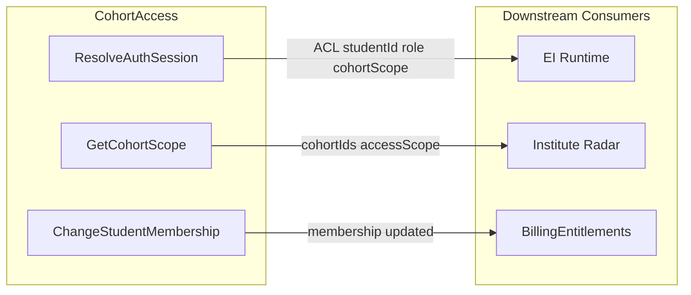

# CohortAccess Strategic Alignment and Tactical DDD Plan

## Part 1: Strategic DDD Alignment Check

### Aligned elements


| Document                                                                                                  | CohortAccess content                                                                                                                             | Status  |
| --------------------------------------------------------------------------------------------------------- | ------------------------------------------------------------------------------------------------------------------------------------------------ | ------- |
| [02-subdomains.md](docs/engineering-ddd-design/02-subdomains.md)                                                | Full subdomain definition: capability, boundaries, A+B+C+D check, classification (Generic, Focus: Now), access surfaces table                    | Aligned |
| [03-context-map.md](docs/engineering-ddd-design/03-context-map.md)                                              | Context in map; relationships: CohortAccess → EI Runtime (ACL), → Institute Radar (Customer-Supplier), → BillingEntitlements (Customer-Supplier) | Aligned |
| [canvas-cohort-access.md](docs/engineering-ddd-design/canvas-cohort-access.md)                                  | Purpose, UL, inbound/outbound comm, business decisions, verification metrics, open questions                                                     | Aligned |
| [05-cross-cutting-concerns.md](docs/engineering-ddd-design/05-cross-cutting-concerns.md)                        | ACL table (Identity → EI Runtime); invariants (server-derived identity, privacy boundary); future tables list                                    | Aligned |
| [agg-student-membership.md](docs/engineering-ddd-design/aggregates/agg-student-membership.md)                   | Full aggregate canvas; commands, invariants, storage                                                                                             | Aligned |
| [student-membership-tactical-spec.md](docs/engineering-ddd-design/tactical/student-membership-tactical-spec.md) | Tactical spec for StudentMembership aggregate                                                                                                    | Aligned |


### Alignment gaps

1. **05-domain-message-flows-storyboards.md** — CohortAccess is absent from all sequence diagrams (S2, S5, S7). Flows show `Student → Runtime` directly; per the ACL, identity must be resolved before Runtime. **Action:** Add a CohortAccess participant to at least one representative flow (e.g. S2) as `ResolveAuthSession` before Runtime receives the request.
2. **05-cross-cutting-concerns data ownership** — Tables listed under "Identity" (institutes, cohorts, students, student_cohort_membership, roles). Context map and canvas use "CohortAccess." **Action:** Replace "Identity" with "CohortAccess" in the table ownership column for consistency.
3. **ACL current vs target** — Cross-cutting doc correctly states: *Current: client-provided studentId; Target: server-derived from auth session.* Code confirms this gap: [src/app/api/ei/protocol2/route.ts](src/app/api/ei/protocol2/route.ts) accepts `studentId` from `body` and uses `PILOT_SECRET` Bearer auth. No CohortAccess module exists yet.

### Alignment summary

Strategic design is **largely rigid**; the main gaps are (1) domain flows omitting CohortAccess, (2) data-ownership naming inconsistency, and (3) implementation not yet reflecting the ACL. These are documentation polish plus implementation work, not structural redesign.

---

## Part 2: CohortAccess Tactical DDD Spec

Create [docs/engineering-ddd-design/tactical/cohort-access-tactical-spec.md](docs/engineering-ddd-design/tactical/cohort-access-tactical-spec.md) following the structure of [ei-runtime-tactical-spec.md](docs/engineering-ddd-design/tactical/ei-runtime-tactical-spec.md).

### Structural mapping (EI Runtime → CohortAccess)


| EI Runtime section        | CohortAccess equivalent                                                                                                                                                                                                          |
| ------------------------- | -------------------------------------------------------------------------------------------------------------------------------------------------------------------------------------------------------------------------------- |
| 1) Why an Aggregate       | 1) Why aggregates vs domain services — StudentMembership is the only aggregate; Auth resolution is infrastructure, not domain                                                                                                    |
| 2) Aggregate Root         | 2) Aggregate: StudentMembership (reference [student-membership-tactical-spec](tactical/student-membership-tactical-spec.md)); no StudySession-like root                                                                          |
| 3) Ubiquitous Language    | 3) Ubiquitous Language (tactical) — AuthSession, AccessScope, Role, etc.                                                                                                                                                         |
| 4) State Model            | 4) State Model — StudentMembership lifecycle; Auth resolution has no domain state                                                                                                                                                |
| 5) Commands and Decisions | 5) Use-case-level commands (ResolveAuthSession, GetCohortScope, ChangeStudentMembership)                                                                                                                                         |
| 6) Invariants             | 6) Invariants (from canvas + 05-cross-cutting)                                                                                                                                                                                   |
| 7) Value Objects          | 7) Value Objects — AuthSession, AccessScope, Role, StudentId (from shared/ids), CohortId                                                                                                                                         |
| 8) Domain Service         | 8) None — Auth resolution is a driven port (IResolveAuthSessionPort) calling Neon Auth + membership lookup                                                                                                                       |
| 9) Domain Events          | 9) Optional MembershipChanged (internal; see student-membership spec). If emitted, define in `domain/student-membership/events.ts` with past-tense naming and payload: studentId, cohortId, changedAt, source.                   |
| 10) Repository            | 10) IStudentMembershipRepository (from agg spec)                                                                                                                                                                                 |
| 11) Ports                 | 11) Ports — driver: IResolveAuthSessionUseCase, IGetCohortScopeUseCase, IChangeStudentMembershipUseCase; driven: IResolveAuthSessionPort (Neon Auth), IStudentMembershipRepository, IIdempotencyKeyStore, IGetInstituteScopePort |
| 12) Application Use Cases | 12) ResolveAuthSessionHandler, GetCohortScopeHandler, ChangeStudentMembershipHandler                                                                                                                                             |
| 13) File Structure        | 13) File structure under `src/cohort-access/` per [01-ei-tactical-conventions](tactical/01-ei-tactical-conventions.md)                                                                                                           |
| 14) Migration             | 14) Migration from current (PILOT_SECRET + client studentId) to CohortAccess ACL                                                                                                                                                 |
| 15) Test Strategy         | 15) Test scenarios for auth resolution, membership, idempotency                                                                                                                                                                  |
| 16) Open Questions        | 16) From canvas + student-membership spec                                                                                                                                                                                        |


### Value Object Specifications (CHEATSHEET-compliant)

Per [CHEATSHEET](.agents/skills/clean-ddd-hexagonal/references/CHEATSHEET.md): private constructor, `static create()`, validation on construction, `equals()` for value equality.

- **AuthSession** — Private constructor; `static create(props: { studentId, cohortId, role, accessScope })` with validation (studentId non-empty, role in allowed enum, accessScope valid); `equals(other: AuthSession)`; getters for all fields.
- **AccessScope** — Private constructor; `static create(props: { cohortIds: string[], scope: 'cohort' | 'global' })` with validation (cohortIds array, scope enum); `equals(other: AccessScope)`; getters.
- **Role** — Enum or VO; if VO: private constructor; `static create(value: 'student' | 'admin' | 'institute')` with validation; `equals(other: Role)`; getter.

### Key tactical design decisions

1. **Auth resolution is not an aggregate** — Resolving `auth_user_id` → `studentId`, `cohortId`, `role` is infrastructure (Neon Auth + DB lookup). It is a **driven port** (`IResolveAuthSessionPort`) implemented by an adapter that calls Neon Auth and `student_cohort_membership`. The **driver port** `IResolveAuthSessionUseCase` is the ACL entry point EI Runtime (and others) call.
2. **StudentMembership** — One aggregate, already specified in [student-membership-tactical-spec](tactical/student-membership-tactical-spec.md). The cohort-access spec references it and adds context: it lives in `src/cohort-access/domain/student-membership/`.
3. **Module placement** — Per [01-ei-tactical-conventions](tactical/01-ei-tactical-conventions.md) Section 2: `src/cohort-access/` is the CohortAccess bounded-context module. EI API routes depend on `IResolveAuthSessionUseCase` (injected), which returns `AuthSession` with server-derived `studentId`. See **EI import boundaries** (below) for what EI may import.
4. **ACL integration** — EI route handlers receive `AuthSession` from a middleware or wrapper that calls `ResolveAuthSessionHandler.execute(sessionCookie)`. The handler passes `authSession.studentId` to RunP1Gate, RunP2Gate, etc. Body must NOT contain `studentId` for authorization; it may remain for backward compatibility during migration but must be ignored for auth.
5. **IdempotencyKeyStore** — `ChangeStudentMembershipHandler` depends on `IIdempotencyKeyStore` for redemption idempotency (same idempotency key + same cohort → no-op). Adapter uses `ei_idempotency_keys` (or equivalent) table per [05-cross-cutting-concerns](docs/engineering-ddd-design/05-cross-cutting-concerns.md).
6. **GetCohortScope** — Reads cohort scope for institute users from roles / cohort assignments; uses `IGetInstituteScopePort` (driven) to avoid query logic in the aggregate repository; returns `{ cohortIds, role, accessScope }`.
7. **AuthSession layer placement** — AuthSession lives in `domain/shared/` as a value object because it represents a domain concept ("Server-validated session; yields student_id and scope") from the canvas UL; EI consumes the type but never imports CohortAccess infrastructure.
8. **EI import boundaries** — EI route handlers import `IResolveAuthSessionUseCase` from `src/cohort-access/application/resolve-auth-session/port.ts` and `AuthSession` from `src/cohort-access/domain/shared/auth-session.ts` (or re-exported from `src/cohort-access/application/` for a single public API). EI must never import from `src/cohort-access/infrastructure/`.

### Spec document outline

```markdown
# CohortAccess — Tactical DDD Spec

1) Why Aggregates vs Domain Services
2) Aggregate: StudentMembership (reference)
3) Ubiquitous Language (Tactical)
4) Auth Resolution (ACL Entry Point)
5) Value Objects
6) Invariants
7) Ports (Hexagonal)
8) Application Use Cases
9) File Structure
10) Migration from Current Auth
11) Test Strategy
12) Open Questions
```

### File structure (to include in spec)

```
src/cohort-access/
├── domain/
│   ├── student-membership/
│   │   ├── student-membership.ts
│   │   ├── value-objects.ts
│   │   ├── events.ts            # MembershipChanged (optional)
│   │   ├── repository.ts
│   │   └── errors.ts
│   └── shared/
│       ├── auth-session.ts      # AuthSession VO
│       ├── access-scope.ts      # AccessScope VO
│       └── role.ts              # Role enum / VO
├── application/
│   ├── resolve-auth-session/
│   │   ├── command.ts
│   │   ├── handler.ts
│   │   └── port.ts
│   ├── get-cohort-scope/
│   │   ├── command.ts
│   │   ├── handler.ts
│   │   └── port.ts
│   └── change-student-membership/
│       ├── command.ts
│       ├── handler.ts
│       └── port.ts
└── infrastructure/
    ├── auth/
    │   └── neon-auth-resolver.pg.ts   # IResolveAuthSessionPort
    └── persistence/
        ├── student-membership-repository.pg.ts
        ├── idempotency-key-store.pg.ts   # IIdempotencyKeyStore
        └── get-institute-scope.pg.ts     # IGetInstituteScopePort
```

- **Driven port interfaces:** `IIdempotencyKeyStore` in `application/change-student-membership/port.ts` or `application/shared/port-idempotency-key-store.ts`; `IGetInstituteScopePort` in `application/get-cohort-scope/port.ts` or `application/shared/`.

### Composition root and wiring

Next.js route handlers or a server-side setup (e.g. `lib/cohort-access.ts` or route-level factory) instantiates adapters and handlers. EI routes receive `IResolveAuthSessionUseCase` and gate handlers via constructor or props. No DI container required for MVP; wire at app bootstrap or per-route as needed.

### Context map flow (for spec diagram)




---

## Deliverables

1. **Strategic alignment report** — Document the alignment check (gaps above) in the tactical spec’s opening section or a short addendum.
2. **cohort-access-tactical-spec.md** — Full tactical spec at `docs/engineering-ddd-design/tactical/cohort-access-tactical-spec.md` following the ei-runtime template but adapted for CohortAccess.
3. **Optional strategic doc updates** — After spec approval: (a) add CohortAccess to one DMF in 05-domain-message-flows; (b) rename "Identity" to "CohortAccess" in 05-cross-cutting data ownership.

---

## Implementation order (post-spec)

After the tactical spec is approved, implementation would proceed as:

1. Create `src/cohort-access/` module structure
2. Implement AuthSession, AccessScope, Role value objects (CHEATSHEET-compliant: create(), validation, equals())
3. Implement IResolveAuthSessionPort + Neon Auth adapter (depends on Neon Auth SDK setup)
4. Implement StudentMembership aggregate + repository (depends on `student_cohort_membership` table); add `events.ts` if MembershipChanged is emitted
5. Implement IIdempotencyKeyStore + adapter (e.g. `idempotency-key-store.pg.ts` using `ei_idempotency_keys`)
6. Implement IGetInstituteScopePort + adapter (e.g. `get-institute-scope.pg.ts`) for GetCohortScope
7. Implement ResolveAuthSessionHandler, GetCohortScopeHandler, ChangeStudentMembershipHandler
8. Add auth middleware to EI API routes that calls ResolveAuthSession before invoking gate handlers
9. Remove client-provided studentId from auth path; optionally keep in body for logging only

