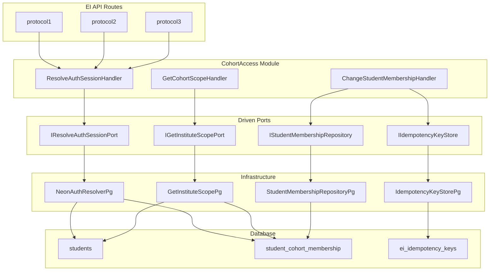

# CohortAccess Tactical DDD Implementation Plan

## Context Summary

- **Current:** EI routes use `PILOT_SECRET` Bearer auth and accept `studentId` from request body. No CohortAccess module. Tables `students`, `student_cohort_membership`, `institutes`, `cohorts`, `roles` do not exist; `ei_idempotency_keys` exists.
- **Target:** Server-derived identity via `ResolveAuthSession`; CohortAccess owns auth resolution, membership, and cohort scope.
- **Key constraint:** EI must never import from `src/cohort-access/infrastructure/`; only application ports and domain types.

---

## Phase 1: Database Migrations

Create CohortAccess tables. Add a new migration file (or extend `src/ei/db/migrate.ts` per project convention) with:


| Table                       | Purpose                                                                                                  |
| --------------------------- | -------------------------------------------------------------------------------------------------------- |
| `institutes`                | Tenant; id, name, created_at                                                                             |
| `cohorts`                   | id, institute_id, name, created_at                                                                       |
| `students`                  | id (UUID), auth_user_id (Neon Auth), institute_id?, created_at. Maps auth_user_id to internal student_id |
| `student_cohort_membership` | student_id PK, cohort_id (nullable), updated_at. One row per student; null cohort_id = unassigned        |
| `roles`                     | Optional: student_id, role (student                                                                      |


**Migration location:** Add to [src/ei/db/migrate.ts](src/ei/db/migrate.ts) (shared monolith DB) or create `src/cohort-access/db/migrate.ts` for clarity. Recommend extending existing migrate.ts to keep one migration entrypoint.

**Idempotency:** IIdempotencyKeyStore uses existing `ei_idempotency_keys` with key format `cohort-access:MembershipChangeOnRedemption:{redemptionId}` (or equivalent per [05-cross-cutting-concerns.md](docs/engineering-ddd-design/05-cross-cutting-concerns.md)).

**Neon / DB:** Use **parameterized queries** only for any raw SQL (no string concatenation of user input). Use existing `DATABASE_URL` / shared DB handle; no hardcoded credentials. Reference: [.cursor/rules/neon-serverless.mdc](.cursor/rules/neon-serverless.mdc).

---

## Phase 2: Module Structure

Create folder structure per [cohort-access-tactical-spec.md §9](docs/engineering-ddd-design/tactical/cohort-access-tactical-spec.md):

```
src/cohort-access/
├── domain/
│   ├── student-membership/
│   │   ├── student-membership.ts
│   │   ├── value-objects.ts       # MembershipState, etc.
│   │   ├── events.ts             # MembershipChanged (optional)
│   │   ├── repository.ts         # IStudentMembershipRepository
│   │   └── errors.ts
│   └── shared/
│       ├── auth-session.ts
│       ├── access-scope.ts
│       └── role.ts
├── application/
│   ├── resolve-auth-session/
│   │   ├── command.ts
│   │   ├── handler.ts
│   │   └── port.ts               # IResolveAuthSessionUseCase, IResolveAuthSessionPort
│   ├── get-cohort-scope/
│   │   ├── command.ts
│   │   ├── handler.ts
│   │   └── port.ts               # IGetCohortScopeUseCase, IGetInstituteScopePort
│   └── change-student-membership/
│       ├── command.ts
│       ├── handler.ts
│       └── port.ts               # IChangeStudentMembershipUseCase, IIdempotencyKeyStore (driven)
└── infrastructure/
    ├── auth/
    │   └── neon-auth-resolver.pg.ts
    └── persistence/
        ├── student-membership-repository.pg.ts
        ├── idempotency-key-store.pg.ts
        └── get-institute-scope.pg.ts
```

**Note:** CohortAccess does not import from `src/ei/`. It needs its own `ValueObject`-like pattern or plain classes; CHEATSHEET pattern (private constructor, `static create()`, `equals()`) applies.

---

## Phase 3: Domain Layer

### 3a) Value Objects (CHEATSHEET-compliant)

Implement in [src/cohort-access/domain/shared/](src/cohort-access/domain/shared/):


| VO              | Validation                                           | Location        |
| --------------- | ---------------------------------------------------- | --------------- |
| **AuthSession** | studentId non-empty, role in enum, accessScope valid | auth-session.ts |
| **AccessScope** | cohortIds array, scope in 'cohort'                   | 'global'        |
| **Role**        | Enum or VO: 'student'                                | 'admin'         |


Pattern: `private constructor`, `static create(props)`, `equals(other)`, getters. Throw domain errors on invalid input.

**StudentId, CohortId:** Simple wrapper types in `domain/shared/ids.ts` (or inline) to avoid stringly-typed IDs.

### 3b) StudentMembership Aggregate

Per [student-membership-tactical-spec.md](docs/engineering-ddd-design/tactical/student-membership-tactical-spec.md):

- **Identity:** studentId
- **State:** cohortId (string | null), membershipState (active | unassigned)
- **Commands:** `AdminEnroll`, `MembershipChangeOnRedemption` — handled by aggregate methods
- **Invariants:** Exactly one active cohort or unassigned; idempotency enforced at handler level

Implementation: `StudentMembership` class with `handleAdminEnroll()`, `handleMembershipChangeOnRedemption()` (or single `changeMembership()` that branches). No event sourcing; state is source of truth. Optional `MembershipChanged` event for future Ledger integration.

### 3c) IStudentMembershipRepository

Interface in `domain/student-membership/repository.ts`:

```ts
findByStudentId(studentId: string): Promise<StudentMembership | null>;
save(membership: StudentMembership): Promise<void>;
```

### 3d) Domain Errors

`MissingStudentIdError`, `InvalidCohortIdError`, etc. in `domain/student-membership/errors.ts` and `domain/shared/errors.ts`.

---

## Phase 4: Application Layer

### 4a) ResolveAuthSession

- **Command:** `{ sessionContext }` — cookies/headers or request object
- **Handler:** Delegates to `IResolveAuthSessionPort.resolve(sessionContext)` → returns `AuthSession | null`
- **Port:** Driver `IResolveAuthSessionUseCase`; Driven `IResolveAuthSessionPort`

### 4b) GetCohortScope

- **Command:** `{ instituteUserId }` (or auth context)
- **Handler:** Delegates to `IGetInstituteScopePort.getScope(instituteUserId)` → `{ cohortIds, role, accessScope }`
- **Port:** Driver `IGetCohortScopeUseCase`; Driven `IGetInstituteScopePort`

### 4c) ChangeStudentMembership

- **Command:** `{ studentId, targetCohortId, source: 'admin'|'redemption', idempotencyKey? }`
- **Handler:**
  1. For `source === 'redemption'` and `idempotencyKey`: check `IIdempotencyKeyStore` — if key exists with same cohort → return existing state (no-op)
  2. If key exists with different cohort → reject (conflict)
  3. Load `StudentMembership` via repository; call `handleAdminEnroll` or `handleMembershipChangeOnRedemption`
  4. Save; record idempotency key if redemption
- **Ports:** Driven `IStudentMembershipRepository`, `IIdempotencyKeyStore`

---

## Phase 5: Infrastructure Layer

### 5a) NeonAuthResolverPg (IResolveAuthSessionPort)

**Prerequisite:** Install `@neondatabase/auth` and configure Neon Auth per [.cursor/rules/neon-auth.mdc](.cursor/rules/neon-auth.mdc).

- **Package:** `@neondatabase/auth`; use `createAuthClient()` from `@neondatabase/auth/next` (e.g. in `lib/auth/client.ts`).
- **Server-side session:** Validate session via `auth.getSession()` (or equivalent from the auth client). Map `session.user.id` (Neon Auth user id) to `auth_user_id` in `students`, then to internal `student_id`.
- **Session shape:** Per neon-auth.mdc, session has `user.id`, `user.email`, `session.userId`; use `user.id` as `auth_user_id` for the `students` lookup.
- **References:** [.cursor/rules/neon-auth.mdc](.cursor/rules/neon-auth.mdc); Setup Reference Next.js and Common Mistakes if implementing auth route (see Phase 7).

Adapter flow:

1. Validate session via Neon Auth SDK → obtain `auth_user_id`
2. Query `students` table: `auth_user_id` → `student_id`
3. Query `student_cohort_membership` → cohortId
4. Determine role (from `roles` or students table)
5. Build and return `AuthSession`

**Session context:** Next.js request (cookies) or `getSession()` from auth client. Adapter receives whatever the port interface defines (e.g. `Request` or `{ cookies }`).

### 5b) StudentMembershipRepositoryPg

- `findByStudentId`: SELECT from `student_cohort_membership` WHERE student_id = ?
- `save`: UPSERT on student_id; set cohort_id, updated_at
- Map row ↔ `StudentMembership` aggregate

### 5c) IdempotencyKeyStorePg

- Uses `ei_idempotency_keys` with key format `cohort-access:MembershipChangeOnRedemption:{redemptionId}`
- `checkAndRecord(key, cohortId)`: if key exists, return stored cohortId; else insert and return null (first use)
- Reject if key exists with different cohortId (conflict)

### 5d) GetInstituteScopePg (IGetInstituteScopePort)

- Query `roles` / cohort assignments for institute user
- Return `{ cohortIds, role, accessScope }`
- MVP: Can return empty scope if roles/cohorts not yet populated.

**Persistence (all adapters):** All Postgres adapters (5b, 5c, 5d): use parameterized queries only; follow [.cursor/rules/neon-serverless.mdc](.cursor/rules/neon-serverless.mdc) for connection and query patterns.

---

## Phase 6: Composition Root and Wiring

Create `src/cohort-access/lib.ts` or `lib/cohort-access.ts`:

- Factory function(s) that instantiate adapters (with `eiStore.db` or injected DB) and handlers
- Export `createResolveAuthSessionHandler()`, `createGetCohortScopeHandler()`, `createChangeStudentMembershipHandler()`
- No DI container; manual constructor injection

```ts
// Example
export function createResolveAuthSessionUseCase(db: EiDb): IResolveAuthSessionUseCase {
  const port = new NeonAuthResolverPg(db, authClient);
  return new ResolveAuthSessionHandler(port);
}
```

---

## Phase 7: EI Route Integration (Optional / Final Step)

**Scope:** Add auth middleware so EI routes obtain studentId from CohortAccess instead of body.

1. Create a wrapper or middleware that:
  - Calls `ResolveAuthSessionHandler.execute(sessionContext)` with request cookies
  - If `AuthSession` returned → pass `authSession.studentId` to gate handlers
  - If null (unauthenticated) → 401
2. Update [src/app/api/ei/protocol1/route.ts](src/app/api/ei/protocol1/route.ts), protocol2, protocol3 to:
  - Use the middleware/wrapper
  - Remove `studentId` from body for auth (keep in body only for backward compatibility during migration, but ignore for auth)
3. **Migration mode:** Support `PILOT_SECRET` fallback when `ResolveAuthSession` returns null (for dev/pilot) — configurable via env.

**Auth setup (Neon):**

- **Auth API route:** `app/api/auth/[...path]/route.ts` with `authApiHandler()` from `@neondatabase/auth/next` (per neon-auth.mdc).
- **Auth client:** `createAuthClient()` in `lib/auth/client.ts`; use `auth.getSession()` on server to obtain session for `ResolveAuthSession`.
- **References:** [.cursor/rules/neon-auth.mdc](.cursor/rules/neon-auth.mdc), [docs/launch-requirements-checklist.md](docs/launch-requirements-checklist.md) (Implementation references: Neon Auth + Next.js).
- **Env:** `NEON_AUTH_BASE_URL` / `NEXT_PUBLIC_NEON_AUTH_URL` (or as per Neon Auth docs).

**EI imports:** EI routes import only from `src/cohort-access/application/.../port.ts` (IResolveAuthSessionUseCase) and `src/cohort-access/domain/shared/auth-session.ts` (AuthSession type). Never from infrastructure.

---

## Phase 8: Tests

Per [cohort-access-tactical-spec.md §12](docs/engineering-ddd-design/tactical/cohort-access-tactical-spec.md):


| Scenario                                            | Layer       | Approach                             |
| --------------------------------------------------- | ----------- | ------------------------------------ |
| AuthSession invalid studentId                       | Domain      | Unit test — DomainError              |
| AccessScope invalid scope                           | Domain      | Unit test                            |
| ResolveAuthSessionHandler unauthenticated           | Application | Unit — fake port returns null        |
| ResolveAuthSessionHandler valid session             | Application | Unit — fake port returns AuthSession |
| ChangeStudentMembership duplicate idempotency key   | Application | Unit — fake IdempotencyKeyStore      |
| ChangeStudentMembership conflicting idempotency key | Application | Unit — reject                        |
| First enrollment                                    | Domain      | Unit — membershipState = active      |


Test files: `src/cohort-access/tests/unit/domain/`, `src/cohort-access/tests/unit/application/`

---

## Dependencies

- **New:** `@neondatabase/auth` (for Neon Auth session validation)
- **Existing:** `@mastra/pg` (or shared DB), zod (if used for validation)
- Implementation should follow the Neon rules below (neon-auth for auth, neon-serverless for DB access).

---

## References (Neon)

- **[.cursor/rules/neon-auth.mdc](.cursor/rules/neon-auth.mdc)** — Neon Auth: Next.js setup, `authApiHandler`, `createAuthClient`, `getSession`, Session structure, AuthView/UI. Use for Phase 5a (NeonAuthResolverPg) and Phase 7 (EI route integration).
- **[.cursor/rules/neon-serverless.mdc](.cursor/rules/neon-serverless.mdc)** — DB: parameterized queries, connection string from env, HTTP vs Pool. Use for Phase 1 (migrations) and Phase 5 (all persistence adapters).
- **Optional:** [.cursor/rules/neon-get-started.mdc](.cursor/rules/neon-get-started.mdc) — Only if first-time Neon/Env setup is needed.

---

## Implementation Order

1. Migrations (CohortAccess tables)
2. Domain: shared VOs (AuthSession, AccessScope, Role)
3. Domain: StudentMembership aggregate + repository interface + errors
4. Application: ResolveAuthSession (command, port, handler)
5. Application: GetCohortScope (command, port, handler)
6. Application: ChangeStudentMembership (command, port, handler)
7. Infrastructure: StudentMembershipRepositoryPg
8. Infrastructure: IdempotencyKeyStorePg
9. Infrastructure: GetInstituteScopePg
10. Infrastructure: NeonAuthResolverPg (requires Neon Auth setup)
11. Composition root (lib/cohort-access.ts)
12. Unit tests
13. (Optional) EI route integration + PILOT_SECRET fallback

---

## Open Questions (from spec, deferred)

- Idempotency key format: `redemptionId` vs `couponId+userId`
- Whether `MembershipChanged` published to Ledger
- Cohort validation: verify targetCohortId exists or trust caller
- Student+Parent household model (future)

---

## Diagram: Data Flow




