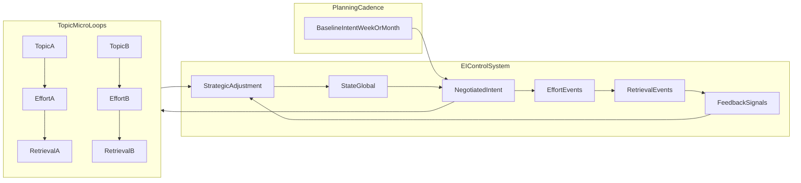

# EI Multiscale Cadence + Multi-Topic Loop (Plan)

## Context in repo

- The current EI loop is framed as “treat a study day as a loop” in [`Unified_Master_Doc.md`](c:\Users\Mukul\code\personal-projects\ai-study-brother\Unified_Master_Doc.md) (Section 4.1) and is paired with transition protocols (Section 4.3).
- The B2B requirement is **leading indicators** with **minimal daily effort** (Problem Validation Criteria in Section 3).
- We’ll add a **product-spec clarification** that the loop is a **control system** whose cadence is not strictly daily, and that many topics can be in different steps concurrently.

## Goal

- Support **all student types** (weekly/monthly planners, daily planners, inconsistent/avoidant, high performers) without turning EI into a task manager.
- Preserve the EI thesis: measure **loop integrity** and intervene at **transition gates**, producing leading indicators for institutes.

## Spec additions to write (high-level)

### 1) Reframe the loop as a control loop (cadence-agnostic)

- Replace “daily loop” interpretation with: **EI is a closed-loop control system**. The “loop” runs at multiple time scales:
- **Session micro-loop**: `Effort -> Retrieval -> Feedback` (verification truth check)
- **Periodic review loop**: `StateTrend -> IntentPortfolio -> Evidence -> StrategicAdjustment` (weekly by default, daily optional)
- **Macro loop**: month-level syllabus/backlog strategy (lightweight; mostly reporting)

### 2) Separate planning ownership from EI negotiation

- Define:
- **BaselineIntent**: student’s pre-planned week/month structure (owned by student/coaching).
- **NegotiatedIntent**: EI’s small scope/difficulty negotiation based on `State`, `TMS`, and recent deltas.
- EI does **not** reschedule the whole plan; it negotiates at the margin to protect loop integrity.

### 3) Check-in architecture: event-driven + adaptive periodic summaries

- **Micro check-ins (always, low friction)** at protocol gates:
- Protocol 1: minimal state capture (or inferred)
- Protocol 2: scope confirmation
- Protocol 3: verification decision (do-now vs schedule vs skip-with-reason)
- **Periodic summaries (adaptive)**:
- Weekly review is the default “Strategic Adjustment.”
- Daily wrap-up becomes **optional** and is triggered by risk (silence, overdue verification, avoidance latency), not by calendar.
- This preserves leading-indicator detection without demanding daily journaling.

### 4) Multi-topic execution model

- Introduce concurrent **topic micro-loops** where different topics can be in different steps the same day.
- Add a soft control variable:
- **WIP/OpenLoops**: count of topics with Effort but overdue Retrieval (prevents passive learning across too many topics).

### 5) Adaptive tightness (works for all student types)

- Define a **TightnessPolicy** that scales prompts and deadlines based on:
- `State` (energy/anxiety), consistency, avoidance signals
- `TMS` and `ΔDecay`
- Recent deltas (`ExecutionΔ`, `EfficiencyΔ`, `PerceptionΔ`)
- Behavior-based modes:
- **HighCompliance**: fewer prompts, more autonomy
- **Drifting/Avoidant**: earlier micro interventions
- **BurnoutRisk**: reduce pressure, focus on recovery + tiny verification

### 6) Metrics (leading indicators) to specify

- **LoopLatency(topic)**: time from `EffortEnd` to first meaningful `RetrievalAttempt`.
- **VerificationRate**: fraction of Effort sessions that end with either immediate retrieval OR a scheduled retrieval.
- **OpenLoops(WIP)**: number of topics overdue for retrieval.
- **AvoidanceLatency(subject)**: days since last meaningful retrieval on a weak/high-priority subject.
- Aggregate these into B2B risk signals without leaking raw student diary.

## Mermaid diagram to include

