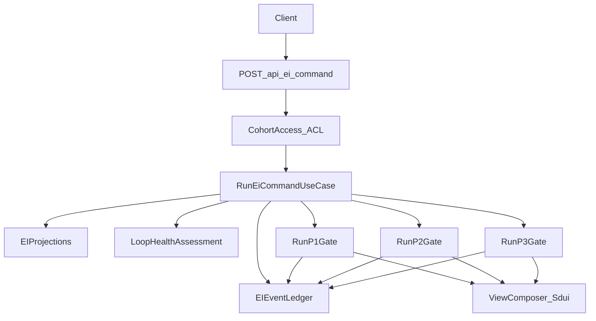

# EI Runtime Strategic+Tactical Docs Alignment (Detailed)

## Outcomes (what “done” means)

- **No new `docs/engineering-ddd-design/contracts/` folder**. Cross-context “contracts” are documented in the same places your strategic design already says are authoritative: context map + cross-cutting concerns + tactical specs.
- `[docs/engineering-ddd-design/tactical/ei-runtime-tactical-spec.md](c:/Users/Mukul/code/personal-projects/ai-study-brother/docs/engineering-ddd-design/tactical/ei-runtime-tactical-spec.md)` gains four explicit sections:
  - Session state derivation
  - Routing matrix
  - Orchestrator use case spec (new explicit use case)
  - Idempotency + event completeness at the command boundary
- The new doc content is consistent with:
  - strategic EI Runtime canvas (StudySession lifecycle, command-driven inbound, CohortAccess upstream)
  - cross-cutting invariants + event catalog
  - P0/P1 launch checklist (auth isolation, gate reliability, minimum event set, idempotency)
  - current runtime entrypoint shape (`POST /api/ei/command` + Mastra workflows) in `[src/app/api/ei/command/route.ts](c:/Users/Mukul/code/personal-projects/ai-study-brother/src/app/api/ei/command/route.ts)`

---

## Part 1 — “Contracts folder” vs “DDD artifacts only” (comparison grounded in your DDD docs)

### A. What the DDD references require (conceptually)

Use these as the anchor for the comparison:

- **Strategic DDD**: bounded contexts + relationship patterns (ACL, Published Language). Source: `.agents/skills/clean-ddd-hexagonal/references/DDD-STRATEGIC.md`.
- **Hexagonal/Clean**: boundary “contracts” as ports + DTOs; adapters translate external inputs to use cases. Sources: `.agents/skills/clean-ddd-hexagonal/references/HEXAGONAL.md`, `.agents/skills/clean-ddd-hexagonal/references/LAYERS.md`.

### B. Compare the two documentation packaging options

#### Option 1: Dedicated `docs/engineering-ddd-design/contracts/` folder

- **Strengths**
  - One file per relationship: easy to find; reduces copy/paste.
- **Risks**
  - Competes with your existing single sources of truth (`03-context-map.md` + `05-cross-cutting-concerns.md`).
  - Higher chance of stale duplication.

#### Option 2 (chosen): Document contracts through existing modeling artifacts

Your strategic design already has a contract home:

- `[docs/engineering-ddd-design/03-context-map.md](c:/Users/Mukul/code/personal-projects/ai-study-brother/docs/engineering-ddd-design/03-context-map.md)`: relationship catalog describes **integration semantics** (ACL vs Published Language).
- `[docs/engineering-ddd-design/05-cross-cutting-concerns.md](c:/Users/Mukul/code/personal-projects/ai-study-brother/docs/engineering-ddd-design/05-cross-cutting-concerns.md)`: “constitution” of **invariants**, **event contracts**, **data ownership**, and **ACL intent**.
- Tactical specs (like EI Runtime): define **ports**, **DTOs**, and **use case steps**.

### C. Drift prevention without a contracts folder (what we will add)

Make it explicit in one place only:

- Update `05-cross-cutting-concerns.md` under `## ACLs` with a short “Where contracts live” paragraph:
  - Relationship semantics live in `03-context-map.md`
  - Constitutional invariants + event catalog live here
  - Port-level contracts + algorithms live in tactical specs

This preserves DDD purity (no new doc taxonomy) but still makes “contracts location” discoverable.

> **Anti-pattern we avoid:** Shared kernel by copy-paste — duplicating contracts/schemas across multiple files so that one context updates and another stays stale. By keeping contract semantics in a single place per concern (context map for relationships, cross-cutting for invariants/events, tactical for ports/algorithms), we avoid accidental shared-kernel drift.

---

## Part 2 — Update EI Runtime tactical spec with the 4 missing sections

### Placement strategy in `ei-runtime-tactical-spec.md`

The file already has:

- StudySession lifecycle + invariants
- Ports + RunP1/RunP2/RunP3 use cases
- A persistence note that StudySession is derivable from Ledger events

So we’ll insert the new sections in a way that **extends** what’s already present rather than duplicating:

- Add the new material near the existing persistence note and use case section.

### 2.1 Add **Session state derivation** section

**Recommended location**: immediately after the existing “Persistence note for MVP” under `## 10) Repository Interface (Domain Port)`.

**Content to add**:

- **Goal**: define how Runtime derives StudySession lifecycle phase from system-of-record facts.
- **Inputs (authoritative)**:
  - Ledger events (per `05-cross-cutting-concerns.md` event catalog):
    - `NegotiatedIntentIssued`
    - `ActivationPlanIssued`
    - `VerificationDecisionIssued`
    - (plus command events where needed: `IntentSet`, `SessionEnd`, `Replan`)
  - Projections as supporting read model (topic state, aggregates) only where they are explicitly the source.
- **Derived evidence flags** (per topicId): `hasIntent`, `hasActivationPlan`, `hasVerificationDecision`, `lastIssuedAt`.
- **Mapping to lifecycle** (normative):
  - no intent → `negotiating`
  - intent but no plan → `activating`
  - plan but no decision → `active`
  - decision exists → `verifying` (and optionally “closed when retrieval resolved” if you model that)
- **Recency rule**: document any “recent within N days” heuristic and why it exists.
- **SessionId note**: tie to your existing line that `sessionId` matches AppOpen idempotency key; clarify what you can/can’t derive without an explicit stored session record.

### 2.2 Add **Routing matrix** section

**Recommended location**: immediately after Session state derivation.

**Content to add**:

- A “Command × DerivedPhase → NextProtocolOrFlow” matrix (bulleted or list-based, no tables required).
- Include the command types that exist today at the boundary:
  - from strategic canvas: `AppOpen`, `IntentSet`, `SessionEnd`, `VerifyNow`, `ScheduleVerify`, `SkipWithReason`
  - from current route: `SessionStart`, `Replan`, `VerificationComplete`, `RetrievalSchedule`, `RetrievalSkip` (document how these correspond to strategic terms/events)
- Rules must cover:
  - normal flow
  - invalid transitions (what error is returned)
  - replan loop (already mentioned in current open questions)

### 2.3 Add **Orchestrator use case spec** (new explicit use case)

**Recommended location**: inside `## 12) Application Use Cases`, before the existing RunP1/RunP2/RunP3 examples, as an umbrella use case.

**Define**:

- **Driver port**: `IRunEiCommandUseCase` (or similar) with `execute(command)`.
- **Command DTO**: a discriminated union aligned with `EiCommandSchema` in the route, plus an explicit `idempotencyKey` field (even if the current implementation doesn’t enforce it yet).
- **Driven ports** (tie to strategic relationship patterns):
  - CohortAccess ACL: resolve auth/session → `studentId` (server-derived)
  - Ledger read: query events / stream reader (derive session phase)
  - Gate executors: RunP1/RunP2/RunP3 use cases (or directly Mastra workflows as an adapter detail)
  - Ledger append: append command events + protocol output events
  - Projections read: GetStudentSignals and LoopHealth assessment
- **Algorithm** (step-by-step):
  1. Resolve auth (CohortAccess upstream)
  2. Validate command schema (strict; unknown keys rejected)
  3. Derive phase/state from ledger/projections
  4. Choose next protocol via routing matrix
  5. Invoke the protocol workflow/handler
  6. Append required events (command events + output events)
  7. Return response (SDUI + domain fields)
- **Error taxonomy**: unauthenticated, forbidden (role/cohort scope), invalid command schema, invalid transition, idempotency conflict.

Tie this explicitly back to LAYERS/HEXAGONAL: route is a driver adapter; workflows are execution mechanism; the orchestrator is the application service.

### 2.4 Add **Idempotency + event completeness at the command boundary** section

**Recommended location**: immediately after the orchestrator spec (still within Application Use Cases), or as its own top-level section after `## 12) Application Use Cases`.

**Content to add (aligned with P0)**:

- Reference the cross-cutting ledger invariants rather than restating them:
  - Immutability, Idempotency, Schema strictness from `05-cross-cutting-concerns.md`.
- Define a **command-boundary idempotency policy**:
  - Which commands must be idempotent and why (retry safety; P0).
  - Recommended key formats (include studentId + topic + occurredAt or client-generated UUID).
  - How idempotency is enforced in the Ledger adapter (`ei_idempotency_keys`) per cross-cutting guidance.
- Define **minimum viable event set** enforcement:
  - The tactical spec should say whether `/api/ei/command` is the “choke point” that ensures the minimum event set is appended.
  - Map from launch checklist “minimum viable event set” to which side owns emission:
    - UI-only events vs runtime-appended events vs workflow-appended output events.

---

## Part 3 — Minimal strategic doc touchpoints (no new folder)

### Update `05-cross-cutting-concerns.md`

- Under `## ACLs`, add a short “Contracts location” paragraph pointing to:
  - `03-context-map.md` (relationship semantics)
  - this file (invariants + event catalog + ACL intent)
  - tactical specs (ports + algorithms)

### No changes required to `09-tactical-ddd-candidates.md`

- It already lists StudySession as a primary aggregate candidate and points to this tactical spec; we’ll keep consistency with it.

---

## Mermaid diagram to include in the tactical spec (recommended)

---

## Acceptance checklist (P0/P1 coverage)

Explicitly confirm the updated docs cover P0 items from `docs/launch-requirements-checklist.md`:

- Google OAuth + server-derived `student_id` (CohortAccess upstream ACL)
- Gate-triggered protocols reliability (routing matrix + orchestrator)
- Minimum event set completeness (command-boundary completeness policy)
- Idempotent event writes (command idempotency + ledger adapter policy)
- Resume continuity (“it remembers”) (state derivation inputs and projection dependencies)

And P1 items are supported as extensions:

- background recomputation jobs/backfill/replay: referenced via invariants (replaceability) and “read-only replay” hooks
- reminders/dashboard/radar/coupons: remain in cross-cutting event catalog + context map relationships; orchestrator spec leaves room for additional command types

