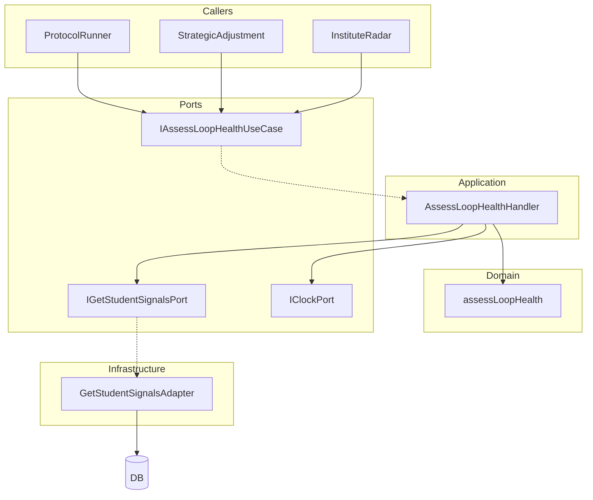

# LHA Implementation Plan

## Context

LHA is documented as a stateless domain service in [docs/engineering-ddd-design/tactical/loop-health-assessment-tactical-spec.md](docs/engineering-ddd-design/tactical/loop-health-assessment-tactical-spec.md). Current logic lives in [src/ei/engine/classify.ts](src/ei/engine/classify.ts). Callers (protocol-runner, SA, Radar) fetch signals via Mastra tools, adapt types, then call `assignP1Label`, `assignP2Label`, `assignP3Label`, `resolveMode` directly.

**Constraint:** `domain/` must not import `engine/`. Pure classification logic belongs in domain; we move it and have engine delegate.

---

## Architecture (Target)

Handler fetches signals and `now`, passes to pure `assessLoopHealth`; domain never calls ports.

---

## Phase 1: Domain Layer

### 1.1 Create `domain/loop-health/` folder

| File                      | Responsibility                                                                                                                                                                                                                                                      |
| ------------------------- | ------------------------------------------------------------------------------------------------------------------------------------------------------------------------------------------------------------------------------------------------------------------- |
| `loop-health-snapshot.ts` | Types: `LoopHealthSnapshot`, `LoopHealthEvidence`, `P1Label`, `P2Label`, `P3Label`, `Mode`, `StateTrend`                                                                                                                                                            |
| `gate-context.ts`         | Types: `P1Context`, `P2Context`, `P3Context`, `GateContext` union                                                                                                                                                                                                   |
| `aggregates-input.ts`     | `StudentAggregatesInput` interface (flat DTO matching classify input); `StudentPolicyInput` interface                                                                                                                                                               |
| `tunables.ts`             | Classification constants only (P1_*, P2_*, P3_*, SILENCE_DAYS_THRESHOLD, OPEN_LOOPS_THRESHOLD) — extract from [engine/tunables.ts](src/ei/engine/tunables.ts) lines 189–211                                                                                         |
| `assess-loop-health.ts`   | Pure function `assessLoopHealth(aggregates, gateContext, policy?, gatePhase?) -> LoopHealthSnapshot` — move logic from `assignP1Label`, `assignP2Label`, `assignP3Label`, `resolveMode`; compute all three labels and dominant mode; build evidence from aggregates |
| `errors.ts`               | Domain errors if any; per conventions may be minimal/empty (validation happens at application boundary)                                                                                                                                                             |

**Tunables strategy:** Domain defines its own classification tunables. [engine/tunables.ts](src/ei/engine/tunables.ts) re-exports them (e.g. `export { P1_LOW_ENERGY_THRESHOLD, ... } from '../domain/loop-health/tunables'`) so existing engine/score, engine/escalation imports keep working.

---

## Phase 2: Application Layer

### 2.1 Create `application/assess-loop-health/` use case

| File         | Content                                                                                                                                                                                                                                                                                                                                                                                                                                                                                                           |
| ------------ | ----------------------------------------------------------------------------------------------------------------------------------------------------------------------------------------------------------------------------------------------------------------------------------------------------------------------------------------------------------------------------------------------------------------------------------------------------------------------------------------------------------------- |
| `command.ts` | `AssessLoopHealthCommand`: `studentId`, `gatePhase?: 'P1'                                                                                                                                                                                                                                                                                                                                                                                                                                                         |
| `port.ts`    | `IAssessLoopHealthUseCase.execute(cmd) -> Promise<LoopHealthSnapshot>`; `IGetStudentSignalsPort.getSignals(studentId) -> Promise<StudentSignals>`; `StudentSignals` = `{ aggregates: StudentAggregatesInput; topicState?: TopicStateSnapshot[]; policy?: StudentPolicyInput }`. Classification uses aggregates only; topicState included for contract alignment with Projections (e.g. future pending-check details). Adapter may return empty array if not needed for v1.                                        |
| `handler.ts` | If `aggregates` not in command, call `getSignalsPort.getSignals(studentId)`; validate inputs; call `assessLoopHealth()` from domain; set `computedAt` via `IClockPort.now()` (reuse [application/shared/port-clock.ts](src/ei/application/shared/port-clock.ts)); return snapshot. Define application errors per §7b: `MissingAggregatesError` (student not found), `InvalidGateContextError` (invalid gateContext shape). Place in `application/shared/errors.ts` or `application/assess-loop-health/errors.ts`. |

Handler depends on: `IGetStudentSignalsPort`, `IClockPort`.

---

## Phase 3: Infrastructure Adapter

### 3.1 Implement `IGetStudentSignalsPort`

Create `infrastructure/get-student-signals.pg.ts` (or `persistence/get-student-signals.pg.ts`):

- Use [db/queries.ts](src/ei/db/queries.ts) `getAggregates`, `getPolicy` (or `Q.getPolicy`)
- Map `AggregatesRow` to `StudentAggregatesInput`; `PolicyRow` to `StudentPolicyInput`
- Map topic state rows to `TopicStateSnapshot[]` if applicable (or return `[]` for v1 classification-only path)
- If aggregates row is null, throw or return null — handler treats "student not found" as application error

---

## Phase 4: Refactor Engine

### 4.1 Update `engine/classify.ts`

- **Option A (recommended):** Re-export from domain: `export { assignP1Label, assignP2Label, assignP3Label, resolveMode, classifyP1, classifyP2, classifyP3 } from '../domain/loop-health/assess-loop-health'` (after adding those as exports in domain). Keep `engine/classify` as a facade for backward compatibility.
- **Option B:** Delete engine/classify; update all 8 import sites to use `domain/loop-health`

[protocol-runner.ts](src/ei/protocol-runner.ts), [engine/plays.ts](src/ei/engine/plays.ts), [engine/play-executor.ts](src/ei/engine/play-executor.ts), [engine/strategic-adjustment.ts](src/ei/engine/strategic-adjustment.ts), [engine/escalation.ts](src/ei/engine/escalation.ts), [tests/replay-harness.test.ts](src/ei/tests/replay-harness.test.ts) currently import from `engine/classify`.

### 4.2 Refactor protocol-runner to use `IAssessLoopHealthUseCase`

For each protocol (P1, P2, P3):

- Build `AssessLoopHealthCommand` with `studentId`, `gatePhase`, `gateContext` (from session), and optionally pass pre-fetched `aggregates`/`policy` if we keep the "fetch via tools then call handler" flow
- Call `assessLoopHealthUseCase.execute(cmd)`; use `snapshot.p1`/`p2`/`p3`, `snapshot.mode` instead of direct classify calls
- **Do-no-harm guardrail:** Runtime continues to call `applyDoNoHarmGuardrail(mode, aggregates, ...)` after consuming `snapshot.mode`. LHA produces raw mode; engine/escalation applies guardrail. Keep guardrail logic in engine.

**Wire:** protocol-runner needs `IAssessLoopHealthUseCase` and `IGetStudentSignalsPort`. For Mastra tools context, inject adapters that use `getEiDb(context)` and `getClock(context)`. Create handler at call site (e.g. in API route or tool) and pass it in, or use a factory.

---

## Phase 5: Tests

| Location                                                        | Scenarios                                                                                                                                                                                                |
| --------------------------------------------------------------- | -------------------------------------------------------------------------------------------------------------------------------------------------------------------------------------------------------- |
| `tests/unit/domain/loop-health/assess-loop-health.test.ts`      | S2 lowCapacity, S5 lowEnergy, S7 avoidantRisk, precedence (risk overrides ambition, AVOIDANT→Rescue, STALLED→Rescue), determinism                                                                        |
| `tests/unit/application/assess-loop-health/handler.test.ts`     | Fake GetStudentSignalsPort + Clock; assert snapshot shape; student not found; `MissingAggregatesError` when GetStudentSignalsPort returns null; `InvalidGateContextError` when gateContext shape invalid |
| Optional: `tests/infrastructure/get-student-signals.pg.test.ts` | Integration with real DB (skip if no DATABASE_URL)                                                                                                                                                       |

---

## Migration Order

1. **Domain:** Create `domain/loop-health/` (types, tunables, `assessLoopHealth`); update `engine/tunables.ts` to re-export classification constants from domain
2. **Engine:** Have `engine/classify.ts` delegate to domain (import and re-export) — no behavior change
3. **Application:** Add `application/assess-loop-health/` (command, port, handler)
4. **Infrastructure:** Add `GetStudentSignalsAdapter`
5. **Wire:** Refactor protocol-runner to use `IAssessLoopHealthUseCase` (and optionally SA/Radar if they call classify)
6. **Tests:** Add domain + application unit tests
7. **Docs:** Update [docs/engineering-ddd-design/00-index.md](docs/engineering-ddd-design/00-index.md) "Implemented vs planned (code pointers)" — add `LoopHealth (domain):` [src/ei/domain/loop-health/](../../src/ei/domain/loop-health/), `AssessLoopHealth (use case):` [src/ei/application/assess-loop-health/](../../src/ei/application/assess-loop-health/)

---

## Open Decisions

1. **Mode in snapshot:** Use mode for requested `gatePhase`, or dominant mode (Rescue wins)? Spec says singular `mode`; suggest dominant mode for consistency with precedence rules.
2. **Protocol-runner injection:** Construct `AssessLoopHealthHandler` + `GetStudentSignalsAdapter` inside each `runProtocol`* using `getEiDb(context)`, or pass handler as param from API layer.
3. **SA/Radar:** Confirm whether they need to call `IAssessLoopHealthUseCase` now or later; if later, Phase 4.2 can be protocol-runner only.
4. **schemaVersion:** Deferred until LoopHealthSnapshot is exposed as formal API or event. When exposed, add `schemaVersion: 'v1'` to output contract per ds-loop-health and canvas Assumptions.

