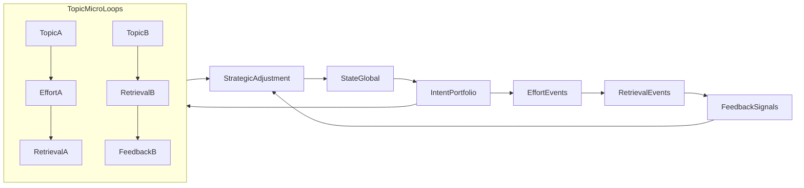

# Multi-topic Execution Loop Spec (Plan)

## Context in repo

- Existing loop + protocols are defined in [`Unified_Master_Doc.md`](c:\Users\Mukul\code\personal-projects\ai-study-brother\Unified_Master_Doc.md) around the loop equation and protocol matrix (see the loop at lines ~61–73 and protocols at ~74–93).
- We will **not rewrite** that core section yet; we’ll add a **product-spec section** that clarifies how the loop works when multiple subjects/topics are in different steps on the same day.

## What we will add (spec content)

### 1) Model: Daily meta-loop + Topic micro-loops

- **Daily meta-loop** (global): `State -> IntentPortfolio -> EffortEvents -> RetrievalEvents -> FeedbackSignals -> StrategicAdjustment -> next State`.
- **Topic micro-loop** (per topic): `State(topic) -> Intent(topic) -> Effort(topic) -> Retrieval(topic) -> Feedback(topic) -> Adjustment(topic)` where each topic advances only when interacted with.
- Key rule: EI optimizes **transition integrity** and **latency**, not “finish every step today”.

### 2) Definitions (to prevent ambiguity)

- **Entity**: `Topic` (e.g., Physics/Kinematics), `Task` (specific assignment), `Session` (a contiguous effort block), `RetrievalAttempt` (quiz/PYQ/recall), `FeedbackTag` (confidence, friction, avoidance).
- **Step state** per topic: one of `{Intent, Effort, Retrieval, Feedback}` plus timestamps.
- **WIP (work-in-progress)**: count of topics currently in `Effort` without a corresponding `Retrieval` within the target window.

### 3) Adaptive latency rules (EI not too tight)

- Introduce **adaptive windows** for the Effort→Retrieval gate:
- Base target window (e.g., 24–48h) becomes adaptive via factors already present in the doc: `State` (energy/anxiety), `TMS` (Topic Mastery Score), difficulty tier, recent decay (

\(\Delta_{Decay} = TMS_{Last} - Retrieval_{Today}\)).

- EI actions are based on **rolling-window integrity** (e.g., last 3–7 days), not strict daily completion.
- Add a soft constraint: limit `WIP` to avoid “too many open loops” (prevents pure passive learning across many topics).

### 4) How protocols map in a multi-topic day

- **Protocol 1 (State→Intent)** selects an **IntentPortfolio** (a set of topic intents + difficulty) instead of a single linear plan.
- **Protocol 2 (Intent→Effort)** runs per-session (topic-specific) and can recommend switching topics when State is mismatched.
- **Protocol 3 (Effort→Retrieval)** becomes a **verification scheduler**: allow immediate micro-retrieval OR schedule retrieval later with accountability.

### 5) Metrics + diagnostics (spec)

- **LoopLatency(topic)**: time from `EffortEnd` to first meaningful `RetrievalAttempt`.
- **VerificationRate**: percent of sessions that end with either immediate retrieval or a scheduled retrieval.
- **OpenLoops(WIP)**: number of topics with Effort but overdue Retrieval.
- **Cross-topic mix**: detect healthy interleaving vs chaotic switching (many short Effort blocks + no retrieval).
- Map these back to existing deltas (`AmbitionΔ`, `ExecutionΔ`, `EfficiencyΔ`, `PerceptionΔ`) as “per-topic deltas” aggregated into daily risk signals.

### 6) Minimal UX contract (so the model is implementable)

- At session end, the student chooses one of:
- `QuickVerifyNow` (1–5 questions)
- `ScheduleVerify` (tomorrow / +2 days / before next class)
- `SkipWithReason` (uses write-off/bankruptcy constraints if abused)
- End-of-day: EI generates **StrategicAdjustment** that rebalances the IntentPortfolio and reduces WIP.

## Diagram to include in the spec

