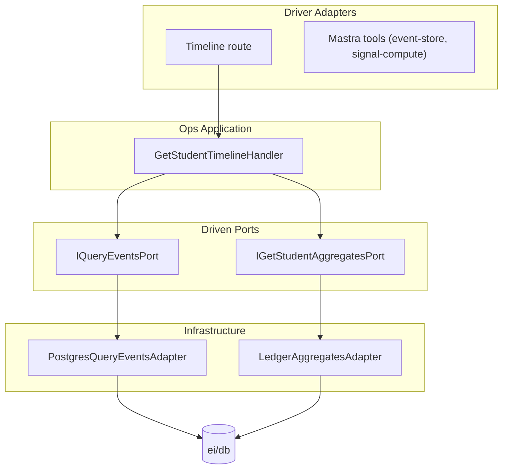

# Ops Launch MVP — DDD Tactical Implementation Plan

## Goal

Implement the Ops Launch MVP (correlation id propagation, structured gate logs, timeline debug endpoint, manual backfill tools) as the production baseline, following the DDD tactical structure in [01-ei-tactical-conventions.md](docs/engineering-ddd-design/tactical/01-ei-tactical-conventions.md) and mirroring patterns from [cohort-access-tactical-spec.md](docs/engineering-ddd-design/tactical/cohort-access-tactical-spec.md).

---

## Current State


| Capability                         | Status               | Location                                                                                                                                                             |
| ---------------------------------- | -------------------- | -------------------------------------------------------------------------------------------------------------------------------------------------------------------- |
| CorrelationId creation + gate logs | Exists               | [src/ei/infrastructure/logging.ts](src/ei/infrastructure/logging.ts), [src/app/api/ei/command/route.ts](src/app/api/ei/command/route.ts)                             |
| Timeline endpoint                  | Exists (no use case) | [src/app/api/admin/students/[studentId]/timeline/route.ts](src/app/api/admin/students/[studentId]/timeline/route.ts) — calls `queryEvents`, `getAggregates` directly |
| Manual backfill tools              | Exist                | [src/mastra/tools/signal-compute.ts](src/mastra/tools/signal-compute.ts), [src/mastra/tools/event-store.ts](src/mastra/tools/event-store.ts)                         |
| CorrelationId in workflows         | Missing              | Handler receives it but does not pass to `workflow.start()`                                                                                                          |


---

## Architecture (DDD Tactical)

Ops has no aggregate (consumer + orchestrator). Per [ops-observability-tactical-spec.md](docs/engineering-ddd-design/tactical/ops-observability-tactical-spec.md):

- **Driver ports:** Use cases invoked by routes/tools
- **Driven ports:** Ledger read, Projections read, Logger (optional)
- **Layers:** Application (use cases) + Infrastructure (adapters)

Per [01-ei-tactical-conventions.md](docs/engineering-ddd-design/tactical/01-ei-tactical-conventions.md): Ops is listed under `src/mastra/tools/`. For formal use cases, we introduce `src/ops/` as the Ops bounded-context module (same pattern as `src/cohort-access/`).




---

## Implementation Tasks

### 1. Create Ops module and GetStudentTimeline use case

**New files:**

- `src/ops/application/get-student-timeline/command.ts` — `GetStudentTimelineCommand { studentId, limit? }`
- `src/ops/application/get-student-timeline/port.ts` — `IGetStudentTimelineUseCase`, `IGetStudentTimelineDataPort` or split: `IQueryEventsPort` (reuse from ei), `IGetStudentAggregatesPort`
- `src/ops/application/get-student-timeline/handler.ts` — `GetStudentTimelineHandler` implements `IGetStudentTimelineUseCase`; calls both ports, returns `{ events, aggregates }`

**Driven ports:** Reuse `IQueryEventsPort` from [src/ei/application/shared/port-query-events.ts](src/ei/application/shared/port-query-events.ts). Add `IGetStudentAggregatesPort` in `port.ts`:

```typescript
// IGetStudentAggregatesPort — returns student aggregates or null
getStudentAggregates(studentId: string): Promise<StudentAggregatesRow | null>;
```

**Port choice:** Use `IQueryEventsPort` (reuse from ei). Adapter returns `QueriedEvent[]` with `occurredAt: Date`. Timeline response maps to `{ id, eventType, topicId, payload, occurredAt }` (ISO string for JSON). No Ops-specific port needed; reuse keeps Ledger contract consistent.

**Infrastructure adapters:**

- `src/ops/infrastructure/persistence/ledger-timeline-adapter.ts` — implements `IQueryEventsPort` + `IGetStudentAggregatesPort` by wrapping `eiStore.db`, calling `queryEvents` and `getAggregates` from [src/ei/db/queries.ts](src/ei/db/queries.ts)

Per dependency rule: `src/ops/` may import from `src/ei/db/queries.ts` and `src/ei/application/shared/port-query-events.ts` in infrastructure only. Application layer depends only on port interfaces.

---

### 2. Refactor timeline route to use GetStudentTimelineHandler

**File:** [src/app/api/admin/students/[studentId]/timeline/route.ts](src/app/api/admin/students/[studentId]/timeline/route.ts)

- Keep auth/RBAC flow (ResolveAuthSession, admin check) in the route.
- Replace direct `queryEvents`/`getAggregates` calls with:
  - Instantiate `LedgerTimelineAdapter(eiStore.db)` and `GetStudentTimelineHandler(adapter)`.
  - Call `handler.execute({ studentId, limit })`.
- Map `StudentAggregatesRow` to the existing response shape (pendingChecks, openLoops, etc.).
- Ensure `limit` is clamped 1–500 per spec.
- **Ordering:** Per [ei-event-ledger-tactical-spec.md](docs/engineering-ddd-design/tactical/ei-event-ledger-tactical-spec.md), BehavioralTimeline is `occurred_at ASC`. [src/ei/db/queries.ts](src/ei/db/queries.ts) `queryEvents` returns DESC (line 108). The adapter or handler must **reverse to ASC** so timeline output is chronological.

---

### 3. Add tenant isolation for timeline (invariant)

Per [05-cross-cutting-concerns.md](docs/engineering-ddd-design/05-cross-cutting-concerns.md) and Ops spec: "Admin-only + tenant isolation."

- If `authSession.accessScope` is cohort-scoped, verify `studentId` belongs to one of `authSession.cohortIds` (or use `GetCohortScope` / membership check).
- If scope is global (e.g. super-admin), allow any studentId.
- Reject with 403 if studentId is not in admin's scope.

**Strategy:** Use CohortAccess `authSession.accessScope` and `authSession.cohortIds`. If scope is `cohort`, resolve student → cohort via `student_cohort_membership` (or equivalent CohortAccess persistence) and verify `studentId` is in `authSession.cohortIds`. If scope is `global`, allow any studentId. Source: [cohort-access-tactical-spec.md](docs/engineering-ddd-design/tactical/cohort-access-tactical-spec.md). If `student_cohort_membership` is not implemented, document tenant isolation as "deferred until CohortAccess persistence exists" and keep admin check only.

---

### 4. Correlation id propagation

**Current:** `correlationId` is created in the route and passed to `handler.execute()` but not forwarded to workflows.

**Change:** Pass `correlationId` into workflow `inputData` so it is available for any future logging inside workflow steps.

**Files to update:**

- [src/ei/application/run-ei-command/handler.ts](src/ei/application/run-ei-command/handler.ts) — when calling `eiAppOpenWorkflow.createRun().start()`, include `correlationId` in `inputData`.
- [src/mastra/workflows/ei-app-open.ts](src/mastra/workflows/ei-app-open.ts) — add `correlationId?: string` to `AppOpenWorkflowInput`; pass through to nested workflows (protocol1, protocol2, checkin).
- Other workflow entry points (IntentSet, SessionEnd, etc.) — add `correlationId` to their `inputData` when invoked from the handler. Handler receives `correlationId` and must pass it to each `workflow.start({ inputData: { ..., correlationId } })`.

---

### 5. Structured logging (no spec change)

Existing `logGateCall` in [src/ei/infrastructure/logging.ts](src/ei/infrastructure/logging.ts) already meets MVP. Consider adding `inputSummary`/`outputSummary` (redacted) if not present. No new port required for Launch MVP.

---

### 6. Manual backfill drivers, ordering rule, and auditability

**Launch MVP requires** (per [ops-observability-tactical-spec.md](docs/engineering-ddd-design/tactical/ops-observability-tactical-spec.md) §8): `computeAggregatesTool` + **projector entrypoints** for TopicLoop and StudentPolicy.

**6a) Add Mastra tools for projector backfill**

- `recomputeTopicLoopTool` — invokes [recomputeTopicLoop](src/ei/infrastructure/projector/topic-loop-projector.ts) per (studentId, topicId). For full-student backfill, caller must iterate topics (or add a batch variant).
- `recomputeStudentPolicyTool` — invokes [recomputeStudentPolicy](src/ei/infrastructure/projector/student-policy-projector.ts) per studentId.

**6b) Backfill ordering rule** (per [student-aggregates-tactical-spec.md](docs/engineering-ddd-design/tactical/student-aggregates-tactical-spec.md) §8 Preconditions)

- When recomputing from scratch: **TopicLoop before StudentAggregates**. StudentAggregates derives openLoops/pendingChecks from TopicLoop state. Document this in tool descriptions and in ops-observability-tactical-spec references.

**6c) Auditability**

- Each backfill invocation (computeAggregatesTool, recomputeTopicLoopTool, recomputeStudentPolicyTool) logs a structured audit entry: `{ correlationId, projectionName, studentId, topicId? (if TopicLoop), completedAt }`. Use `createCorrelationId()` at tool entry; include in log. Per canvas: "idempotent, auditable, throttled."

**6d) Document as production baseline**

- Add doc comments in [signal-compute.ts](src/mastra/tools/signal-compute.ts), [event-store.ts](src/mastra/tools/event-store.ts), and new projector tools referencing [ops-observability-tactical-spec.md](docs/engineering-ddd-design/tactical/ops-observability-tactical-spec.md) §7 and §8.

---

### 7. Update tactical conventions (optional)

If `src/ops/` is created, add a row to [01-ei-tactical-conventions.md](docs/engineering-ddd-design/tactical/01-ei-tactical-conventions.md) Section 2 "Strategic → Tactical Mapping":


| Module     | Bounded contexts    | Rationale                                             |
| ---------- | ------------------- | ----------------------------------------------------- |
| `src/ops/` | Ops & Observability | GetStudentTimeline, future backfill job orchestration |


And note that Mastra tools remain in `src/mastra/tools/` as driver adapters.

---

## File Summary


| Action | File                                                                                 |
| ------ | ------------------------------------------------------------------------------------ |
| Create | `src/ops/application/get-student-timeline/command.ts`                                |
| Create | `src/ops/application/get-student-timeline/port.ts`                                   |
| Create | `src/ops/application/get-student-timeline/handler.ts`                                |
| Create | `src/ops/infrastructure/persistence/ledger-timeline-adapter.ts`                      |
| Edit   | `src/app/api/admin/students/[studentId]/timeline/route.ts`                           |
| Edit   | `src/ei/application/run-ei-command/handler.ts`                                       |
| Edit   | `src/mastra/workflows/ei-app-open.ts` (+ other workflow entry points)                |
| Edit   | `src/mastra/tools/signal-compute.ts`, `event-store.ts` (doc comments)                |
| Edit   | `docs/engineering-ddd-design/tactical/01-ei-tactical-conventions.md` (optional)            |
| Create | `src/mastra/tools/recompute-topic-loop.ts` (or add to existing backfill module)      |
| Create | `src/mastra/tools/recompute-student-policy.ts` (or add to existing backfill module)  |
| Create | `src/ei/tests/.../timeline-rbac.test.ts` (or integration test for timeline endpoint) |


---

## Test Tasks

Per [ops-observability-tactical-spec.md](docs/engineering-ddd-design/tactical/ops-observability-tactical-spec.md) §9:

- **Timeline RBAC:** Admin session → 200; student session → 403; no session → 401.
- **Timeline ordering:** Events in response are chronological (occurred_at ASC).
- **Tenant isolation:** When implemented, admin of cohort A cannot access timeline for student in cohort B → 403.
- **Redaction (optional):** Gate log with PII-like input produces no raw PII in output (inputSummary/outputSummary only).

---

## Verification

- `npm run build` passes.
- Timeline endpoint: `GET /api/admin/students/{studentId}/timeline` returns events + aggregates for admin; 403 for non-admin; 401 when unauthenticated.
- Timeline events are in chronological order (occurred_at ASC).
- Tenant isolation: Admin with cohort scope cannot access timeline for student outside their cohort (when implemented).
- CorrelationId is present in workflow `inputData` for EI command flows.
- Manual backfill tools (`computeAggregatesTool`, recomputeTopicLoopTool, recomputeStudentPolicyTool) remain functional and documented.
- Backfill tools (computeAggregates, recomputeTopicLoop, recomputeStudentPolicy) log structured audit entries.
- TopicLoop is run before StudentAggregates when doing full-student recompute.

---

## Out of Scope (Later)

- `IStructuredLoggerPort` (keep `logGateCall` direct).
- `BackfillJob` table and persistent job orchestration.
- Canary/dry-run, alerting, SLOs.
- Third-party observability tools.

