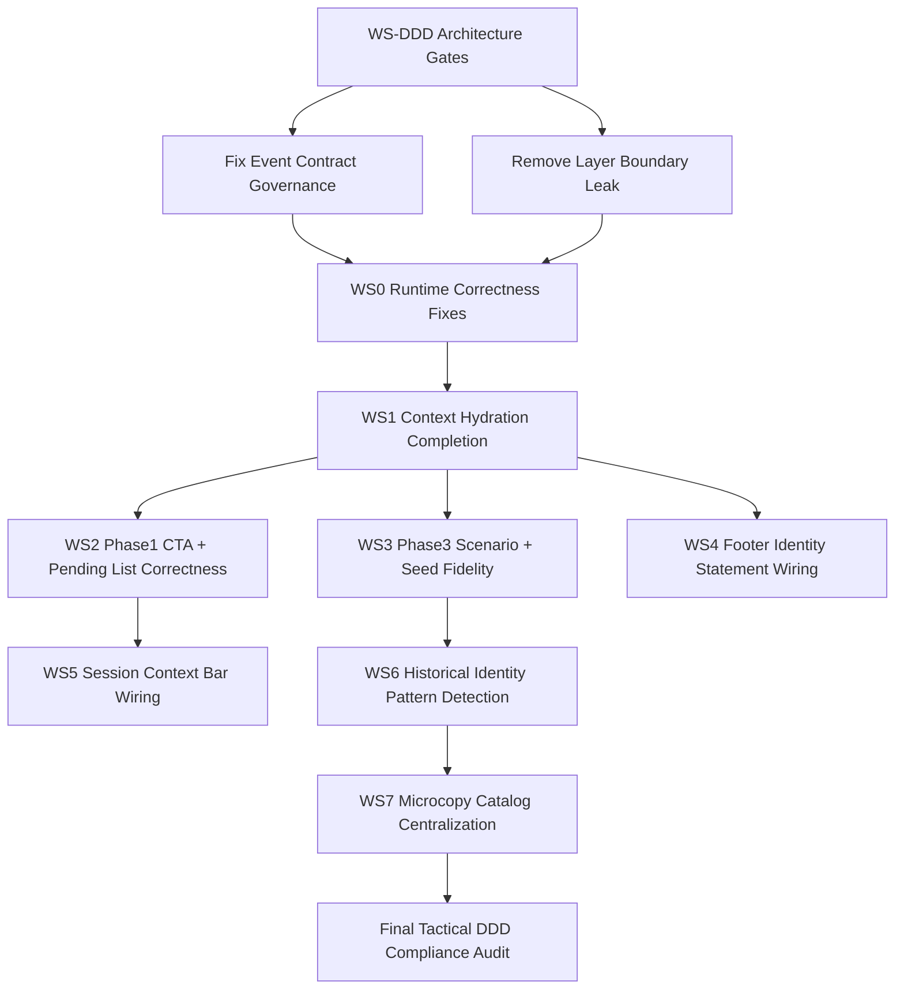
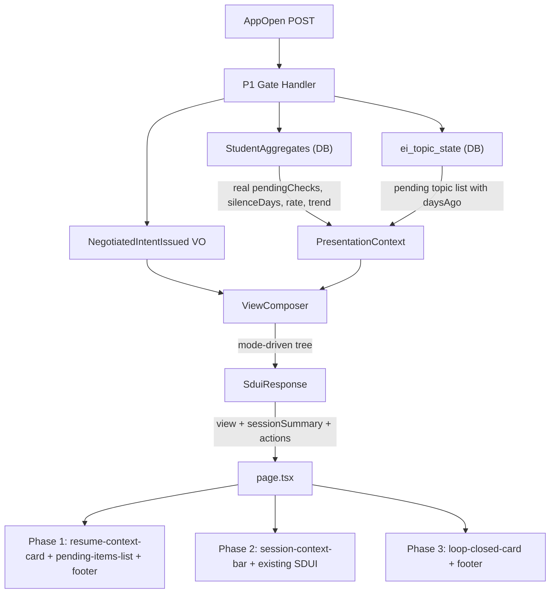
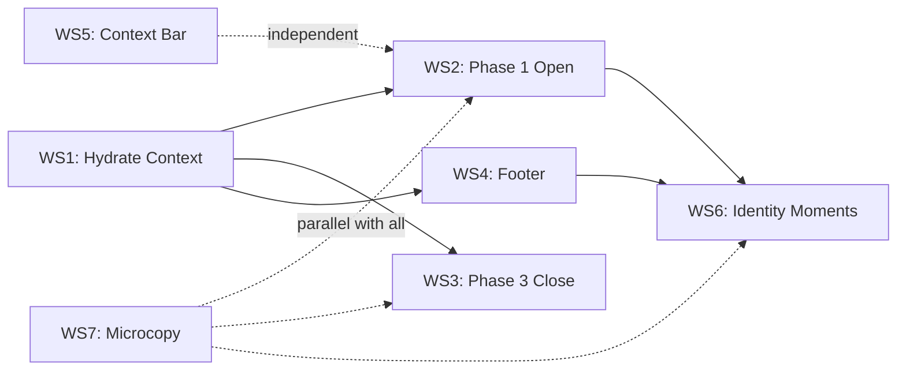

# Student Experience System -- Implementation Plan

## Current State

The **domain layer is complete**: `StudentAggregates` already computes `pendingChecks`, `silenceDays`, `verificationRate7d`, `stateTrend7d`, `openLoops`, `skipCount7d`, `startLatencyMinMedian7d`. Gate handlers (P1/P2/P3) load these signals and compute mode. The **SDUI architecture is correct**: `SduiResponse` shape, `ViewComposer`, client renderer, 16 component types.

The gap is between domain and presentation: the ViewComposer receives hard-coded context instead of real student data, and several SDUI component types required by the experience docs don't exist yet.

---

## Rigid Validation (Plan vs Code) — Current Findings

This section captures the post-implementation audit outcomes and the concrete correctness gaps to close before calling the system "spec-complete."

### PASS (implemented + wired)

- SDUI contract + client registry include: `resume-context-card`, `pending-items-list`, `loop-closed-card`, `session-summary-footer`, `identity-moment-card`, `session-context-bar`
- Footer persistence across phase transitions is implemented in `page.tsx` (footer nodes cached and rendered via `SduiSlot`)
- Phase 3 close workflows call `composePhase3View` (verification complete / retrieval schedule / retrieval skip)
- Identity rate-limiting persistence exists via `IdentityMomentShown` event (`getLastIdentityShownAt`, `insertIdentityMomentShownEvent`)

### PARTIAL / FAIL (must fix)

- **Phase 1 greeting CTA wiring (FAIL):** `small_start` and the identity CTA currently POST the `AppOpen` command template containing `{{topic}}` and `{{energy}}`. If tapped before inputs are filled, unresolved placeholders are omitted and the server receives an invalid AppOpen payload.
- **P3 PresentationContext energy/pressure (FAIL):** `buildP3PresentationContext` currently hard-codes `energy=3` and `pressure=1`, making "Clear one more" unreachable and breaking scenario-specific tone.
- **Session context bar wiring (FAIL):** `composeSessionView` supports `taskType`/`difficultyTier`, but `session-start` workflow does not supply them.
- **Pending items list correctness (PARTIAL):** list currently uses IDs as names, does not strictly filter to "pending checks," and overflow counts may diverge from the pendingChecks metric.
- **Footer identity statement (FAIL):** footer component supports `identityStatement` but ViewComposer does not include it.
- **Seed/close copy fidelity (PARTIAL):** Phase 3 seeds should be count/time anchored and must respect "no seed after skip," "milestone replaces seed," and "first-ever is teaching (no seed)."
- **Identity pattern detection fidelity (PARTIAL):** current detection logic is based on present state; spec patterns (silence-resolved, pressure-resolved) are historical and should be derived from recent event history/signals.

### Tactical DDD / Hexagonal Compliance Gaps (must fix before sign-off)

- **Event contract governance:** `IdentityMomentShown` is being persisted but is not currently in canonical `EventTypeEnum` and strategic event catalog alignment.
- **Layer boundary leak:** `src/ei/sdui/presentation-context.ts` imports DB row types (`AggregatesRow`, `TopicStateRow`). Presentation should consume application-mapped DTOs/VOs, not persistence row contracts.
- **Gateway context contract drift:** `canvas-ei-runtime.md` expects ViewComposer context derivation from protocol output + already-resolved context; avoid making SDUI types depend on persistence shape.
- **Single interpretation rule:** keep label/threshold semantics in LoopHealthAssessment; avoid re-encoding interpretation logic in ViewComposer eligibility/pattern detection beyond presentation-level formatting.
- **Cross-context invariants:** preserve ACL/privacy and no-raw-data boundaries (Radar/privacy invariants) while extending identity/footer features.

---

## Tactical DDD Alignment Matrix (Source Docs -> Implementation Gates)

| Source doc                                                   | Alignment gate                         | Required outcome                                                                                            |
| ------------------------------------------------------------ | -------------------------------------- | ----------------------------------------------------------------------------------------------------------- |
| `docs/engineering-ddd-design/00-index.md`                          | Context responsibilities remain intact | No feature code collapses context boundaries (Runtime vs Projections vs CohortAccess).                      |
| `docs/engineering-ddd-design/tactical/00-index.md`                 | Tactical specs remain authoritative    | All runtime/presentation changes trace to EI Runtime tactical spec, not ad-hoc workflow logic.              |
| `.agents/skills/.../HEXAGONAL.md`                            | Ports and adapters discipline          | Driver adapters remain thin; domain/application do not depend on infra typing.                              |
| `.agents/skills/.../DDD-TACTICAL.md`                         | Aggregate and VO integrity             | StudySession invariants stay in aggregate/VOs; no migration of core business rules into UI/presenter layer. |
| `.agents/skills/.../DDD-STRATEGIC.md`                        | Published language + ACL discipline    | Event schemas/versioning and ACL translation remain explicit and stable.                                    |
| `.agents/skills/.../LAYERS.md`                               | Dependency rule                        | Infrastructure -> Application -> Domain only; presentation modules not typed to DB rows.                    |
| `docs/engineering-ddd-design/09-tactical-ddd-candidates.md`        | Candidate ownership consistency        | Changes remain in expected modules (StudySession, StudentAggregates, ViewComposer).                         |
| `docs/engineering-ddd-design/05-cross-cutting-concerns.md`         | Invariants and event catalog           | Event type strictness, idempotency, schema conformance, privacy boundaries are maintained.                  |
| `docs/engineering-ddd-design/canvas-ei-runtime.md`                 | Execution vs gateway boundary          | ViewComposer stays pure presenter with context from application boundary, not direct persistence types.     |
| `docs/engineering-ddd-design/tactical/ei-runtime-tactical-spec.md` | Runtime tactical conformance           | Routing, event completeness, command boundaries, and SDUI responsibilities match spec.                      |
| `docs/engineering-ddd-design/02-subdomains.md`                     | Subdomain boundaries                   | StudySessionOrchestration remains supporting context; no metric/label computation ownership drift.          |
| `docs/engineering-ddd-design/03-context-map.md`                    | Relationship integrity                 | Customer-supplier and published language edges are not bypassed by convenience reads/writes.                |

---

## DDD-First Remediation Sequence (Updated Critical Path)

## Data Flow (Target State)

---

## Workstream 1: Hydrate PresentationContext with Real Data

**Why first:** Every other workstream depends on real `silenceDays`, `pendingChecks`, `isFirstOfDay`, and `tightnessLevel` flowing into the ViewComposer.

**Files to change:**

- [src/ei/sdui/presentation-context.ts](src/ei/sdui/presentation-context.ts) -- `buildP1PresentationContext` currently approximates `pendingChecks` as `3 or 0` and hard-codes `silenceDays: 0`. Change the signature to accept the full `AggregateMetrics` object and extract real values.
- [src/mastra/workflows/steps/compose-p1-view.ts](src/mastra/workflows/steps/compose-p1-view.ts) -- Pass aggregates through from the workflow step that calls `composeP1View`.
- [src/ei/sdui/presentation-context.ts](src/ei/sdui/presentation-context.ts) -- `buildP3PresentationContext` must accept real `energy` + `pressure` (and aggregates) so Phase 3 can show "Clear one more" and pick correct scenario tone.
- [src/mastra/workflows/steps/compose-p3-view.ts](src/mastra/workflows/steps/compose-p3-view.ts) -- Thread aggregates to P3 context.

**Key changes to `PresentationContext` interface:**

- Add `sessionsLast7d: number` (for footer + identity eligibility)
- Add `loopsClosedLast7d: number` (for footer)
- Add `verificationRate7d: number` (for footer + identity)
- Add `stateTrend7d: StateTrend` (for footer)
- Add `topicStates: TopicStateSnapshot[]` (for pending-items-list)
- Add `lastIdentityShownAt: Date | null` (for identity rate-limiting)

---

## Workstream 2: Phase 1 "The Open" -- New Components

**What the docs require:** A contextual greeting screen that varies by mode/variant (SILENCE RE-ENTRY, HIGH PRESSURE, CHALLENGE, CLEAN START, DEAL CARD, PENDING+STANDARD, ONBOARDING, IDENTITY MOMENT). See [05-phase1-the-open.md](docs/student-experience/05-phase1-the-open.md) variant matrix.

### 2a. `resume-context-card` component

**New files:**

- `src/ei/sdui/types/components.ts` -- Add `SduiResumeContextCardSchema` to the discriminated union. Props: `greeting: string`, `subGreeting?: string`, `pendingItems?: PendingItem[]`, `primaryCta: { label, actionId }`, `secondaryCta?: { label, actionId }`, `tertiaryCta?: { label, actionId }`
- `src/app/sdui/components/resume-context-card.tsx` -- Client renderer for the card
- `src/app/sdui/registry.tsx` -- Register `'resume-context-card'`

### 2b. `pending-items-list` component

**New files:**

- `src/ei/sdui/types/components.ts` -- Add `SduiPendingItemsListSchema`. Props: `items: { topicId, topicName, daysAgo, actionId }[]`, `overflowLabel?: string`
- `src/app/sdui/components/pending-items-list.tsx` -- Renders tappable list; max 5 items + "and X more"
- `src/app/sdui/registry.tsx` -- Register `'pending-items-list'`

### 2c. ViewComposer: `composePhase1View`

**File:** [src/ei/sdui/view-composer.ts](src/ei/sdui/view-composer.ts)

Add a new `composePhase1View(ctx: PresentationContext): SduiResponse` function that:

- Reads `ctx.mode` and `ctx.silenceDays` to select the layout variant
- Emits `resume-context-card` with mode-appropriate greeting + CTA count (1 for Rescue, 2-3 for Neutral/Boost)
- Emits `pending-items-list` (only when `pendingChecks > 0 AND mode !== 'Rescue'`)
- Emits `session-summary-footer` in the footer slot (see Workstream 4)
- Assigns actions: primary CTA fires appropriate command (topic-specific IntentSet for pending items, generic AppOpen for "5-minute win")

This function is called BEFORE the checkin form -- it's the greeting screen. The existing `composeCheckinView` becomes Phase 1.5 (the form the student fills in after seeing the greeting).

**Additional hard requirement (from validation):** Phase 1 greeting CTAs must not POST `AppOpen` unless required inputs are present. Either:\n

- make greeting CTA a client-only dismiss/scroll affordance (no server action), OR
- make it an action that only becomes enabled after required inputs are collected, OR
- split the flow into two screens (greeting first, then inputs) so "Start small" can safely submit.

**Decision:** The Phase 1 greeting and the checkin form can be combined into a single SDUI response. The greeting card sits in `body[0]`, the energy/topic inputs follow in `body[1+]`. This avoids adding a new phase and keeps the existing flow intact. The key change is: the greeting copy and button structure are now mode-driven from real aggregates.

---

## Workstream 3: Phase 3 "The Close" -- `loop-closed-card`

**What the docs require:** 7 close scenarios (A-G) with counter animation, scenario-specific copy, forward-looking seed, and conditional "Clear one more" button. See [07-phase3-the-close.md](docs/student-experience/07-phase3-the-close.md).

### 3a. `loop-closed-card` component

**Files:**

- `src/ei/sdui/types/components.ts` -- Add `SduiLoopClosedCardSchema`. Props:
  - `title: string` (e.g. "Loop closed.")
  - `topicName: string`
  - `message: string` (e.g. "you proved you remember it")
  - `countBefore?: number`, `countAfter?: number` (for counter animation)
  - `seed?: string` (forward-looking signal)
  - `clearMoreCta?: { label, actionId }` (conditional)
  - `milestone?: boolean` (pending=0 special treatment)
  - `firstEver?: boolean` (first loop close teaching moment)
- `src/app/sdui/components/loop-closed-card.tsx` -- Renders counter animation (`3 -> 2`), message, seed, optional "Clear one more" button
- `src/app/sdui/registry.tsx` -- Register `'loop-closed-card'`

### 3b. ViewComposer: scenario routing

**File:** [src/ei/sdui/view-composer.ts](src/ei/sdui/view-composer.ts)

Modify the post-verification/post-skip/post-schedule flow. Currently `composeDoneView` is generic. Replace with `composePhase3View(ctx, scenario)` that:

- Routes to the correct scenario (A: verified, B: reminded, C-E: skip by reason, F: milestone, G: first-ever)
- Populates `countBefore` / `countAfter` from real aggregates
- Computes seed copy per scenario
- Shows "Clear one more" only when `energy >= 4 AND pendingChecks >= 1 AND scenario === 'verified'`

**Additional hard requirement (from validation):** seeds must follow spec:\n

- Verified: seed is count-based ("X checks left this week — you're ahead.")
- Reminded: seed is time-based ("Tomorrow at this time." / "See you tomorrow.")
- Skip: no seed
- Milestone: identity-style statement replaces seed (no forward hook)
- First-ever: teaching moment, no seed

### 3c. Mastra workflow integration

**Files:**

- [src/mastra/workflows/verification-complete.ts](src/mastra/workflows/verification-complete.ts) -- After VerificationCompleted, call `composePhase3View` with scenario A/F/G
- [src/mastra/workflows/retrieval-schedule.ts](src/mastra/workflows/retrieval-schedule.ts) -- Call with scenario B
- [src/mastra/workflows/retrieval-skip.ts](src/mastra/workflows/retrieval-skip.ts) -- Call with scenario C/D/E based on skip reason

---

## Workstream 4: "Your Week" Footer

**What the docs require:** A collapsible one-line footer at the bottom of Phase 1 and Phase 3. Always collapsed by default. Shows warm label instead of numbers after silence. See [08-footer-and-identity.md](docs/student-experience/08-footer-and-identity.md).

### 4a. `session-summary-footer` component

**Files:**

- `src/ei/sdui/types/components.ts` -- Add `SduiSessionSummaryFooterSchema`. Props: `collapsedLabel: string`, `sessions: number`, `loopsClosed: number`, `pending: number`, `rate: number`, `trend: string`, `identityStatement?: string`, `warmLabel?: string` (replaces numbers after silence)
- `src/app/sdui/components/session-summary-footer.tsx` -- Collapsed by default (one line), expandable on tap. Shows numbers or warm label.
- `src/app/sdui/registry.tsx` -- Register `'session-summary-footer'`

### 4b. ViewComposer: footer assembly

**File:** [src/ei/sdui/view-composer.ts](src/ei/sdui/view-composer.ts)

In both `composePhase1View` and `composePhase3View`, push a `session-summary-footer` into the `footer` slot. Data comes from `PresentationContext` aggregates:

- `collapsedLabel`: "This week: {sessions} sessions . {loopsClosed} loops closed . {trendLabel}"
- After silence (`silenceDays >= 3`): `warmLabel: "Quiet week. That's okay."` replaces numbers
- `identityStatement` included when available (from identity computation)

**Additional hard requirement (from validation):** ensure ViewComposer actually populates `identityStatement` when an identity statement is available (either from eligibility computation or from a derived identity summary).\n
**Additional hard requirement (from tactical docs):** footer should remain presentation-only; identity statement derivation must come from application/context inputs, not persistence row logic inside component builders.

### 4c. Client: persistent footer

**File:** [src/app/page.tsx](src/app/page.tsx)

The footer component should persist across SDUI payload swaps. Store `sessionSummary` from the AppOpen response in component state. Render it below the `SduiView` so it survives phase transitions (Phase 2 doesn't include a footer, but the footer from Phase 1 should remain visible).

---

## Workstream 5: Session Context Bar (Phase 2)

**Small scope.** See [06-phase2-the-session.md](docs/student-experience/06-phase2-the-session.md).

**Files:**

- `src/ei/sdui/types/components.ts` -- Add `SduiSessionContextBarSchema`. Props: `topic: string`, `taskType: string`, `difficultyTier: string`
- `src/app/sdui/components/session-context-bar.tsx` -- Fixed top bar, small muted text: "Integration . Practice . Hard (3)"
- `src/app/sdui/registry.tsx` -- Register `'session-context-bar'`
- `src/ei/sdui/view-composer.ts` -- In `composeSessionView`, push `session-context-bar` into `header` slot

**Additional hard requirement (from validation):** thread `taskType` and `difficultyTier` into `composeSessionView` from the `session-start` workflow.\n

---

## Workstream 6: Identity Moments

**Depends on:** Workstreams 1 (hydrated context) and 4 (footer with identity statement).

### 6a. Identity eligibility computation

**New file:** `src/ei/sdui/identity/compute-identity-eligibility.ts`

Pure function: `computeIdentityEligibility(ctx: PresentationContext): { eligible: boolean; statement: string | null; pattern: string | null }`

Logic from [08-footer-and-identity.md](docs/student-experience/08-footer-and-identity.md):

- All conditions: `verificationRate7d >= 0.70`, `pendingChecks <= 2`, `sessionsLast7d >= 4`, `lastIdentityShownAt` > 7 days ago
- Statement selection priority: silence-resolved > pressure-resolved > integrity-consistent > technique-improved > zero-pending > generic

**Additional hard requirement (from validation):** silence-resolved and pressure-resolved are historical patterns (e.g., “silence occurred in last 14 days and now sessionsLast7d >= 4”), not just current `silenceDays` / `pressure`.\n
**Additional hard requirement (from cross-cutting docs):** if identity moments are represented as domain events, add them to canonical event schema/contracts and preserve strict validation + idempotency semantics.

### 6b. `identity-moment-card` component

**Files:**

- `src/ei/sdui/types/components.ts` -- Add `SduiIdentityMomentCardSchema`. Props: `statement: string`, `detail: string` (2-line factual summary), `ctaLabel: string`
- `src/app/sdui/components/identity-moment-card.tsx` -- Statement is bold/emphasized, detail is plain, single CTA
- `src/app/sdui/registry.tsx` -- Register `'identity-moment-card'`

### 6c. ViewComposer integration

**File:** [src/ei/sdui/view-composer.ts](src/ei/sdui/view-composer.ts)

In `composePhase1View`, before building the normal greeting:

- Call `computeIdentityEligibility(ctx)`
- If eligible, emit `identity-moment-card` instead of `resume-context-card`
- Hide footer while identity card is showing

### 6d. Rate-limiting persistence

**File:** [src/ei/db/queries.ts](src/ei/db/queries.ts) or a new table

Track `last_identity_shown_at` per student. Options:

- Add column to `ei_student_aggregates` table
- Or use the event log: emit an `IdentityMomentShown` event and query for it

---

## Workstream 7: Microcopy Expansion

**Parallel with each workstream above.**

**Files:**

- [src/ei/sdui/microcopy/p1.ts](src/ei/sdui/microcopy/p1.ts) -- Add slots: `phase1_greeting` (per variant: SILENCE_RE_ENTRY, HIGH_PRESSURE, CHALLENGE, CLEAN_START, ONBOARDING, PENDING_STANDARD, DEAL_CARD), `phase1_sub_greeting`, `phase1_footer_warm_label`
- [src/ei/sdui/microcopy/p3.ts](src/ei/sdui/microcopy/p3.ts) -- Add slots: `close_verified`, `close_reminded`, `close_skip_time`, `close_skip_fatigue`, `close_skip_confusion`, `close_milestone`, `close_first_ever`, `seed_verified`, `seed_reminded`
- [src/ei/sdui/microcopy/catalog.ts](src/ei/sdui/microcopy/catalog.ts) -- Add new slot names to `MicrocopySlot` union
- **New file:** `src/ei/sdui/microcopy/identity.ts` -- Identity statement library (8 statements from [10-microcopy-bible.md](docs/student-experience/10-microcopy-bible.md) Section 7)

**Additional hard requirement (from validation):** migrate hard-coded copy tables (Phase 1 and Phase 3) to `microcopyCatalog` slots so SDUI copy remains centralized and enforceable.\n
**Additional hard requirement (from tactical docs):** centralized copy governance must not introduce domain decisions in microcopy resolver (copy selection by gate/mode/play only).

---

## Doc-by-Doc Sign-Off Checklist (Definition of Done)

- `05-cross-cutting-concerns.md`: Event catalog updated for any newly persisted event types; strict schema + idempotency preserved.
- `LAYERS.md` / `HEXAGONAL.md`: no DB row type imports in `src/ei/sdui/`*; mapping happens in application/workflow boundary.
- `canvas-ei-runtime.md`: ViewComposer remains pure, zero DB calls, and receives non-persistence presentation context.
- `ei-runtime-tactical-spec.md`: command boundary completeness and routing invariants remain satisfied after CTA/Phase3 fixes.
- `03-context-map.md`: no new direct dependency that bypasses Published Language / ACL edges.
- `02-subdomains.md`: StudySessionOrchestration still does presentation orchestration only; no ownership drift into metrics interpretation.
- `09-tactical-ddd-candidates.md`: aggregate responsibilities unchanged (StudySession/StudentAggregates/TopicLoop invariants remain in domain).
- Student-experience docs: Phase1/Phase3/footer/identity behavior and microcopy are spec-faithful.

---

## Execution Order

WS1 is the critical path. WS5 and WS7 can run in parallel with everything else.