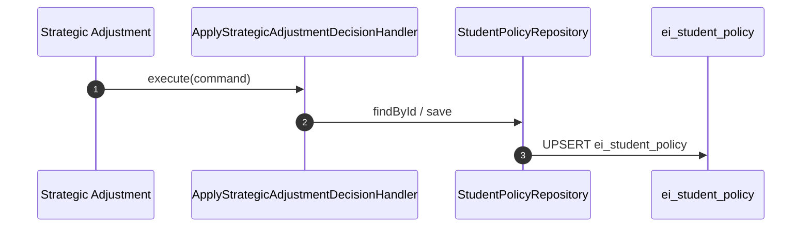

## Context and target behavior

Per [docs/engineering-ddd-design/03-context-map.md](docs/engineering-ddd-design/03-context-map.md):

- **Strategic Adjustment → EI Projections**: Customer-Supplier, **Sync write** of `StrategicAdjustmentDecision`; persisted as policy.
- **No SA → Ledger**: The context map does not show Strategic Adjustment writing to the EI Event Ledger. SA owns policy semantics; Projections own storage.

**Direct write flow** (what we implement):

---

## Doc alignment note

- **Event Catalog** ([05-cross-cutting-concerns.md](docs/engineering-ddd-design/05-cross-cutting-concerns.md)) lists StrategicAdjustmentDecision as Producer=SA, Consumer=Ledger. The **context map** instead shows SA → Projections direct. This plan follows the **context map** as the canonical relationship document.
- **Replaceability** for policy: Without StrategicAdjustmentDecision in the Ledger, we cannot replay from events. For now, policy is current-state only; SA can re-run and overwrite. If future design adds SA → Ledger, a projector can be introduced later.

---

## Scope (what changes)

- Add a **StudentPolicy** aggregate slice under `src/ei/` per [docs/engineering-ddd-design/tactical/01-ei-tactical-conventions.md](docs/engineering-ddd-design/tactical/01-ei-tactical-conventions.md).
- Wire the Strategic Adjustment workflow `persist-and-emit` step to call `ApplyStrategicAdjustmentDecisionHandler` (inject repository, execute command).
- Optionally refactor `setPolicyTool` to use the handler instead of raw `Q.upsertPolicy`.
- Add unit tests (domain + application) and a PG integration test (skip if `DATABASE_URL` missing).

## 1) Domain (pure): `src/ei/domain/student-policy/`

Implement per [docs/engineering-ddd-design/tactical/student-policy-tactical-spec.md](docs/engineering-ddd-design/tactical/student-policy-tactical-spec.md).

- `value-objects.ts`
  - `StudentPolicyId` (VO: `{ studentId: string }`, validates non-empty).
  - (Optional) `TightnessLevel` VO/enum wrapper to avoid stringly typed values.
- `student-policy.ts`
  - `StudentPolicy` aggregate root with `applyStrategicAdjustmentDecision(decision)`.
  - Enforce invariants: atomic replace, reject invalid tightness enum, idempotent apply.
- `repository.ts`
  - `IStudentPolicyRepository { findById(id); save(policy); }`
- `errors.ts`
  - `MissingStudentIdError`, `InvalidTightnessLevelError` (minimal set).

## 2) Application use case: `src/ei/application/apply-strategic-adjustment-decision/`

- `command.ts`
  - `ApplyStrategicAdjustmentDecisionCommand` shaped from SA decision output (studentId, tightnessLevel, adjustmentMode, dials, constraints, issuedAt).
  - Map SA output `dials` → policy `dials`; SA may use `nextCycleConstraints` → policy `constraints`.
- `port.ts`
  - `IApplyStrategicAdjustmentDecisionUseCase.execute(command): Promise<void>`
- `handler.ts`
  - Inject `IStudentPolicyRepository`.
  - Flow: load existing policy (or create empty) → apply decision in domain → save.

## 3) Infrastructure (Postgres adapters): `src/ei/infrastructure/persistence/`

- `mappers/student-policy-mapper.ts`
  - Map between `PolicyRow` (from [src/ei/db/queries.ts](src/ei/db/queries.ts)) and domain `StudentPolicy`.
- `student-policy-repository.pg.ts`
  - Implements `IStudentPolicyRepository` via `getPolicy` / `upsertPolicy`.

## 4) Wire into Strategic Adjustment workflow

- Update [src/mastra/workflows/strategic-adjustment.ts](src/mastra/workflows/strategic-adjustment.ts):
  - In `persist-and-emit` step: obtain `db` via `getEiDb(context)` (workflow context must provide DB).
  - Construct `PostgresStudentPolicyRepository(db)`, `ApplyStrategicAdjustmentDecisionHandler(repo)`.
  - Build `ApplyStrategicAdjustmentDecisionCommand` from step input (studentId, tightnessLevel, mode, dials, constraints, issuedAt).
  - Call `handler.execute(command)`.
- Mastra workflows may need to receive `context` with DB. If workflow steps do not have DB access, an alternative is to have the **invoker** of the workflow call the handler after the workflow completes (workflow returns the decision; invoker applies it).

## 5) Optional: Refactor setPolicyTool

- Update [src/mastra/tools/policy-store.ts](src/mastra/tools/policy-store.ts) `setPolicyTool`:
  - Replace direct `Q.upsertPolicy` with `ApplyStrategicAdjustmentDecisionHandler` + `PostgresStudentPolicyRepository`.
  - Map tool input → `ApplyStrategicAdjustmentDecisionCommand` (issuedAt = now).
  - Keeps a single write path through the use case.

(DDD-lite note: manual construction—no DI container.)

## 6) Tests

- **Domain unit tests**: `src/ei/tests/unit/domain/student-policy/student-policy.test.ts`
  - first decision creates state
  - replace overwrites all fields (old constraints removed)
  - invalid tightness rejected
  - idempotent apply
- **Application unit tests**: `src/ei/tests/unit/application/apply-strategic-adjustment-decision/handler.test.ts`
  - in-memory repo; assert orchestration and persistence
- **Infrastructure integration test (PG)**: `src/ei/tests/infrastructure/persistence/student-policy-repository.pg.test.ts`
  - pattern like `topic-loop-repository.pg.test.ts`: `import 'dotenv/config'`, `describe.skipIf(!process.env.DATABASE_URL)`
  - exercise: repo `findById` null / save / load

## Non-goals (explicitly deferred)

- SA → Ledger: Not per context map; no `StrategicAdjustmentDecision` events appended by SA.
- Projector / replay from Ledger: No events to replay; replaceability deferred.
- Event-stream reader port: Not needed for direct write path.
- DI container; event bus.

