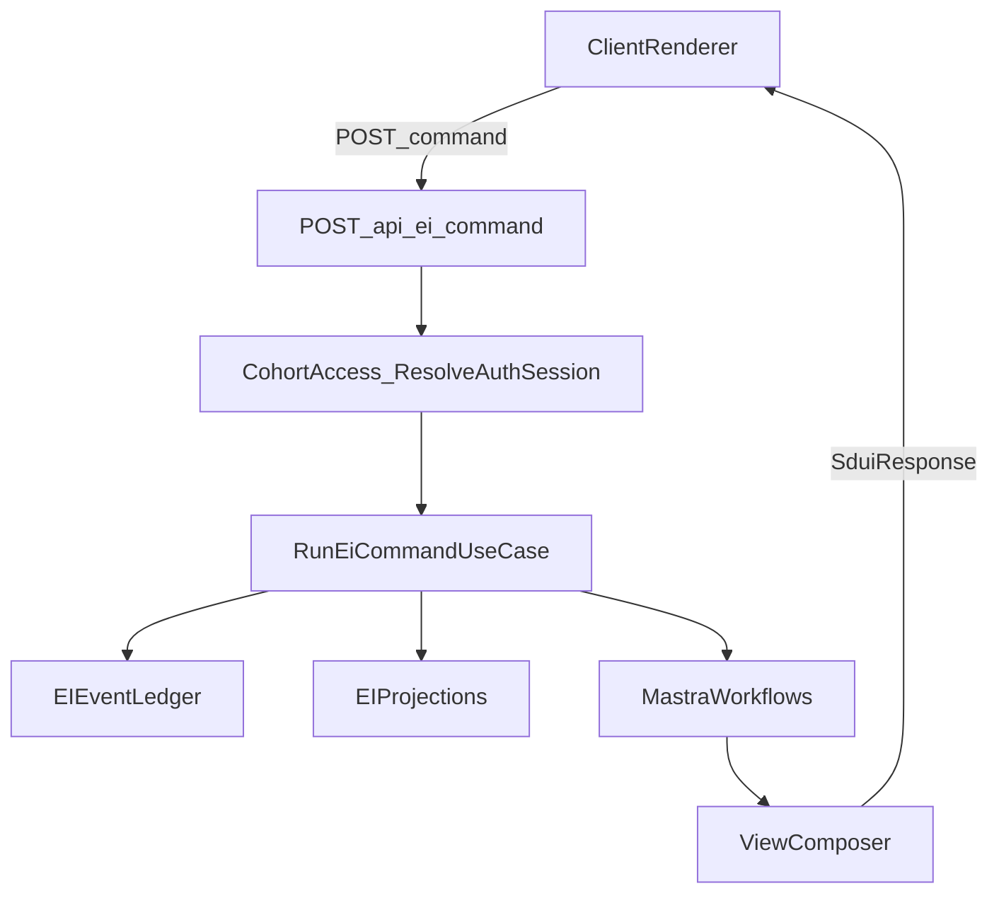

# True behaviour-driven SDUI (EI Runtime)

## Goal

Make the client a thin renderer (render server `SduiResponse` + submit server-provided `actions`) while moving all behaviour/routing/state derivation and reliability policies into a single backend orchestrator use case.

---

## Implementation status (audit)

| Area                              | Status  | Notes                                                                                                                                                                                                                                                                                                  |
| --------------------------------- | ------- | ------------------------------------------------------------------------------------------------------------------------------------------------------------------------------------------------------------------------------------------------------------------------------------------------------ |
| **A) Client pure renderer**       | Done    | Mount always POSTs AppOpen; only `currentSduiResponse` + `formValues`; `credentials: 'include'`; no pilot identity                                                                                                                                                                                     |
| **B) Auth session cookies**       | Partial | `withEiSession` uses Neon Auth; verify login routes and cookie flow end-to-end                                                                                                                                                                                                                         |
| **C) RunEiCommand orchestrator**  | Done    | Port, command, handler, errors exist; handler delegates to workflows; AppOpen routing via eiAppOpenWorkflow + ProtocolRouter                                                                                                                                                                           |
| **D) Thin command route**         | Done    | Route parses, validates, auths, delegates to handler; maps InvalidCommandError→400, InvalidTransitionError→422, IdempotencyConflictError→409                                                                                                                                                           |
| **E) Idempotency + completeness** | Partial | Route extracts `idempotencyKey`; handler passes to workflows; event-level idempotency in `ei_idempotency_keys` (insertEvent returns existing on duplicate). Gaps: no command-boundary pre-check; `InvalidTransitionError`/`IdempotencyConflictError` never thrown; client does not send idempotencyKey |
| **F) Tests**                      | Missing | No RunEiCommandHandler unit tests; no SDUI loop integration test                                                                                                                                                                                                                                       |

---

## Current baseline

- SDUI contract: `src/ei/sdui/types/sdui-contract.ts` (server returns `view` + `actions` that POST back to `/api/ei/command`).
- Client loop: `src/app/page.tsx` — pure renderer (mount→POST AppOpen; actions→POST; no phase gating).
- Command endpoint: `src/app/api/ei/command/route.ts` — thin driver adapter delegating to RunEiCommandHandler.
- RunEiCommand orchestrator: `src/ei/application/run-ei-command/` (port, command, handler, errors).
- Routing primitive: `src/ei/application/ei-protocol-router/router.ts` (used by eiAppOpenWorkflow for P1 vs P2).
- Auth wrapper: `src/app/api/ei/with-session.ts` (CohortAccess ResolveAuthSession; Neon Auth when env set).

## Target flow (single loop)

## Implementation plan

### A) Client: become a pure SDUI renderer — Done

- Update `src/app/page.tsx` so it:
  - On mount, **always** POST `AppOpen` (no `phase` gating).
  - Stores only:
    - `currentSduiResponse`
    - `formValues` (for `{{inputId}}` placeholder substitution)
  - Removes pilot-only identity handling (`studentId`, `secret`, localStorage) once cookie/session auth is live.
  - Treats `phase` as display-only (derived from response), not flow control.
- Keep `src/app/sdui/renderer.tsx` as the generic renderer + `resolvePayload()` utility.

### B) Auth: switch to session cookies (server-owned identity) — Partial

- Ensure EI UI calls `/api/ei/command` without manual Authorization headers. — Done (`credentials: 'include'`).
- Keep identity resolution server-side via `withEiSession` (`src/app/api/ei/with-session.ts`). — Done.
- Remaining: Verify Neon Auth wiring (login routes + session retrieval) so `createServerGetSession()` succeeds end-to-end. When env not set, returns null → 401.

### C) Backend: introduce a first-class RunEiCommand orchestrator — Done

- Add new application slice:
  - `src/ei/application/run-ei-command/port.ts` (`IRunEiCommandUseCase`)
  - `src/ei/application/run-ei-command/command.ts` (DTO: `EiCommand` + `studentId` + optional `idempotencyKey`)
  - `src/ei/application/run-ei-command/handler.ts`
  - `src/ei/application/run-ei-command/errors.ts` (typed errors + mapping) — All done.
- Handler responsibilities (align to tactical spec):
  - Validate command envelope (strict schema)
  - Derive lifecycle state using Ledger events (and projections where needed)
  - Choose protocol/workflow via routing matrix
  - Invoke the correct Mastra workflow or gate handler
  - Enforce command-boundary idempotency and minimum-event completeness policies — Note: `InvalidTransitionError` and `IdempotencyConflictError` defined but never thrown.

### D) Refactor `/api/ei/command` to a thin driver adapter — Done

- Parse JSON, validate schema, call `withEiSession`, delegate to handler, map typed errors → HTTP (400, 422, 409, 500). — Done.

### E) Command-boundary idempotency + event completeness — Partial

- Route extracts `idempotencyKey` from body and passes to handler. — Done.
- Handler passes key to all workflows; workflows pass to append adapters. — Done.
- Event-level idempotency in `ei_idempotency_keys` (`insertEvent` returns existing on duplicate key). — Done.
- Remaining: No command-boundary pre-check (workflow runs on duplicate; events deduplicated at append). Optional: add `idempotencyKey` to envelope schema; client sends key for retry safety.

### F) Tests + verification — Remaining

- Add unit tests for `RunEiCommandHandler`:
  - AppOpen with/without recent intent routes correctly
  - Invalid transitions return 400-class errors
  - Duplicate idempotency key does not duplicate events
  - Command paths emit/append the required minimum event set hooks
- Add a lightweight end-to-end “SDUI loop” test (can be browser or integration) that:
  - Loads page → receives checkin view
  - Submits an action → receives next view
  - Repeats without any client-side routing logic

---

## Remaining work (prioritized)

| Priority | Item                                                                          |
| -------- | ----------------------------------------------------------------------------- |
| High     | Add unit tests for RunEiCommandHandler (routing, errors)                      |
| High     | Add SDUI loop integration/E2E test                                            |
| Medium   | Verify Neon Auth end-to-end (login, cookies, session)                         |
| Medium   | Optional: command-boundary idempotency (pre-workflow check + stored response) |
| Low      | Use InvalidTransitionError where lifecycle rules violated                     |
| Low      | Add idempotencyKey to envelope schema for strict validation                   |
| Low      | Client sends idempotencyKey for retry safety                                  |

---

## P0/P1 coverage mapping

- **P0**
  - Server-derived identity: session cookies + `withEiSession`
  - Gate reliability: centralized orchestrator + explicit routing
  - Minimum event set completeness: command-boundary enforcement
  - Idempotency: idempotencyKey policy backed by `ei_idempotency_keys`
  - Resume continuity: AppOpen derives state from Ledger (recency + derived flags)
- **P1**
  - Replay/backfill hooks: orchestrator + ledger-derived derivation is compatible with read-only replay
  - Additional commands (reminders/dashboard/radar/coupons): orchestrator pattern supports extension without client flow changes

