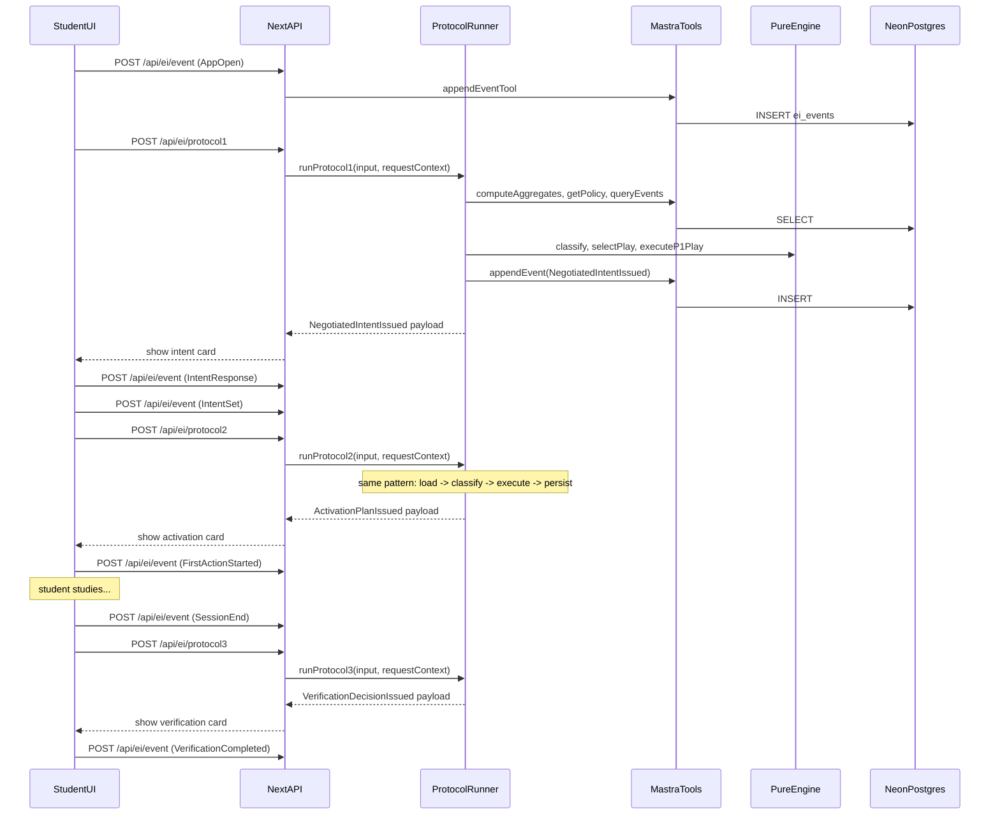

# V1 Coaching Loop MVP

## Current state

- **Pure engine layers** (score, classify, plays, play-executor, escalation, cross-protocol, strategic-adjustment) are fully implemented and tested.
- **Tools** (event-store, signal-compute, tms-store, policy-store, radar-store) are fully implemented with `getEiDb(context)` RequestContext injection.
- **Workflows** compile but have two problems:
  - **Placeholder steps**: `loadStudentContext` returns empty objects, `executeAndEmit` has commented-out tool calls.
  - **48 uses of `z.any()`** in step `inputSchema`/`outputSchema` across all 5 workflow files, which bypasses type safety.
- **API routes** exist for event write (`POST /api/ei/event`), event read (`GET /api/ei/events`), aggregates (`GET /api/ei/aggregates`), and health.
- **Schemas** in [src/ei/schemas/outputs.ts](src/ei/schemas/outputs.ts) are already fully typed with proper Zod schemas for all protocol outputs.
- **UI** is a placeholder page.

## Architecture (how protocols run)

## Phase 0 -- Fix z.any() in workflow step schemas

All 5 workflow files use `z.any()` for step `inputSchema`/`outputSchema` (48 total occurrences). Replace each with proper typed Zod schemas using the existing schemas from [src/ei/schemas/outputs.ts](src/ei/schemas/outputs.ts) and [src/ei/schemas/events.ts](src/ei/schemas/events.ts).

**Files to fix (occurrence counts):**

- [src/mastra/workflows/protocol1-ignition.ts](src/mastra/workflows/protocol1-ignition.ts) -- 12 uses
- [src/mastra/workflows/protocol2-activation.ts](src/mastra/workflows/protocol2-activation.ts) -- 8 uses
- [src/mastra/workflows/protocol3-verification.ts](src/mastra/workflows/protocol3-verification.ts) -- 10 uses
- [src/mastra/workflows/strategic-adjustment.ts](src/mastra/workflows/strategic-adjustment.ts) -- 10 uses
- [src/mastra/workflows/radar-recompute.ts](src/mastra/workflows/radar-recompute.ts) -- 8 uses

**Approach**: define inline `z.object({...})` schemas for each step's input/output using the field shapes already documented in the step's return value. Reference the output schemas from `src/ei/schemas/outputs.ts` for the final steps.

## Phase 1 -- Protocol runner (backend orchestration)

### Orchestration approach (v1 choice, not a dead-end)

For v1, protocol orchestration lives in a **reusable runner module** that Next API routes call directly. This calls tools (DB reads/writes) + pure engine functions in a single request. The existing Mastra workflow files remain as structured documentation and can wrap this same runner logic later when the Mastra workflow runner's `requestContext` propagation matures or when you need multi-phase execution (durable retries, suspend/resume, step-level tracing).

This is an **orchestration layer choice**: the runner module is the canonical protocol logic; the HTTP route is just a thin auth + parse + call + respond shell. Migrating to Mastra workflow runner later means wrapping the same runner functions inside workflow steps, not rewriting.

Each protocol API route will:

1. Call tools directly (they already work with `getEiRequestContext()`)
2. Run the pure engine functions (classify, selectPlay, executePlay)
3. Call `appendEventTool` to persist the output
4. Return the output to the UI

### 1a. Create protocol runner module: [src/ei/protocol-runner.ts](src/ei/protocol-runner.ts)

A single module with three functions that orchestrate the protocol flow. Each function accepts `(input, requestContext)` and returns the typed protocol output.

`**runProtocol1(input, requestContext)` -- Ignition**

- Calls `computeAggregatesTool.execute!({studentId}, {requestContext})`
- Calls `getPolicyTool.execute!({studentId}, {requestContext})`
- Calls `getAllTopicStatesTool.execute!({studentId}, {requestContext})`
- Calls `queryEventsTool.execute!({studentId, filters: {eventTypes: ['NegotiatedIntentIssued','IntentResponse'], limit: 10}}, {requestContext})`
- Adapts tool outputs to engine types (see 1b below)
- Runs pure engine: `computeStateScore()` -> `assignP1Label()` -> `resolveMode()` -> `computeEscalationContext()` -> `applyDoNoHarmGuardrail()` -> `selectPlay()` -> `executeP1Play()`
- Enriches output with `mode` field (from `resolveMode`) and `issuedAt` timestamp
- Calls `appendEventTool.execute!({studentId, eventType: 'NegotiatedIntentIssued', topicId, payload: output}, {requestContext})`
- Returns the `NegotiatedIntentIssued` output (matching the schema in `outputs.ts`)

`**runProtocol2(input, requestContext)` -- Activation**

- Calls `computeAggregatesTool`, `getPolicyTool`, `queryEventsTool` (for Replan/FirstActionStarted events since intent set)
- Computes session metrics from queried events (startLatencyMin, replanCount, hasStartSignal)
- Adapts tool outputs to engine types
- Runs pure engine: `assignP2Label()` -> `resolveMode()` -> `computeTightnessLevel()` -> `getP2Escalation()` -> `selectPlay()` -> `executeP2Play()`
- Enriches output with `mode` + `issuedAt`
- Calls `appendEventTool` to persist `ActivationPlanIssued`
- Returns the output

`**runProtocol3(input, requestContext)` -- Verification**

- Calls `computeAggregatesTool`, `getPolicyTool`, `getTopicStateTool`, `queryEventsTool` (for cross-protocol events in this session)
- Checks cross-protocol constraints (`findP1VerificationFloorFromEvents`, `findP2WatchOnlyFlagFromEvents`)
- Adapts tool outputs to engine types
- Runs pure engine: `assignP3Label()` -> `resolveMode()` -> `computeTightnessLevel()` -> `getP3Escalation()` -> `selectPlay()` -> `executeP3Play()`
- Enriches output with `mode` + `issuedAt`
- Calls `appendEventTool` to persist `VerificationDecisionIssued`
- Returns the output

### 1b. Type adapters between tool outputs and engine inputs

The tools return camelCase objects. The engine expects specific interfaces. Create a small adapter section in `protocol-runner.ts`:

- **Aggregates adapter**: `computeAggregatesTool` returns `{pendingChecks, openLoops, verificationRate7d, ...startLatencyMinMedian7d, intentAcceptanceRate7d, replanLoopCount7d, stateTrend7d, loopLatencyTrend}`. The engine `StudentAggregates` expects `{startLatencyMin?, ...}`. Map `startLatencyMinMedian7d` -> `startLatencyMin`, cast `stateTrend7d` to `StateTrend`, cast `loopLatencyTrend` to the union type.
- **Policy adapter**: `getPolicyTool` returns `{tightnessLevel, adjustmentMode, dials, constraints}` or null. Map to `StudentPolicy` interface (extract nested dials fields). Default to empty policy if null.
- **Play-executor output enrichment**: `executeP1Play()` returns `NegotiatedIntentIssued` (from play-executor.ts) which lacks `mode` and `issuedAt`. The runner adds `mode` from `resolveMode()` result and `issuedAt: new Date().toISOString()` before persisting and returning.

## Phase 2 -- Protocol API routes

### 2a. `POST /api/ei/protocol1` -- [src/app/api/ei/protocol1/route.ts](src/app/api/ei/protocol1/route.ts)

- Input body: `{ studentId, topic, energy, sleepBucket?, pressure?, backlogPressure? }`
- Auth: same `PILOT_SECRET` pattern as existing routes
- Emits `AppOpen` event first (so the event log includes the trigger)
- Calls `runProtocol1(input, getEiRequestContext())`
- Returns: the `NegotiatedIntentIssued` payload

### 2b. `POST /api/ei/protocol2` -- [src/app/api/ei/protocol2/route.ts](src/app/api/ei/protocol2/route.ts)

- Input body: `{ studentId, topic, taskType?, setAt }`
- Calls `runProtocol2(input, getEiRequestContext())`
- Returns: the `ActivationPlanIssued` payload

### 2c. `POST /api/ei/protocol3` -- [src/app/api/ei/protocol3/route.ts](src/app/api/ei/protocol3/route.ts)

- Input body: `{ studentId, topic, endedAt }`
- Calls `runProtocol3(input, getEiRequestContext())`
- Returns: the `VerificationDecisionIssued` payload

## Phase 3 -- Minimal student UI

A single-page session flow using React state machine (no router needed for MVP). All screens render on `src/app/page.tsx`.

### UX contract (from EI_UX_Scales.md -- must follow)

These rules come from the product strategist work (`EI_UX_Scales.md`, `EI_Engine_Taxonomy.md`) and must be respected in the UI:

- **Labels-first, numbers second**: energy is not a 1-5 number input. It is 5 segmented chips: `Exhausted (1)` / `Low (2)` / `Okay (3)` / `Good (4)` / `Sharp (5)`. Same for all other 1-5 scales.
- **"Pending checks" not "open loops"**: whenever the UI mentions learning debt, show "Pending checks: N" (things you studied but haven't tested yet). Never expose `OpenLoops` or any internal metric name to the student.
- **Conditional field display on check-in**: Energy is always asked. `Pressure` is optional ("More context" toggle). `BacklogPressure` and `Sleep` are asked conditionally (first session of the day only -- can be determined by checking `localStorage` for a `lastCheckinDate` key).
- **TaskType is student-editable**: on the Intent Card (Edit flow), the student can change the `taskType` from the P1 suggestion. Display it as three chips: `Learn` / `Practice` / `Revise`.
- **Skip reasons are structured**: on the Verification Card, the Skip path shows three buttons, not a free-text field: `Skip (Fatigue)` / `Skip (Time)` / `Skip (Confusion)`. These map to `reason ∈ {fatigue, time, confusion}`.
- **Not a task manager guardrail**: constraints shown on the Intent Card (e.g. "Clear 1 pending check first") must read as guardrails/suggestions, not assigned tasks. Phrase as: "Deal: clear 1 pending check first, then go big" -- not "Task: ..."

### Screen flow (5 screens, one page)

1. **Check-in** -- student enters `studentId` (persisted in `localStorage` for repeat visits), topic (free text: "What are you studying?"), then:
  - Always shown: `Energy` chips (Exhausted / Low / Okay / Good / Sharp).
  - Conditionally shown (once/day based on `lastCheckinDate` in `localStorage`): `Sleep` bucket chips (Sleep-debt / Low sleep / Okay sleep / Fully slept) and `BacklogPressure` chips (On track / Mostly on track / Some pending / Behind / Drowning).
  - Optional always (collapsed "More context" section): `Pressure` chips (Calm / Slightly tense / Uneasy / Very stressed / Panicky).
  - Submit -> emit `AppOpen` + call `POST /api/ei/protocol1`.
2. **Intent Card** -- display `NegotiatedIntentIssued`:
  - Mode badge (Rescue / Neutral / Boost).
  - Topic, TaskType chips (Learn / Practice / Revise -- editable), scope, difficulty tier, verification plan summary.
  - Constraint line if present (e.g. "Clear 1 pending check first, then go big" -- not framed as a task).
  - Three buttons: Accept / Edit (shows editable fields for topic + taskType + scope) / Reject.
  - On click -> emit `IntentResponse` via `POST /api/ei/event`, then emit `IntentSet` (if accepted/edited), then call `POST /api/ei/protocol2`.
3. **Activation Card** -- display `ActivationPlanIssued`:
  - Mode badge, first action description, timebox, focus contract (e.g. "Stay on topic for the first 20 min").
  - "Start" button -> emit `FirstActionStarted`.
  - "Replan" button -> emit `Replan` event (count shown; if count >= `replanCap`, disable button).
4. **Session Timer** -- simple elapsed-time display. "End Session" button -> emit `SessionEnd` via `POST /api/ei/event`, then call `POST /api/ei/protocol3`.
5. **Verification Card** -- display `VerificationDecisionIssued`:
  - If `VerifyNow`: show small form: `questionsAttempted` (number), `correct` (number), optional confidence chip (1-5). Submit -> emit `VerificationCompleted` with result payload.
  - If `ScheduleVerify`: show the deadline ("Remind me tomorrow at..."). Emit `RetrievalScheduled` with `dueAt`.
  - If `Skip`: show three structured reason buttons: `Skip (Fatigue)` / `Skip (Time)` / `Skip (Confusion)`. Choosing one -> emit `RetrievalSkipped` with `reason` field set.
  - After submission -> "Session Complete" screen with summary (Pending checks count, mode shown today) + "Start New Session" link.

### UI implementation notes

- Use inline styles or minimal CSS (no Tailwind install needed for MVP; keep it functional but clean).
- All API calls use `fetch()` with `Authorization: Bearer <secret>` header. The secret is entered once on check-in and stored in `localStorage`.
- The page is a client component (`'use client'`) with a state machine: `phase in {checkin, intent, activation, session, verification, done}`.
- Each phase stores the protocol output in React state to display the card.
- Show loading states during API calls (protocol computation may take 1-2s on cold start).
- Show error messages if API calls fail (with retry option).
- Students open the app 1-2 times per study block (before study + at session end). The UI is not notification-driven; all interaction happens when the student is in the app at a gate.

### What "adaptive" looks like to the student

- **Same student, different energy**: Energy: Exhausted (1) -> Rescue mode, small scope, easy tier. Energy: Sharp (5) -> Boost mode, harder tier, more questions.
- **Pending checks rising**: P1 switches to close-one-pending-check play (P1-R2), shows "Clear 1 pending check first, then go big" on Intent Card.
- **Avoidant exit pattern**: P3 forces VerifyNow with 1 question (Trojan Horse / R3-01) instead of allowing schedule.
- **Stalled start**: P2 switches to micro-start (P2-R1), caps replans at 2 (P2-N2).

## Phase 4 -- Topic handling (critical for protocols to work)

The engine needs a `topicId` to function. For MVP:

- The check-in screen includes a text input for "What are you studying?" (free text topic name, e.g. "Physics Ch3 Mechanics").
- This becomes the `topicId` (used as-is; no slugification needed since `ei_topic_state` PK is `(student_id, topic_id)` as TEXT).
- P1 output includes the topic; the student can change it on the Intent Card ("Edit" flow).
- If the student has existing `ei_topic_state` rows with high `OpenLoops`, the P1 runner can detect this via `getAllTopicStatesTool` and the engine's `P1-R2 close-one-open-loop` play will automatically suggest closing an open loop topic instead of starting new work.

## Phase 5 -- Strategic Adjustment (deferred for initial MVP)

SA runs on a weekly schedule or risk trigger. For initial MVP:

- Wire it the same way as P1/P2/P3 (a `runStrategicAdjustment` function + `POST /api/ei/strategic-adjustment`).
- But it can be invoked manually (admin) or on a simple cron later.
- The `computeDeltas` step currently returns zeros; it needs real delta computation from `reviewEvents`. This is non-trivial but lower priority than the 3 gates.

## File summary

- **New**: `src/ei/protocol-runner.ts` -- Orchestrates P1/P2/P3 by calling tools + pure engine, with type adapters
- **New**: `src/app/api/ei/protocol1/route.ts` -- POST endpoint for P1
- **New**: `src/app/api/ei/protocol2/route.ts` -- POST endpoint for P2
- **New**: `src/app/api/ei/protocol3/route.ts` -- POST endpoint for P3
- **Fix**: `src/mastra/workflows/protocol1-ignition.ts` -- Replace z.any() with typed schemas
- **Fix**: `src/mastra/workflows/protocol2-activation.ts` -- Replace z.any() with typed schemas
- **Fix**: `src/mastra/workflows/protocol3-verification.ts` -- Replace z.any() with typed schemas
- **Fix**: `src/mastra/workflows/strategic-adjustment.ts` -- Replace z.any() with typed schemas
- **Fix**: `src/mastra/workflows/radar-recompute.ts` -- Replace z.any() with typed schemas
- **Rewrite**: `src/app/page.tsx` -- Student session UI (5-screen flow)
- **Rewrite**: `src/app/layout.tsx` -- Add viewport meta, basic global styles
- **No change**: `src/ei/engine/`* -- Pure engine layers stay as-is
- **No change**: `src/mastra/tools/`* -- Tools stay as-is (already use RequestContext)
- **No change**: `src/app/api/ei/event/route.ts` -- Event ingestion stays as-is

## Test plan

- Local: `npm run dev`, open browser, complete a full session flow (check-in -> intent -> activation -> session -> verification -> done).
- Verify in Neon that events appear in order: `AppOpen`, `NegotiatedIntentIssued`, `IntentResponse`, `IntentSet`, `ActivationPlanIssued`, `FirstActionStarted`, `SessionEnd`, `VerificationDecisionIssued`, `VerificationCompleted`.
- Change energy from 2 to 4 and verify mode shifts from Rescue to Neutral/Boost.
- Create 3+ open loops (multiple sessions without verification) and verify P1 switches to close-loop play.
- End session without verification and verify P3 outputs Rescue/VerifyNow (Trojan Horse).
- Verify `next build` passes with zero type errors (no z.any() remaining in workflows).

