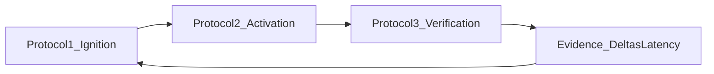

# **EI Protocol 3 — Verification (Effort → Retrieval)**

### _Deep dive specification_

**Shared definitions (signals, modes, guardrails) live in** `EI_Protocols_Deep_Dive.md`.

---

## **Protocol 3: Verification (Effort → Retrieval)**

### **Objective**

- Ensure effort produces proof; prevent passive learning; improve LoopLatency and VerificationRate.

### **Inputs (observable signals)**

- Session end event
- Whether retrieval happened / scheduled
- Topic context: TMS, ΔDecay, difficulty tier

### **Classification (Rescue vs Boost)**

- **Rescue** when the student is about to exit without retrieval or has a history of verification avoidance.
- **Boost** when effort quality is high and verification integrity is strong (push harder questions, better calibration).
- **Neutral (fallback):** if neither triggers, enforce minimum verification (1–3 Q) or `ScheduleVerify` within 24–48h; avoid default “skip”.

### **Decision Contract (UI-agnostic output)**
At every `SessionEnd`, Protocol 3 must output a single **VerificationDecision** plus a structured spec. The UI can be minimal or rich, but the engine output stays stable.

**Output:**
- `VerificationDecision ∈ { VerifyNow, ScheduleVerify, SkipWithReason }`

**VerificationSpec (parameters, not UI):**
- `minQuestions` (default depends on mode)
- `difficultyTier ∈ {easy, med, hard, advanced}` (or Tier1–Tier4)
- `format ∈ {single_topic, mixed_set, recall, error_log}` (pick one for MVP)
- `timeboxSec` (optional)

**DeadlineSpec (only when scheduled):**
- `dueInHours` (default 24–48) or `dueAt` (timestamp)
- `gracePolicy` (what happens if missed; see Failure handling)

**Rationale (short):**
- a 1–2 line reason referencing **State + Evidence + Adherence** (no shame language)

### **Precedence rules (conflict resolution)**
When signals conflict, follow this order:

1) **Integrity first:** If the session is ending with **no** retrieval **and** no schedule, treat as **AVOIDANT → Rescue** (Trojan Horse).  
2) **Adherence beats mood:** High energy / “flow” never upgrades to Boost if adherence is weak (low VerificationRate, rising OpenLoops, SilenceDays).  
3) **Neutral by default:** If neither Rescue nor Boost is clearly warranted, apply **NEUTRAL** and enforce a minimum verification or a near-term schedule.  
4) **Quality-boost override:** If `Efficiency Δ` is poor or `StateTrend` is declining, any “Boost” becomes a **quality boost** (method), not a **quantity boost** (more volume).

### **Mode routing (Rescue vs Neutral vs Boost)**
Protocol 3 chooses a mode based on **State + Evidence + Adherence**.

#### **RESCUE (Trojan Horse)**
Trigger when **AVOIDANT** is detected (examples):
- Session ends with no `VerifyNow` and no `ScheduleVerify`
- `VerificationRate7d < 0.60`
- `OpenLoops ≥ 3` or rising quickly
- `SilenceDays ≥ 2`

**Goal:** force a tiny proof-of-learning step without increasing friction.

#### **NEUTRAL (default fallback)**
Trigger when the student is not avoidant, but also not clearly boost-eligible.

**Goal:** keep loop integrity high with minimal pressure.

#### **BOOST (Double-Down)**
Trigger when verification integrity is strong and the student is stable:
- Session ends with `VerifyNow` (or `ScheduleVerify` reliably honored)
- `VerificationRate7d ≥ 0.75`
- `OpenLoops ≤ 2`
- State is not LOW ENERGY
- (If available) integrity signals are not worsening

**Goal:** increase challenge density and calibration, not just volume.

### **Defaults table (MVP; tune later)**
These are engine defaults; UI can expose them or keep them implicit.

| Mode | VerificationDecision | `minQuestions` | `difficultyTier` | `dueInHours` (if scheduled) | Notes |
| :--- | :--- | :--- | :--- | :--- | :--- |
| **RESCUE** | Prefer `VerifyNow` | 1 | easy/med | 24 | “tiny proof” to prevent passive learning |
| **NEUTRAL** | `VerifyNow` or `ScheduleVerify` | 1–3 | med | 24–48 | minimum verification OR near-term schedule |
| **BOOST** | Prefer `VerifyNow` | 5+ (or mixed set) | hard/advanced | 24 | harder tier / mixed set / error-log when appropriate |

**State-sensitive adjustment:** if LOW ENERGY, keep `minQuestions` at 1–2 and prefer scheduling over long sets, but avoid default skip.

**MVP format lock-in (v1):**
- **RESCUE / NEUTRAL:** default `format=single_topic` (lowest complexity, highest clarity).
- **BOOST:** allow `format=mixed_set` only when adherence is strong; use `format=error_log` for quality boosts and anti-gaming.

### **Intervention Catalog (v1 implementable; UI-agnostic)**
This section defines concrete, reusable “plays” that Protocol 3 can output via the Decision Contract. The UI can render them as buttons, cards, or prompts later.

Each play outputs:
- `VerificationDecision` (VerifyNow / ScheduleVerify / SkipWithReason)
- `VerificationSpec` (minQuestions, tier, format, timebox)
- Optional `DeadlineSpec` (dueInHours/dueAt + gracePolicy)
- `Rationale` (short, calm)

#### **RESCUE plays (AVOIDANT → Trojan Horse)**
Use when AVOIDANT triggers or when the student is exiting with no proof.

1) **R3-01: One-Question Unlock (default rescue)**
- **When**: SessionEnd with no retrieval/schedule OR repeated avoidance pattern.
- **Output**:
  - `VerificationDecision=VerifyNow`
  - `minQuestions=1`, `difficultyTier=easy|med`, `format=single_topic`, `timeboxSec=120–240`
- **Rationale**: “One question keeps the loop honest. Tiny proof beats vague effort.”

2) **R3-02: Schedule with hard window (fatigue-safe rescue)**
- **When**: LOW ENERGY or time constraint, but skipping would create open loops.
- **Output**:
  - `VerificationDecision=ScheduleVerify`
  - `minQuestions=1–3`, `difficultyTier=med`, `format=single_topic`
  - `dueInHours=24` (default) with `gracePolicy=\"If missed → OpenLoop + tighten next SessionEnd\"`
- **Rationale**: “If not now, lock it in. We close loops fast.”

3) **R3-03: Confusion rescue (verify + diagnose)**
- **When**: Skip reason = confusion OR repeated wrong answers in same topic.
- **Output**:
  - `VerificationDecision=VerifyNow`
  - `minQuestions=1–3`, `difficultyTier=easy|med`, `format=single_topic`
  - Add note: “If wrong → tag as ‘concept gap’ and trigger Technique Pivot later”
- **Rationale**: “Let’s locate the gap before you do more hours.”

#### **NEUTRAL plays (default integrity)**
Use when the student isn’t avoidant, but also not clearly boost-eligible.

4) **N3-01: Minimum VerifyNow (default neutral)**
- **When**: Neither AVOIDANT nor BOOST eligible.
- **Output**:
  - `VerificationDecision=VerifyNow`
  - `minQuestions=1–3`, `difficultyTier=med`, `format=single_topic`, `timeboxSec=300–600`
- **Rationale**: “Quick proof to keep the loop clean.”

5) **N3-02: Near-term ScheduleVerify (spaced-friendly neutral)**
- **When**: Student ends a session cleanly but wants spacing or is time-limited.
- **Output**:
  - `VerificationDecision=ScheduleVerify`
  - `minQuestions=1–3`, `difficultyTier=med`, `format=single_topic`
  - `dueInHours=24–48` (default 24)
- **Rationale**: “Schedule the proof while the memory is still warm.”

#### **BOOST plays (high integrity → challenge density)**
Use when adherence is strong and the student is stable.

6) **B3-01: Hard-tier set (default boost)**
- **When**: BOOST eligible and State stable.
- **Output**:
  - `VerificationDecision=VerifyNow`
  - `minQuestions=5+`, `difficultyTier=hard|advanced`, `format=single_topic|mixed_set`
  - Optional `timeboxSec=900–1500`
- **Rationale**: “Use this focus on higher-signal questions.”

7) **B3-02: Error-log requirement (quality boost)**
- **When**: BOOST eligible, or gaming risk, or repeated wrong answers.
- **Output**:
  - `VerificationDecision=VerifyNow`
  - `minQuestions=3–8`, `difficultyTier=med|hard`, `format=error_log`
  - rule: “wrong answers require a 1-line why”
- **Rationale**: “We don’t just score—we learn from the miss.”

8) **B3-03: Quality-boost override (no volume boost)**
- **When**: `Efficiency Δ` deteriorating OR `StateTrend` declining.
- **Output**:
  - Keep `minQuestions` low/moderate (1–5) but change `format` to `error_log` or `recall`
  - Increase tier only if adherence is strong (don’t punish low energy)
- **Rationale**: “Same hours won’t help—method change will.”

---

### **Tightness & escalation (v1 rules)**
Protocol 3 must adapt strictness based on repeated outcomes, without becoming a nag.

#### **Escalation ladder**
Track these counters over a rolling window (e.g., last 7 days):
- `avoidantExits7d`: SessionEnd with no VerifyNow and no ScheduleVerify
- `scheduleMisses7d`: scheduled verifies missed past due window
- `skipCount7d`: SkipWithReason count

**Escalation rules (defaults):**
- If `avoidantExits7d ≥ 2` → next SessionEnd forces **R3-01** (1Q unlock) before allowing exit.
- If `scheduleMisses7d ≥ 2` → next SessionEnd prefers **VerifyNow** (minimum) over scheduling.
- If `skipCount7d ≥ 3` → require smaller scope next intent + minimum verification next time (protect integrity, reduce load).

#### **De-escalation (return autonomy)**
- If 7-day adherence improves (VerificationRate7d ≥ 0.75 AND OpenLoops ≤ 2), reduce prompting frequency and allow more scheduling.

---

### **Telemetry definitions (so metrics are unambiguous)**
To validate Protocol 3, define events consistently.

**Core events:**
- `SessionEnd(topic, taskType, durationSec, endedAt)`
- `RetrievalVerified(topic, questionsAttempted, tier, format, verifiedAt, score(optional))`
- `RetrievalScheduled(topic, dueAt|dueInHours, questionsPlanned, tier, format, scheduledAt)`
- `RetrievalSkipped(topic, reason, skippedAt)`
- `ScheduleMissed(topic, dueAt, missedAt)` (derived when now > dueAt and no retrieval occurred)
- `OpenLoopCreated(topic, effortAt, targetDueAt)` (derived: effort happened, retrieval overdue)
- `OpenLoopClosed(topic, closedAt)` (derived when retrieval occurs after effort)

**Metric mapping (examples):**
- `VerificationRate7d` counts `RetrievalVerified` + `RetrievalScheduled` as “verified-or-committed” outcomes per SessionEnd.
- `LoopLatency(topic)` computed from `LastEffortAt → LastRetrievalAt` (or overdue time vs target).
- `OpenLoops` computed as topics with Effort but missing Retrieval past target window.

**Rule:** Scheduling only counts as adherence if it is later honored at a reasonable rate (missed schedules increase risk weight).

**Derived rules (v1 defaults):**
- **Schedule grace:** `scheduleGraceHours = 12` (a schedule is considered “honored” if verified within `dueAt + 12h`).
- **Schedule honored:** derive `ScheduleHonored(topic, dueAt, honoredAt)` when `RetrievalVerified` occurs before `dueAt + scheduleGraceHours`.
- **Schedule missed:** derive `ScheduleMissed(topic, dueAt, missedAt)` when `now > dueAt + scheduleGraceHours` and no `RetrievalVerified` occurred.
- **TargetLatency (OpenLoop policy):**
  - If `RetrievalScheduled` exists, set `targetDueAt = dueAt`.
  - Else default `targetDueAt = effortAt + 48h` (global v1 default; can later vary by TaskType or test proximity).
  - Derive `OpenLoopCreated` when `now > targetDueAt + scheduleGraceHours` and retrieval is still missing; derive `OpenLoopClosed` when retrieval occurs later.

### **Failure handling (misses, skipping, gaming)**
#### **Missed ScheduleVerify**
If `dueAt` / `dueInHours` is missed:
- mark as **OpenLoop** for that topic
- increase risk weight for future routing (more likely Rescue/Neutral)
- next `SessionEnd` should prefer `VerifyNow` minimum verification

#### **SkipWithReason (allowed but bounded)**
`SkipWithReason` is allowed only with an explicit reason (fatigue / time / confusion).
- repeated skips should escalate: smaller scope next intent + minimum verification next time
- skip contributes to adherence risk signals (leading indicator for drift)

#### **Anti-gaming (lightweight MVP rules)**
If patterns suggest random guessing (e.g., very low time-per-question + repeated wrong answers):
- require a minimal **error-log** on wrong answers over time
- shift Boost → quality boost (method), not more questions

### **Validation (what “working” means)**
Protocol 3 is reliable if it causes (without harming StateTrend):
- `VerificationRate` ↑
- `LoopLatency(topic)` ↓
- `OpenLoops(WIP)` ↓ / bounded
- AvoidanceLatency on weak subjects ↓ (indirectly, via enforced closure and scheduling)

**Leading-indicator promise:** Protocol 3 should detect and correct “studying without proof” **before** mock scores reveal decay.

---

## **Diagram: Protocol gates and evidence loop**

