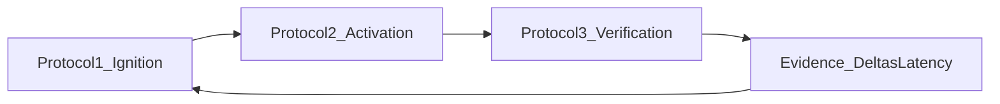

# **EI Protocols — Deep Dive**

### _Detailed Specs for Protocol 1/2/3 (Rescue vs Boost)_

---

## **How to use this document**

This document turns the high-level “Transition Protocols” concept into implementable specs.

- **Source of truth:** See `EI_Spec.md` for canonical definitions (loop, deltas, TMS/ΔDecay, latency metrics).
- **This doc:** Defines **observable signals**, **decision rules**, **intervention menus**, **guardrails**, and **validation metrics** for each protocol.

---

## **Shared Definitions (used by all protocols)**

### **Signals**

**State signals (Protocol 1 inputs):**

- Energy / sleep proxy
- Anxiety / backlog pressure

**Adherence signals (Protocols 2–3 inputs):**

- Start-latency (intent set → first effort)
- Session completion (started → ended cleanly)
- Verification avoidance (effort ends without retrieval now/scheduled)

**Evidence signals (cross-protocol):**

- Deltas: Ambition Δ, Execution Δ, Efficiency Δ, Perception Δ
- Latency/WIP: LoopLatency(topic), OpenLoops(WIP), AvoidanceLatency(subject), Silence
- Topic memory: TMS and ΔDecay
- Adherence: start-latency + VerificationRate + verification-avoidance patterns

### **Modes**

- **RESCUE:** Lower activation energy to keep loop moving.
- **BOOST:** Increase challenge density when evidence shows stability.

### **General guardrails**

- **No learned helplessness:** repeated Rescue must evolve (scope ↓ then technique change, not endless reduction).
- **No burnout by “Boosting volume”:** if Efficiency Δ is poor or StateTrend is declining, Boost must be “quality boost”, not “quantity boost”.
- **No passive learning loophole:** Protocol 2 “easy start” is only acceptable if Protocol 3 verification remains healthy.

---

## **Protocol 1: Ignition (State → Intent)**

### **Objective**

- Prevent unrealistic intent under low State; reduce Ambition Δ extremes; preserve momentum.

### **Inputs (observable signals)**

- State tags: energy, anxiety, sleep, backlog pressure
- Recent evidence: OpenLoops, VerificationRate trend, recent misses

### **Classification (Rescue vs Boost)**

- **Rescue** when State is low OR risk signals are elevated (e.g., OpenLoops rising).
- **Boost** when State is stable AND evidence supports increasing difficulty without harming integrity.

### **Interventions (menu)**

- Rescue: “one easy win”, scope shrink, technique simplification
- Boost: stretch difficulty tier, increase challenge density (not just time)

### **Success metrics**

- Ambition Δ reduces
- Start-latency decreases
- Intent completion improves without reducing verification

### **Failure modes + guardrails**

- Over-reduction → learned helplessness (cap rescue streaks; require a climb-back plan)
- Over-stretch → burnout risk (use StateTrend + Efficiency Δ as brakes)

### **Examples**

- Example A (Low energy): negotiate to small, concrete win
- Example B (High energy + stable retrieval): stretch difficulty

---

## **Protocol 2: Activation (Intent → Effort)**

### **Objective**

- Convert intent into actual effort; reduce procrastination and friction.

### **Inputs (observable signals)**

- Start-latency
- Repeated switching / re-planning
- Prior compliance with verification (to avoid “avoidance disguised as flow”)

### **Classification (Rescue vs Boost)**

- **Rescue** when start-latency is high or repeated stalls occur.
- **Boost** when the student starts quickly and sustains focus (protect flow).

### **Interventions (menu)**

- Rescue: friction-lowering first action (e.g., “watch only”, “1 problem only”, “open notes and highlight”)
- Boost: isolation/timebox, distraction blocking, continuation prompts

### **Success metrics**

- Start-latency decreases
- Session completion increases
- Verification remains stable or improves (no passive loophole)

### **Failure modes + guardrails**

- “Easy start” becomes avoidance → require Protocol 3 verification minimum or schedule

### **Examples**

- Example A (Stalled): minimal start action
- Example B (Flowing): protect focus

---

## **Protocol 3: Verification (Effort → Retrieval)**

### **Objective**

- Ensure effort produces proof; prevent passive learning; improve LoopLatency and VerificationRate.

### **Inputs (observable signals)**

- Session end event
- Whether retrieval happened / scheduled
- Topic context: TMS, ΔDecay, difficulty tier

### **Classification (Rescue vs Boost)**

- **Rescue** when the student is about to exit without retrieval or has a history of verification avoidance.
- **Boost** when effort quality is high and verification integrity is strong (push harder questions, better calibration).

### **Interventions (menu)**

- Rescue: “1 question now” (trojan horse), micro-quiz unlock, schedule verify
- Boost: harder tier questions, error-log requirement, timeboxed mixed set

### **Success metrics**

- VerificationRate increases
- LoopLatency(topic) decreases
- OpenLoops(WIP) decreases

### **Failure modes + guardrails**

- Over-testing fatigue → adaptive minimums based on State
- Gaming (random guessing) → require error-log or explanation on wrong answers over time

### **Examples**

- Example A (Avoidant exit): 1-question trojan horse
- Example B (High focus): double-down with harder tier

---

## **Diagram: Protocol gates and evidence loop**

