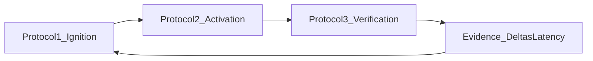

# **EI Protocols — Deep Dive**

### _Index + shared definitions (Rescue vs Boost)_

---

## **How to use this document**

This document is the shared “glossary + guardrails” for the protocol system, and an index to the full deep-dive specs.

- **Source of truth:** See `EI_Spec.md` for canonical definitions (loop, deltas, TMS/ΔDecay, latency metrics).
- **Protocol deep dives:** See the protocol-specific docs linked below.

---

## **Index**

- **Protocol 1 — Ignition (State → Intent):** `EI_Protocol_1_Ignition.md`
- **Protocol 2 — Activation (Intent → Effort):** `EI_Protocol_2_Activation.md`
- **Protocol 3 — Verification (Effort → Retrieval):** `EI_Protocol_3_Verification.md`

---

## **Shared Definitions (used by all protocols)**

### **Signals**

**State signals (Protocol 1 inputs):**

- Energy / sleep proxy
- Anxiety / backlog pressure

**Adherence signals (Protocols 2–3 inputs):**

- Start-latency (intent set → first effort)
- Session completion (started → ended cleanly)
- Verification avoidance (effort ends without retrieval now/scheduled)

**Evidence signals (cross-protocol):**

- Deltas: Ambition Δ, Execution Δ, Efficiency Δ, Perception Δ
- Latency/WIP: LoopLatency(topic), OpenLoops(WIP), AvoidanceLatency(subject), Silence
- Topic memory: TMS and ΔDecay
- Adherence: start-latency + VerificationRate + verification-avoidance patterns

### **Modes**

- **RESCUE:** Lower activation energy to keep loop moving.
- **BOOST:** Increase challenge density when evidence shows stability.

### **General guardrails**

- **No learned helplessness:** repeated Rescue must evolve (scope ↓ then technique change, not endless reduction).
- **No burnout by “Boosting volume”:** if Efficiency Δ is poor or StateTrend is declining, Boost must be “quality boost”, not “quantity boost”.
- **No passive learning loophole:** Protocol 2 “easy start” is only acceptable if Protocol 3 verification remains healthy.

---

## **Diagram: Protocol gates and evidence loop**

