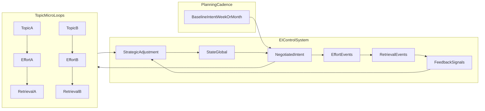

# **Execution Intelligence (EI) — Spec**

### _The Deep Technical / Product Thesis_

---

## **Source of Truth**

This document is the **authoritative specification** for Execution Intelligence (EI).

- The master narrative lives in `Unified_Master_Doc.md`.
- `Unified_Master_Doc.md` should contain only a **short EI overview** and link here for full depth.
- Protocol shared definitions + index live in `EI_Protocols_Deep_Dive.md` (full deep dives are in `EI_Protocol_1_Ignition.md`, `EI_Protocol_2_Activation.md`, `EI_Protocol_3_Verification.md`).

---

## **4. The Scientific Thesis: Execution Intelligence (EI)**

We do not track "Time Spent" (a vanity metric). We track the integrity of the student's **Execution Loop**. EI is a closed-loop coaching system: it diagnoses _where_ the loop breaks and applies the correct intervention **at the transition** (now) and **at the end** (next adjustment cycle).

### **4.1 The Loop Equation (Closed Loop, Not Linear)**

We treat study as a loop where the output updates the next input:

$$State \xrightarrow{\text{Protocol 1}} Intent \xrightarrow{\text{Protocol 2}} Effort \xrightarrow{\text{Protocol 3}} Retrieval \to Feedback \to \mathbf{[Strategic\ Adjustment]} \to State$$

- **State:** Sleep, energy, anxiety, backlog pressure (engine condition).
- **Intent:** Today's targets chosen under that state.
- **Effort:** What actually happened (depth, duration, focus).
- **Retrieval:** Proof of learning (MCQs/PYQs/recall test/error-log).
- **Feedback:** Student's qualitative signal (confidence, shame, denial, friction tags).
- **Strategic Adjustment:** Next-cycle plan rewrite (macro intervention).

### **4.2 The "Transition Protocols" (Catalyst Layer / Decision Gates)**

The arrows ($\to$) are not passive connectors; they are active **Decision Gates**. At each gate, the AI measures the student's **Velocity** (energy + mood + momentum) and triggers one of two modes:

- **Tactical Rescue (The Paramedic):** Triggered by friction. Lower the bar to keep the loop moving.
- **Momentum Boost (The Coach):** Triggered by flow. Raise the bar to maximize growth.

**Why this matters:** A "Rescue-only" system fails the **Smart Kid Problem** (high performers feel patronized). Dual-mode EI stays sticky across the entire spectrum.

#### **Protocol System Overview (Why 3 Gates Work)**

The protocol system focuses on the three highest-leverage breakpoints in real study behavior. These gates are **always-on** because they prevent loop breakage early, with minimal extra effort from the student.

- **Protocol 1 — Ignition (State → Intent):** Prevents unrealistic targets under a bad State. Output is a _NegotiatedIntent_ (scope/difficulty) that matches today’s energy/anxiety.
- **Protocol 2 — Activation (Intent → Effort):** Prevents “planned but never started.” Output is a startable first action that reduces friction (Rescue) or protects focus (Boost).
- **Protocol 3 — Verification (Effort → Retrieval):** Prevents passive learning. Output is proof of learning now or a scheduled verification (reduces LoopLatency and OpenLoops).

**Mode switch principle:** Rescue vs Boost is chosen from **State + Evidence**, not from “student type.”

- **Evidence** includes (a) outcome integrity (Δ metrics), (b) **adherence signals** (start-latency, VerificationRate, LoopLatency/OpenLoops, avoidance/silence), and (c) topic memory (TMS/ΔDecay).
- In short: gating behaves like **State × Evidence × Adherence** — meaning we never “Boost” on mood alone, and we never “Rescue” forever for someone who is reliably closing loops.
- Practically: adherence signals are the earliest leading indicators (they show loop breakage before scores move).
- Adherence = behavior/compliance signals
- Evidence = outcomes + adherence + topic memory

**Reliability (what ‘working’ means):**

- Protocol 1 improves realism (reduces Ambition Δ extremes).
- Protocol 2 reduces start failure (lower start-latency, higher session completion).
- Protocol 3 improves learning integrity (higher VerificationRate, lower LoopLatency/OpenLoops).

**Safety guardrails (do-no-harm):**

- **Rescue cannot become learned helplessness:** repeated Rescue must evolve (scope ↓, then technique change / replan), not endless reduction.
- **Boost cannot become burnout:** Boost requires stable evidence; if Efficiency Δ is poor or StateTrend is declining, Boost becomes a _quality boost_ (method) not a _quantity boost_ (volume).

**Roadmap (optional, not required for the 3-gate core):**

- **Protocol 4 — Calibration (Retrieval → Feedback):** Micro-check to correct Perception Δ (imposter syndrome vs denial).
- **Protocol 5 — Replan (Feedback → Strategic Adjustment):** Scheduled synthesis engine (weekly default; risk-triggered daily wrap) rather than a blocking gate.

For shared definitions and a link index to the protocol deep dives, see `EI_Protocols_Deep_Dive.md`.

### **4.3 Protocol Matrix: Rescue vs. Boost**

| Transition Protocol                               | The Trigger             | If User is...                                | Mode       | Intervention Pattern                                                                |
| :------------------------------------------------ | :---------------------- | :------------------------------------------- | :--------- | :---------------------------------------------------------------------------------- |
| **Protocol 1: Ignition (State → Intent)**         | User opens app.         | **LOW ENERGY** _(Anxious, Tired)_            | **RESCUE** | **The Reduction:** _"Ignore the backlog. Just do ONE easy win today."_              |
|                                                   |                         | **HIGH ENERGY** _(Confident, Well-Slept)_    | **BOOST**  | **The Stretch:** _"You're fully charged. Let's raise the bar (difficulty/volume)."_ |
| **Protocol 2: Activation (Intent → Effort)**      | User sets a goal.       | **STALLED** _(Procrastinating)_              | **RESCUE** | **The Lubrication:** _"Too hard to start? Just watch the video. No notes."_         |
|                                                   |                         | **FLOWING** _(Starts immediately)_           | **BOOST**  | **The Isolation:** _"You're in the zone. Block distractions for 60m."_              |
| **Protocol 3: Verification (Effort → Retrieval)** | User finishes studying. | **AVOIDANT** _(Closing app without testing)_ | **RESCUE** | **The Trojan Horse:** _"Unlock your break by answering 1 question."_                |
|                                                   |                         | **CONFIDENT** _(High focus duration)_        | **BOOST**  | **The Double-Down:** _"Don't waste focus on easy Qs. Unlocking advanced tier."_     |

#### Operational Definitions (MVP defaults; tune later)

These labels are **observable bundles**, not personality traits. They are used only to route **Rescue vs Boost** at the protocol gates.

**Shared primitives (examples):**
- `Energy` (1–5), `Anxiety` (1–5), `SleepHours` (optional), `BacklogPressure` (1–5)
- `StartLatencyMin` = minutes from IntentSet → EffortStart
- `VerificationRate7d` = **verified-or-scheduled** sessions / ended sessions (rolling 7d). *(Think: “verification commitment rate,” not “verified correctness.”)*
- *(Optional later)* `ScheduleHonoredRate7d` = schedules honored / schedules made (rolling 7d), where “honored” means verified within `dueAt + scheduleGraceHours`. *(This measures “paper compliance.”)*
- `OpenLoops` = topics where Effort happened but Retrieval is overdue
- `SilenceDays` = days since a meaningful event (IntentSet / SessionEnd / Retrieval)
- (If available) `Efficiency Δ` trend, `StateTrend` (sleep/energy/anxiety drift)

##### 1) LOW ENERGY (Protocol 1 label)
Trigger if **any**:
- `Energy ≤ 2` OR `SleepHours < 6`
- `Anxiety ≥ 4` OR `BacklogPressure ≥ 4`
- `StateTrend` declining (2–3 days of sleep↓ or anxiety↑)

##### 2) HIGH ENERGY (Protocol 1 label)
Trigger if **all**:
- `Energy ≥ 4` AND `SleepHours ≥ 7` (if known)
- `Anxiety ≤ 2` AND `BacklogPressure ≤ 3`
- No active risk spike (e.g., not `SilenceDays ≥ 2`, not `OpenLoops ≥ 3`)

##### 3) STALLED (Protocol 2 label)
Trigger if **any**:
- `StartLatencyMin ≥ 15` (or repeated ≥10 min stalls)
- ≥2 re-plans/switches after setting intent without starting effort
- “App open + intent set” but no EffortStart within a reasonable window (e.g., 20 min)

##### 4) FLOWING (Protocol 2 label)
Trigger if **all**:
- `StartLatencyMin ≤ 3`
- No repeated re-planning/switching during start window
- Not currently in verification-avoidance pattern (see AVOIDANT)

##### 5) AVOIDANT (Protocol 3 label)
Trigger if **any**:
- Session ends with **no** `VerifyNow` and **no** `ScheduleVerify`
- `VerificationRate7d < 0.60`
- `OpenLoops ≥ 3` or rising quickly
- `SilenceDays ≥ 2` (avoidance-by-disappearance)

##### 6) CONFIDENT (Protocol 3 label)
Trigger if **all**:
- Session ends with `VerifyNow` (or `ScheduleVerify` within a defined window)
- `VerificationRate7d ≥ 0.75`
- `OpenLoops ≤ 2`
- (If available) `Efficiency Δ` not deteriorating

##### Precedence + reliability rules
- **AVOIDANT overrides CONFIDENT** (high focus duration is not “confidence” if verification is skipped).
- **BOOST is never chosen from mood alone**. Boost eligibility requires **State + Evidence + Adherence**:
  - State is stable (not LOW ENERGY),
  - Evidence shows integrity (Δ + latency not worsening),
  - Adherence is healthy (verification rate / open loops / start latency).
- If `Efficiency Δ` is poor or `StateTrend` is declining, any “Boost” becomes a **quality boost** (technique / question type), not a **quantity boost** (more volume).

##### NEUTRAL (fallback when no label matches)
Real students often fall between extremes. If the user does not meet the thresholds for Rescue or Boost at a gate, route to **NEUTRAL**:

- **Goal:** keep the loop moving with **minimal pressure**, while still protecting integrity.
- **Protocol 1 (State → Intent):** keep BaselineIntent direction, but negotiate only the margin (slight scope adjustment; set a small verification minimum).
- **Protocol 2 (Intent → Effort):** provide a simple `FirstAction` (30–120 seconds) without adding strict isolation or extra volume.
- **Protocol 3 (Effort → Retrieval):** default to **minimum verification** (e.g., 1–3 questions) or **ScheduleVerify within 24–48h**, instead of “skip” (skip only via `SkipWithReason`).

### **4.4 The Adjustment Architecture (The Brain: Now vs. Next Cycle)**

EI separates **fixing the current moment** from **rewriting the next loop**.

- **Tactical Rescue / Boost (in the arrows):** micro-interventions at the decision gates (Protocols 1–3).  
  - Trigger: the student is *already at a transition* (AppOpen, IntentSet, SessionEnd).
  - Output: a single gate decision (NegotiatedIntent / ActivationPlan / VerificationDecision) that keeps integrity high *right now*.

- **Strategic Adjustment (at the end):** a synthesis engine that changes the *next* loop using rolling evidence.  
  - Trigger: scheduled review (weekly default) **or** risk spike (leading indicators).
  - Output: next-cycle plan correction (scope caps, constraints, tightness policy, technique pivots), not a daily task list.

**Routing logic (operational):**

- _“Stuck right now”_ → call a **Transition Protocol** (P1–P3). Examples:
  - `StartLatencyMin ≥ 15` (stall)
  - `SessionEnd` with no `VerifyNow` and no `ScheduleVerify` (avoidant exit)
  - sudden `OpenLoops` increase or `SilenceDays ≥ 2`

- _“Bad week / drift pattern”_ → call **Strategic Adjustment**. Examples:
  - `StateTrend` declining (sleep↓ / anxiety↑ for 2–3+ days)
  - `VerificationRate7d` falling OR `LoopLatency` rising OR `OpenLoops` staying high
  - repeated `ScheduleMissed` (scheduling not honored) indicating “paper compliance”

**Design constraint:** Strategic Adjustment must feel like an elder brother: short, evidence-based, and minimal—negotiate at the margin, don’t become a task manager.

#### **StrategicAdjustmentDecision (v1 — UI-agnostic output contract)**

Strategic Adjustment is not a gate. It is a **next-cycle synthesis output** emitted on a **scheduled review (weekly default)** or a **risk-trigger** (leading indicators).

**Output:**
- `AdjustmentMode ∈ { Recovery, TechniquePivot, IntegrityClamp, DifficultyRaise, CloseLoopsFirst }`

- `NextCycleConstraints` (0–2 items; keep minimal in v1):
  - examples: `maxOpenLoops=2`, `noNewTopicUntil=1LoopClosed`, `closeOldestOpenLoopFirst=true`

- `ScopePolicy` (coarse dials, not a calendar):
  - `scopeMultiplier ∈ [0.5..1.2]` (default `1.0`)
  - optional: `scopeCapMinPerSession` (e.g., 30–60), `scopeCapQuestions` (if practice-mode)

- `DifficultyPolicy`:
  - `difficultyTierDelta ∈ { -1, 0, +1 }` (default `0`)
  - **Rule:** if `Efficiency Δ` is poor, prefer “quality raise” (question type / error-log) over tier increase.

- `VerificationPolicy` (defaults for the next loop):
  - `minQuestionsDefault ∈ { 1, 3, 5 }` (mode-dependent)
  - `scheduleAllowed: boolean`
  - `dueInHoursDefault ∈ { 24, 48 }` (if scheduling is allowed)
  - `scheduleGraceHours` (e.g., 12) and “schedule only counts if honored”

- `Rationale` (1–2 lines, non-shaming):
  - must reference **StateTrend + Evidence (Δ + latency) + Adherence**  
  - example: “OpenLoops stayed high and schedules were missed twice → closing loops first this week.”

**Non-goals (v1):**
- No day-by-day task plan, no full week/month rewrite.
- Strategic Adjustment only sets **guardrails + dials** that the transition protocols apply at the gates.

### **4.5 "Cascading Context" (Previous-Step Weightage)**

The AI does not judge steps in isolation. The same effort can mean "heroic" or "failed" depending on prior context.

The transition function evolves as the loop progresses:

- Transition 1: $f(\text{State})$
- Transition 2: $f(\text{Intent}, \text{State})$
- Transition 3: $f(\text{Effort}, \text{Intent}, \text{State})$
- Transition 4: $f(\text{Retrieval}, \text{Effort}, \text{Intent}, \text{State})$
- Transition 5: $f(\text{Feedback}, \text{Retrieval}, \text{Effort}, \text{Intent}, \text{State})$

Strategic Adjustment uses this same idea at a longer horizon: it reads **accumulated deltas + latency/adherence** over a **review boundary** (weekly by default, or risk-triggered), not a single session.

In the multi-topic reality, “context” can be topic-local (via `TopicStep`, `LoopLatency(topic)`, `OpenLoops`, and `TMS(topic)`), not just global.

### **4.6 The Delta Strategy (Integrity Metrics)**

The core signal is not the absolute score; it is the **Delta ($\Delta$)** between steps.

| Delta            | Formula                             | Measures       | Diagnostic Meaning               | Default Action                                      |
| :--------------- | :---------------------------------- | :------------- | :------------------------------- | :-------------------------------------------------- |
| **Ambition Δ**   | $\Delta_A = Intent - State$         | Realism        | Overcompensation vs. sandbagging | Reduce goal (if too high) / Boost goal (if too low) |
| **Execution Δ**  | $\Delta_E = Effort - Intent$        | Integrity      | Execution gap                    | Rescue: re-scope, adjust retrieval difficulty       |
| **Efficiency Δ** | $\Delta_{Eff} = Retrieval - Effort$ | Method quality | Junk volume vs. mastery          | Technique pivot / Promote topic                     |
| **Perception Δ** | $\Delta_P = Feedback - Retrieval$   | Self-awareness | Imposter syndrome vs. denial     | Confidence correction / Reality check               |

**v1 note (Protocol 4 deferred):** Perception Δ is still logged and used, but it primarily influences **StrategicAdjustmentDecision rationale** and gentle messaging rather than becoming a hard gate.

### **4.7 The Cognitive Diagnostics Engine (Second Half of the Loop)**

#### **Effort → Retrieval (Efficiency Δ)**

- **Junk Volume Risk:** High effort, low retrieval.
  - **Diagnosis:** Not laziness. Bad technique.
  - **Adjustment:** Force active recall / PYQ-first; block passive reading.
- **Lucky Guesser / Already Mastered Risk:** Low effort, high retrieval.
  - **Diagnosis:** Either mastered or guessing.
  - **Adjustment:** Promote topic; raise difficulty tier; skip basics.
  - **Guardrail:** Promotion should be confirmed by consistent retrieval (or error-log/recall patterns), not a single high result.

#### **Retrieval → Feedback (Perception Δ)**

- **Imposter Syndrome:** High retrieval + negative self-report.
  - **Adjustment:** Show objective streak; confidence boost; reduce anxiety load.
- **Dunning-Kruger / Numbness:** Low retrieval + dismissive self-report.
  - **Adjustment:** Reality check; pause; structured reflection/reset.

These diagnoses feed the **Strategic Adjustment Matrix** (4.8) by selecting an `AdjustmentMode` (e.g., `TechniquePivot`, `DifficultyRaise`, `Recovery`, `CloseLoopsFirst`) and setting next-cycle dials.

### **4.8 Strategic Adjustment Matrix (Next Plan Rewrite)**

Strategic Adjustment chooses a **next-cycle policy** (guardrails + dials), not a calendar.  
It emits a `StrategicAdjustmentDecision` (see 4.4) using **Δ patterns plus latency/adherence** (OpenLoops, LoopLatency, ScheduleMissed).

| Scenario        | Ambition Δ           | Efficiency Δ               | Perception Δ          | AdjustmentMode | Dials (v1 defaults; tune later) |
| :-------------- | :------------------- | :------------------------- | :-------------------- | :------------- | :------------------------------ |
| **The Burnout** | High (over-planning) | Low (grinding w/o results) | Negative (self-hate)  | **Recovery** | `scopeMultiplier=0.6–0.8`, `difficultyTierDelta=0 or -1`, `minQuestionsDefault=1`, `scheduleAllowed=true`, `dueInHoursDefault=24`, `maxOpenLoops=2` |
| **The Coaster** | Low (under-planning) | High (easy wins)           | Positive / complacent | **DifficultyRaise** | `scopeMultiplier=1.0`, `difficultyTierDelta=+1`, `minQuestionsDefault=3–5`, `scheduleAllowed=true`, `dueInHoursDefault=24`, guardrail: if `OpenLoops≥3` → switch to `CloseLoopsFirst` |
| **The Grinder** | Balanced             | Low (struggling)           | Balanced acceptance   | **TechniquePivot** | `scopeMultiplier=1.0`, `difficultyTierDelta=0`, `minQuestionsDefault=3`, `scheduleAllowed=true`, `dueInHoursDefault=24`, force **quality verification** (`format=error_log/recall`), avoid volume increases |
| **Integrity Debt** | Any | Any | Any | **CloseLoopsFirst** (or **IntegrityClamp**) | `scopeMultiplier=0.8–1.0`, `difficultyTierDelta=0`, `minQuestionsDefault=1–3`, `scheduleAllowed=false` if `scheduleMisses7d ≥ 2` else `true`, `dueInHoursDefault=24`, constraints: `noNewTopicUntil=1LoopClosed`, `closeOldestOpenLoopFirst=true`, `maxOpenLoops=2` |

**Definition (v1):** “Loop-end” is not “end of every day.” It means a **review boundary**: the weekly review by default, or a **risk-triggered wrap** when leading indicators spike (e.g., OpenLoops/LoopLatency rising, VerificationRate falling, repeated ScheduleMissed, or SilenceDays ≥ 2).

**Override rule:** If `OpenLoops` is high/rising or `LoopLatency` worsening, prioritize `CloseLoopsFirst` or `IntegrityClamp` even if State/energy is high.

### **4.9 The Mastery Index (Revision Is a Spiral, Not a Reset)**

#### **V1 documentation depth bar (for 4.9–4.13)**

For the following sections, we document only what’s required to make the system implementable **without becoming a task manager**.

Each section must include:
- **Definition**: what it is (1–2 lines)
- **Inputs / signals**: what data it reads (3–6 bullets)
- **V1 defaults**: 1–3 concrete numbers/rules (e.g., 48h window, OpenLoops cap, SilenceDays threshold)
- **Downstream effect**: one line stating how it influences:
  - Protocol 1 (Intent negotiation)
  - Protocol 2 (Activation constraints)
  - Protocol 3 (Verification defaults / scheduling)
  - StrategicAdjustmentDecision (mode + dials)

**Non-goals (v1):**
- No intervention playbooks here (those live in Protocol docs).
- No ML formulas required; use coarse heuristics and tune with data later.
- No calendar ownership: we set guardrails/dials, not daily schedules.

If the AI treats every session as a fresh start, it will fail. It must know: _"Is this first learning or 10th revision?"_

Introduce a persistent variable per topic:

- **Topic Mastery Score (TMS):** Rolling estimate of mastery that persists across days.

$$Transition = f(Current\_Step + \mathbf{TMS_{Topic}})$$

#### **TMS (Topic Mastery Score) — v1 definition + usage**

**Definition:** `TMS(topic)` is a persistent mastery estimate for a topic on a **0–100** scale. It exists to prevent the “fresh start illusion” and to calibrate intent/verification difficulty against what the student likely knows.

**Inputs / signals (v1):**
- `RetrievalVerified(topic, score(optional), tier, format, verifiedAt)`
- Recency: time since last verified retrieval
- (Optional later) error-log density / repeated misses
- **Guardrail inputs:** `LoopLatency(topic)`, `OpenLoops`, `scheduleMisses7d` (these affect *risk*, not mastery)

**Update rules (v1 heuristics; tune later):**
1) **Verified retrieval increases mastery:** when `RetrievalVerified` occurs, increase `TMS(topic)` (more if tier is higher; less if it was easy).
2) **Recency decay is gentle:** if a topic has no verified retrieval for a long window, allow mild decay or simply treat it as “stale” via `ΔDecay` (don’t tank TMS aggressively in v1).
3) **Integrity debt is not mastery loss:** missed schedules / open loops **do not directly decrease TMS**. They increase **risk weight** and trigger `CloseLoopsFirst` / tighter verification, because the issue is loop integrity, not knowledge.

**ΔDecay (spaced repetition integrity):**
- \(\Delta_{Decay} = TMS_{Last} - Retrieval_{Today}\)
- Interpretation:
  - small `ΔDecay` → retention is stable
  - large `ΔDecay` → leaky bucket / poor consolidation

**How EI uses TMS (v1):**
- **Comfort Zone detection:** high `TMS` + passive intent (notes-only) → prefer difficulty raise / retrieval-first work.
- **Rush Job detection:** low `TMS` + “quick skim” intent → negotiate scope upward and require near-term verification.
- **If ΔDecay is large:** bias Protocol 3 toward near-term verification (`dueInHours=24`) and Strategic Adjustment toward `TechniquePivot` (method change) over volume increases.

**Guardrail (anti-overpromotion):**
- Do not “promote” a topic from a single high retrieval. Require consistent retrieval evidence (or error-log/recall patterns) before declaring mastery.

### **4.10 Multiscale Cadence (Control Loop, Not Calendar)**

The “study day loop” phrasing in **4.1** is a convenience for explaining the control system. In reality, EI must work across **multiple time scales** without forcing every student to “close the loop” daily.

**EI runs as a control loop with multiple cadences:**

- **Session micro-loop (always-on):** Effort → Retrieval → Feedback
  - Goal: prevent passive learning and verification avoidance at the moment it happens.
- **Periodic review loop (default weekly; daily optional/adaptive):** State trend → Intent portfolio → Evidence → Strategic adjustment
  - Goal: re-balance workload, technique, and confidence using rolling evidence (deltas + latency).
- **Macro loop (monthly):** syllabus progress + backlog economics + major strategy shifts
  - Goal: keep the “north star” aligned without becoming a task manager.

**Cadence → components (v1):**
- **Event-driven (always-on):** Protocol 1/2/3 run only at gate moments (`AppOpen`, `IntentSet`, `SessionEnd`).
- **Weekly (default):** emit a `StrategicAdjustmentDecision` (mode + dials) using rolling Δ + latency/adherence.
- **Risk-triggered wrap (as needed):** when leading indicators spike (e.g., `OpenLoops ≥ 3`, `SilenceDays ≥ 2`, `scheduleMisses7d ≥ 2`), issue a short adjustment that tightens constraints until integrity stabilizes.

**Key rule:** EI is **event-driven** at the transition gates (Protocols 1–3) and **risk-driven** for periodic reviews (more in 4.13).

### **4.11 Multi-Topic Execution Model (Parallel Micro-Loops)**

Students naturally run multiple topics in parallel (different topics in different steps on the same day). EI must support this by tracking **topic-local state**.

**Per topic, track a lightweight step-state:**

- `TopicStep ∈ {Intent, Effort, Retrieval, Feedback}`
- `LastEffortAt`, `LastRetrievalAt`, `LastFeedbackAt`
- `TMS_Topic` and `ΔDecay`

**Open loops (WIP):** count topics where Effort has happened but Retrieval is overdue relative to an adaptive window.

- `OpenLoops = { topic | LastEffortAt exists AND LastRetrievalAt < LastEffortAt AND now - LastEffortAt > TargetLatency(topic) }`

#### **OpenLoops + TargetLatency(topic) (v1 policy)**

**Definition:** An **OpenLoop** is “learning debt”: effort happened, but retrieval proof is overdue beyond an expected window (`TargetLatency`).

**Inputs / signals:**
- `LastEffortAt(topic)`
- `LastRetrievalAt(topic)` (if any)
- `RetrievalScheduled(topic, dueAt)` (if any)
- `TaskType ∈ {learn, practice, revise}` (optional in v1; can ignore initially)
- `scheduleGraceHours` (global default)
- Derived: `ScheduleMissed(topic)`, `LoopLatency(topic)`, `OpenLoops` count

**V1 defaults (tune later):**
- `scheduleGraceHours = 12`
- If a schedule exists: `targetDueAt = dueAt`
- Else (no schedule): `targetDueAt = LastEffortAt + 48h` (single global default in v1)

**Lifecycle (derived definitions):**
- **OpenLoopCreated(topic)** when:
  - `LastEffortAt` exists AND (`LastRetrievalAt` is missing OR `LastRetrievalAt < LastEffortAt`) AND
  - `now > targetDueAt + scheduleGraceHours`
- **OpenLoopClosed(topic)** when:
  - a `RetrievalVerified` occurs with `verifiedAt > LastEffortAt`

**LoopLatency(topic):**
- If closed: `LastRetrievalAt - LastEffortAt`
- If still open: `now - LastEffortAt` (overdue latency)

**WIP policy (soft constraint, not a task manager):**
- Keep `OpenLoops` bounded to prevent “spread-out passive study” across many topics.
- **V1 rule of thumb:** if `OpenLoops ≥ 3` (or rising), treat this as an integrity-risk spike.

**Downstream effect (how this feeds the system):**
- **Protocol 1 (Ignition):** if `OpenLoops ≥ 3`, bias intent toward **CloseLoopsFirst** (e.g., “close one open loop before starting a new topic”).
- **Protocol 2 (Activation):** prefer starts that continue/close an existing thread (reduce switching cost and debt).
- **Protocol 3 (Verification):** overdue topics increase the likelihood of `VerifyNow` minimums and tighter scheduling windows (scheduling only counts if later honored).
- **StrategicAdjustmentDecision (4.8):** high/rising `OpenLoops` or worsening `LoopLatency` increases probability of `AdjustmentMode=CloseLoopsFirst` and constraints like `maxOpenLoops=2`, `noNewTopicUntil=1LoopClosed`.

### **4.12 Planning Ownership: BaselineIntent vs. NegotiatedIntent**

EI must respect that many students pre-plan weekly/monthly and do not want an app to “own their calendar.”

- **BaselineIntent:** the student’s (or coaching’s) pre-planned allocation (week/month targets).
- **NegotiatedIntent:** the EI-adjusted scope/difficulty for the next session/day, based on **State + evidence** (deltas, latency, TMS/ΔDecay).

**Rule:** EI does not rewrite the entire plan. It negotiates **at the margin** to protect loop integrity:

- Reduce scope when State is low (Rescue).
- Increase difficulty when flow/evidence supports it (Boost).
- Re-route from passive effort to retrieval-first when Efficiency Δ is poor.

#### **Planning ownership boundaries (v1)**

**Allowed (EI may negotiate at the margin):**
- **Scope adjustment:** typically ±10–20% on timebox/question-count (bigger reductions allowed in Rescue).
- **Difficulty adjustment:** `difficultyTierDelta ∈ { -1, 0, +1 }` when evidence supports it.
- **Verification tightening:** require `minQuestionsDefault` or a nearer-term `dueInHoursDefault` (especially when adherence is drifting).
- **Close-loops-first constraints (risk-driven):** temporarily enforce “close 1 open loop before starting a new topic.”

**Not allowed (v1):**
- Rewriting the weekly/monthly BaselineIntent into a day-by-day calendar.
- Becoming a task manager (no full portfolio reshuffle, no time-slot ownership).
- Adding high-friction prompts outside decision points (check-ins must remain event/risk-driven per 4.13).

**Override condition (when EI may enforce constraints):**
If leading risk indicators spike, EI may temporarily apply stronger constraints via `StrategicAdjustmentDecision` dials:
- `OpenLoops ≥ 3` or rising
- `SilenceDays ≥ 2`
- `scheduleMisses7d ≥ 2` or VerificationRate falling
Examples of override constraints:
- `noNewTopicUntil=1LoopClosed`
- `maxOpenLoops=2`
- `closeOldestOpenLoopFirst=true`

### **4.13 Check-ins: Event-Driven Gates + Adaptive Reviews**

To keep daily effort minimal while staying a leading-indicator system, EI should prefer **micro check-ins** only when the student is already making a decision.

**Always (event-driven, 5–20 seconds):**

- **Protocol 1 (app open):** capture/infer State (sleep/energy/anxiety/backlog pressure).
- **Protocol 2 (goal set):** confirm intent scope (“is this realistic under current State?”).
- **Protocol 3 (session end):** verify learning (do-now vs schedule vs skip-with-reason).

**Sometimes (adaptive periodic reviews):**

- **Weekly review (default):** strategic adjustment using rolling deltas + latencies.
- **Risk-triggered wrap (optional):** only when risk spikes (e.g., rising OpenLoops, repeated verification avoidance, silence).

**Escalation triggers (examples):**

- **Silence:** no meaningful events for 2–3 days.
- **Verification avoidance:** repeated Effort without Retrieval.
- **Avoidance latency:** a weak/high-priority subject not touched for \(N\) days.

#### **Risk-trigger thresholds (v1 defaults; tune later)**

These triggers do not add new daily check-ins. They decide when to (a) issue a targeted gate intervention at the next natural decision point, or (b) emit a short `StrategicAdjustmentDecision` (risk-triggered wrap).

| Signal (leading) | Default threshold (v1) | What EI should do (output) |
| :--- | :--- | :--- |
| **SilenceDays** | `SilenceDays ≥ 2` | Next `AppOpen`: run **Protocol 1** with Rescue/Neutral bias and a small close-loops constraint if debt exists. |
| **OpenLoops (WIP)** | `OpenLoops ≥ 3` (or rising) | Prefer `AdjustmentMode=CloseLoopsFirst` (4.8) + enforce “close one open loop before new topic” via **Protocol 1**. |
| **VerificationRate7d** | `< 0.60` OR falling trend | Next `SessionEnd`: **Protocol 3** biases to `VerifyNow` minimums; reduce scheduling freedom until honored. |
| **ScheduleMisses7d** | `scheduleMisses7d ≥ 2` | Treat “ScheduleVerify” as weak adherence: next `SessionEnd` prefer `VerifyNow(minQuestions=1–3)`; Strategic Adjustment may set `scheduleAllowed=false` temporarily. |
| **Avoidant exits** | `avoidantExits7d ≥ 2` (SessionEnd without VerifyNow/ScheduleVerify) | Next `SessionEnd`: enforce Trojan Horse minimum proof (Protocol 3 rescue play). |
| **AvoidanceLatency(subject)** | subject not touched for \(N\) days | Next `AppOpen`: Protocol 1 may route to weak-topic-first **only if** integrity debt is controlled; otherwise CloseLoopsFirst wins. |

**Tightness principle (v1):**
- More drift/risk → tighter defaults (verification minimums, shorter due windows, close-loops constraints).
- Stable adherence → fewer prompts and more autonomy (scheduling allowed; less constraints).
- Tightness changes should be expressed via **StrategicAdjustmentDecision dials** and **gate outputs**, not via extra “nag sessions.”

### **4.14 Adaptive Tightness Policy (Works Across Student Types)**

#### **TightnessPolicy (v1) — adaptive strictness without nagging**

**Purpose:** Tightness is the system’s “pressure dial.” It controls defaults (verification minimums, due windows, constraints) so EI stays a leading-indicator system while respecting autonomy.

**Inputs (signals):**
- **StateTrend** (sleep/energy/anxiety drift; burnout runway)
- **OpenLoops** (WIP) and `LoopLatency` trend
- **VerificationRate7d** (and trend)
- **scheduleMisses7d** (scheduling not honored)
- **SilenceDays**
- *(Optional later)* **ComplianceElasticity** (how much pressure they tolerate before disengaging)

**Outputs (dials / policies):**
- **Prompt frequency** (risk-triggered wraps; gates remain event-driven per 4.13)
- `minQuestionsDefault ∈ {1, 3, 5}`
- `dueInHoursDefault ∈ {24, 48}`
- `scheduleAllowed: boolean` (and scheduling only “counts” if honored)
- **Close-loops constraints** (e.g., `maxOpenLoops=2`, `noNewTopicUntil=1LoopClosed`, `closeOldestOpenLoopFirst=true`)

---

##### **3-level ladder (v1 defaults; tune later)**

###### **Loose**
Use when adherence is stable and debt is low:
- Conditions (examples): `VerificationRate7d ≥ 0.75` AND `OpenLoops ≤ 2` AND `scheduleMisses7d ≤ 1` AND `SilenceDays < 2`
- Defaults:
  - `minQuestionsDefault=1–3`
  - `scheduleAllowed=true`, `dueInHoursDefault=48`
  - Constraints: none by default

###### **Normal**
Default state for most students:
- Conditions: neither clearly Loose nor clearly Tight
- Defaults:
  - `minQuestionsDefault=3`
  - `scheduleAllowed=true`, `dueInHoursDefault=24–48` (prefer 24 when `LoopLatency` rising)
  - Constraints: soft reminders (suggest close loops; enforce only if risk spikes)

###### **Tight**
Use when leading indicators show drift or “paper compliance”:
- Conditions (examples): `OpenLoops ≥ 3` OR `SilenceDays ≥ 2` OR `VerificationRate7d < 0.60` OR `scheduleMisses7d ≥ 2` OR `avoidantExits7d ≥ 2` OR `skipCount7d ≥ 3`
- Defaults:
  - `minQuestionsDefault=1–3` and prefer **VerifyNow** over **ScheduleVerify**
  - `scheduleAllowed=false` temporarily if misses persist; otherwise `dueInHoursDefault=24`
  - Constraints: enable **CloseLoopsFirst** dials (e.g., `maxOpenLoops=2`, `noNewTopicUntil=1LoopClosed`)

---

##### **Guardrail (do-no-harm)**
- If **StateTrend is collapsing** (low energy / high anxiety / sleep debt), do not “tighten” via volume. Route to **Recovery** (4.8): reduce scope and keep verification minimal (tiny proof or near-term schedule), prioritizing re-engagement over enforcement.

##### **Implementation note (v1)**
- Tightness should be applied via `StrategicAdjustmentDecision` dials and gate outputs (Protocols 1–3), not by adding extra check-ins outside decision points.

### **4.15 Leading Metrics → B2B Risk Signals**

The system should surface **leading indicators** (behavioral breaks) rather than lagging outcomes (test scores), while keeping raw diary content private.

| Metric (Leading)              | Measures                                            | Break it Detects                          | Example B2B Signal                                 |
| :---------------------------- | :-------------------------------------------------- | :---------------------------------------- | :------------------------------------------------- |
| **LoopLatency(topic)**        | Time from Effort → Retrieval                        | Passive learning / verification avoidance | “High Effort, Low Recall risk rising”              |
| **VerificationRate**          | % sessions that end with retrieval now or scheduled | Avoidant closing / no proof of learning   | “Verification compliance dropping”                 |
| **OpenLoops (WIP)**           | # topics overdue for retrieval                      | Too many unfinished learning cycles       | “Open loops accumulating (burnout/avoidance risk)” |
| **AvoidanceLatency(subject)** | Days since meaningful retrieval on weak subject     | Subject avoidance                         | “Subject avoidance latency: Physics”               |
| **StateTrend**                | sleep/energy/anxiety drift                          | Burnout runway                            | “Burnout risk (3-week runway)”                     |

These metrics can be aggregated to produce sanitized alerts in the “Radar” dashboard (no raw journaling, no sensitive text).

#### **Aggregation windows (v1 defaults)**
All “risk signals” are computed from **structured events** (AppOpen/IntentSet/SessionEnd/Retrieval…) and exposed as **rolling aggregates**, not raw logs.

- **Rolling windows (primary)**
  - `VerificationRate7d`: rolling **7 days**
  - `scheduleMisses7d`, `avoidantExits7d`, `skipCount7d`: rolling **7 days**
  - `LoopLatency7d(topic)`: rolling **7 days** (use median/p50; optionally also p90)
- **Point-in-time (stateful)**
  - `OpenLoops`: **current** WIP count (and 7d trend: rising vs stable vs falling)
  - `SilenceDays`: computed **daily** from “last meaningful event”
  - `AvoidanceLatency(subject)`: computed **daily** since last meaningful event in that subject
- **Trends (coarse)**
  - `StateTrend7d`: 7-day slope / direction for Energy/Anxiety (no need for precise stats in v1; just {improving, flat, worsening})

#### **Alert thresholds (coarse; v1 defaults; tune later)**
Alerts should be **few, high-signal**, and mapped to an action.

- **Red (action recommended)**
  - `SilenceDays ≥ 2`
  - `OpenLoops ≥ 3` (or rising quickly)
  - `VerificationRate7d < 0.60` (or falling trend)
  - `scheduleMisses7d ≥ 2`
  - `avoidantExits7d ≥ 2`
  - `AvoidanceLatency(subject) ≥ N days` for a weak/high-priority subject (choose N by exam distance later; start with 5–7)
  - `StateTrend7d = worsening` for 3+ days (burnout runway)
- **Yellow (watch)**
  - `VerificationRate7d ∈ [0.60, 0.75)`
  - `OpenLoops = 2` and not decreasing
  - `scheduleMisses7d = 1` with rising LoopLatency
  - early “state drift” (Energy trending down or Anxiety trending up)

**Severity rule (v1):** If multiple reds co-occur (e.g., `OpenLoops ≥ 3` AND `scheduleMisses7d ≥ 2`), emit a single consolidated alert with **primary cause = integrity debt** (CloseLoopsFirst), not multiple noisy alerts.

#### **Privacy rules (non-negotiable)**
- **No raw journaling / no sensitive text** is visible to the institute.
- Institute views only:
  - **aggregated metrics** (counts, rates, trends),
  - **coarse tags** (e.g., “verification avoidance rising”, “burnout runway risk”),
  - **topic/subject labels** only if the student/institute policy allows it (configurable).
- Student-only views may show personal context/reasons; institute view must not.
- Alerts must be explainable using **numbers + categories**, never “quotes” or diary excerpts.

#### **Actionability (what an institute can do without private content)**
Every alert must include a recommended **intervention class** that the institute can execute.

**Alert → recommended institute actions (v1 examples):**
- **VerificationDrop / AvoidantExits (integrity risk)**:
  - assign a “verification drill” session (short daily PYQ/quiz block)
  - mentor message: “show proof daily” framing (non-shaming)
  - reduce new-topic load until verification stabilizes (CloseLoopsFirst guidance)
- **OpenLoopsSpike / ScheduleMisses (paper compliance risk)**:
  - enforce “close 1 loop before new topic” in coaching guidance for a week
  - create a supervised catch-up slot (30–60 min) for closure
- **Silence (disengagement risk)**:
  - gentle outreach from mentor/counselor
  - check for external blockers (health/family/logistics) via **private 1:1** (not via dashboard)
- **StateTrend worsening (burnout runway)**:
  - reduce volume expectations for 3–7 days (Recovery guidance; no punishment framing)
  - recommend sleep/reset and lighter targets; encourage mentor check-in
- **SubjectAvoidance (localized risk)**:
  - schedule targeted doubt-solving / foundation repair for that subject
  - pair with a peer/mentor for the first restart session

#### **Alert payload (what the Radar shows; v1)**
A single “Radar alert” is a privacy-safe, action-oriented object:

- `studentId` (or anonymized id) + `batchId`
- `alertType ∈ { Silence, IntegrityDebt, VerificationDrop, OpenLoopsSpike, BurnoutRunway, SubjectAvoidance }`
- `severity ∈ { yellow, red }`
- `window`: e.g., `7d` (rolling aggregation window)
- `evidenceSummary` (2–4 fields max; privacy-safe):
  - examples: `VerificationRate7d`, `OpenLoops`, `SilenceDays`, `scheduleMisses7d`, `avoidantExits7d`, `StateTrend7d`
- `recommendedAction` (1–2 bullets; from the mapping above)
- `lastUpdatedAt`

**Privacy rule:** `evidenceSummary` must contain only **aggregated numeric signals** and coarse categories; never raw text, never quotes, never “reasons” captured in private UX.

#### **Radar (Institute view) — one-screen triage spec (v1)**

**Goal:** A single screen that lets an institute triage execution risk using **aggregated leading indicators** (no raw student private content) and take the next best action.

##### **Row model (one row = one student’s current primary alert)**
Radar shows **at most 1 active primary alert per student** (deduped).  
Each row is derived from the `alertType/severity/evidenceSummary/recommendedAction` contract.

##### **Columns (v1 minimal set)**
- **Student**: name/id + batch (no private notes)
- **Severity**: `red|yellow`
- **Primary alert**: `alertType` (e.g., IntegrityDebt / Silence / BurnoutRunway)
- **Evidence (privacy-safe, 2–4 fields max)**:
  - `VerificationRate7d`
  - `OpenLoops`
  - `SilenceDays`
  - `scheduleMisses7d` (and/or `avoidantExits7d` when relevant)
- **Last updated**: `lastUpdatedAt`
- **Recommended action (1-liner)**: from mapping (e.g., “CloseLoopsFirst + supervised closure slot”)
- **Owner (optional)**: mentor assigned (if institute uses assignment)

##### **Sorting (triage order; deterministic)**
Default sort is:
1) **Severity**: red first, then yellow  
2) **Primary alert priority** (highest first):
   - `Silence`
   - `IntegrityDebt` / `OpenLoopsSpike`
   - `VerificationDrop`
   - `BurnoutRunway`
   - `SubjectAvoidance`
3) **Recency**: newest `lastUpdatedAt` first

##### **Primary alert priority (v1)**
When multiple alert conditions are true, select exactly one “primary” alert by priority:

| alertType | Priority (higher wins) |
| :--- | :---: |
| Silence | 5 |
| IntegrityDebt / OpenLoopsSpike | 4 |
| VerificationDrop | 3 |
| BurnoutRunway | 2 |
| SubjectAvoidance | 1 |

##### **Deduping + merge rules (no alert spam)**
- **One primary alert per student** at a time.
- If multiple red conditions are true, pick the primary alert by priority above.
- Secondary conditions may be shown only as **evidence fields**, not separate alerts.
- **Suppress duplicates**: do not create a new alert if `alertType` and `severity` are unchanged and evidence moved < small delta (e.g., `OpenLoops` unchanged and `VerificationRate7d` change < 0.05).

##### **Update cadence (v1)**
- Radar recomputes on:
  - nightly batch (daily), and
  - event-driven updates when a major trigger flips (e.g., `SilenceDays` crosses 2, `OpenLoops` crosses 3, `scheduleMisses7d` hits 2).

##### **Allowed institute actions (privacy-safe)**
Actions must not require private student content.
- **Assign mentor owner** (optional)
- **Mark as acknowledged** (does not delete; just reduces noise)
- **Trigger a playbook message** (templated, non-shaming; e.g., “close 1 loop today”)
- **Schedule an intervention slot** (supervised verification/closure session)
- **Escalate to 1:1 check** (for Silence/Burnout; content gathered privately in-person, not in dashboard)

##### **Explicit non-goals (v1)**
- No raw journaling, chat transcripts, or “why they skipped” text.
- No per-minute activity tracking or surveillance.
- No day-by-day task plan inside Radar; Radar only surfaces risk + next action class.

### **4.16 MVP UX Contract (Buttons-First Inputs)**

For MVP safety and low friction, EI should run on structured events (buttons) and a small taxonomy of tags.

**Minimum event set:**

- **AppOpen (Protocol 1):** `Energy` + `Anxiety` + optional `Sleep` (quick tap scale).
- **IntentSet (Protocol 2):** choose `Topic`, `TaskType` (learn/practice/revise), `DifficultyTier`.
- **SessionEnd (Protocol 3):** choose one of:
  - `VerifyNow` (1–5 questions)
  - `ScheduleVerify` (tomorrow / +2 days / before next class/test)
  - `SkipWithReason` (fatigue, time, confusion) — rate-limited by anti-gaming logic elsewhere (Bankruptcy Protocol).

#### **Minimum payload per event (v1)**
All events implicitly include: `studentId`, `occurredAt` (timestamp), and a stable `topicId` where relevant.

- **AppOpen**
  - user inputs: `Energy (1–5)`, `Anxiety (1–5)`, optional `SleepHours`
  - payload: `{ occurredAt, Energy, Anxiety, SleepHours? }`

- **IntentSet**
  - user inputs: `Topic`, `TaskType ∈ {learn, practice, revise}`, `DifficultyTier ∈ {easy, med, hard}`
  - payload: `{ occurredAt, topicId, taskType, difficultyTier }`

- **SessionEnd** (end of an effort block for a topic)
  - user input: `verifyChoice ∈ { VerifyNow, ScheduleVerify, SkipWithReason }`
  - payload: `{ occurredAt, topicId, taskType, verifyChoice }`
  - **Note (v1):** treat `SessionEnd.occurredAt` as `effortAt` for latency/OpenLoop computations (no separate EffortStart required).

**Protocol 3 outcome sub-events (emitted by the SessionEnd flow):**
- If `VerifyNow` → emit `RetrievalVerified(topicId, questionsAttempted, tier, format, verifiedAt, score?)`
- If `ScheduleVerify` → emit `RetrievalScheduled(topicId, dueAt, questionsPlanned, tier, format, scheduledAt)`
- If `SkipWithReason` → emit `RetrievalSkipped(topicId, reason, skippedAt)`

#### **Derived metric computability (proof that the MVP event set is sufficient)**

- **SilenceDays**
  - definition: `now - lastMeaningfulEventAt` (in whole days)
  - meaningful events (v1): `IntentSet`, `SessionEnd`, `RetrievalVerified`, `RetrievalScheduled`  
  - note: `AppOpen` alone does not reset SilenceDays unless you want “opens-but-does-nothing” to count as engagement (recommend: do NOT count it).

- **VerificationRate7d**
  - denominator: count of `SessionEnd` in last 7d
  - numerator: count of `SessionEnd` that produced either `RetrievalVerified` or `RetrievalScheduled` in the same flow
  - rule: scheduling is “commitment,” but **missed schedules** increase risk via `scheduleMisses7d` (see below).

- **avoidantExits7d**
  - definition: count of `SessionEnd` events in last 7d that produced neither `RetrievalVerified` nor `RetrievalScheduled` (i.e., exit with no proof and no commitment)

- **ScheduleMissed**
  - input: `RetrievalScheduled(dueAt)` + `scheduleGraceHours`
  - derived: if `now > dueAt + scheduleGraceHours` and no `RetrievalVerified` occurred for that topic after the schedule → emit/mark `ScheduleMissed(topicId, dueAt, missedAt)`.

- **scheduleMisses7d**
  - definition: count of derived `ScheduleMissed` events in last 7d

- **skipCount7d**
  - definition: count of `RetrievalSkipped` events in last 7d

- **OpenLoops (WIP)**
  - an “open loop” exists when effort happened but retrieval is overdue.
  - base signal: `SessionEnd(topicId)` happened (so effort happened).
  - target due:
    - if `RetrievalScheduled` exists → `targetDueAt = dueAt`
    - else → `targetDueAt = SessionEnd.occurredAt + 48h` (global v1 default; can later vary by TaskType/test proximity)
  - derived: if `now > targetDueAt + scheduleGraceHours` and no `RetrievalVerified` occurred → count this topic in `OpenLoops`.

- **LoopLatency(topic)**
  - compute from `effortAt = SessionEnd.occurredAt` to `retrievalAt = RetrievalVerified.verifiedAt`
  - if overdue (no retrieval yet), latency can be reported as `now - effortAt` and compared to `targetDueAt`.

**Design constraint:** EI acts like an “elder brother” — it negotiates and nudges at gates, not a full task manager UI.

**Strategic Adjustment output contract:** see **4.4** (`StrategicAdjustmentDecision`). In v1, Strategic Adjustment sets **dials + constraints** (not a calendar) that Protocols 1–3 apply at the gates.

---

## **Appendix**

### **A. Diagram: Planning Cadence + EI Control + Topic Micro-Loops**

