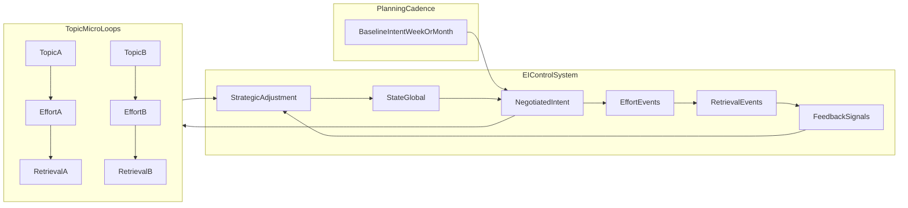

# **Execution Intelligence (EI) — Spec**

### _The Deep Technical / Product Thesis_

---

## **Source of Truth**

This document is the **authoritative specification** for Execution Intelligence (EI).

- The master narrative lives in `Unified_Master_Doc.md`.
- `Unified_Master_Doc.md` should contain only a **short EI overview** and link here for full depth.
- Protocol shared definitions + index live in `EI_Protocols_Deep_Dive.md` (full deep dives are in `EI_Protocol_1_Ignition.md`, `EI_Protocol_2_Activation.md`, `EI_Protocol_3_Verification.md`).

---

## **4. The Scientific Thesis: Execution Intelligence (EI)**

We do not track "Time Spent" (a vanity metric). We track the integrity of the student's **Execution Loop**. EI is a closed-loop coaching system: it diagnoses _where_ the loop breaks and applies the correct intervention **at the transition** (now) and **at the end** (next adjustment cycle).

### **4.1 The Loop Equation (Closed Loop, Not Linear)**

We treat study as a loop where the output updates the next input:

$$State \xrightarrow{\text{Protocol 1}} Intent \xrightarrow{\text{Protocol 2}} Effort \xrightarrow{\text{Protocol 3}} Retrieval \to Feedback \to \mathbf{[Strategic\ Adjustment]} \to State$$

- **State:** Sleep, energy, anxiety, backlog pressure (engine condition).
- **Intent:** Today's targets chosen under that state.
- **Effort:** What actually happened (depth, duration, focus).
- **Retrieval:** Proof of learning (MCQs/PYQs/recall test/error-log).
- **Feedback:** Student's qualitative signal (confidence, shame, denial, friction tags).
- **Strategic Adjustment:** Next-cycle plan rewrite (macro intervention).

### **4.2 The "Transition Protocols" (Catalyst Layer / Decision Gates)**

The arrows ($\to$) are not passive connectors; they are active **Decision Gates**. At each gate, the AI measures the student's **Velocity** (energy + mood + momentum) and triggers one of two modes:

- **Tactical Rescue (The Paramedic):** Triggered by friction. Lower the bar to keep the loop moving.
- **Momentum Boost (The Coach):** Triggered by flow. Raise the bar to maximize growth.

**Why this matters:** A "Rescue-only" system fails the **Smart Kid Problem** (high performers feel patronized). Dual-mode EI stays sticky across the entire spectrum.

#### **Protocol System Overview (Why 3 Gates Work)**

The protocol system focuses on the three highest-leverage breakpoints in real study behavior. These gates are **always-on** because they prevent loop breakage early, with minimal extra effort from the student.

- **Protocol 1 — Ignition (State → Intent):** Prevents unrealistic targets under a bad State. Output is a _NegotiatedIntent_ (scope/difficulty) that matches today’s energy/anxiety.
- **Protocol 2 — Activation (Intent → Effort):** Prevents “planned but never started.” Output is a startable first action that reduces friction (Rescue) or protects focus (Boost).
- **Protocol 3 — Verification (Effort → Retrieval):** Prevents passive learning. Output is proof of learning now or a scheduled verification (reduces LoopLatency and OpenLoops).

**Mode switch principle:** Rescue vs Boost is chosen from **State + Evidence**, not from “student type.”

- **Evidence** includes (a) outcome integrity (Δ metrics), (b) **adherence signals** (start-latency, VerificationRate, LoopLatency/OpenLoops, avoidance/silence), and (c) topic memory (TMS/ΔDecay).
- In short: gating behaves like **State × Evidence × Adherence** — meaning we never “Boost” on mood alone, and we never “Rescue” forever for someone who is reliably closing loops.
- Practically: adherence signals are the earliest leading indicators (they show loop breakage before scores move).
- Adherence = behavior/compliance signals
- Evidence = outcomes + adherence + topic memory

**Reliability (what ‘working’ means):**

- Protocol 1 improves realism (reduces Ambition Δ extremes).
- Protocol 2 reduces start failure (lower start-latency, higher session completion).
- Protocol 3 improves learning integrity (higher VerificationRate, lower LoopLatency/OpenLoops).

**Safety guardrails (do-no-harm):**

- **Rescue cannot become learned helplessness:** repeated Rescue must evolve (scope ↓, then technique change / replan), not endless reduction.
- **Boost cannot become burnout:** Boost requires stable evidence; if Efficiency Δ is poor or StateTrend is declining, Boost becomes a _quality boost_ (method) not a _quantity boost_ (volume).

**Roadmap (optional, not required for the 3-gate core):**

- **Protocol 4 — Calibration (Retrieval → Feedback):** Micro-check to correct Perception Δ (imposter syndrome vs denial).
- **Protocol 5 — Replan (Feedback → Strategic Adjustment):** Scheduled synthesis engine (weekly default; risk-triggered daily wrap) rather than a blocking gate.

For shared definitions and a link index to the protocol deep dives, see `EI_Protocols_Deep_Dive.md`.

### **4.3 Protocol Matrix: Rescue vs. Boost**

| Transition Protocol                               | The Trigger             | If User is...                                | Mode       | Intervention Pattern                                                                |
| :------------------------------------------------ | :---------------------- | :------------------------------------------- | :--------- | :---------------------------------------------------------------------------------- |
| **Protocol 1: Ignition (State → Intent)**         | User opens app.         | **LOW ENERGY** _(Anxious, Tired)_            | **RESCUE** | **The Reduction:** _"Ignore the backlog. Just do ONE easy win today."_              |
|                                                   |                         | **HIGH ENERGY** _(Confident, Well-Slept)_    | **BOOST**  | **The Stretch:** _"You're fully charged. Let's raise the bar (difficulty/volume)."_ |
| **Protocol 2: Activation (Intent → Effort)**      | User sets a goal.       | **STALLED** _(Procrastinating)_              | **RESCUE** | **The Lubrication:** _"Too hard to start? Just watch the video. No notes."_         |
|                                                   |                         | **FLOWING** _(Starts immediately)_           | **BOOST**  | **The Isolation:** _"You're in the zone. Block distractions for 60m."_              |
| **Protocol 3: Verification (Effort → Retrieval)** | User finishes studying. | **AVOIDANT** _(Closing app without testing)_ | **RESCUE** | **The Trojan Horse:** _"Unlock your break by answering 1 question."_                |
|                                                   |                         | **CONFIDENT** _(High focus duration)_        | **BOOST**  | **The Double-Down:** _"Don't waste focus on easy Qs. Unlocking advanced tier."_     |

#### Operational Definitions (MVP defaults; tune later)

These labels are **observable bundles**, not personality traits. They are used only to route **Rescue vs Boost** at the protocol gates.

**Shared primitives (examples):**
- `Energy` (1–5), `Anxiety` (1–5), `SleepHours` (optional), `BacklogPressure` (1–5)
- `StartLatencyMin` = minutes from IntentSet → EffortStart
- `VerificationRate7d` = verified sessions / ended sessions (rolling 7d)
- `OpenLoops` = topics where Effort happened but Retrieval is overdue
- `SilenceDays` = days since a meaningful event (IntentSet / SessionEnd / Retrieval)
- (If available) `Efficiency Δ` trend, `StateTrend` (sleep/energy/anxiety drift)

##### 1) LOW ENERGY (Protocol 1 label)
Trigger if **any**:
- `Energy ≤ 2` OR `SleepHours < 6`
- `Anxiety ≥ 4` OR `BacklogPressure ≥ 4`
- `StateTrend` declining (2–3 days of sleep↓ or anxiety↑)

##### 2) HIGH ENERGY (Protocol 1 label)
Trigger if **all**:
- `Energy ≥ 4` AND `SleepHours ≥ 7` (if known)
- `Anxiety ≤ 2` AND `BacklogPressure ≤ 3`
- No active risk spike (e.g., not `SilenceDays ≥ 2`, not `OpenLoops ≥ 3`)

##### 3) STALLED (Protocol 2 label)
Trigger if **any**:
- `StartLatencyMin ≥ 15` (or repeated ≥10 min stalls)
- ≥2 re-plans/switches after setting intent without starting effort
- “App open + intent set” but no EffortStart within a reasonable window (e.g., 20 min)

##### 4) FLOWING (Protocol 2 label)
Trigger if **all**:
- `StartLatencyMin ≤ 3`
- No repeated re-planning/switching during start window
- Not currently in verification-avoidance pattern (see AVOIDANT)

##### 5) AVOIDANT (Protocol 3 label)
Trigger if **any**:
- Session ends with **no** `VerifyNow` and **no** `ScheduleVerify`
- `VerificationRate7d < 0.60`
- `OpenLoops ≥ 3` or rising quickly
- `SilenceDays ≥ 2` (avoidance-by-disappearance)

##### 6) CONFIDENT (Protocol 3 label)
Trigger if **all**:
- Session ends with `VerifyNow` (or `ScheduleVerify` within a defined window)
- `VerificationRate7d ≥ 0.75`
- `OpenLoops ≤ 2`
- (If available) `Efficiency Δ` not deteriorating

##### Precedence + reliability rules
- **AVOIDANT overrides CONFIDENT** (high focus duration is not “confidence” if verification is skipped).
- **BOOST is never chosen from mood alone**. Boost eligibility requires **State + Evidence + Adherence**:
  - State is stable (not LOW ENERGY),
  - Evidence shows integrity (Δ + latency not worsening),
  - Adherence is healthy (verification rate / open loops / start latency).
- If `Efficiency Δ` is poor or `StateTrend` is declining, any “Boost” becomes a **quality boost** (technique / question type), not a **quantity boost** (more volume).

##### NEUTRAL (fallback when no label matches)
Real students often fall between extremes. If the user does not meet the thresholds for Rescue or Boost at a gate, route to **NEUTRAL**:

- **Goal:** keep the loop moving with **minimal pressure**, while still protecting integrity.
- **Protocol 1 (State → Intent):** keep BaselineIntent direction, but negotiate only the margin (slight scope adjustment; set a small verification minimum).
- **Protocol 2 (Intent → Effort):** provide a simple `FirstAction` (30–120 seconds) without adding strict isolation or extra volume.
- **Protocol 3 (Effort → Retrieval):** default to **minimum verification** (e.g., 1–3 questions) or **ScheduleVerify within 24–48h**, instead of “skip” (skip only via `SkipWithReason`).

### **4.4 The Adjustment Architecture (The Brain: Now vs. Next Cycle)**

- **Tactical Rescue (in the arrow):** Micro-interventions to fix the current session.
- **Strategic Adjustment (at the end):** Macro-interventions to optimize the next loop.

**Routing logic:**

- _"The student is stuck right now"_ $\to$ call a **Transition Protocol**.
- _"The student had a bad week"_ $\to$ call **Strategic Adjustment**.

### **4.5 "Cascading Context" (Previous-Step Weightage)**

The AI does not judge steps in isolation. The same effort can mean "heroic" or "failed" depending on prior context.

The transition function evolves as the loop progresses:

- Transition 1: $f(\text{State})$
- Transition 2: $f(\text{Intent}, \text{State})$
- Transition 3: $f(\text{Effort}, \text{Intent}, \text{State})$
- Transition 4: $f(\text{Retrieval}, \text{Effort}, \text{Intent}, \text{State})$
- Transition 5: $f(\text{Feedback}, \text{Retrieval}, \text{Effort}, \text{Intent}, \text{State})$

### **4.6 The Delta Strategy (Integrity Metrics)**

The core signal is not the absolute score; it is the **Delta ($\Delta$)** between steps.

| Delta            | Formula                             | Measures       | Diagnostic Meaning               | Default Action                                      |
| :--------------- | :---------------------------------- | :------------- | :------------------------------- | :-------------------------------------------------- |
| **Ambition Δ**   | $\Delta_A = Intent - State$         | Realism        | Overcompensation vs. sandbagging | Reduce goal (if too high) / Boost goal (if too low) |
| **Execution Δ**  | $\Delta_E = Effort - Intent$        | Integrity      | Execution gap                    | Rescue: re-scope, adjust retrieval difficulty       |
| **Efficiency Δ** | $\Delta_{Eff} = Retrieval - Effort$ | Method quality | Junk volume vs. mastery          | Technique pivot / Promote topic                     |
| **Perception Δ** | $\Delta_P = Feedback - Retrieval$   | Self-awareness | Imposter syndrome vs. denial     | Confidence correction / Reality check               |

### **4.7 The Cognitive Diagnostics Engine (Second Half of the Loop)**

#### **Effort → Retrieval (Efficiency Δ)**

- **Junk Volume Risk:** High effort, low retrieval.
  - **Diagnosis:** Not laziness. Bad technique.
  - **Adjustment:** Force active recall / PYQ-first; block passive reading.
- **Lucky Guesser / Already Mastered Risk:** Low effort, high retrieval.
  - **Diagnosis:** Either mastered or guessing.
  - **Adjustment:** Promote topic; raise difficulty tier; skip basics.

#### **Retrieval → Feedback (Perception Δ)**

- **Imposter Syndrome:** High retrieval + negative self-report.
  - **Adjustment:** Show objective streak; confidence boost; reduce anxiety load.
- **Dunning-Kruger / Numbness:** Low retrieval + dismissive self-report.
  - **Adjustment:** Reality check; pause; structured reflection/reset.

### **4.8 Strategic Adjustment Matrix (Next Plan Rewrite)**

At loop-end, the AI chooses the next strategy from the pattern of deltas.

| Scenario        | Ambition Δ           | Efficiency Δ               | Perception Δ          | Strategic Adjustment (Next Plan)                                                                  |
| :-------------- | :------------------- | :------------------------- | :-------------------- | :------------------------------------------------------------------------------------------------ |
| **The Burnout** | High (over-planning) | Low (grinding w/o results) | Negative (self-hate)  | **Recovery Protocol:** Cut volume by 50%. Protect sleep. Easy wins to restore State.              |
| **The Coaster** | Low (under-planning) | High (easy wins)           | Positive / complacent | **Hunter Protocol:** Increase difficulty by ~20% immediately.                                     |
| **The Grinder** | Balanced             | Low (struggling)           | Balanced acceptance   | **Technique Pivot:** Effort is fine; method is wrong. Switch to retrieval-first + error-log loop. |

### **4.9 The Mastery Index (Revision Is a Spiral, Not a Reset)**

If the AI treats every session as a fresh start, it will fail. It must know: _"Is this first learning or 10th revision?"_

Introduce a persistent variable per topic:

- **Topic Mastery Score (TMS):** Rolling estimate of mastery that persists across days.

$$Transition = f(Current\_Step + \mathbf{TMS_{Topic}})$$

This detects two common revision failures:

- **Comfort Zone Revision:** High TMS + passive work $\to$ wasting time.
  - **Action:** Block notes; force advanced problems.
- **Rush Job Revision:** Low TMS + "quick skim" intent $\to$ fake revision.
  - **Action:** Block skim; force deep dive scope.

**Decay Delta (Spaced Repetition Integrity):**

$$\Delta_{Decay} = TMS_{Last} - Retrieval_{Today}$$

- If $\Delta_{Decay}$ is small: retention is stable $\to$ schedule next revision further out.
- If $\Delta_{Decay}$ is large: leaky bucket $\to$ schedule rapid re-test (24h) + technique restart.

### **4.10 Multiscale Cadence (Control Loop, Not Calendar)**

The “study day loop” phrasing in **4.1** is a convenience for explaining the control system. In reality, EI must work across **multiple time scales** without forcing every student to “close the loop” daily.

**EI runs as a control loop with multiple cadences:**

- **Session micro-loop (always-on):** Effort → Retrieval → Feedback
  - Goal: prevent passive learning and verification avoidance at the moment it happens.
- **Periodic review loop (default weekly; daily optional/adaptive):** State trend → Intent portfolio → Evidence → Strategic adjustment
  - Goal: re-balance workload, technique, and confidence using rolling evidence (deltas + latency).
- **Macro loop (monthly):** syllabus progress + backlog economics + major strategy shifts
  - Goal: keep the “north star” aligned without becoming a task manager.

**Key rule:** EI is **event-driven** at the transition gates (Protocols 1–3) and **risk-driven** for periodic reviews (more in 4.13).

### **4.11 Multi-Topic Execution Model (Parallel Micro-Loops)**

Students naturally run multiple topics in parallel (different topics in different steps on the same day). EI must support this by tracking **topic-local state**.

**Per topic, track a lightweight step-state:**

- `TopicStep ∈ {Intent, Effort, Retrieval, Feedback}`
- `LastEffortAt`, `LastRetrievalAt`, `LastFeedbackAt`
- `TMS_Topic` and `ΔDecay`

**Open loops (WIP):** count topics where Effort has happened but Retrieval is overdue relative to an adaptive window.

- `OpenLoops = { topic | LastEffortAt exists AND LastRetrievalAt < LastEffortAt AND now - LastEffortAt > TargetLatency(topic) }`

EI should keep `OpenLoops` bounded (softly) to prevent “spread-out passive study” across many topics.

### **4.12 Planning Ownership: BaselineIntent vs. NegotiatedIntent**

EI must respect that many students pre-plan weekly/monthly and do not want an app to “own their calendar.”

- **BaselineIntent:** the student’s (or coaching’s) pre-planned allocation (week/month targets).
- **NegotiatedIntent:** the EI-adjusted scope/difficulty for the next session/day, based on **State + evidence** (deltas, latency, TMS/ΔDecay).

**Rule:** EI does not rewrite the entire plan. It negotiates **at the margin** to protect loop integrity:

- Reduce scope when State is low (Rescue).
- Increase difficulty when flow/evidence supports it (Boost).
- Re-route from passive effort to retrieval-first when Efficiency Δ is poor.

### **4.13 Check-ins: Event-Driven Gates + Adaptive Reviews**

To keep daily effort minimal while staying a leading-indicator system, EI should prefer **micro check-ins** only when the student is already making a decision.

**Always (event-driven, 5–20 seconds):**

- **Protocol 1 (app open):** capture/infer State (sleep/energy/anxiety/backlog pressure).
- **Protocol 2 (goal set):** confirm intent scope (“is this realistic under current State?”).
- **Protocol 3 (session end):** verify learning (do-now vs schedule vs skip-with-reason).

**Sometimes (adaptive periodic reviews):**

- **Weekly review (default):** strategic adjustment using rolling deltas + latencies.
- **Daily wrap-up (optional / triggered):** only when risk spikes (e.g., rising OpenLoops, repeated verification avoidance, silence).

**Escalation triggers (examples):**

- **Silence:** no meaningful events for 2–3 days.
- **Verification avoidance:** repeated Effort without Retrieval.
- **Avoidance latency:** a weak/high-priority subject not touched for \(N\) days.

### **4.14 Adaptive Tightness Policy (Works Across Student Types)**

EI should not have a single “strictness level.” It should adapt the pressure based on a student’s observed compliance and risk.

Inputs to a **TightnessPolicy**:

- **Compliance Elasticity** (how much pressure they tolerate before breaking).
- **State trend** (sleep/energy/anxiety).
- **Integrity signals:** Execution Δ, Efficiency Δ, Perception Δ.
- **Latency signals:** OpenLoops, LoopLatency, AvoidanceLatency, Silence.

Outputs:

- **Prompt frequency** (fewer prompts for high performers; more for drifting students).
- **Verification minimum** (e.g., 1 question vs 5 questions).
- **Deadlines** (adaptive TargetLatency windows).
- **Rescue vs Boost routing** at each protocol gate.

### **4.15 Leading Metrics → B2B Risk Signals**

The system should surface **leading indicators** (behavioral breaks) rather than lagging outcomes (test scores), while keeping raw diary content private.

| Metric (Leading)              | Measures                                            | Break it Detects                          | Example B2B Signal                                 |
| :---------------------------- | :-------------------------------------------------- | :---------------------------------------- | :------------------------------------------------- |
| **LoopLatency(topic)**        | Time from Effort → Retrieval                        | Passive learning / verification avoidance | “High Effort, Low Recall risk rising”              |
| **VerificationRate**          | % sessions that end with retrieval now or scheduled | Avoidant closing / no proof of learning   | “Verification compliance dropping”                 |
| **OpenLoops (WIP)**           | # topics overdue for retrieval                      | Too many unfinished learning cycles       | “Open loops accumulating (burnout/avoidance risk)” |
| **AvoidanceLatency(subject)** | Days since meaningful retrieval on weak subject     | Subject avoidance                         | “Subject avoidance latency: Physics”               |
| **StateTrend**                | sleep/energy/anxiety drift                          | Burnout runway                            | “Burnout risk (3-week runway)”                     |

These metrics can be aggregated to produce sanitized alerts in the “Radar” dashboard (no raw journaling, no sensitive text).

### **4.16 MVP UX Contract (Buttons-First Inputs)**

For MVP safety and low friction, EI should run on structured events (buttons) and a small taxonomy of tags.

**Minimum event set:**

- **AppOpen (Protocol 1):** `Energy` + `Anxiety` + optional `Sleep` (quick tap scale).
- **IntentSet (Protocol 2):** choose `Topic`, `TaskType` (learn/practice/revise), `DifficultyTier`.
- **SessionEnd (Protocol 3):** choose one of:
  - `QuickVerifyNow` (1–5 questions)
  - `ScheduleVerify` (tomorrow / +2 days / before next class/test)
  - `SkipWithReason` (fatigue, time, confusion) — rate-limited by anti-gaming logic elsewhere (Bankruptcy Protocol).

**Design constraint:** EI acts like an “elder brother” — it negotiates and nudges at gates, not a full task manager UI.

---

## **Appendix**

### **A. Diagram: Planning Cadence + EI Control + Topic Micro-Loops**

