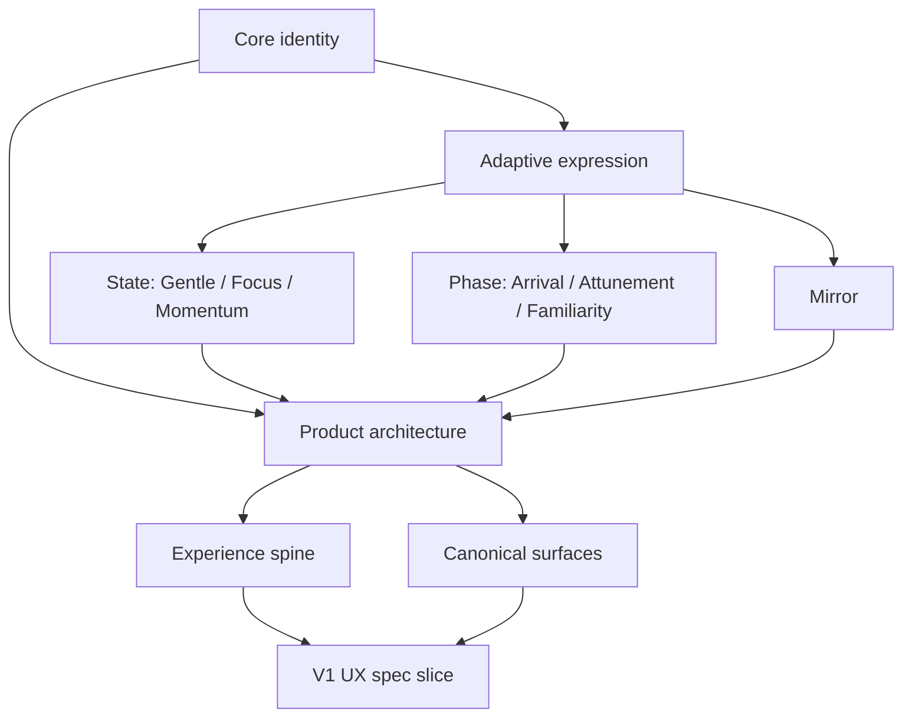

# Documentation Boundary And Terminology

This document is the canonical governance layer for Eli's strategy-to-spec documentation stack.

Its job is to keep `docs/eli-brand/`, `docs/product-experience-architecture/`, and downstream UX specifications aligned without re-debating scope or redefining core terms in multiple places.

## 1. Documentation Stack

Use the Eli documentation stack in this order:

1. **Brand system** (`docs/eli-brand/`)
   Defines who Eli is, what Eli must never become, and how adaptive expression works at the principle level.
2. **Product experience architecture** (`docs/product-experience-architecture/`)
   Defines what kind of product follows from the brand system: loop, structure, surfaces, navigation posture, and behavior rules.
3. **UX specifications** (`docs/v1-ux-spec/` and future UX spec folders)
   Define what the student sees and does: routes, handoffs, surface behavior, content placement, interaction models, and validation-ready product form.
4. **Design brief** (`docs/v1-design-brief/`)
   Bridges UX spec to visual design: design tokens, typography assignments, focal action declarations, and AI design tool prompts. Derived from layers 1-3; does not redefine them.
5. **Implementation docs**
   Define engineering logic, runtime thresholds, instrumentation, and delivery details.

This order is binding. Downstream layers may apply upstream decisions, but must not silently redefine them.

## 2. Shared System Map

Use this map when you need to understand the full path from Eli's brand model to product architecture and then to the V1 UX spec.

Read the map this way:

- `Core identity` is the permanent constraint layer.
- `Adaptive expression` regulates how Eli can change without becoming a different brand.
- `State`, `Phase`, and `Mirror` are the adaptation mechanisms.
- `Product architecture` translates those mechanisms into product form.
- `Experience spine` and `Canonical surfaces` are the product-level structure.
- `V1 UX spec slice` is a constrained implementation of the larger system, not a replacement for it.

## 3. Boundary Model

### Brand docs own

- brand thesis and territory
- core identity, laws, and anti-patterns
- adaptive expression principles
- meaning of `Gentle`, `Focus`, `Momentum`, `Arrival`, `Attunement`, `Familiarity`, and `Mirror`
- voice, typography, visual behavior, and interface laws
- mark and asset behavior

### Product architecture docs own

- product thesis and experience model
- the canonical loop
- structural product model
- canonical surfaces
- navigation, interaction, content, and visual architecture at the product level
- V1 product form decisions that stop short of final screen specs

### UX specs own

- information architecture and routes
- screen and surface composition
- transitions and handoffs
- content placement and UI states
- exact interaction behavior
- validation-ready V1 behavior for real product moments

### Implementation docs own

- design tokens and component rules
- runtime logic, signal thresholds, and experiments
- analytics and instrumentation details
- engineering architecture and build decisions

## 4. Escalation Rule

If a section starts doing one of the following, move it to the correct layer:

- redefining identity, anti-patterns, or adaptive laws: move upstream to brand docs
- redefining the loop, surfaces, or navigation posture: move to product architecture docs
- describing step-by-step routes, screen behavior, or transition mechanics: move downstream to UX specs
- describing thresholds, system logic, tokens, or implementation details: move to implementation docs

## 5. Canonical Terminology

Each major concept has one owner doc. Other docs may reference, translate, or apply the concept, but must not silently redefine it.

### `Identity`

The permanent brand layer: role, emotional promise, personality, laws, and anti-patterns that do not change by student condition or relationship depth.

- Owner doc: `docs/eli-brand/02-core-identity.md`

### `Adaptive expression`

The system by which Eli changes how it shows up without changing who it is. It regulates expression through states, phases, and `Mirror`.

- Owner doc: `docs/eli-brand/03-adaptive-expression.md`

### `State`

The current-capacity operating posture Eli uses to fit the student's present condition. States answer what the student needs right now.

- Owner doc: `docs/eli-brand/04-brand-states.md`
- Product translation doc: `docs/product-experience-architecture/05-state-architecture.md`

### `Phase`

The earned relationship maturity model that regulates how much Eli is allowed to assume, express, and carry forward. Phases answer how much Eli has earned the right to do.

- Owner doc: `docs/eli-brand/05-brand-phases.md`
- Product translation doc: `docs/product-experience-architecture/06-phase-architecture.md`

### `Mirror`

The reflective layer that may appear when Eli has enough evidence to turn observation into meaning. `Mirror` is not a default operating state, not a permanent destination, and not a justification for constant reflection.

- Owner doc: `docs/eli-brand/03-adaptive-expression.md`
- Product application docs: `docs/product-experience-architecture/03-experience-spine.md`, `docs/product-experience-architecture/07-surface-architecture.md`

### `Loop`

The canonical product sequence Eli is organized around: return, orient, commit, work, close, and reflect when earned.

- Owner doc: `docs/product-experience-architecture/03-experience-spine.md`

### `Surface`

A recurring product moment with a distinct job in the product architecture. Surfaces are not final screens or route specs.

- Owner doc: `docs/product-experience-architecture/07-surface-architecture.md`

### `Continuity`

Lightweight embedded support inside the main route that helps the student re-enter or carry forward meaningful context. Continuity is not a top-level destination, dashboard, or analytics page.

- Owner doc: `docs/product-experience-architecture/04-structural-product-model.md`
- UX application doc: `docs/v1-ux-spec/08-embedded-continuity.md`

### `Companion`

Eli's operating role: a product that works beside the student, adapts to what is needed, and supports study without becoming a tutor, tracker, or judgment surface.

- Owner docs: `docs/eli-brand/02-core-identity.md`, `docs/product-experience-architecture/01-product-thesis.md`

### `Grounded progress`

Progress that feels real, believable, and confirmed by meaningful completion rather than dashboards, streaks, praise inflation, or performance theater.

- Owner docs: `docs/eli-brand/02-core-identity.md`, `docs/product-experience-architecture/02-core-experience-model.md`

### `Earned reflection`

Reflection that appears only when Eli has sufficient repeated evidence, enough relational permission, and a useful meaning to offer. It must remain bounded, credible, and non-diagnostic.

- Owner docs: `docs/eli-brand/08-voice-and-copy.md`, `docs/product-experience-architecture/10-content-architecture.md`

## 6. Deprecated Usage

Avoid these usage patterns:

- using `state` to mean persona, mood label, or loyalty segment
- using `phase` to mean session count alone
- using `Mirror` to mean any reflective copy, insight widget, or branded flourish
- using `continuity` to mean history dashboard, analytics area, or review destination
- using `surface` to mean a fully specified UI screen
- using `adaptive` to justify visible personalization theater without clear product benefit

If a new usage is needed, update this document first.

## 7. Editing Rules

- Each major concept has one owner doc.
- Non-owner docs may reference, translate, or apply the concept, but must not silently redefine it.
- When a concept needs a new meaning, update this document and the owner doc together.
- Prefer linking to owner docs over restating definitions in multiple places.
- If a downstream doc needs more specificity, add application guidance there without rewriting the upstream definition.

## 8. Review Test

The boundary model is working when:

- a new contributor can tell where a concept belongs without asking
- repeated terms have one stable meaning across folders
- brand, product architecture, UX spec, and implementation responsibilities are clearly separated
- review comments can point to an owner doc rather than arguing from preference

If those conditions are not true, the documentation stack is drifting.
