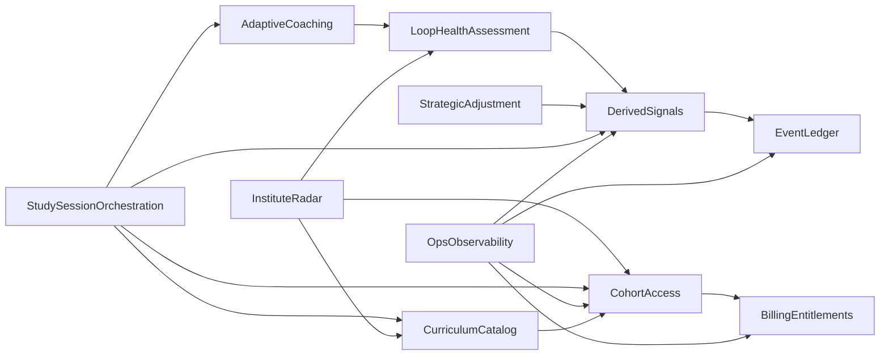

# Subdomains

> **Subdomains = problem-space** (what the business does; how the domain is broken down). **Bounded contexts = solution-space** (how the system is built); see [03-context-map.md](03-context-map.md). Good design aligns them (carpet fits floor).
>
> **Source:** [EI_Spec.md](../ei/spec/EI_Spec.md), [EI_Scenarios.md](../ei/scenarios/EI_Scenarios.md), storyboards, [launch-requirements-checklist.md](../launch-requirements-checklist.md)

---

## Section A: Subdomain discovery

Candidate subdomains from "What distinct business capabilities does EI have?" (no classification yet):

1. **AdaptiveCoaching (P1/P2/P3)** — Gate-time negotiation at State→Intent, Intent→Effort, Effort→Retrieval.
2. **StrategicAdjustment (P5 Replan)** — Next-cycle synthesis; dials and constraints when week/pattern drifts.
3. **LoopHealthAssessment** — Labels and interpretation of loop health (thresholds, precedence, LoopHealthSnapshot); depends on DerivedSignals for metric values.
4. **Event Ledger** — Append-only event store and queryable behavioral timeline per student; source of truth for what happened.
5. **DerivedSignals** — Produces metric values and persisted state (aggregates, topic state, policy) from the event ledger for fast queries.
6. **StudySessionOrchestration** — End-to-end study-session journey: check-in, intent, activation, session, verification.
7. **InstituteRadar** — Privacy-safe leading indicators for institutes; no raw data.
8. **CohortAccess (Identity, Cohorts, RBAC)** — Who is who; cohort membership; roles.
9. **OpsObservability** — Run, debug, recompute.
10. **BillingEntitlements** (Billing, Sponsor, Coupons) — Provision paid access via entitlements; coupons and audit.
11. **Protocol 4 Calibration (candidate, Later)** — Perception correction (Retrieval→Feedback); v1 deferred.
12. **CurriculumCatalog** — Structured, searchable catalog of study topics with stable identifiers; curriculum tree, type-ahead search, institute-scoped browse, normalization queue.

---

## Section B: Subdomain definition (detail)

For each candidate, define: capability, key concepts, boundaries, why distinct. One full example below; fill the rest as the workbook progresses.

### Template (per subdomain)

| Field                         | Purpose                                                       |
| ----------------------------- | ------------------------------------------------------------- |
| **Capability (one sentence)** | What does the business do in this area?                       |
| **Key concepts**              | Ubiquitous language terms this subdomain owns or contributes  |
| **Boundaries (in)**           | What belongs here                                             |
| **Boundaries (out)**          | What belongs to other subdomains                              |
| **Why distinct**              | Why this is a separate problem-space, not merged with another |

---

### 1. AdaptiveCoaching (P1/P2/P3)

| Field                         | Content                                                                                                                                                                                                                                                                                        |
| ----------------------------- | ---------------------------------------------------------------------------------------------------------------------------------------------------------------------------------------------------------------------------------------------------------------------------------------------- |
| **Capability (one sentence)** | At each decision gate (AppOpen, IntentSet, SessionEnd), the business negotiates or suggests the next step so the student's loop keeps moving with the right bar (Rescue vs Boost).                                                                                                             |
| **Key concepts**              | NegotiatedIntent, ActivationPlan, VerificationDecision; Rescue, Neutral, Boost; LOW_ENERGY, HIGH_ENERGY, STALLED, FLOWING, AVOIDANT, CONFIDENT; play (e.g. The Reduction, The Trojan Horse); gate, protocol (P1 Ignition, P2 Activation, P3 Verification); TimeCommitment (student-declared timebox: 10/20/45/60 min; primary source for `NegotiatedIntent.scope.timeboxMin` when provided; mode-range midpoint fallback when absent for variants that hide time chips). Note: `difficultyTier` and `questionCount` are computed internally from mode + policy + energy — never surfaced in student UX. |
| **Boundaries (in)**           | Gate-time routing logic; selection of mode (Rescue/Neutral/Boost) and play; output of a single gate decision (scope, first action, verify-now/schedule/skip). AdaptiveCoaching consumes a LoopHealthSnapshot (labels + key evidence) from LoopHealthAssessment rather than re-deriving labels. |
| **Boundaries (out)**          | Labels, precedence, thresholds, and health snapshot contract — LoopHealthAssessment. Metric values/state that LoopHealthAssessment consumes — DerivedSignals. Next-cycle policy (dials, constraints) — StrategicAdjustment. Storing events — Event Ledger.                                     |
| **Why distinct**              | Trigger is "student at a transition right now"; output is one immediate decision. Different from Strategic Adjustment (scheduled/risk-triggered, outputs next-cycle policy) and from any subdomain that only computes or stores state.                                                         |

---

### 2. StrategicAdjustment (P5 Replan)

| Field                         | Content                                                                                                                                                                                                                                                                                                                                                                |
| ----------------------------- | ---------------------------------------------------------------------------------------------------------------------------------------------------------------------------------------------------------------------------------------------------------------------------------------------------------------------------------------------------------------------- |
| **Capability (one sentence)** | Next-cycle synthesis engine that emits a StrategicAdjustmentDecision (guardrails + dials), triggered weekly by default or by risk spike.                                                                                                                                                                                                                               |
| **Key concepts**              | StrategicAdjustmentDecision; AdjustmentMode (Recovery, TechniquePivot, IntegrityClamp, DifficultyRaise, CloseLoopsFirst); dials (scopeMultiplier, difficultyTierDelta, minQuestionsDefault, scheduleAllowed, dueInHoursDefault); constraints (maxOpenLoops, noNewTopicUntil, closeOldestOpenLoopFirst); review boundary (weekly), risk-triggered wrap; TightnessLevel. |
| **Boundaries (in)**           | Choosing modes/dials/constraints from accumulated evidence over the review boundary; defining policy semantics (what each dial/constraint means); deciding when to run (scheduled + risk-triggered) without becoming a task planner.                                                                                                                                   |
| **Boundaries (out)**          | Consumes LoopHealthSnapshot/labels — LoopHealthAssessment. Consumes metric values/state — DerivedSignals. Writes/reads policy storage via DerivedSignals. Does not own gate play selection (AdaptiveCoaching), event storage (Event Ledger), or institute alerts (Institute Radar).                                                                                    |
| **Why distinct**              | Horizon-level policy vs gate-time decisions; trigger is review boundary or risk spike, not “student at a gate”; wrong SA affects a week, wrong gate play affects a session.                                                                                                                                                                                            |

**A+B+C+D check:** Distinct capability output (StrategicAdjustmentDecision); independent change cadence (policy tuning); multiple consumers rely on identical meaning (gates, radar, ops); non-trivial business rules (control policy, guardrails).

---

### 3. LoopHealthAssessment

| Field                         | Content                                                                                                                                                                                                          |
| ----------------------------- | ---------------------------------------------------------------------------------------------------------------------------------------------------------------------------------------------------------------- |
| **Capability (one sentence)** | Assess loop health and produce a LoopHealthSnapshot (labels + key evidence numbers) for downstream consumers.                                                                                                    |
| **Key concepts**              | OpenLoops, VerificationRate7d, LoopLatency, SilenceDays, StateTrend; AVOIDANT, CONFIDENT, LOW_ENERGY, HIGH_ENERGY, STALLED, FLOWING; precedence rules (risk overrides ambition); thresholds; LoopHealthSnapshot. |
| **Boundaries (in)**           | Interpretation and labeling (metrics → labels); precedence rules; definition of health snapshot shape and contract.                                                                                              |
| **Boundaries (out)**          | Metric values and persisted state — DerivedSignals. Event ingestion/storage — Event Ledger (indirect, via DerivedSignals).                                                                                       |
| **Why distinct**              | Own tuning cadence (thresholds/labels); shared by AdaptiveCoaching, StrategicAdjustment, Institute Radar; single place for "what is healthy" avoids duplicated thresholds.                                       |

---

### 4. Event Ledger

| Field                         | Content                                                                                                                                                                                                                                                                                                                                |
| ----------------------------- | -------------------------------------------------------------------------------------------------------------------------------------------------------------------------------------------------------------------------------------------------------------------------------------------------------------------------------------- |
| **Capability (one sentence)** | Maintain a faithful, append-only record of what happened (domain events) as the system of record and expose a queryable behavioral timeline per student.                                                                                                                                                                               |
| **Key concepts**              | Event; event type (AppOpen, IntentSet, SessionEnd, NegotiatedIntentIssued, ActivationPlanIssued, VerificationDecisionIssued, RetrievalVerified, RetrievalScheduled, StrategicAdjustmentDecision, etc.); event payload / schema; append-only; idempotency key; behavioral timeline (ordered event stream per student); source of truth. |
| **Boundaries (in)**           | Event ingestion (append with schema validation); idempotent writes; query by student_id (and optionally time range); ownership of event store (e.g. ei_events, idempotency_keys); invariants: immutability, idempotency, schema strictness (from [05-cross-cutting-concerns.md#invariants](05-cross-cutting-concerns.md#invariants)).                                                |
| **Boundaries (out)**          | Computing derived state/metrics from events — DerivedSignals. Interpreting metrics into labels/snapshots — LoopHealthAssessment. Gate decisions — AdaptiveCoaching. Next-cycle policy — StrategicAdjustment. Institute alerts — Institute Radar. Debug/replay tooling reads events but is owned by Ops.                                |
| **Why distinct**              | Single source of truth for "what happened"; all derived state and interpretation depend on it. Change cadence is event schema, ingestion guarantees, and storage—not protocol or label rules. Multiple consumers (DerivedSignals, Ops) rely on the same event semantics.                                                               |

**A+B+C+D check:** Distinct capability output (immutable event stream / behavioral timeline per student); independent change cadence (event schema, new event types, idempotency and ingestion); multiple consumers rely on identical meaning (DerivedSignals, Ops); non-trivial business rules (invariants: append-only, idempotency, schema strictness; guarantee that derived state can be recomputed from the log).

---

### 5. DerivedSignals

| Field                         | Content                                                                                                                                                                       |
| ----------------------------- | ----------------------------------------------------------------------------------------------------------------------------------------------------------------------------- |
| **Capability (one sentence)** | Compute and persist (project) the student's derived state/metrics from the event ledger for fast queries.                                                                     |
| **Key concepts**              | Rolling windows (7d), topic_state, aggregates (ei_student_aggregates, ei_topic_state, ei_student_policy); idempotent recompute/projection; monotonic timestamps; TMS, ΔDecay. |
| **Boundaries (in)**           | Computation and persistence of metric values and state (OpenLoops count, VerificationRate7d, SilenceDays, topic last_effort_at / last_retrieval_at, policy storage).          |
| **Boundaries (out)**          | Event ingestion/storage — Event Ledger. Meaning/labels (interpretation) — LoopHealthAssessment. Gate decisions — AdaptiveCoaching (consumes via LoopHealthAssessment).        |
| **Why distinct**              | System's "memory" of derived state; many consumers need consistent numbers; commodity projection patterns; avoid over-investing pre-PMF.                                      |

---

### 6. StudySessionOrchestration

| Field                         | Content                                                                                                                                                                                                                                                                                                                                                                                                                                                                 |
| ----------------------------- | ----------------------------------------------------------------------------------------------------------------------------------------------------------------------------------------------------------------------------------------------------------------------------------------------------------------------------------------------------------------------------------------------------------------------------------------------------------------------- |
| **Capability (one sentence)** | Own the end-to-end student-facing study-session journey orchestration across gates (check-in → intent → activation → session → verification → done), including progressive disclosure and trust-preserving friction.                                                                                                                                                                                                                                                       |
| **Key concepts**              | Gate, Scene, Step; prompt/nudge, microcopy, defaults; reason-coded skip; two-step card; "Pending checks" (student term); hint-personalization; autonomy/back-off; TimeCommitment chips (4-option single-select on checkin screen: 10 min / 20 min / 45 min / 1h+); TaskType chips (3-option single-select on checkin screen: Learn / Practice / Revise — moved from P1 screen in scope redesign); ConfirmationStrip (P1 screen element replacing prescriptive scope card; shows "topic . taskType . ~time" — student's own choices, not ELI's prescription; single "Let's go" CTA). |
| **Boundaries (in)**           | Orchestrating screens/steps and when they appear (e.g. S7 "honest mirror", "deal", two-step card). Mapping protocol outputs (NegotiatedIntent, ActivationPlan, VerificationDecision) into UI steps. Collecting taps/inputs (Energy, Sleep, BacklogPressure; skip reasons) and emitting the corresponding domain events. Collecting `timeCommitment` and `taskType` on the checkin screen (moved from P1 screen in scope redesign) — these are form inputs, not UX decoration; they flow through to the AppOpen command payload. Personalization of *presentation* (hints, button labels like "Remind me tomorrow (24h)", fewer prompts once stable), without changing scale meanings. **Cross-session adaptation:** may *consume* cross-session summaries/signals (e.g. pending checks, streaks, last deferrals) to adapt step order, defaults, and microcopy in the current session—**but does not compute those metrics or interpret them into labels** (that stays in DerivedSignals and LoopHealthAssessment). |
| **Boundaries (out)**          | Gate decision logic and play selection — AdaptiveCoaching. Weekly/risk-triggered dials/constraints semantics — StrategicAdjustment. Labels/thresholds/precedence for loop health — LoopHealthAssessment. **Computing** metric values/state (e.g. pending-check counts, comparisons across sessions) — DerivedSignals; **interpreting** them into labels — LoopHealthAssessment. Event-store guarantees — Event Ledger invariants. Calendar/task management ("ELI does not assign tasks or manage the calendar," per S7).                                                                                                                                 |
| **Why distinct**              | Different change cadence (UX iteration); different failure modes (trust/friction). It is the "delivery wrapper" for protocols rather than the policy itself; merging it with AdaptiveCoaching would mix presentation experiments with gate logic.                                                                                                                                                                                                                                                                                        |

**S7 example (ownership by scene):** Scene 3–4 — mirror + choice UI and "deal" presentation. Scene 6 — 24h reminder framing. Scene 7 — two-step card. Scene 11 — back off to autonomy (fewer prompts); uses *recent-session summaries* (from DerivedSignals/LoopHealthAssessment) to decide when to lighten prompts.

---

### 7. InstituteRadar

| Field                         | Content                                                                                                                                                                                                                                                                                                                                                                                                                                                                 |
| ----------------------------- | ----------------------------------------------------------------------------------------------------------------------------------------------------------------------------------------------------------------------------------------------------------------------------------------------------------------------------------------------------------------------------------------------------------------------------------------------------------------------- |
| **Capability (one sentence)** | Produce and expose a privacy-safe triage signal for institutes: at most one primary alert per student, with evidence summary and recommended intervention class (v1: alerts-only; no workflow).                                                                                                                                                                                                                                                                           |
| **Key concepts**              | RadarAlert; alertType (Silence, IntegrityDebt, VerificationDrop, OpenLoopsSpike, BurnoutRunway, SubjectAvoidance); severity (red, yellow); evidenceSummary (aggregated metrics only); recommendedAction; primaryAlert; dedupe (one per student); priority ordering; cohortScoped; privacyBoundary (no raw events, no private text).                                                                                                                                        |
| **Boundaries (in)**           | Producing/publishing privacy-safe alerts from downstream evidence (consuming LoopHealthSnapshot and/or pre-aggregated signals). Dedupe/merge rules ("one primary alert per student"), priority ordering, and stable sorting for triage. Privacy enforcement: no raw events, no private text; evidence is aggregated numbers/tags only. Cohort-scoped filtering (consumes cohort membership; does not own it).                                                                   |
| **Boundaries (out)**          | Raw event access/storage — Event Ledger. Computing metrics/rolling windows — DerivedSignals. Interpreting metrics into health labels and thresholds — LoopHealthAssessment. Gate-time student decisions — AdaptiveCoaching. Next-cycle policy — StrategicAdjustment. Auth/RBAC/cohort membership invariants — CohortAccess. Institute workflow actions (acknowledge, assign owner, trigger playbook) — out of scope for v1; can be added later in same subdomain. |
| **Why distinct**              | Different customer/actor (institute); hard privacy boundary and dedupe/priority semantics; independent tuning cadence (alert thresholds, action mapping); multiple institute-facing consumers rely on the same alert meaning.                                                                                                                                                                                                                                              |

**A+B+C+D check:** Distinct capability output (RadarAlert per student, privacy-safe); independent change cadence (alert types, thresholds, recommended-action mapping); institute dashboard and any downstream consumers rely on identical alert semantics; non-trivial business rules (privacy boundary, one-primary-per-student, priority ordering).

---

### 8. CohortAccess (Identity, Cohorts, RBAC)

| Field                         | Content                                                                                                                                                                                                                                                                                                                                                                                                                                                                 |
| ----------------------------- | ----------------------------------------------------------------------------------------------------------------------------------------------------------------------------------------------------------------------------------------------------------------------------------------------------------------------------------------------------------------------------------------------------------------------------------------------------------------------- |
| **Capability (one sentence)** | Enforce tenant/cohort isolation and role-based access for all EI surfaces; own membership and enrollment semantics (including unassigned as valid state).                                                                                                                                                                                                                                                                                                                |
| **Key concepts**              | AuthSession; auth_user_id → student_id mapping; Institute; Cohort; Student; Membership (active / unassigned); Role (student, admin, institute); AccessScope (cohort-scoped views); Enrollment (admin enroll, student join/coupon path); Audit (membership changes).                                                                                                                                                                                                   |
| **Boundaries (in)**           | Server-derived identity on every request; never trust client-provided studentId. Membership invariant: exactly one active cohort or explicitly unassigned. RBAC for admin/institute endpoints; cohort-scoped filtering for institute views; privacy boundary for institute-facing data (no raw events). Enrollment flows that change membership (admin enroll; student join/coupon redemption) with read-your-writes; atomic redemption → membership update. |
| **Boundaries (out)**          | Coupon issuance, limits, expiration, redemption audit — BillingEntitlements. EI domain events, derived signals, radar alert content — their respective subdomains. Ops/debug tooling: Timeline and backfill use OpsAuth (Ops-specific). CohortAccess does not serve platform ops.                                                                                                                                                                                                      |
| **Why distinct**              | Security/tenancy invariants; different change cadence from EI coaching logic; every request depends on identical authz meaning; supports multiple buyer models (institute vs self/parent) via unassigned and roles. Subdomain is generic Identity & Access; cohort is current instantiation (future pivot to Student+Parent may add household/parent role without dropping this subdomain).                                                                                    |

**Access surfaces (explicit):**

| Surface                                               | What CohortAccess owns                                                                                                                                                                                                                                                                 |
| ----------------------------------------------------- | -------------------------------------------------------------------------------------------------------------------------------------------------------------------------------------------------------------------------------------------------------------------------------------- |
| **Student-facing EI routes** (events, protocols, aggregates) | Server-derived student_id; scope to own data only; cohort where applicable (unassigned allowed). Never trust client studentId.                                                                                                                                                         |
| **Institute dashboard (Radar)**                        | Cohort-scoped visibility; institute role; no cross-cohort access; privacy boundary (no raw events) enforced for this actor.                                                                                                                                                            |
| **Institute admin (enrollment)**                       | Cohort-scoped enrollment; role check; tenant isolation. Same actor as Institute Radar.                                                                                                                                                                                                |
| **Platform ops (backfill, timeline, etc.)**            | Out of scope for CohortAccess. OpsObservability uses OpsAuth (API key, cron secret); CohortAccess does not own identity for platform operators.                                                                                                                                      |
| **Coupon/sponsor redemption**                          | Membership change on valid redemption; who can join which cohort; atomic join; 0 unauthorized cohort joins. Coupon rules/issuance/audit — BillingEntitlements.                                                                                                                              |

**A+B+C+D check:** Distinct capability output (authorization decision / access scope); multiple consumers (all routes depend on identical meaning); non-trivial business rules (0 cross-cohort visibility, 0 privilege escalation, server-derived identity per [05-cross-cutting-concerns.md#invariants](05-cross-cutting-concerns.md#invariants)).

---

### 9. OpsObservability

| Field                         | Content                                                                                                                                                                                                                                                                                                                                                                                                                                                                 |
| ----------------------------- | ----------------------------------------------------------------------------------------------------------------------------------------------------------------------------------------------------------------------------------------------------------------------------------------------------------------------------------------------------------------------------------------------------------------------------------------------------------------------- |
| **Capability (one sentence)** | Keep EI runnable and diagnosable in production: observe behavior (logs, metrics, traces), investigate issues, and safely recompute or repair projections via replay/backfill without corrupting domain truth.                                                                                                                                                                                                                                                             |
| **Key concepts**              | CorrelationId, TraceId; TimelineDebug (student or request timeline); SLI, SLO; Alert; Runbook; Incident; ReplayJob; BackfillJob; ProjectionVersion; Checkpoint, Watermark; IdempotentJobKey; DryRun, Canary; Throttling; DataFix; Redaction; OpsAuditLog.                                                                                                                                                                                                                 |
| **Boundaries (in)**           | End-to-end observability semantics (what to log, measure, trace; how to correlate across contexts). Operational dashboards, alerting, runbooks. Debug tooling that reads event/projection history to explain "why did EI do X?". Replay/backfill orchestration: scope selection, versioned projections, checkpoints, idempotency, throttling, auditability, safe rollouts (dry-run/canary). Operational safety rules: least-privilege, tenant isolation for ops views, redaction/privacy in tooling. |
| **Boundaries (out)**          | Event schema, append-only semantics, idempotent ingestion — Event Ledger (enables replay; Ops reads timeline). Metric/state definitions and computation logic — DerivedSignals (Ops runs backfills; does not define metrics). Interpretation/labels/thresholds — LoopHealthAssessment. Gate decisions/plays — AdaptiveCoaching. AuthN/AuthZ/roles — CohortAccess (Ops consumes; does not own identity). Billing/coupons — BillingEntitlements. |
| **Why distinct**              | Different primary stakeholder (ops/dev) and change cadence (instrumentation, safety controls, job orchestration). High-blast-radius operations (replay/backfill) need explicit invariants (idempotent, auditable, throttled, versioned). Multiple contexts rely on identical meaning for correlation IDs, job states, and "what was recomputed when" for debugging. |

**A+B+C+D check:** Distinct capability output (production visibility + operational repair outcomes: alerts, incident artifacts, replay/backfill results); independent change cadence (instrumentation, SLOs, job orchestration); multiple consumers rely on identical meaning (trace/correlation, job status, redaction, audit); non-trivial business rules (safe replay/backfill, privacy/redaction in tooling, least privilege).

---

### 10. BillingEntitlements

| Field                         | Content                                                                                                                                                                                                                                                                                                                                                                                                                                                                 |
| ----------------------------- | ----------------------------------------------------------------------------------------------------------------------------------------------------------------------------------------------------------------------------------------------------------------------------------------------------------------------------------------------------------------------------------------------------------------------------------------------------------------------- |
| **Capability (one sentence)** | Provision paid access to EI by issuing entitlements (self purchase, sponsor seats, coupons), recording redemptions, and maintaining a billing/audit system of record.                                                                                                                                                                                                                                                                                                  |
| **Key concepts**              | Product, Plan/Offer, Price; BillingAccount (Sponsor, Parent, Self); Subscription (optional); Seat/License; Entitlement (scope + expiry); Coupon, CouponBatch/Campaign; Redemption; Eligibility; Limit (per-coupon / per-cohort / per-campaign); Expiration; Trial; Invoice/Receipt; PaymentIntent/Charge; Refund/Chargeback; BillingAuditLog.                                                                                                                              |
| **Boundaries (in)**           | Product/offer definitions; sponsor vs self purchase flows; coupon issuance and distribution (batches, campaigns); coupon validation rules (eligibility, expiry, max redemptions, one-per-user); redemption recording (idempotent, auditable); entitlement lifecycle (grant, extend, revoke, expire); payment-provider/webhook handling; reporting for finance/support (who paid, what entitlement, when).                                                                   |
| **Boundaries (out)**         | Identity/roles/cohort membership changes (who the user is; joining a cohort; unassigned state) — CohortAccess. Learning events and coaching decisions — Event Ledger, AdaptiveCoaching, StrategicAdjustment. Derived metrics/health labels — DerivedSignals, LoopHealthAssessment. Institute alerts — InstituteRadar (may display paid/active status; does not decide it). Ops tooling — OpsObservability (reads billing audit; does not define billing rules).                |
| **Why distinct**             | System of record for paid access. Mixing with CohortAccess (security/membership) or EI coaching domains increases blast radius; financial and entitlement invariants plus audit trail have a different change cadence.                                                                                                                                                                                                                                                  |

**A+B+C+D check:** Distinct capability output (EntitlementGranted/Expired, CouponRedeemed, PaymentSucceeded/Failed, audit trail); independent change cadence (pricing, coupon campaigns, payment provider); multiple consumers rely on identical meaning (CohortAccess for enrollment gating, student app for feature access, institute/support for who is paid, Ops for investigations); non-trivial business rules (eligibility, limits, expiry, idempotency, refund semantics, no unauthorized access grant).

---

### 11. Protocol 4 Calibration (candidate, Later)

---

### 12. CurriculumCatalog

| Field                         | Content                                                                                                                                                                                                                                                                                                                                                                                                                                                                 |
| ----------------------------- | ----------------------------------------------------------------------------------------------------------------------------------------------------------------------------------------------------------------------------------------------------------------------------------------------------------------------------------------------------------------------------------------------------------------------------------------------------------------------- |
| **Capability (one sentence)** | Maintain a structured, searchable catalog of study topics with stable identifiers, enabling friction-free topic selection across all phases and reliable topic-level analytics.                                                                                                                                                                                                                                                                                           |
| **Key concepts**              | CatalogTopic, TopicId (UUID), TopicName, Alias; Exam, Subject, Unit, Chapter (hierarchy levels); CurriculumTree; InstituteCurriculum (institute-scoped subset); NormalizationQueue (unmapped free-text → alias resolution); TopicReference (Published Language: `{ topicId, topicName }`).                                                                                                                                                                               |
| **Boundaries (in)**           | Catalog CRUD (topics, aliases, tree structure). Search (type-ahead, fuzzy match, institute-priority ranking). Browse (hierarchical drill-down, institute-scoped filtering). Institute curriculum import (CSV/JSON → catalog entries with dedup). Normalization queue (log + resolve unmapped free-text). Topic reference resolution (raw string → stable UUID via alias lookup + free-text fallback).                                                                       |
| **Boundaries (out)**          | Institute/cohort membership and identity — CohortAccess. Event storage — Event Ledger. Metric computation and topic state — DerivedSignals. Gate decisions and play selection — AdaptiveCoaching. UX rendering and topic picker component — StudySessionOrchestration. Subject-level alerts — Institute Radar (consumes subject grouping).                                                                                                                                 |
| **Why distinct**              | Different change cadence (syllabus updates, new exams, institute onboarding — independent of coaching logic or gate decisions). Multiple consumers need identical topic identity (events, projections, radar, strategic adjustment). Distinct ubiquitous language (Exam, Subject, Unit, Chapter vs Gate, Protocol, Mode, Play).                                                                                                                                             |

**A+B+C+D check:** Distinct capability output (stable TopicReference UUIDs, searchable catalog, curriculum tree); independent change cadence (syllabus updates, institute onboarding, alias curation — none coupled to coaching or gate logic); multiple consumers rely on identical meaning (EI Runtime for event creation, Projections for normalization, Radar for subject grouping, Strategic Adjustment for subject avoidance); non-trivial business rules (search ranking with institute priority, alias dedup, free-text fallback, UUID stability invariant).

**Design source:** [14-topic-selection-system.md](../student-ux-architecture/14-topic-selection-system.md) — Stage 1 (Curriculum Tree + Topic Picker) and Stage 2 (Graph Edges, post-PMF).

---

## Section C: Classification and focus

**To be revisited after definitions in Section B are complete.**

| Subdomain                                | Description                                                                                           | Classification | Focus |
| ---------------------------------------- | ----------------------------------------------------------------------------------------------------- | -------------- | ----- |
| AdaptiveCoaching (P1/P2/P3)              | Gate-time protocol routing and play selection; consumes LoopHealthSnapshot                            | **Core**       | Now   |
| LoopHealthAssessment                     | Labels, thresholds, precedence; LoopHealthSnapshot (interpretation only)                              | **Core**       | Now   |
| StrategicAdjustment (P5 Replan)          | Next-cycle synthesis (dials + constraints); weekly or risk-triggered; not a gate                      | **Core**       | Next  |
| Event Ledger                             | Append-only event store, idempotent writes, query by student; behavioral timeline as source of truth. | **Supporting** | Now   |
| DerivedSignals                           | Metric values and persisted state (aggregates, topic state, policy) from events                       | **Supporting** | Now   |
| StudySessionOrchestration               | Orchestrates student-facing gates and renders protocol outputs; check-in, intent, activation, session, verification. | **Supporting** | Now   |
| InstituteRadar                           | Privacy-safe alerts, cohort-filtered; one primary alert per student (v1 alerts-only).                 | **Supporting** | Next  |
| CohortAccess (Identity, Cohorts, RBAC)   | Auth, cohort membership, enrollment, roles; server-derived identity; four access surfaces (student EI, Radar, admin/ops, coupon redemption). | **Generic**    | Now   |
| OpsObservability                         | Observability (logs, metrics, traces, correlation); debug timelines; safe replay/backfill orchestration (idempotent, throttled, auditable). | **Generic**    | Now   |
| BillingEntitlements                       | Entitlements, coupon issuance/redemption, audit trail; provision paid access (self/sponsor/coupons). | **Generic**    | Next  |
| CurriculumCatalog                        | Structured searchable catalog; stable UUIDs, curriculum tree, institute browse, normalization queue. | **Supporting** | Now   |

Dependency chain (problem-space):

**Rationale (why each classification):**

- **Core (differentiation):** AdaptiveCoaching, LoopHealthAssessment, and StrategicAdjustment are EI's unique value. Rescue vs Boost, verification-floor enforcement, and loop-health assessment (labels/thresholds) are not commodity features.
- **Supporting (necessary but not unique):** Event Ledger is the system of record for events; essential for projections and replay but built with standard event-sourcing/append-only patterns. DerivedSignals (projections), study-session orchestration, institute radar, and CurriculumCatalog are required for EI to work but can be built with standard patterns. CurriculumCatalog provides stable topic identifiers and a searchable curriculum tree — essential for analytics and UX but not EI's coaching differentiation. Radar's privacy boundary is important but the capability is support, not differentiation.
- **Generic (commodity):** CohortAccess (Identity, cohorts, RBAC), OpsObservability, and BillingEntitlements are table stakes for a production app. We integrate Neon Auth and standard patterns rather than inventing them.

