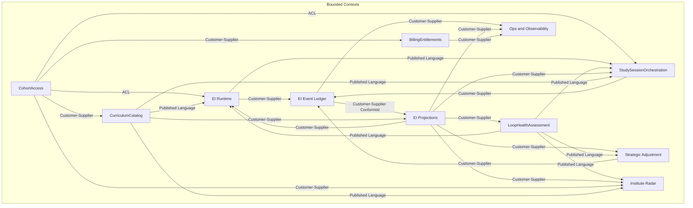

# Context Map

> **How to fill:** Define bounded context boundaries and their relationships. Use relationship types from [DDD-STRATEGIC.md](.agents/skills/clean-ddd-hexagonal/references/DDD-STRATEGIC.md): Customer-Supplier, Conformist, ACL, Partnership, Published Language.
>
> **Explanatory notes:** See [03-context-map-notes.md](03-context-map-notes.md) for upstream/downstream, pattern heuristics, and rationale.
>
> **Rule:** Each bounded context has its own ubiquitous language and model. Same real-world concept may mean different things across contexts.
>
> **Today:** Bounded contexts are implemented as modules within a monolith; this map still applies if later split into services.

---

## Bounded contexts

Aligned with [02-subdomains.md](02-subdomains.md). Subdomain names match Section B/C there. **Canvases:** [canvas-ei-runtime](canvas-ei-runtime.md), [canvas-study-session-orchestration](canvas-study-session-orchestration.md), [canvas-ei-event-ledger](canvas-ei-event-ledger.md), [canvas-ei-projections](canvas-ei-projections.md), [canvas-loop-health-assessment](canvas-loop-health-assessment.md) (core); [canvas-strategic-adjustment](canvas-strategic-adjustment.md), [canvas-cohort-access](canvas-cohort-access.md), [canvas-institute-radar](canvas-institute-radar.md), [canvas-ops-observability](canvas-ops-observability.md), [canvas-billing-entitlements](canvas-billing-entitlements.md), [canvas-curriculum-catalog](canvas-curriculum-catalog.md) (supporting + generic).

| Context                          | Responsibility                                                                                                                               | Subdomain(s)                                | Owned data (high-level)                                                                                                                            |
| -------------------------------- | -------------------------------------------------------------------------------------------------------------------------------------------- | ------------------------------------------- | -------------------------------------------------------------------------------------------------------------------------------------------------- |
| **CohortAccess**                 | Auth (Neon), server-derived student_id, cohorts, enrollment, roles; never trust client identity.                                             | CohortAccess (Identity, Cohorts, RBAC)      | Auth sessions, cohort membership, role assignments; see [05-cross-cutting-concerns.md#data-ownership](05-cross-cutting-concerns.md#data-ownership) |
| **EI Event Ledger**              | Append-only event store, idempotent writes, query by student; source of truth for what happened.                                             | Event Ledger                                | `ei_events`, idempotency keys; event schema ownership                                                                                              |
| **EI Projections**               | Compute and persist derived state/metrics from events (aggregates, topic state, policy) for fast queries.                                    | DerivedSignals                              | `ei_student_aggregates`, `ei_topic_state`, `ei_student_policy`; projection logic                                                                   |
| **LoopHealthAssessment**         | Interpret metrics into labels and produce LoopHealthSnapshot (thresholds, precedence); single place for "what is healthy."                   | LoopHealthAssessment                        | Labels, thresholds, precedence rules; LoopHealthSnapshot contract (target ownership even if not yet a separate module)                             |
| **EI Runtime**                   | P1/P2/P3 gate decisions, protocol play selection (Rescue/Neutral/Boost), emit protocol outputs. AdaptiveCoaching only — decides **what coaching move** to make **at** each gate. | AdaptiveCoaching | Protocol output contracts (NegotiatedIntent, ActivationPlan, VerificationDecision); gate routing logic; StudySession aggregate                     |
| **StudySessionOrchestration**    | End-to-end student-facing journey orchestration **across** gates: flow selection (WHEN), view composition (WHAT), input collection, cross-session adaptation. "What does the student see, and when?" See [ADR-005](decisions/adr-005-flow-level-adaptation.md). | StudySessionOrchestration | FlowTemplate definitions, SduiResponse contracts, microcopy, PresentationContext; FlowSelected + UI-produced events (AppOpen, IntentSet, SessionEnd, etc.) |
| **Strategic Adjustment**         | Next-cycle synthesis: emit StrategicAdjustmentDecision (dials, constraints); weekly or risk-triggered; policy feeds Runtime via Projections. | StrategicAdjustment                         | Policy semantics; SA decision schema; appends StrategicAdjustmentDecision to Ledger; Projections consume and persist policy                        |
| **Institute Radar**              | Privacy-safe triage: at most one primary alert per student, evidence summary, cohort-filtered; no raw events.                                | InstituteRadar                              | RadarAlert schema; alert types, priority ordering, dedupe rules                                                                                    |
| **Ops & Observability**          | Debug timeline, correlation ids, replay/backfill orchestration; observability semantics and safe repair.                                     | OpsObservability                            | Correlation IDs, job state, runbooks; read-only access to Ledger/Projections for debug                                                             |
| **BillingEntitlements** (future) | Coupons, redemptions, entitlement lifecycle, billing audit trail.                                                                            | BillingEntitlements                         | Coupons, redemptions, entitlements, audit log                                                                                                      |
| **CurriculumCatalog**            | Structured topic catalog with stable UUIDs; search, browse, institute-scoped filtering, normalization queue.                                | CurriculumCatalog                           | `curriculum_topics`, `curriculum_exams/subjects/units/chapters`, `institute_curriculum`, `topic_normalization_queue`                                |

---

## Context map diagram (Mermaid)

---

## Relationship catalog (detailed)

Contract names reference implemented schemas in [src/ei/schemas/events.ts](../../src/ei/schemas/events.ts) and [src/ei/schemas/outputs.ts](../../src/ei/schemas/outputs.ts) where applicable.

| Upstream             | Downstream           | Team relationship     | Context mapping pattern        | Integration style              | Contracts / messages                                                                                                                                                                                                                                                                                                                                                                                                                         | Notes                                                                                         |
| -------------------- | -------------------- | --------------------- | ------------------------------ | ------------------------------ | -------------------------------------------------------------------------------------------------------------------------------------------------------------------------------------------------------------------------------------------------------------------------------------------------------------------------------------------------------------------------------------------------------------------------------------------- | --------------------------------------------------------------------------------------------- |
| CohortAccess         | EI Runtime           | Upstream → Downstream | **ACL**                        | Sync (per request)             | Auth session / user claims → `studentId`, role, cohort scope                                                                                                                                                                                                                                                                                                                                                                                 | Never trust client-provided studentId; server-derived identity only.                          |
| CohortAccess         | SSO                  | Upstream → Downstream | **ACL**                        | Sync (per request)             | Auth session / user claims → `studentId`, role, cohort scope                                                                                                                                                                                                                                                                                                                                                                                 | SSO also needs server-derived identity for all student-facing routes.                         |
| CohortAccess         | Institute Radar      | Upstream → Downstream | Customer-Supplier              | Sync                           | Cohort scope, institute role for filtering                                                                                                                                                                                                                                                                                                                                                                                                   | Radar is cohort-scoped; CohortAccess owns membership.                                         |
| CohortAccess         | BillingEntitlements  | Upstream → Downstream | Customer-Supplier              | Sync / event                   | Who can redeem; membership change on redemption                                                                                                                                                                                                                                                                                                                                                                                              | Enrollment gating; atomic join on valid redemption.                                           |
| EI Runtime           | EI Event Ledger      | Upstream → Downstream | Customer-Supplier              | Sync append                    | **Protocol outputs (AC-owned events):** `SessionIntentIssued`, `ActivationPlanIssued`, `VerificationDecisionIssued`, `ScheduleMissed`. See `EventTypeEnum` in events.ts. StrategicAdjustmentDecision produced by SA (see SA → Ledger row). | Runtime appends gate output events; Ledger owns schema and idempotency.                       |
| EI Runtime           | SSO                  | Upstream → Downstream | **Published Language**         | Sync (gate output)             | Gate output VOs: `SessionIntentIssuedOutput`, `ActivationPlanIssuedOutput`, `VerificationDecisionIssuedOutput` — versioned contracts consumed by SSO's ViewComposer | SSO consumes gate outputs without influencing how they're produced. Same pattern as LHA→Runtime. |
| SSO                  | EI Event Ledger      | Upstream → Downstream | Customer-Supplier              | Sync append                    | **UI-produced events (SSO-owned):** `AppOpen`, `IntentSet`, `SessionEnd`, `FirstActionStarted`, `Replan`, `IntentResponse`, `RetrievalVerified`, `RetrievalScheduled`, `RetrievalSkipped`, `VerificationCompleted`; **SSO-specific:** `FlowSelected`, `IdentityMomentShown`. | SSO owns student command events; Ledger owns schema and idempotency.                          |
| EI Event Ledger      | EI Projections       | Upstream → Downstream | Customer-Supplier (Conformist) | Batch / recompute or sync read | Event stream: all types in `EventTypeEnum` + payload schemas (events.ts)                                                                                                                                                                                                                                                                                                                                                                     | Projections conform to Ledger event schema; source of truth is Ledger.                        |
| EI Projections       | LoopHealthAssessment | Upstream → Downstream | Customer-Supplier              | Sync query                     | Aggregates/topic state/policy: e.g. `openLoops`, `verificationRate7d`, `silenceDays`, `startLatencyMinMedian7d`, policy dials/constraints (see protocol-runner adaptAggregates/adaptPolicy)                                                                                                                                                                                                                                                  | Numeric evidence only; LoopHealthAssessment owns interpretation.                              |
| LoopHealthAssessment | EI Runtime           | Upstream → Downstream | **Published Language**         | Sync call                      | `LoopHealthSnapshot` (labels + key evidence)                                                                                                                                                                                                                                                                                                                                                                                                 | Target: Runtime consumes snapshot only; label/threshold tuning lives in LoopHealthAssessment. |
| LoopHealthAssessment | SSO                  | Upstream → Downstream | **Published Language**         | Sync call                      | `LoopHealthSnapshot` (mode for PresentationContext)                                                                                                                                                                                                                                                                                                                                                                                          | SSO uses mode for flow selection signals and PresentationContext.                             |
| LoopHealthAssessment | Institute Radar      | Upstream → Downstream | Published Language             | Sync call                      | Labels + aggregated evidence (no raw events)                                                                                                                                                                                                                                                                                                                                                                                                 | Privacy boundary: Radar never sees raw events or private text.                                |
| EI Projections       | EI Runtime           | Upstream → Downstream | Customer-Supplier              | Sync query                     | Aggregates, topic state (including **SessionLifecycleState**: session_phase, current_session_id, verification_floor, watch_only_flag, intent_source per [ADR-003](decisions/adr-003-projection-schema-evolution.md)), policy (for gate decisions). Cross-protocol constraints sourced from reconstituted aggregate ([ADR-004](decisions/adr-004-session-lifecycle-persistence.md)). | Runtime reads for P1/P2/P3; policy written by Strategic Adjustment.                           |
| EI Projections       | SSO                  | Upstream → Downstream | Customer-Supplier              | Sync query                     | StudentAggregates (pendingChecks, silenceDays, verificationRate7d, sessionsTotal), TopicState (session_phase for resume detection, consecutive_deferrals), StudentPolicy (dials/cohortFlags for A/B) | SSO reads for FlowSelectionContext (R1) + PresentationContext (R3).                           |
| Strategic Adjustment | EI Event Ledger      | Upstream → Downstream | Customer-Supplier              | Sync append                    | `StrategicAdjustmentDecision` (outputs.ts: dials, constraints, adjustmentMode, issuedAt)                                                                                                                                                                                                                                                                                                                                                     | SA appends; Ledger owns schema; Projections consume and persist to ei_student_policy.         |
| EI Projections       | Strategic Adjustment | Upstream → Downstream | Customer-Supplier              | Sync query                     | Aggregates/topic state/policy (openLoops, verificationRate7d, topic state, policy dials); see [signals.ts](../../src/ei/schemas/signals.ts)                                                                                                                                                                                                                                                                                                  | SA consumes state to decide policy; not interpretation (that comes from LHA).                 |
| LoopHealthAssessment | Strategic Adjustment | Upstream → Downstream | **Published Language**         | Sync call                      | `LoopHealthSnapshot` (labels + key evidence); same contract as LHA→Runtime                                                                                                                                                                                                                                                                                                                                                                   | SA uses labels for adjustment-mode choice; threshold tuning stays in LHA.                     |
| EI Projections       | Institute Radar      | Upstream → Downstream | **Published Language**         | Sync / feed                    | Privacy-safe signals/alerts feed (aggregated metrics only)                                                                                                                                                                                                                                                                                                                                                                                   | No raw events; versioned alert schema for Radar consumers.                                    |
| EI Event Ledger      | Ops & Observability  | Upstream → Downstream | Customer-Supplier              | Read-only / replay             | Event stream for debug timeline; replay job scope                                                                                                                                                                                                                                                                                                                                                                                            | OpsAuth (API key, cron, dev bypass); enables timeline debug and replay/backfill. No CohortAccess.                                                          |
| EI Projections       | Ops & Observability  | Upstream → Downstream | Customer-Supplier              | Read-only / backfill           | Projection state for debug; backfill job specs, versioning                                                                                                                                                                                                                                                                                                                                                                                   | Ops runs backfills; does not define metrics.                                                  |
| BillingEntitlements  | Ops & Observability  | Upstream → Downstream | Customer-Supplier              | Read-only query                | Billing audit, redemption history, entitlement status (for investigations; future)                                                                                                                                                                                                                                                                                                                                                           | Ops reads for support/finance investigations; does not define billing rules.                  |
| CohortAccess         | CurriculumCatalog    | Upstream → Downstream | Customer-Supplier              | Sync query                     | `instituteId` from AuthSession / cohort membership for institute-scoped browse filtering                                                                                                                                                                                                                                                                                                                                                     | CC queries institute scope; CohortAccess owns institute/cohort membership.                    |
| CurriculumCatalog    | EI Runtime           | Upstream → Downstream | **Published Language**         | Sync query                     | `TopicReference { topicId: UUID, topicName: string }` — stable topic identity for event creation                                                                                                                                                                                                                                                                                                                                             | Runtime consumes TopicReference; CC owns catalog, search, aliases.                            |
| CurriculumCatalog    | SSO                  | Upstream → Downstream | **Published Language**         | Sync query                     | `TopicReference { topicId: UUID, topicName: string }` — for ViewComposer topic picker and microcopy                                                                                                                                                                                                                                                                                                                                          | SSO consumes TopicReference for presentation; CC owns catalog.                                |
| CurriculumCatalog    | EI Projections       | Upstream → Downstream | Customer-Supplier              | Sync query                     | Catalog alias/UUID lookup for reconciling old string-based `topic` fields to stable `topicId` UUIDs                                                                                                                                                                                                                                                                                                                                          | Projections may normalize legacy topics; CC owns alias resolution.                            |
| CurriculumCatalog    | Institute Radar      | Upstream → Downstream | **Published Language**         | Sync query                     | Subject/exam grouping from curriculum hierarchy for SubjectAvoidance alerts and subject-level aggregation                                                                                                                                                                                                                                                                                                                                     | Radar uses catalog hierarchy; no raw student data flows to CC.                                |

---

## Governance notes (DDD-lite)

- **Hard boundaries**
  - **Server-derived identity:** All student-facing and institute-facing routes MUST obtain `studentId`/scope from CohortAccess (ACL); never trust client-provided identity.
  - **Append-only ledger:** EI Event Ledger is immutable and idempotent; no updates or deletes of events. Derived state can be recomputed from the log.
  - **Privacy boundary (Radar):** Institute Radar MUST NOT receive raw events or private text; only aggregated metrics and versioned alert types (Published Language).
- **Published Language (versioned contracts)**
  - **Radar alert schema:** Institute-facing alert types and evidence summary shape should be versioned; breaking changes require coordination with any Radar consumers.
  - **LoopHealthSnapshot:** If exposed as a formal API or event, version it; threshold/label changes stay inside LoopHealthAssessment.
- **Event ownership ([ADR-005](decisions/adr-005-flow-level-adaptation.md))**
  - **SSO-owned events (producer: "UI"/"SSO"):** `AppOpen`, `IntentSet`, `SessionEnd`, `FirstActionStarted`, `Replan`, `IntentResponse`, `RetrievalVerified`, `RetrievalScheduled`, `RetrievalSkipped`, `VerificationCompleted`, `FlowSelected`, `IdentityMomentShown`.
  - **AdaptiveCoaching-owned events (producer: "P1"/"P2"/"P3"):** `SessionIntentIssued`, `ActivationPlanIssued`, `VerificationDecisionIssued`, `ScheduleMissed`.
  - Both contexts append to the shared Ledger. Every event has exactly one owning BC.
- **Coordination**
  - **Event schema changes:** Adding or changing event types (events.ts) affects Event Ledger, Projections, and any replay/backfill; add new event types in a backward-compatible way where possible.
  - **Threshold/label tuning:** Owned by LoopHealthAssessment; changing thresholds does not require changing EI Runtime gate code, only the snapshot contract if it changes.
  - **Gate output contracts (Published Language):** `SessionIntentIssuedOutput`, `ActivationPlanIssuedOutput`, `VerificationDecisionIssuedOutput` are versioned contracts from EI Runtime consumed by SSO. Breaking changes require coordination.
  - **Catalog stability:** Once a `topicId` UUID is issued by CurriculumCatalog, it must not be reused or reassigned. Adding exams, subjects, or changing tree structure affects browse/search consumers but must not change existing topic UUIDs. `TopicReference` is a Published Language contract — breaking changes require coordination with EI Runtime, SSO, Projections, and Radar.

