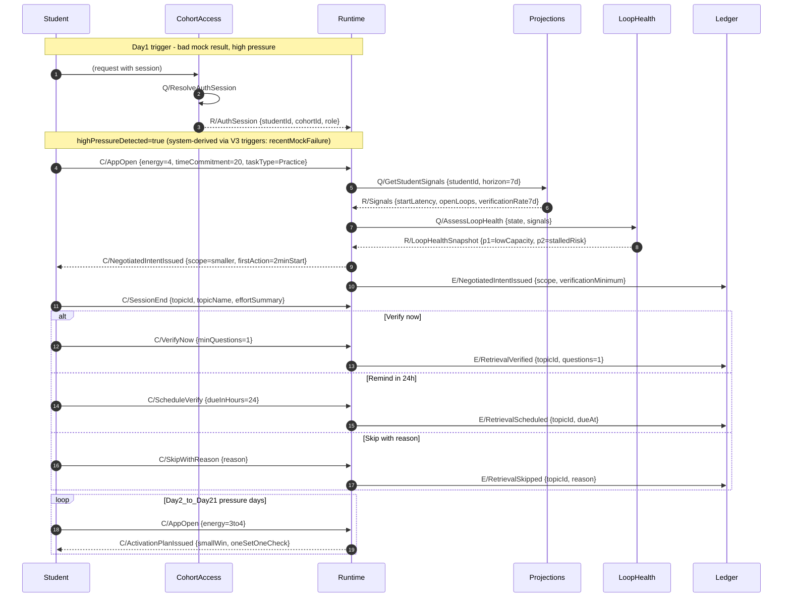
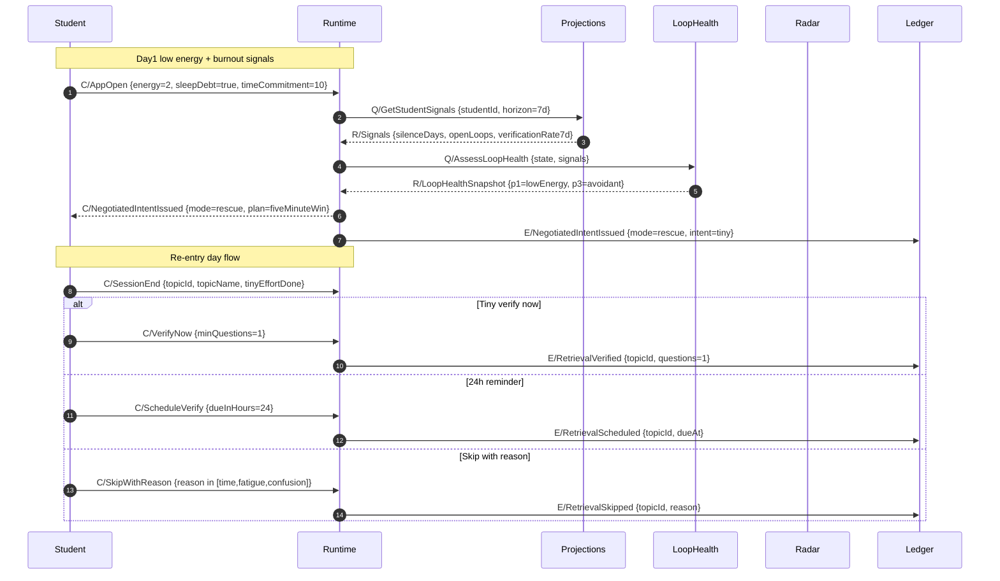
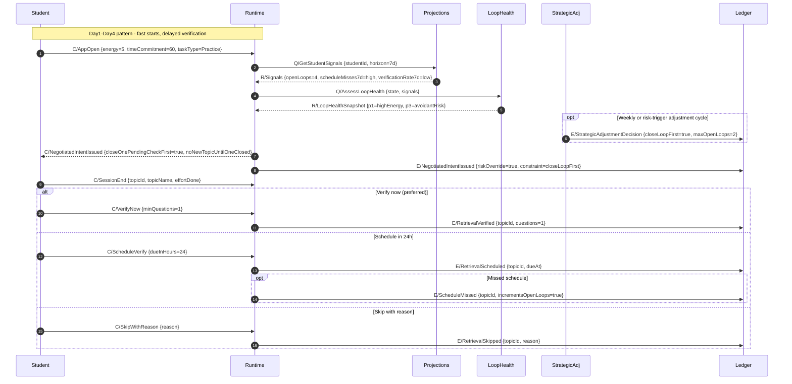

# Domain Message Flows - Storyboards (S2, S5, S7)

This document captures Domain Message Flow Modelling (DMF) for the three detailed storyboard journeys:

- `S2` Revenge planning after a bad mock
- `S5` Burnout runway plus silence
- `S7` High energy with rising pending checks

It follows the DMF guidance in [../domain-modelling-flow.md](../domain-modelling-flow.md) and maps interactions onto bounded contexts from [03-context-map.md](03-context-map.md).

---

## DMF notation and assumptions

- **Diagram type:** Mermaid `sequenceDiagram` (best fit for ordered message exchange).
- **Message kinds:** `C/` command, `Q/` query, `R/` response, `E/` domain event.
- **Payload hints:** each message includes only significant fields (not full schema).
- **Student-facing wording:** "Pending checks" corresponds to open retrieval loops (`openLoops` + schedule misses influence).
- **Scope level:** one canonical interaction loop per storyboard, with `alt/opt/loop` blocks for important branches.

### Participants used

- `Student` - user actor.
- `CohortAccess` - CohortAccess bounded context (auth, identity, cohort scope); resolves session → studentId before any EI processing.
- `CC` - CurriculumCatalog bounded context (topic search, browse, resolution); resolves free-text or selection → `TopicReference { topicId: UUID, topicName: string }`.
- `Runtime` - EI Runtime bounded context (gate orchestration and protocol outputs).
- `Projections` - EI Projections bounded context (aggregates/state/policy reads).
- `LoopHealth` - LoopHealthAssessment bounded context (labels and evidence synthesis).
- `StrategicAdj` - Strategic Adjustment bounded context (policy decisions to Projections).
- `Ledger` - EI Event Ledger bounded context (append-only source of truth).
- `Radar` - Institute Radar bounded context (privacy-safe risk signaling).

**GetStudentSignals:** The query is shown in diagrams as `Q/GetStudentSignals {studentId, horizon=7d}`; the 7d horizon is implicit in how Projections build and store aggregates/topic state (not a parameter of the read API).

---

## Topic Selection Flow (all scenarios)

Every study session begins with topic selection. This DMF shows how CurriculumCatalog resolves topic identity before Runtime processes the session. This flow precedes the P1 gate in all storyboards (S2, S5, S7).

```mermaid
sequenceDiagram
    autonumber
    participant Student
    participant CohortAccess
    participant Runtime
    participant CC
    participant Ledger

    Note over Student,CC: Phase 1 - Topic Selection (before P1 gate)
    Student->>CohortAccess: (request with session)
    CohortAccess->>CohortAccess: Q/ResolveAuthSession
    CohortAccess-->>Runtime: R/AuthSession {studentId, cohortId, instituteId}

    Note over Student,Runtime: timeCommitment and taskType absent for V1 SILENCE_RE_ENTRY, V3 HIGH_PRESSURE,<br/>V9 IDENTITY_MOMENT, V10 ONBOARDING; system uses mode-based fallback when absent.
    Student->>Runtime: C/AppOpen {energy, sleep, timeCommitment?, taskType?}

    Note over Runtime,CC: ViewComposer renders topic picker
    Runtime->>CC: Q/SearchTopics {query, instituteId, limit}
    CC-->>Runtime: R/SearchResult[] {topicId, topicName, examName, matchType}

    alt Student selects from catalog (type-ahead / browse / recent chip)
        Student->>CC: Q/BrowseTree {examId, subjectId, instituteId}
        CC-->>Student: R/CurriculumTreeLevel {nodes[]}
        Student->>Runtime: C/IntentSet {topicId, topicName}
    else Student types free-text (no match)
        Student->>Runtime: C/IntentSet {rawText}
        Runtime->>CC: C/ResolveTopic {rawText, studentId, instituteId}
        CC->>CC: alias lookup → fuzzy match → provisional fallback
        CC-->>Runtime: R/TopicReference {topicId: UUID, topicName}
        Note over CC: If provisional: persists entry + appends to normalization queue
    end

    Runtime->>Ledger: E/IntentSet {topicId, topicName}
    Note over Runtime,Ledger: Session continues with P1 gate (see S2/S5/S7 below)
```

**Key invariants:**
- **Never block the student:** Free-text always works. If no catalog match, CC creates a provisional topic with a stable UUID and logs to the normalization queue.
- **TopicReference is Published Language:** All downstream contexts (Runtime, Projections, Radar) consume `{ topicId: UUID, topicName: string }` from CC.
- **Institute scoping:** Search returns global results; institute topics ranked higher. Browse is filtered to the student's institute curriculum.

---

## S2 DMF - Revenge planning after a bad mock

Scenario intent: high-pressure situation detected (post-mock failure) despite decent energy, so Runtime must negotiate scope and force a tiny start plus tiny proof-of-learning.

> **Topic pre-resolved:** Topics are resolved via the [Topic Selection Flow](#topic-selection-flow-all-scenarios) before gate entry. Events below carry `topicId: UUID` + `topicName: string` from CurriculumCatalog.



---

## S5 DMF - Burnout runway plus silence

Scenario intent: re-entry and dignity preservation are primary. DMF emphasizes low-friction rescue, silence handling, and minimal compliance asks. Radar obtains LoopHealthSnapshot via Q/AssessLoopHealth when building daily triage; no push event.

> **Topic pre-resolved:** Topics are resolved via the [Topic Selection Flow](#topic-selection-flow-all-scenarios) before gate entry. Events below carry `topicId: UUID` + `topicName: string` from CurriculumCatalog.



---

## S7 DMF - High energy with rising pending checks

Scenario intent: risk overrides mood. Even with high energy and fast starts, rising open loops and missed schedules force close-loop-first constraints.

> **Topic pre-resolved:** Topics are resolved via the [Topic Selection Flow](#topic-selection-flow-all-scenarios) before gate entry. Events below carry `topicId: UUID` + `topicName: string` from CurriculumCatalog.



---

## Cross-scenario invariants reflected in DMFs

- **Server-derived identity:** All EI flows resolve identity via CohortAccess (ResolveAuthSession) before Runtime processes any command. `studentId` in GetStudentSignals, AppOpen, etc. comes from AuthSession, never from client body.
- **Risk over mood:** high energy alone does not permit Boost when adherence risk is high (`openLoops`, `scheduleMisses`, silence).
- **Tiny proof-of-learning:** every `SessionEnd` path preserves integrity through `VerifyNow`, bounded `ScheduleVerify`, or explicit `SkipWithReason`.
- **Ledger is source-of-truth:** protocol outputs and retrieval outcomes are appended as domain events.
- **Interpretation boundary:** `LoopHealth` owns labels and precedence; `Runtime` consumes snapshots for routing.
- **Student trust boundary:** rescue paths reduce friction and preserve dignity, especially in silence/burnout states.
- **Topic identity from catalog:** All topic references in events use `TopicReference { topicId: UUID, topicName: string }` from CurriculumCatalog. Free-text fallback creates a provisional entry; student is never blocked. See [Topic Selection Flow](#topic-selection-flow-all-scenarios) above.
- **Student declares, ELI adapts:** `timeCommitment` and `taskType` are collected on the checkin screen and flow into the AppOpen command payload. The P1 screen shows a ConfirmationStrip (topic . taskType . ~time) reflecting the student's own choices — not ELI's prescription — with a single "Let's go" CTA. Accept/Edit/Reject buttons no longer exist.
