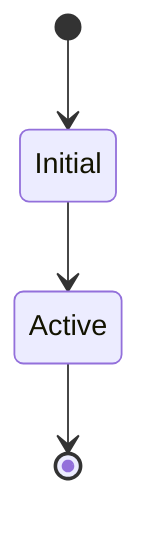

# Aggregate Design Canvas — [AggregateName]

**Owned by bounded context:** [ContextName]
**Related subdomain(s):** [SubdomainName(s)]
**Sources:** [02-subdomains.md](../02-subdomains.md), [03-context-map.md](../03-context-map.md), [05-domain-message-flows-storyboards.md](../05-domain-message-flows-storyboards.md), [05-cross-cutting-concerns.md](../05-cross-cutting-concerns.md)
**Code pointers (current):** `src/...`

---

## 1) Name

- **Aggregate:** [AggregateName]
- **Aggregate Type:** [Projection | Command Handler | Hybrid] — Projection = event-driven state; Command Handler = handles commands and emits events; Hybrid = both
- **Instance identity:** (e.g. studentId+topicId, studentId, orderId)
- **Lifetime:** (session / week / forever / …)

---

## 2) Description

- **Responsibility:**
- **Why these boundaries:**
- **Trade-offs:** (what you intentionally did NOT include)

---

## 2b) Dependencies

Upstream contexts, events, or aggregates this one depends on.

- 
- 

---

## 3) State Transitions

- **States:**
- **Transitions:**
- (Optional) Diagram:

---

## 4) Enforced Invariants

List the invariants this aggregate enforces atomically (within the consistency boundary).

- 
- 

---

## 5) Corrective Policies

If some invariants are relaxed, how do we correct later? (retries, compensations, reconciliations)

- 
- 

---

## 6) Handled Commands

Commands that mutate the aggregate.

| Command | Preconditions | State changes | Notes |
|---------|---------------|---------------|-------|
| | | | |

---

## 7) Created Events

Events emitted as a result of processing commands.

| Event | Triggered by (command) | Key fields | Consumers |
|-------|------------------------|------------|-----------|
| | | | |

---

## 7b) Supported Queries

Read operations that return aggregate state (or subsets). Map to GetX / R/X patterns from message flows.

| Query | Key params | Returns | Notes |
|-------|------------|---------|-------|
| | | | |

---

## 8) Throughput (concurrency risk)

| Metric | Average | Maximum | Notes |
|--------|---------|---------|-------|
| Command handling rate | | | |
| Total number of clients | | | |
| Concurrency conflict chance | | | |

---

## 9) Size

| Metric | Average | Maximum | Notes |
|--------|---------|---------|-------|
| Event growth rate | | | |
| Lifetime of a single instance | | | |
| Number of events persisted | | | |

---

## 9b) Storage & Projection

Where aggregate state lives and how it is written/read.

| Aspect | Value | Notes |
|--------|-------|-------|
| Table(s) / store | | Per [05-cross-cutting-concerns.md#data-ownership](../05-cross-cutting-concerns.md#data-ownership) |
| Write path | | Who writes; sync vs batch/recompute |
| Read path | | Who reads; latency expectations |
| Replay / recompute | | Can state be rebuilt from events? |

---

## Open questions

- 
