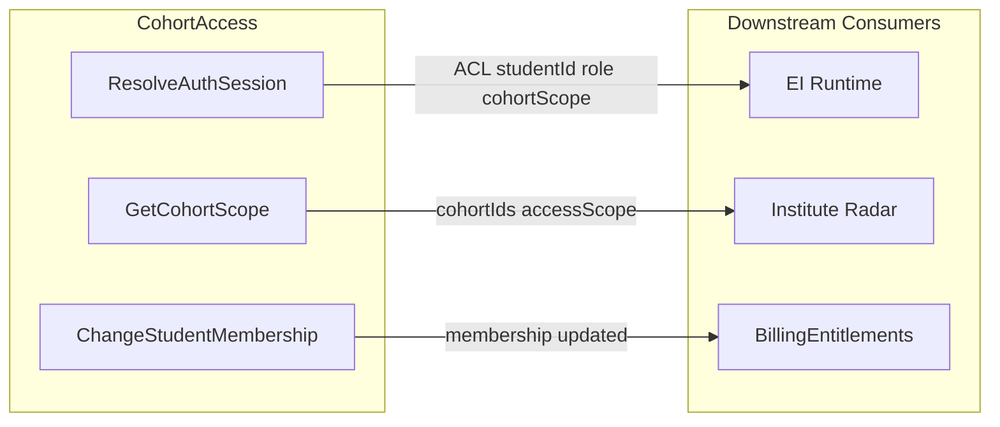

# CohortAccess — Tactical DDD Spec

> Sources: [canvas-cohort-access.md](../canvas-cohort-access.md), [03-context-map.md](../03-context-map.md), [05-cross-cutting-concerns.md](../05-cross-cutting-concerns.md), [01-ei-tactical-conventions.md](01-ei-tactical-conventions.md), [student-membership-tactical-spec.md](student-membership-tactical-spec.md), [DDD-TACTICAL.md](../../../.agents/skills/clean-ddd-hexagonal/references/DDD-TACTICAL.md), [HEXAGONAL.md](../../../.agents/skills/clean-ddd-hexagonal/references/HEXAGONAL.md), [LAYERS.md](../../../.agents/skills/clean-ddd-hexagonal/references/LAYERS.md).

---

## Strategic Alignment Addendum

Before implementation, the following alignment was verified:

| Document | Status |
|----------|--------|
| [02-subdomains.md](../02-subdomains.md) | Aligned — CohortAccess (Generic, Focus: Now); full subdomain definition |
| [03-context-map.md](../03-context-map.md) | Aligned — CohortAccess → EI Runtime (ACL), → Institute Radar (Customer-Supplier), → BillingEntitlements (Customer-Supplier) |
| [canvas-cohort-access.md](../canvas-cohort-access.md) | Aligned — Purpose, UL, inbound/outbound comm, business decisions |
| [05-cross-cutting-concerns.md](../05-cross-cutting-concerns.md) | Aligned — ACL, invariants (server-derived identity) |
| [agg-student-membership.md](../aggregates/agg-student-membership.md) | Aligned — Aggregate canvas |
| [student-membership-tactical-spec.md](student-membership-tactical-spec.md) | Aligned — Tactical spec for StudentMembership |

**Remaining gaps (docs only):**
1. **05-domain-message-flows-storyboards.md** — CohortAccess absent from sequence diagrams; add ResolveAuthSession before Runtime in at least one flow.
2. **05-cross-cutting-concerns** data ownership — Tables listed under "Identity"; should be "CohortAccess" for consistency.

---

## 1) Why Aggregates vs Domain Services

CohortAccess has **one aggregate** (StudentMembership) and **no domain services**. Auth resolution is infrastructure, not domain.

Per CHEATSHEET.md "Aggregate boundary?" decision tree:
> "Must these objects change together atomically? YES → Same aggregate"

StudentMembership enforces "exactly one active cohort or unassigned" per student. The cohortId and membershipState change together atomically on AdminEnroll or MembershipChangeOnRedemption — hence an aggregate.

**Auth resolution** (auth_user_id → studentId, cohortId, role) does **not** belong in domain:
- It requires external systems (Neon Auth, DB lookup)
- No domain invariants to enforce — it is a lookup/translation
- Correctly modeled as a **driven port** (`IResolveAuthSessionPort`) implemented by infrastructure

**GetCohortScope** (cohort scope for institute users) is a read-model query, not aggregate loading. It uses `IGetInstituteScopePort` (driven) — separate from the aggregate repository.

---

## 2) Aggregate: StudentMembership

- **Identity:** `studentId` — one instance per student
- **Aggregate type:** Command Handler (per `01-ei-tactical-conventions.md` §6)
- **Consistency boundary:** One student's membership state (active cohort or unassigned)
- **Location:** `src/cohort-access/domain/student-membership/`

Full specification: [student-membership-tactical-spec.md](student-membership-tactical-spec.md).

CohortAccess has no StudySession-like aggregate. StudentMembership is the only aggregate in this bounded context.

---

## 3) Ubiquitous Language (Tactical)

| Term | Definition |
|------|-------------|
| AuthSession | Value Object: server-validated session; yields studentId, cohortId, role, accessScope |
| student_id | Server-derived identity; never trusted from client |
| StudentId | Value Object: identity wrapper |
| CohortId | Value Object: identifier of cohort |
| Institute | Tenant; owns cohorts and roles |
| Cohort | Group of students; scope boundary for institute views |
| Membership | active(cohortId) or unassigned; exactly one per student |
| Role | student \| admin \| institute — governs RBAC |
| AccessScope | Cohort-scoped or global; determined by role and membership |
| ResolveAuthSession | Use case: resolve auth session → AuthSession |
| GetCohortScope | Use case: return cohortIds, role, accessScope for institute user |
| ChangeStudentMembership | Use case: AdminEnroll or MembershipChangeOnRedemption |
| Platform ops            | Out of scope. Backfill, observability, and platform operations use Ops-specific auth (API key, cron secret); CohortAccess does not own identity for platform operators. |

---

## 4) Auth Resolution (ACL Entry Point)

Auth resolution is the **ACL** between Neon Auth (external) and EI Runtime (and other consumers). It translates Neon Auth session + DB lookup → `AuthSession` (our domain model).

**Flow:**
1. Request arrives with session cookie (or Bearer token)
2. ResolveAuthSessionHandler calls `IResolveAuthSessionPort.resolve(sessionContext)`
3. Adapter: (a) validates session via Neon Auth → auth_user_id, (b) looks up students table → student_id, (c) looks up student_cohort_membership → cohortId, (d) determines role
4. Returns `AuthSession` (studentId, cohortId, role, accessScope)

**No domain state** — pure infrastructure orchestration. The handler delegates to the driven port.

---

## 5) Value Objects (CHEATSHEET-compliant)

Per [CHEATSHEET](.agents/skills/clean-ddd-hexagonal/references/CHEATSHEET.md): private constructor, `static create()`, validation on construction, `equals()` for value equality.

### 5a) AuthSession

```typescript
class AuthSession {
  private constructor(private readonly props: AuthSessionProps) {}

  static create(props: {
    studentId: string;
    cohortId: string | null;
    role: Role;
    accessScope: AccessScope;
  }): AuthSession
  // Validates: studentId non-empty, role in allowed enum, accessScope valid

  get studentId(): string
  get cohortId(): string | null
  get role(): Role
  get accessScope(): AccessScope
  equals(other: AuthSession): boolean
}
```

### 5b) AccessScope

```typescript
class AccessScope {
  private constructor(private readonly props: AccessScopeProps) {}

  static create(props: {
    cohortIds: string[];
    scope: 'cohort' | 'global';
  }): AccessScope
  // Validates: cohortIds array, scope enum

  get cohortIds(): string[]
  get scope(): 'cohort' | 'global'
  equals(other: AccessScope): boolean
}
```

### 5c) Role

Enum or VO:

```typescript
type Role = 'student' | 'admin' | 'institute';

// If VO:
class Role {
  private constructor(private readonly _value: Role) {}
  static create(value: 'student' | 'admin' | 'institute'): Role
  get value(): Role
  equals(other: Role): boolean
}
```

### 5d) StudentId, CohortId

From `domain/shared/ids.ts` or equivalent; avoid stringly-typed IDs.

---

## 6) Invariants (Must Hold)

Per [canvas-cohort-access.md](../canvas-cohort-access.md) and [05-cross-cutting-concerns.md](../05-cross-cutting-concerns.md):

1. **Server-derived identity:** All routes obtain studentId from CohortAccess; never trust client-provided studentId.
2. **Exactly one active cohort or unassigned:** No student may have two active states simultaneously.
3. **Zero cross-cohort visibility:** Institute views are strictly cohort-scoped.
4. **Zero privilege escalation:** Institute admin role and cohort-scope checks enforced; no elevation via client input.
5. **Atomic join on valid redemption:** Coupon redemption → membership update is atomic; read-your-writes consistency.
6. **Idempotency:** Same idempotency key + same cohort → no-op for redemption commands.
7. **CohortAccess roles apply only to coaching institute domain:** Roles (student, admin, institute) apply only to coaching institute domain. No platform or super-admin role.

---

## 7) Ports (Hexagonal Architecture)

Per HEXAGONAL.md: Driver ports = "how the world uses your app"; Driven ports = "how your app uses external systems."

### Driver Ports (Application layer)

| Port Interface | Pattern | Implemented by |
|----------------|---------|----------------|
| `IResolveAuthSessionUseCase` | `I{Action}UseCase` | `ResolveAuthSessionHandler` |
| `IGetCohortScopeUseCase` | `I{Action}UseCase` | `GetCohortScopeHandler` |
| `IChangeStudentMembershipUseCase` | `I{Action}UseCase` | `ChangeStudentMembershipHandler` |

### Driven Ports (called by use case handlers)

| Port Interface | Pattern | Location | Implemented by |
|----------------|---------|----------|----------------|
| `IResolveAuthSessionPort` | `I{Action}Port` | `application/resolve-auth-session/port.ts` | `NeonAuthResolverPg` (infrastructure/auth/) |
| `IStudentMembershipRepository` | `I{Aggregate}Repository` | `domain/student-membership/repository.ts` | `StudentMembershipRepositoryPg` |
| `IIdempotencyKeyStore` | `I{Resource}Port` | `application/change-student-membership/port.ts` or `application/shared/` | `IdempotencyKeyStorePg` (uses `ei_idempotency_keys`) |
| `IGetInstituteScopePort` | `I{Resource}Port` | `application/get-cohort-scope/port.ts` | `GetInstituteScopePg` |

---

## 8) Application Use Cases

### ResolveAuthSessionHandler

```typescript
export class ResolveAuthSessionHandler implements IResolveAuthSessionUseCase {
  constructor(private readonly resolveAuthPort: IResolveAuthSessionPort) {}

  async execute(command: ResolveAuthSessionCommand): Promise<AuthSession | null> {
    return this.resolveAuthPort.resolve(command.sessionContext);
  }
}
```

Input: session cookie or request context. Output: AuthSession or null (unauthenticated).

### GetCohortScopeHandler

```typescript
export class GetCohortScopeHandler implements IGetCohortScopeUseCase {
  constructor(private readonly getInstituteScope: IGetInstituteScopePort) {}

  async execute(command: GetCohortScopeCommand): Promise<CohortScopeResult> {
    return this.getInstituteScope.getScope(command.instituteUserId);
  }
}
```

Returns `{ cohortIds, role, accessScope }` for Institute Radar.

### ChangeStudentMembershipHandler

Per [student-membership-tactical-spec.md](student-membership-tactical-spec.md) §8:

- Input: `{ studentId, targetCohortId, source: 'admin' | 'redemption', idempotencyKey? }`
- Delegates to StudentMembership aggregate (AdminEnroll or MembershipChangeOnRedemption)
- Uses IIdempotencyKeyStore for redemption idempotency

---

## 9) File Structure

```
src/cohort-access/
├── domain/
│   ├── student-membership/
│   │   ├── student-membership.ts
│   │   ├── value-objects.ts
│   │   ├── events.ts            # MembershipChanged (optional)
│   │   ├── repository.ts
│   │   └── errors.ts
│   └── shared/
│       ├── auth-session.ts      # AuthSession VO
│       ├── access-scope.ts      # AccessScope VO
│       └── role.ts              # Role enum / VO
├── application/
│   ├── resolve-auth-session/
│   │   ├── command.ts
│   │   ├── handler.ts
│   │   └── port.ts
│   ├── get-cohort-scope/
│   │   ├── command.ts
│   │   ├── handler.ts
│   │   └── port.ts
│   └── change-student-membership/
│       ├── command.ts
│       ├── handler.ts
│       └── port.ts
└── infrastructure/
    ├── auth/
    │   └── neon-auth-resolver.pg.ts   # IResolveAuthSessionPort
    └── persistence/
        ├── student-membership-repository.pg.ts
        ├── idempotency-key-store.pg.ts   # IIdempotencyKeyStore
        └── get-institute-scope.pg.ts     # IGetInstituteScopePort
```

---

## 10) Composition Root and Wiring

Next.js route handlers or a server-side setup (e.g. `lib/cohort-access.ts` or route-level factory) instantiates adapters and handlers. EI routes receive `IResolveAuthSessionUseCase` and gate handlers via constructor or props. No DI container required for MVP; wire at app bootstrap or per-route as needed.

---

## 11) Auth — Production State

Migration complete. The system runs on Neon Auth (Google OAuth) only.

| Aspect | Production |
|--------|-----------|
| Auth | Neon Auth session cookie (required) |
| Student identity | Server-derived from ResolveAuthSession; never trusted from client body |
| CohortAccess module | `src/cohort-access/` — ResolveAuthSession, GetCohortScope, ChangeStudentMembership |

**EI integration:** `src/app/api/ei/with-session.ts` calls `ResolveAuthSessionHandler.execute(req)` before EI gate handlers. `authSession.studentId` is passed to RunP1Gate, RunP2Gate, RunP3Gate. Request body must NOT include studentId for authorization purposes.

**EI import boundaries:** EI imports `IResolveAuthSessionUseCase` from `src/cohort-access/application/resolve-auth-session/port.ts` and `AuthSession` from `src/cohort-access/domain/shared/auth-session.ts`. EI must never import from `src/cohort-access/infrastructure/`.

---

## 12) Test Strategy

Per `01-ei-tactical-conventions.md` §13: domain unit tests use no mocks; application unit tests use in-memory (fake) adapters.

| Scenario | Layer | Test type |
|----------|-------|-----------|
| AuthSession invalid studentId | Domain | Unit — DomainError thrown |
| AccessScope invalid scope | Domain | Unit — DomainError thrown |
| ResolveAuthSessionHandler: unauthenticated | Application | Unit — returns null |
| ResolveAuthSessionHandler: valid session | Application | Unit — returns AuthSession with fake IResolveAuthSessionPort |
| ChangeStudentMembership: duplicate idempotency key | Application | Unit — no-op, returns existing state |
| ChangeStudentMembership: conflicting idempotency key | Application | Unit — reject |
| First enrollment | Domain | Unit — membershipState = active(cohortId) |

---

## 13) Context Map Flow



---

## 14) Open Questions

- Idempotency key format: `redemptionId` vs `couponId + userId`.
- Leave / revoke path (unassigned transition): deferred to future.
- Whether `MembershipChanged` event should be published to Ledger for downstream consumers.
- Cohort validation: should StudentMembership verify `targetCohortId` exists, or trust the caller?
- Student+Parent household model: future extension for parent role.

---

## References

- [canvas-cohort-access.md](../canvas-cohort-access.md)
- [03-context-map.md](../03-context-map.md)
- [05-cross-cutting-concerns.md](../05-cross-cutting-concerns.md)
- [student-membership-tactical-spec.md](student-membership-tactical-spec.md)
- [01-ei-tactical-conventions.md](01-ei-tactical-conventions.md)
- [.agents/skills/clean-ddd-hexagonal/references/DDD-TACTICAL.md](../../../.agents/skills/clean-ddd-hexagonal/references/DDD-TACTICAL.md)
- [.agents/skills/clean-ddd-hexagonal/references/HEXAGONAL.md](../../../.agents/skills/clean-ddd-hexagonal/references/HEXAGONAL.md)
- [.agents/skills/clean-ddd-hexagonal/references/LAYERS.md](../../../.agents/skills/clean-ddd-hexagonal/references/LAYERS.md)
