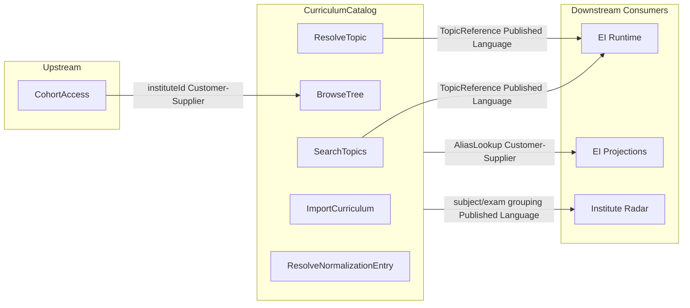

# CurriculumCatalog — Tactical DDD Spec

> Sources: [canvas-curriculum-catalog.md](../canvas-curriculum-catalog.md), [14-topic-selection-system.md](../../student-ux-architecture/14-topic-selection-system.md), [03-context-map.md](../03-context-map.md), [05-cross-cutting-concerns.md](../05-cross-cutting-concerns.md), [01-ei-tactical-conventions.md](01-ei-tactical-conventions.md), [DDD-TACTICAL.md](../../../.agents/skills/clean-ddd-hexagonal/references/DDD-TACTICAL.md), [HEXAGONAL.md](../../../.agents/skills/clean-ddd-hexagonal/references/HEXAGONAL.md), [LAYERS.md](../../../.agents/skills/clean-ddd-hexagonal/references/LAYERS.md).

---

## Strategic Alignment Addendum

Before implementation, the following alignment was verified:

| Document | Status |
|----------|--------|
| [02-subdomains.md](../02-subdomains.md) | Aligned — CurriculumCatalog (Supporting, Focus: Now); subdomain #12 |
| [03-context-map.md](../03-context-map.md) | Aligned — CohortAccess → CC (Customer-Supplier), CC → EI Runtime (Published Language), CC → EI Projections (Customer-Supplier), CC → Institute Radar (Published Language) |
| [canvas-curriculum-catalog.md](../canvas-curriculum-catalog.md) | Aligned — Purpose, UL, inbound/outbound comm, business decisions |
| [05-cross-cutting-concerns.md](../05-cross-cutting-concerns.md) | Aligned — Data ownership (7 tables), Topic ID evolution note in event catalog |
| [09-tactical-ddd-candidates.md](../09-tactical-ddd-candidates.md) | Aligned — TopicReference VO, planned `src/curriculum-catalog/` layout |

**Remaining gaps (docs only):**
1. **05-domain-message-flows-storyboards.md** — CurriculumCatalog absent from sequence diagrams; add ResolveTopic before Runtime in topic-selection flows.

---

## 1) Purpose and Boundary

CurriculumCatalog provides a structured, searchable catalog of study topics with stable identifiers. It replaces the current free-text topic input (`topic: z.string()`) with a curriculum tree backed by stable UUIDs, type-ahead search, institute-scoped browse, and a normalization queue for unmapped free-text fallback.

**Building blocks:** Entities (CatalogTopic, NormalizationQueueEntry), Domain Service (TopicSearchService), Value Objects (TopicReference as Published Language), Ports, Use Cases. **No Aggregate.**

**No Aggregate rationale:** CatalogTopic is simple reference data — no lifecycle state machine, no cross-entity transactional invariants, CRUD-only, read-heavy. NormalizationQueueEntry has a trivial pending-to-resolved lifecycle managed by an application use case, not by aggregate-level invariants. Per CHEATSHEET.md "Aggregate boundary?" decision tree: "Must these objects change together atomically?" — No; CatalogTopic and NormalizationQueueEntry are independent entities.

**What CurriculumCatalog IS:**
- Information holder: canonical topic catalog (source of truth for topic identity)
- Gateway: search/browse API surface for topic selection
- Producer of Published Language (`TopicReference`)

**What CurriculumCatalog is NOT:**
- Not a coaching decision maker (that is EI Runtime / AdaptiveCoaching)
- Not the owner of topic state or loop health (that is EI Projections / DerivedSignals)
- Not the owner of events or event schema (that is EI Event Ledger)
- Not the identity/auth boundary (that is CohortAccess)
- Not the UX rendering layer (that is StudySessionOrchestration / ViewComposer)

---

## 2) Ubiquitous Language (Tactical)

| Term | Definition |
|------|------------|
| CatalogTopic | **Entity (no aggregate):** leaf-level study topic with stable UUID, display name, aliases, hierarchy references (examId, subjectId, unitId, chapterId). Identity by topicId. |
| TopicId | **Value Object (identity):** stable UUID; never reused or reassigned once issued. |
| TopicName | **Value type:** display string for a topic (e.g. "Thermodynamics"). |
| Alias | **Value type:** alternative name or abbreviation that resolves to a CatalogTopic (e.g. "thermo" → Thermodynamics). |
| TopicReference | **Published Language Value Object:** `{ topicId: UUID, topicName: string }` — immutable, equality by value. Contract consumed by EI Runtime, Projections, Radar. |
| ExamId | **Value Object (identity):** UUID for an exam (e.g. JEE Main). |
| SubjectId | **Value Object (identity):** UUID for a subject under an exam. |
| UnitId | **Value Object (identity):** UUID for a unit under a subject. |
| ChapterId | **Value Object (identity):** UUID for a chapter under a unit. |
| CurriculumTree | **Read Model:** hierarchical Exam → Subject → Unit → Chapter → Topic structure; assembled on query. |
| InstituteCurriculum | **Association Entity:** links an institute to a subset of catalog topics for scoped browse. |
| NormalizationQueueEntry | **Lightweight Entity:** unmapped free-text input awaiting ops resolution; lifecycle: `pending` → `resolved`. Identity by entry id. |
| TopicSearchService | **Domain Service (stateless):** fuzzy match, ranking, institute-priority boosting. |
| Provisional topic | A CatalogTopic created from free-text fallback with `provisional: true`; awaiting normalization queue resolution. |

---

## 3) Entities

### 3a) CatalogTopic

- **Identity:** `topicId` (UUID) — stable, permanent, never reassigned
- **Not an aggregate** because: simple reference data, no lifecycle state machine, no cross-entity transactional invariants, read-heavy CRUD-only
- **Persistence:** `curriculum_topics` table

```typescript
interface CatalogTopic {
  topicId: string;           // stable UUID
  name: string;              // display name
  aliases: string[];         // alternative names for search/resolution
  examId: string;            // FK to curriculum_exams
  subjectId: string;         // FK to curriculum_subjects
  unitId: string;            // FK to curriculum_units
  chapterId: string;         // FK to curriculum_chapters
  provisional: boolean;      // true if created from free-text fallback
  createdAt: Date;
  updatedAt: Date;
}
```

**Provisional flag:** When a student types free-text that doesn't match the catalog, a provisional CatalogTopic is created immediately with `provisional: true`. This ensures the UUID is stable from the first submission. When ops resolves the normalization queue entry, the provisional entry is either merged into an existing topic (alias added) or confirmed as a real entry (`provisional: false`).

**Topic collision across exams:** "Thermodynamics" in JEE and "Thermodynamics" in NEET are separate CatalogTopic entries with separate UUIDs. Different exam context = different topic entity.

### 3b) NormalizationQueueEntry

- **Identity:** `id` (UUID)
- **Lifecycle:** `pending` → `resolved` (simple two-state, no complex state machine)
- **Persistence:** `topic_normalization_queue` table

```typescript
interface NormalizationQueueEntry {
  id: string;                    // UUID
  rawText: string;               // student's original typed input
  studentId: string;             // who triggered it
  occurredAt: Date;              // when the free-text was submitted
  status: 'pending' | 'resolved';
  resolvedTopicId: string | null;   // the catalog topic it was mapped to
  resolvedAlias: string | null;     // alias created (if any)
  resolvedAt: Date | null;
  resolvedBy: string | null;        // ops user identifier
}
```

**Resolution actions:** Ops resolves an entry by either:
1. Mapping raw text as a new alias to an existing CatalogTopic → sets `resolvedTopicId`, adds alias
2. Confirming the provisional CatalogTopic as real → sets `provisional: false`, sets `resolvedTopicId`

---

## 4) Value Objects (CHEATSHEET-compliant)

Per [CHEATSHEET](.agents/skills/clean-ddd-hexagonal/references/CHEATSHEET.md): private constructor, `static create()`, validation on construction, `equals()` for value equality.

### 4a) TopicReference (Published Language)

```typescript
class TopicReference {
  private constructor(private readonly props: TopicReferenceProps) {}

  static create(props: {
    topicId: string;
    topicName: string;
  }): TopicReference
  // Validates: topicId non-empty UUID, topicName non-empty string

  get topicId(): string
  get topicName(): string
  equals(other: TopicReference): boolean
}
```

This is the Published Language VO consumed by EI Runtime (event creation, ViewComposer topic picker), Projections (alias reconciliation), and Radar (subject grouping). Changing its shape requires coordination per `03-context-map.md` governance notes.

### 4b) ExamId, SubjectId, UnitId, ChapterId

Simple identity VOs — private constructor, `static create()` with UUID validation, `equals()` by value. Can share a common base pattern:

```typescript
class ExamId {
  private constructor(private readonly _value: string) {}
  static create(value: string): ExamId  // Validates: non-empty UUID
  get value(): string
  equals(other: ExamId): boolean
}
// SubjectId, UnitId, ChapterId follow same pattern
```

### 4c) SearchResult

Structural VO for type-ahead search output:

```typescript
interface SearchResult {
  topicId: string;
  topicName: string;
  examName: string;
  matchType: 'prefix' | 'fuzzy' | 'substring';
  isInstituteCurriculum: boolean;
}
```

### 4d) ImportResult

Structural VO for import outcome:

```typescript
interface ImportResult {
  created: number;
  deduplicated: number;
  errors: Array<{ row: number; reason: string }>;
}
```

### Summary

| Name | Kind | Immutable | Code pointer |
|------|------|-----------|--------------|
| TopicReference | Published Language VO | Yes | `domain/value-objects.ts` |
| ExamId | Identity VO | Yes | `domain/value-objects.ts` |
| SubjectId | Identity VO | Yes | `domain/value-objects.ts` |
| UnitId | Identity VO | Yes | `domain/value-objects.ts` |
| ChapterId | Identity VO | Yes | `domain/value-objects.ts` |
| SearchResult | Structural VO | By convention | `application/search-topics/` |
| ImportResult | Structural VO | By convention | `application/import-curriculum/` |

---

## 5) Domain Service: TopicSearchService

Per CHEATSHEET.md "Domain Service?" decision tree:
> "Does this logic naturally belong to a single entity?" — NO (spans multiple entities, requires index and ranking).
> "Is it stateless business logic?" — YES.
> Conclusion: **Domain Service.**

```typescript
interface ITopicSearchService {
  search(query: string, instituteId: string | null, limit?: number): SearchResult[];
}
```

**Ranking algorithm** (from [14-topic-selection-system.md](../../student-ux-architecture/14-topic-selection-system.md)):

1. Exact prefix from **institute curriculum** (highest priority)
2. Exact prefix from **general catalog**
3. Fuzzy/substring from **institute curriculum**
4. Fuzzy/substring from **general catalog**

Each result shows an exam badge (e.g. `(JEE)`, `(NEET)`) for disambiguation.

**Implementation note:** The domain service interface defines the ranking contract. The infrastructure adapter (`topic-search-adapter.pg.ts`) implements it using `pg_trgm` or prefix-match queries. The domain layer does not know about Postgres.

---

## 6) Invariants (Must Hold)

Per [canvas-curriculum-catalog.md](../canvas-curriculum-catalog.md) and [05-cross-cutting-concerns.md](../05-cross-cutting-concerns.md):

1. **UUID stability:** Once a `topicId` UUID is issued, it must not be reused or reassigned. Downstream contexts (events, projections, radar) depend on UUID stability.
2. **Never block the student:** Free-text fallback always works. If the catalog has no match, accept the raw string, create a provisional CatalogTopic, log to normalization queue. Zero friction added.
3. **Search unrestricted; browse scoped:** Type-ahead search returns results from the full catalog (institute topics ranked higher). Hierarchical browse is filtered to the student's institute curriculum.
4. **Append-only ledger preserved:** No retroactive event rewriting. Old events with `topic: z.string()` are never backfilled. Projections reconcile via alias lookup.
5. **Dedup on import:** Institute curriculum imports deduplicate against existing catalog entries (match by normalized name + exam context). No duplicate topic UUIDs for the same logical topic.
6. **TopicReference is Published Language:** Changes to `TopicReference { topicId, topicName }` require coordination with EI Runtime, Projections, and Radar per context map governance.

---

## 7) Input/Output Contracts (per use case)

### 7a) SearchTopics

**Input:**

| Field | Type | Required | Description |
|-------|------|----------|-------------|
| query | string | Yes | Type-ahead search string (min 2 chars) |
| instituteId | string (UUID) | No | For institute-priority ranking (from CohortAccess) |
| limit | number | No | Max results (default 5, max 10) |

**Output:** `SearchResult[]` — ranked by prefix/fuzzy/substring, institute priority.

**Errors:** Query too short (< 2 chars).

### 7b) BrowseTree

**Input:**

| Field | Type | Required | Description |
|-------|------|----------|-------------|
| instituteId | string (UUID) | No | Scopes tree to institute curriculum; null = full catalog |
| examId | string (UUID) | No | Filter to specific exam |
| subjectId | string (UUID) | No | Filter to specific subject |
| unitId | string (UUID) | No | Filter to specific unit |
| chapterId | string (UUID) | No | Filter to specific chapter |

**Output:** `CurriculumTreeLevel { items: TreeItem[], currentLevel: 'exam' | 'subject' | 'unit' | 'chapter' | 'topic' }`

**Errors:** Invalid hierarchy reference.

### 7c) ResolveTopic

**Input:**

| Field | Type | Required | Description |
|-------|------|----------|-------------|
| rawText | string | Yes | Student-typed topic string |
| studentId | string | Yes | For normalization queue logging |
| instituteId | string (UUID) | No | For alias resolution priority |

**Output:** `TopicReference { topicId, topicName }` — **always succeeds** (invariant #2).

**Side effects (on no catalog match):**
1. Create provisional CatalogTopic in `curriculum_topics` with `provisional: true`
2. Append NormalizationQueueEntry with `status: 'pending'`

**Errors:** None — this use case never fails ("never block the student" invariant).

### 7d) ImportCurriculum

**Input:**

| Field | Type | Required | Description |
|-------|------|----------|-------------|
| instituteId | string (UUID) | Yes | Target institute |
| examId | string (UUID) | Yes | Exam context for the import |
| rows | ImportRow[] | Yes | Parsed rows: `{ subject, unit?, chapter, topic }` |

**Output:** `ImportResult { created, deduplicated, errors }`

**Errors:** Invalid row format; fewer than minimum rows.

### 7e) ResolveNormalizationEntry

**Input:**

| Field | Type | Required | Description |
|-------|------|----------|-------------|
| entryId | string (UUID) | Yes | Queue entry to resolve |
| targetTopicId | string (UUID) | No | Existing topic to map alias to |
| newAlias | string | No | New alias to create |
| newTopicName | string | No | If creating a brand new topic |
| resolvedBy | string | Yes | Ops user identifier |

**Output:** `{ entryId: string, status: 'resolved', resolvedTopicId: string }`

**Errors:** Entry not found; entry already resolved; neither `targetTopicId` nor `newTopicName` provided.

---

## 8) Ports (Hexagonal Architecture)

Per HEXAGONAL.md: Driver ports = "how the world uses your app"; Driven ports = "how your app uses external systems."

### Driver Ports (Application layer)

| Port Interface | Pattern | Implemented by |
|----------------|---------|----------------|
| `ISearchTopicsUseCase` | `I{Action}UseCase` | `SearchTopicsHandler` |
| `IBrowseTreeUseCase` | `I{Action}UseCase` | `BrowseTreeHandler` |
| `IResolveTopicUseCase` | `I{Action}UseCase` | `ResolveTopicHandler` |
| `IImportCurriculumUseCase` | `I{Action}UseCase` | `ImportCurriculumHandler` |
| `IResolveNormalizationEntryUseCase` | `I{Action}UseCase` | `ResolveNormalizationEntryHandler` |

### Driven Ports (called by use case handlers)

| Port Interface | Pattern | Location | Implemented by |
|----------------|---------|----------|----------------|
| `ICatalogRepository` | `I{Entity}Repository` | `domain/catalog-repository.ts` | `CatalogRepositoryPg` (infrastructure/persistence/) |
| `INormalizationQueueRepository` | `I{Entity}Repository` | `domain/normalization-queue-repository.ts` | `NormalizationQueueRepositoryPg` (infrastructure/persistence/) |
| `ITopicSearchAdapter` | `I{Action}Port` | `application/search-topics/port.ts` | `TopicSearchAdapterPg` (infrastructure/search/) — pg_trgm |
| `IGetInstituteScopePort` | `I{Resource}Port` (reuse from CohortAccess) | `application/shared/` | `GetInstituteScopePg` (CohortAccess adapter) |

**Port placement** per `01-ei-tactical-conventions.md` §5: Repository interfaces in `domain/`, driver ports in `application/{use-case}/port.ts`, driven query ports in `application/shared/` or co-located with use case.

---

## 9) Application Use Cases (Handler Pseudocode)

### SearchTopicsHandler

```typescript
export class SearchTopicsHandler implements ISearchTopicsUseCase {
  constructor(
    private readonly searchAdapter: ITopicSearchAdapter,
  ) {}

  async execute(command: SearchTopicsCommand): Promise<SearchResult[]> {
    // 1. Validate query length >= 2; throw if too short
    // 2. Delegate to searchAdapter.search(query, instituteId, limit)
    // 3. Return ranked SearchResult[]
  }
}
```

### BrowseTreeHandler

```typescript
export class BrowseTreeHandler implements IBrowseTreeUseCase {
  constructor(
    private readonly catalogRepo: ICatalogRepository,
  ) {}

  async execute(command: BrowseTreeCommand): Promise<CurriculumTreeLevel> {
    // 1. If instituteId provided, filter to institute curriculum
    // 2. Query hierarchy at requested level (exam/subject/unit/chapter/topic)
    // 3. Return CurriculumTreeLevel { items, currentLevel }
  }
}
```

### ResolveTopicHandler

```typescript
export class ResolveTopicHandler implements IResolveTopicUseCase {
  constructor(
    private readonly catalogRepo: ICatalogRepository,
    private readonly normQueue: INormalizationQueueRepository,
    private readonly searchAdapter: ITopicSearchAdapter,
  ) {}

  async execute(command: ResolveTopicCommand): Promise<TopicReference> {
    // 1. Try exact alias match via catalogRepo.findByAlias(rawText)
    // 2. If no match, try fuzzy via searchAdapter (top-1 with high confidence)
    // 3. If match found → return TopicReference.create({ topicId, topicName })
    // 4. If still no match → free-text fallback:
    //    a. Create provisional CatalogTopic: { topicId: newUUID(), name: rawText,
    //       aliases: [], provisional: true }
    //    b. catalogRepo.save(provisionalTopic)
    //    c. normQueue.save({ rawText, studentId, occurredAt: now, status: 'pending' })
    //    d. Return TopicReference.create({ topicId: provisionalTopic.topicId, topicName: rawText })
    // INVARIANT: This handler NEVER throws — always returns a TopicReference
  }
}
```

### ImportCurriculumHandler

```typescript
export class ImportCurriculumHandler implements IImportCurriculumUseCase {
  constructor(
    private readonly catalogRepo: ICatalogRepository,
  ) {}

  async execute(command: ImportCurriculumCommand): Promise<ImportResult> {
    // 1. Validate rows format
    // 2. For each row: normalize name, check existing topic (dedup by name + examId)
    // 3. Create missing hierarchy entries (subject, unit, chapter) via catalogRepo
    // 4. Create new CatalogTopic entries with stable UUIDs; skip duplicates
    // 5. Link all topics to institute via institute_curriculum
    // 6. Return ImportResult { created, deduplicated, errors }
  }
}
```

### ResolveNormalizationEntryHandler

```typescript
export class ResolveNormalizationEntryHandler implements IResolveNormalizationEntryUseCase {
  constructor(
    private readonly normQueue: INormalizationQueueRepository,
    private readonly catalogRepo: ICatalogRepository,
  ) {}

  async execute(command: ResolveNormalizationEntryCommand): Promise<ResolveResult> {
    // 1. Load entry by id via normQueue.findById(entryId)
    // 2. Reject if not found or already resolved
    // 3. If targetTopicId provided:
    //    a. Add rawText as alias to existing CatalogTopic
    //    b. If provisional topic exists for this entry, merge/delete it
    // 4. If newTopicName provided:
    //    a. Create new CatalogTopic with UUID + set rawText as alias
    //    b. Or confirm provisional topic (set provisional: false, update name)
    // 5. Mark entry as resolved (status, resolvedTopicId, resolvedAt, resolvedBy)
    // 6. Return { entryId, status: 'resolved', resolvedTopicId }
  }
}
```

---

## 10) Persistence Schema (DB Tables)

Per [05-cross-cutting-concerns.md](../05-cross-cutting-concerns.md) data ownership. All tables owned by CurriculumCatalog.

### 10a) `curriculum_exams`

| Column | Type | Description |
|--------|------|-------------|
| id | UUID PK | |
| name | TEXT NOT NULL | Display name (e.g. "JEE Main") |
| slug | TEXT NOT NULL UNIQUE | URL-safe identifier (e.g. "jee-main") |
| created_at | TIMESTAMPTZ NOT NULL | |

### 10b) `curriculum_subjects`

| Column | Type | Description |
|--------|------|-------------|
| id | UUID PK | |
| exam_id | UUID NOT NULL FK → curriculum_exams | |
| name | TEXT NOT NULL | Display name (e.g. "Physics") |
| sort_order | INTEGER NOT NULL DEFAULT 0 | Display ordering within exam |
| created_at | TIMESTAMPTZ NOT NULL | |

Unique: `(exam_id, name)`

### 10c) `curriculum_units`

| Column | Type | Description |
|--------|------|-------------|
| id | UUID PK | |
| subject_id | UUID NOT NULL FK → curriculum_subjects | |
| name | TEXT NOT NULL | |
| sort_order | INTEGER NOT NULL DEFAULT 0 | Display ordering within subject |
| created_at | TIMESTAMPTZ NOT NULL | |

Unique: `(subject_id, name)`

### 10d) `curriculum_chapters`

| Column | Type | Description |
|--------|------|-------------|
| id | UUID PK | |
| unit_id | UUID NOT NULL FK → curriculum_units | |
| name | TEXT NOT NULL | |
| sort_order | INTEGER NOT NULL DEFAULT 0 | Display ordering within unit |
| created_at | TIMESTAMPTZ NOT NULL | |

Unique: `(unit_id, name)`

### 10e) `curriculum_topics`

| Column | Type | Description |
|--------|------|-------------|
| id | UUID PK | Stable, permanent UUID (Invariant #1) |
| name | TEXT NOT NULL | Display name |
| aliases | TEXT[] NOT NULL DEFAULT '{}' | Alternative names for search/resolution |
| exam_id | UUID NOT NULL FK → curriculum_exams | |
| subject_id | UUID NOT NULL FK → curriculum_subjects | |
| unit_id | UUID NOT NULL FK → curriculum_units | |
| chapter_id | UUID NOT NULL FK → curriculum_chapters | |
| provisional | BOOLEAN NOT NULL DEFAULT false | True if created from free-text fallback |
| created_at | TIMESTAMPTZ NOT NULL | |
| updated_at | TIMESTAMPTZ NOT NULL | |

**Indexes:**
- GIN on `aliases` — for alias lookup (`@>` operator)
- GiST or GIN trigram on `name` — for `pg_trgm` fuzzy search
- Composite `(exam_id, subject_id, unit_id, chapter_id)` — for tree queries

### 10f) `institute_curriculum`

| Column | Type | Description |
|--------|------|-------------|
| id | UUID PK | |
| institute_id | UUID NOT NULL | From CohortAccess; not FK (cross-context) |
| topic_id | UUID NOT NULL FK → curriculum_topics | |
| created_at | TIMESTAMPTZ NOT NULL | |

Unique: `(institute_id, topic_id)`

### 10g) `topic_normalization_queue`

| Column | Type | Description |
|--------|------|-------------|
| id | UUID PK | |
| raw_text | TEXT NOT NULL | Student's original typed input |
| student_id | TEXT NOT NULL | Who triggered it |
| occurred_at | TIMESTAMPTZ NOT NULL | When the free-text was submitted |
| status | TEXT NOT NULL DEFAULT 'pending' | `'pending'` or `'resolved'` |
| resolved_topic_id | UUID FK → curriculum_topics | Nullable; set on resolution |
| resolved_alias | TEXT | Nullable; alias created on resolution |
| resolved_at | TIMESTAMPTZ | Nullable |
| resolved_by | TEXT | Nullable; ops user who resolved |
| created_at | TIMESTAMPTZ NOT NULL | |

---

## 11) Context Map Integration



**Integration patterns:**
- **CohortAccess → CC:** Customer-Supplier. CC queries `instituteId` for browse scoping. CohortAccess owns institute/cohort membership.
- **CC → EI Runtime:** Published Language. `TopicReference { topicId, topicName }` — stable topic identity for event creation and ViewComposer topic picker.
- **CC → EI Projections:** Customer-Supplier. Alias/UUID lookup for reconciling legacy string-based `topic` fields to stable `topicId` UUIDs.
- **CC → Institute Radar:** Published Language. Subject/exam grouping from curriculum hierarchy for SubjectAvoidance alerts and subject-level aggregation.

**Schema evolution** (from [05-cross-cutting-concerns.md](../05-cross-cutting-concerns.md)):

Events currently use `topic: z.string()` (raw student input). After CurriculumCatalog ships, new events will use `topicId: UUID` (stable catalog reference) + `topicName: string` (display) + optional `topicRaw: string` (original input for normalization queue). Old events are never backfilled (append-only invariant). Projections reconcile legacy string-based topics to catalog UUIDs via alias lookup in CurriculumCatalog.

---

## 12) File Structure

```
src/curriculum-catalog/
├── domain/
│   ├── catalog-topic.ts                    # CatalogTopic entity (interface)
│   ├── normalization-queue-entry.ts        # NormalizationQueueEntry entity (interface)
│   ├── value-objects.ts                    # TopicReference, ExamId, SubjectId, UnitId, ChapterId
│   ├── topic-search-service.ts            # ITopicSearchService domain service interface
│   ├── catalog-repository.ts              # ICatalogRepository (driven port)
│   ├── normalization-queue-repository.ts   # INormalizationQueueRepository (driven port)
│   └── errors.ts                          # TopicNotFoundError, EntryAlreadyResolvedError, etc.
├── application/
│   ├── search-topics/
│   │   ├── command.ts                     # SearchTopicsCommand
│   │   ├── handler.ts                     # SearchTopicsHandler
│   │   └── port.ts                        # ISearchTopicsUseCase (driver), ITopicSearchAdapter (driven)
│   ├── browse-tree/
│   │   ├── command.ts                     # BrowseTreeCommand
│   │   ├── handler.ts                     # BrowseTreeHandler
│   │   └── port.ts                        # IBrowseTreeUseCase (driver)
│   ├── resolve-topic/
│   │   ├── command.ts                     # ResolveTopicCommand
│   │   ├── handler.ts                     # ResolveTopicHandler
│   │   └── port.ts                        # IResolveTopicUseCase (driver)
│   ├── import-curriculum/
│   │   ├── command.ts                     # ImportCurriculumCommand
│   │   ├── handler.ts                     # ImportCurriculumHandler
│   │   └── port.ts                        # IImportCurriculumUseCase (driver)
│   └── resolve-normalization-entry/
│       ├── command.ts                     # ResolveNormalizationEntryCommand
│       ├── handler.ts                     # ResolveNormalizationEntryHandler
│       └── port.ts                        # IResolveNormalizationEntryUseCase (driver)
├── infrastructure/
│   ├── persistence/
│   │   ├── catalog-repository.pg.ts       # ICatalogRepository adapter
│   │   └── normalization-queue-repository.pg.ts  # INormalizationQueueRepository adapter
│   └── search/
│       └── topic-search-adapter.pg.ts     # ITopicSearchAdapter (pg_trgm / prefix-match)
└── __tests__/
    ├── unit/
    │   ├── domain/
    │   │   ├── topic-reference.test.ts
    │   │   └── value-objects.test.ts
    │   └── application/
    │       ├── search-topics.test.ts
    │       ├── resolve-topic.test.ts
    │       └── import-curriculum.test.ts
    └── integration/
        ├── catalog-repository.test.ts
        ├── topic-search-adapter.test.ts
        └── normalization-queue.test.ts
```

---

## 13) Composition Root and Wiring

Next.js API routes instantiate adapters and handlers. No DI container required. The `IResolveTopicUseCase` is the primary integration point consumed by EI Runtime (via Mastra workflow step or direct handler invocation). API routes for search, browse, and import are separate endpoints. Normalization queue is an admin/ops endpoint.

**EI import boundaries:** EI imports `IResolveTopicUseCase` from `src/curriculum-catalog/application/resolve-topic/port.ts` and `TopicReference` from `src/curriculum-catalog/domain/value-objects.ts`. EI must never import from `src/curriculum-catalog/infrastructure/`.

---

## 14) Test Strategy

Per `01-ei-tactical-conventions.md` §13: domain unit tests use no mocks; application unit tests use in-memory (fake) adapters.

| Scenario | Layer | Test type |
|----------|-------|-----------|
| TopicReference: empty topicId | Domain | Unit — DomainError thrown |
| TopicReference: equals() | Domain | Unit — same props = true |
| ExamId: invalid UUID | Domain | Unit — DomainError thrown |
| SearchTopics: query < 2 chars | Application | Unit — validation error |
| SearchTopics: institute priority ranking | Application | Unit — institute matches ranked first (fake adapter) |
| ResolveTopic: exact alias match | Application | Unit — returns catalog TopicReference |
| ResolveTopic: fuzzy match (high confidence) | Application | Unit — returns fuzzy-matched TopicReference |
| ResolveTopic: no match, free-text fallback | Application | Unit — returns provisional TopicReference, queue entry created |
| ResolveTopic: never throws (invariant #2) | Application | Unit — always returns TopicReference |
| ImportCurriculum: dedup existing topics | Application | Unit — deduplicated count > 0, no new UUID |
| ResolveNormalizationEntry: already resolved | Application | Unit — reject with error |
| CatalogRepository: CRUD operations | Infrastructure | Integration — DB read/write correctness |
| TopicSearchAdapter: pg_trgm ranking | Infrastructure | Integration — prefix > fuzzy > substring ordering |
| NormalizationQueue: pending → resolved | Infrastructure | Integration — status transition, resolved fields set |

---

## 15) Open Questions

1. **Free-text provisional UUID:** Should the UUID be deterministic (hash of normalized text) or random? Current decision: random UUID, persist as provisional immediately. Revisit if duplicate provisionals become a problem.
2. **Search engine evolution:** When to move from `pg_trgm` to a dedicated search engine if query volume grows. Pre-PMF: Postgres is sufficient for ~500 topics + aliases.
3. **LLM-assisted alias suggestions:** Whether to pre-build alias suggestions using LLM for the normalization queue or keep manual-only. Deferred to Stage 2.
4. **Graph edges (Stage 2):** Prerequisite/related/builds-on/applies-in relationships belong in the same CurriculumCatalog BC per canvas assumptions. Deferred post-PMF. When implemented, add a `topic_edges` table and extend the domain model.
5. **Seed data loading mechanism:** Migration script for initial ~500 topics vs admin import endpoint. Recommend migration script for launch seed.
6. **`ei_topic_state.catalogTopicId` column:** How EI Projections adds this column and begins populating it. Owned by Projections, not by CC, but depends on CC being live.
7. **Ranking algorithm tuning:** Exact weights for institute-priority boost. Start with simple position-based boost.

---

## References

- [canvas-curriculum-catalog.md](../canvas-curriculum-catalog.md)
- [14-topic-selection-system.md](../../student-ux-architecture/14-topic-selection-system.md)
- [02-subdomains.md](../02-subdomains.md) — CurriculumCatalog subdomain #12
- [03-context-map.md](../03-context-map.md) — CC relationships, governance notes
- [05-cross-cutting-concerns.md](../05-cross-cutting-concerns.md) — data ownership, topic ID evolution
- [09-tactical-ddd-candidates.md](../09-tactical-ddd-candidates.md) — TopicReference VO, planned file structure
- [01-ei-tactical-conventions.md](01-ei-tactical-conventions.md)
- [.agents/skills/clean-ddd-hexagonal/references/DDD-TACTICAL.md](../../../.agents/skills/clean-ddd-hexagonal/references/DDD-TACTICAL.md)
- [.agents/skills/clean-ddd-hexagonal/references/HEXAGONAL.md](../../../.agents/skills/clean-ddd-hexagonal/references/HEXAGONAL.md)
- [.agents/skills/clean-ddd-hexagonal/references/LAYERS.md](../../../.agents/skills/clean-ddd-hexagonal/references/LAYERS.md)
