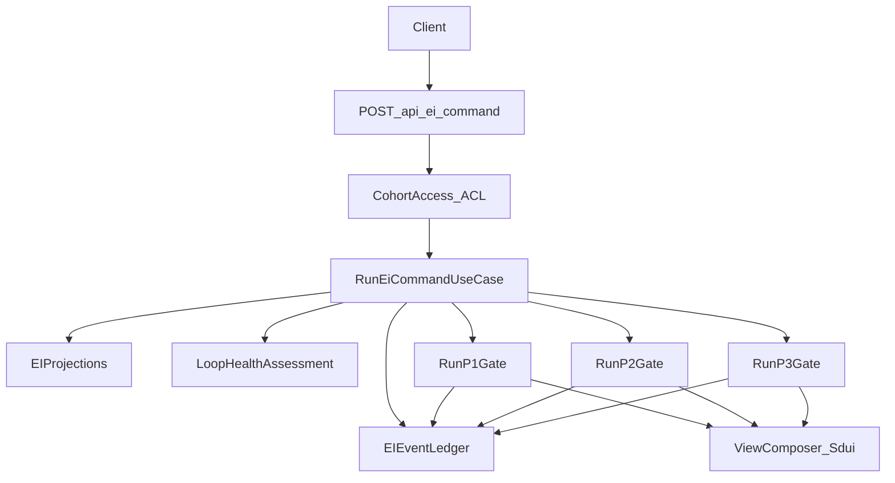

# EI Runtime — Tactical DDD Spec

> Sources: [canvas-ei-runtime.md](../canvas-ei-runtime.md), [05-domain-message-flows-storyboards.md](../05-domain-message-flows-storyboards.md), [01-ei-tactical-conventions.md](01-ei-tactical-conventions.md), [src/ei/engine/plays.ts](../../../src/ei/engine/plays.ts), [src/ei/engine/play-executor.ts](../../../src/ei/engine/play-executor.ts), [DDD-TACTICAL.md](../../../.agents/skills/clean-ddd-hexagonal/references/DDD-TACTICAL.md), [HEXAGONAL.md](../../../.agents/skills/clean-ddd-hexagonal/references/HEXAGONAL.md), [LAYERS.md](../../../.agents/skills/clean-ddd-hexagonal/references/LAYERS.md).

---

## 1) Why an Aggregate (not just Domain Services)

Before listing the design, it is important to address why **EI Runtime needs an aggregate root**, not just domain services.

Per CHEATSHEET.md "Aggregate boundary?" decision tree:
> "Must these objects change together atomically? YES → Same aggregate"

A study session's NegotiatedIntent, ActivationPlan, and VerificationDecision:
- All belong to ONE session lifecycle
- Cannot be activated before negotiating (ordering invariant)
- The P1 verification floor from NegotiatedIntent MUST reach VerificationDecision (cross-protocol invariant)
- All three change as part of the same student session — they must be consistent together

The SKILL.md anemic anti-pattern is: *"Entities are data bags, logic in services."* The previous draft was anemic because `NegotiatedIntentIssued`, `ActivationPlanIssued`, `VerificationDecisionIssued` were plain TypeScript interfaces (data bags), with execution logic in free functions (`executeP1Play`, etc.). The fix is to have a proper aggregate root (`StudySession`) that owns these value objects, with behavior living in the aggregate's command methods.

The `ProtocolEngine` domain service is still legitimate (per DDD-TACTICAL.md "Domain Service: When to Use") for **play selection** because:
- Play selection spans the entire 24-play catalog (multiple modes, multiple protocols)
- It requires multiple inputs (aggregates data, escalation patterns)
- It is stateless — does not need to belong to one entity

---

## 2) Aggregate Root: StudySession

- **Identity:** `sessionId` (string; matches the `AppOpen` event's idempotency key for traceability)
- **Aggregate type:** Command Handler (per `01-ei-tactical-conventions.md` §6)
- **Consistency boundary:** One student's entire study session — from AppOpen to retrieval decision
- **Owns (child value objects):** `NegotiatedIntent`, `ActivationPlan`, `VerificationDecision`

### Why NOT just domain services

From CHEATSHEET.md "Domain Service or Entity method?":
```
Does it naturally belong to one entity?
├── YES → Entity method  ← issueNegotiatedIntent, issueActivationPlan, issueVerificationDecision
```

The gate decision methods naturally belong to the `StudySession` entity. A domain service should only be used "when logic doesn't fit an entity" — and here it does fit.

---

## 3) Ubiquitous Language (Tactical)

| Term | Definition |
|------|-----------|
| StudySession | Aggregate: one student study session from AppOpen to retrieval decision |
| SessionId | Aggregate identity: string UUID, matches AppOpen idempotency key |
| SessionStatus | Lifecycle: `negotiating → activating → active → verifying → closed` |
| Gate | Decision point: P1 (state→intent), P2 (intent→effort), P3 (effort→retrieval) |
| Protocol | Named gate logic: P1 Ignition, P2 Activation, P3 Verification |
| Mode | Rescue / Neutral / Boost — coaching posture for the gate |
| Play | Named coaching move within a protocol + mode (24 total) |
| PlaySelection | Value Object: selected play id, mode, protocol, name |
| NegotiatedIntent | P1 output Value Object: scope, verification plan, constraints (child of StudySession) |
| ActivationPlan | P2 output Value Object: firstAction, replanCap, constraints (child of StudySession) |
| VerificationDecision | P3 output Value Object: decision type + parameters (child of StudySession) |
| ProtocolEngine | Domain Service: selects a play from the 24-play catalog |
| VerificationFloor | P1 minQuestions commitment; P3 must honor it — aggregate enforces this |
| WatchOnlyConstraint | P2-R3 cross-protocol flag; P3 overrides Skip to VerifyNow |
| RiskOverride | openLoops ≥ maxOpenLoops → closeLoopFirst=true regardless of energy |

---

## 4) State Model

| Field | Type | Semantics |
|-------|------|-----------|
| sessionId | string | Aggregate identity |
| studentId | string | Student this session belongs to |
| topicId | string (UUID) | Topic for this session. Resolved via CurriculumCatalog `ResolveTopic`; carries `TopicReference { topicId: UUID, topicName: string }`. Free-text fallback creates a provisional entry in CC. See §4a below. |
| status | SessionStatus | Current lifecycle stage |
| negotiatedIntent | NegotiatedIntent \| null | Set by `issueNegotiatedIntent()`; null until called |
| activationPlan | ActivationPlan \| null | Set by `issueActivationPlan()`; null until called |
| verificationDecision | VerificationDecision \| null | Set by `issueVerificationDecision()`; null until called |

### Lifecycle state machine

```
StudySession.open(studentId, topicId, sessionId)
         │
         ▼
   [negotiating]
         │
         │ issueNegotiatedIntent(play, ctx, policy)
         ▼
   [activating]
         │
         │ issueActivationPlan(play, ctx, policy)
         ▼
    [active]
         │
         │ issueVerificationDecision(play, ctx, policy)
         ▼
   [verifying]
         │
         │ close()
         ▼
    [closed]
```

`close()` is callable from any non-closed state (e.g. student abandons session).

### 4a) Topic Identity Resolution (CurriculumCatalog integration)

Before `StudySession.open()` is called, the topic must be resolved to a `TopicReference` via CurriculumCatalog.

**When:** During the `IntentSet` command processing, before the P1 gate runs.

**How:**
1. Student selects a topic from the SDUI topic picker (type-ahead search, browse, or recent chip) → `topicId` and `topicName` are already resolved.
2. Student types free-text → EI Runtime calls `IResolveTopicUseCase.execute({ rawText, studentId, instituteId })` → returns `TopicReference { topicId: UUID, topicName: string }`.

**Contract:**
- **Always succeeds.** ResolveTopic never throws for valid input. If no catalog match, CC creates a provisional topic with a stable UUID and logs to the normalization queue.
- **Immutability:** Once `NegotiatedIntentIssued` is emitted, `topicId` is locked for the session and carried through all subsequent events (SessionEnd, RetrievalVerified, etc.).

**Published Language:** `TopicReference { topicId: UUID, topicName: string }` from CurriculumCatalog. See [canvas-curriculum-catalog.md](../canvas-curriculum-catalog.md), [tactical/curriculum-catalog-tactical-spec.md](curriculum-catalog-tactical-spec.md).

**Event payload change:** All events that previously carried `topic: z.string()` now carry `topicId: UUID` + `topicName: string`. See [05-cross-cutting-concerns.md § Topic ID evolution](../05-cross-cutting-concerns.md#topic-id-evolution-curriculumcatalog-integration).

---

## 5) Commands and Decisions (Aggregate Methods)

Following the `Order.confirm()` / `Order.ship()` pattern from DDD-TACTICAL.md:

| Command | Guard (precondition) | State change | Domain events emitted |
|---------|---------------------|-------------|----------------------|
| `open(studentId, topicId, sessionId)` | Factory; no precondition | `→ negotiating` | (none; AppOpen already in Ledger) |
| `issueNegotiatedIntent(play, ctx, policy)` | `status === 'negotiating'` | sets `negotiatedIntent`; `→ activating` | `NegotiatedIntentIssued` |
| `issueActivationPlan(play, ctx, policy)` | `status === 'activating'` | sets `activationPlan`; `→ active` | `ActivationPlanIssued` |
| `issueVerificationDecision(play, ctx, policy)` | `status === 'active'` | sets `verificationDecision`; `→ verifying` | `VerificationDecisionIssued` |
| `close()` | not already `'closed'` | `→ closed` | (none) |

---

## 6) Invariants (Must Hold Atomically at Aggregate Boundary)

1. **Lifecycle ordering:** `issueActivationPlan` guards `status === 'activating'` — NegotiatedIntent must exist first. `issueVerificationDecision` guards `status === 'active'` — ActivationPlan must exist first.
2. **No commands after closed:** Any command on a closed session throws `SessionAlreadyClosedError`.
3. **P1 Verification Floor:** When `issueVerificationDecision()` is called, if `negotiatedIntent.verificationPlan.minQuestions > 0`, the VerificationDecision `verifyNow.minQuestions` must be ≥ that floor.
4. **Watch-Only P3 Override:** If `activationPlan.constraints.enforceWatchOnlyVerification === true` AND the resulting VerificationDecision decision would be `Skip`, override to `VerifyNow(minQ=1)`.
5. **Risk Override on NegotiatedIntent:** If `ctx.openLoops ≥ policy.maxOpenLoops`, set `negotiatedIntent.constraints.closeOpenLoopFirst = true`.
6. **Rescue Scope Floor:** If `mode === Rescue`, `negotiatedIntent.scope.timeboxMin` must be ≤ 30.
7. **minQuestions ≥ 1:** All VerifyNow plans must have `minQuestions ≥ 1`.
8. **ScheduleVerify floor:** `dueInHours` must be ≥ 24.

---

## 7) Value Objects

Following the `Money` / `Email` pattern from DDD-TACTICAL.md and CHEATSHEET.md (private constructor, static `create()`, validation on construction, side-effect-free behavior methods).

### 7a) PlaySelection

```typescript
class PlaySelection {
  private constructor(
    private readonly _playId: string,
    private readonly _mode: Mode,
    private readonly _protocol: 1 | 2 | 3,
    private readonly _name: string,
    private readonly _description: string
  ) {}

  static create(playId: string, mode: Mode, protocol: 1|2|3, name: string, description: string): PlaySelection

  get playId(): string
  get mode(): Mode
  get protocol(): 1 | 2 | 3
  get name(): string
  equals(other: PlaySelection): boolean  // by all attributes
}
```

### 7b) P1GateContext

Validated gate input for P1. Exposes domain predicates.

```typescript
class P1GateContext {
  private constructor(private readonly props: P1GateContextProps) {}

  static create(props: {
    studentId: string;        energy: number;       sleepDebt: boolean
    highPressureDetected: boolean;  // System-derived from V3 triggers (Stage 2); defaults to false when absent
    openLoops: number
    verificationRate7d: number; scheduleMisses7d: number; silenceDays: number
    startLatencyMedian7d: number | null;   tightnessLevel: TightnessLevel
    loopLatencyTrend: 'improving' | 'stable' | 'worsening'
    timeCommitment: number | null;  // Student-declared minutes (10/20/45/60); null = use mode fallback
    taskType: string | null;        // Student-declared: 'Learn' | 'Practice' | 'Revise'; null = system default
  }): P1GateContext
  // Validates: energy 1-5, openLoops >= 0, verificationRate7d 0-1

  isLowEnergy(): boolean               // energy <= 2
  isHighPressure(): boolean            // highPressureDetected === true
  hasOpenLoopRisk(): boolean           // openLoops >= 3
  hasSilenceRisk(): boolean            // silenceDays >= 3
  isRevengePlanningRisk(): boolean     // highPressureDetected === true AND energy >= 3 (S2 scenario)
  hasStudentDeclaredTime(): boolean    // timeCommitment !== null
}
```

Similarly for `P2GateContext` and `P3GateContext`:

**P2GateContext** validates: `topic`, `replanCount ≥ 0`, `verificationRate7d 0–1`; exposes: `isStalled()`, `isFlowing()`, `allowsWatchOnly()`

**P3GateContext** validates inputs; exposes: `isAvoidant()`, `hasConfusion()`, `p1VerificationFloor`, `p2WatchOnlyFlag`

### 7c) NegotiatedIntent

P1 output VO. Enforces all P1 business invariants on `create()`.

```typescript
class NegotiatedIntent {
  private constructor(private readonly props: NegotiatedIntentProps) {}

  static create(play: PlaySelection, ctx: P1GateContext, policy: StudentPolicy): NegotiatedIntent
  // Enforces:
  //   scope.timeboxMin >= 1  (relaxed; 2-min micro-start valid; student 10 min is natural minimum in standard flows)
  //   scope.timeboxMin = ctx.timeCommitment when ctx.hasStudentDeclaredTime(); mode-range midpoint fallback otherwise
  //   verificationPlan.minQuestions >= 1
  //   if mode === Rescue: scope.timeboxMin <= 30
  //   if play.playId === 'P1-R2': constraints.closeOpenLoopFirst = true
  //   if ctx.openLoops >= policy.maxOpenLoops: constraints.closeOpenLoopFirst = true
  //   difficultyTier: computed internally from mode + policy.difficultyTierDelta + energy;
  //     no student input. Rescue or energy<=2 → easy; Boost and energy>=4 → hard; else med.

  get playId(): string
  get mode(): Mode
  get scope(): { timeboxMin: number; questionCount: number; difficultyTier: DifficultyTier }
  get taskType(): string | undefined   // Student-declared task type ('Learn'|'Practice'|'Revise') or undefined
  get verificationPlan(): { minQuestions: number; preferVerifyNow: boolean }
  get constraints(): { closeOpenLoopFirst?: boolean; noNewTopicUntil?: string } | undefined

  isRescueMode(): boolean
  requiresVerificationNow(): boolean   // verificationPlan.preferVerifyNow === true
  closeLoopFirst(): boolean            // constraints?.closeOpenLoopFirst === true
  toEventPayload(studentId: string, topicId: string): NegotiatedIntentIssuedPayload
  equals(other: NegotiatedIntent): boolean
}
```

### 7d) ActivationPlan

P2 output VO. Enforces P2 business invariants on `create()`.

```typescript
class ActivationPlan {
  private constructor(private readonly props: ActivationPlanProps) {}

  static create(play: PlaySelection, ctx: P2GateContext, policy: StudentPolicy): ActivationPlan
  // Enforces:
  //   if firstAction.type === 'watch_only': constraints.enforceWatchOnlyVerification = true
  //   replanCap, if set, >= 1

  get playId(): string
  get mode(): Mode
  get firstAction(): { type: FirstActionType; timeboxMin?: number; timeboxSec?: number; description?: string }
  get replanCap(): number | undefined
  get constraints(): { noSwitchingUntil?: number; enforceWatchOnlyVerification?: boolean } | undefined

  isWatchOnly(): boolean
  enforcesWatchOnlyVerification(): boolean
  toEventPayload(studentId: string, topicId: string): ActivationPlanIssuedPayload
  equals(other: ActivationPlan): boolean
}
```

### 7e) VerificationDecision

P3 output VO. Enforces all P3 invariants — including the cross-protocol ones (P1 floor, P2 watchOnly) — on `create()`. Cross-protocol context is received via `P3GateContext.p1VerificationFloor` and `P3GateContext.p2WatchOnlyFlag`.

```typescript
class VerificationDecision {
  private constructor(private readonly props: VerificationDecisionProps) {}

  static create(play: PlaySelection, ctx: P3GateContext, policy: StudentPolicy): VerificationDecision
  // Enforces:
  //   if decision === 'VerifyNow': verifyNow defined and minQuestions >= 1
  //   if decision === 'ScheduleVerify': scheduleVerify defined and dueInHours >= 24
  //   P1 floor: if ctx.p1VerificationFloor set and verifyNow.minQuestions < floor → raise to floor
  //   WatchOnly: if ctx.p2WatchOnlyFlag and decision === 'Skip' → override to VerifyNow(minQ=1)
  //   P3 escalation: if preferVerifyNow and ScheduleVerify → convert to VerifyNow

  get decision(): 'VerifyNow' | 'ScheduleVerify' | 'Skip'
  get verifyNow(): { minQuestions: number; timeboxSec: number; difficultyTier: DifficultyTier; format?: string } | undefined
  get scheduleVerify(): { dueInHours: number; graceHours: number; minQuestions: number } | undefined

  isImmediate(): boolean
  isScheduled(): boolean
  minimumQuestions(): number   // returns minQ regardless of decision type
  toEventPayload(studentId: string, topicId: string): VerificationDecisionIssuedPayload
  equals(other: VerificationDecision): boolean
}
```

---

## 8) Domain Service: ProtocolEngine

**Justification (CHEATSHEET.md "Domain Service or Entity method?" tree):**
```
Does it naturally belong to one entity?
└── NO (spans 24 plays across 3 protocols)

Does it require multiple aggregates?
└── YES (reads from StudentAggregates data via PlayContext)

Is it stateless business logic?
└── YES → Domain Service ✓
```

```typescript
// domain/study-session/protocol-engine.ts

interface IProtocolEngine {
  selectPlay(protocol: 1 | 2 | 3, mode: Mode, context: PlayContext): PlaySelection
}

class ProtocolEngine implements IProtocolEngine {
  selectPlay(protocol: 1 | 2 | 3, mode: Mode, context: PlayContext): PlaySelection {
    // Delegates to selectPlay() from plays.ts catalog
    // Returns highest-priority matching play for (protocol, mode, context)
  }
}
```

The aggregate's command methods (e.g. `issueNegotiatedIntent`) accept a pre-selected `PlaySelection` value object. The application use case handler is responsible for:
1. Resolving `Mode` from `LoopHealthSnapshot`
2. Calling `ProtocolEngine.selectPlay()` → `PlaySelection`
3. Passing `PlaySelection` to the aggregate command

This keeps the aggregate focused on lifecycle + invariants, and the domain service focused on play selection.

---

## 9) Domain Events Emitted

Following LAYERS.md pattern: aggregate collects events via `addDomainEvent()`, use case handler calls `pullDomainEvents()` then publishes via `IAppendEventPort`.

| Domain Event | Emitted when | Key payload fields |
|-------------|-------------|-------------------|
| `NegotiatedIntentIssued` | `issueNegotiatedIntent()` completes | studentId, topicId, playId, scope, verificationPlan, constraints, mode |
| `ActivationPlanIssued` | `issueActivationPlan()` completes | studentId, topicId, playId, firstAction, replanCap, constraints, mode |
| `VerificationDecisionIssued` | `issueVerificationDecision()` completes | studentId, topicId, playId, decision, verifyNow/scheduleVerify, mode |

Event type names from `EventTypeEnum` in `src/ei/schemas/events.ts`. Events are appended to EI Event Ledger by the application handler, not by the aggregate directly.

---

## 10) Repository Interface (Domain Port)

Per DDD-TACTICAL.md: "One repository per aggregate, domain interface in domain layer."

```typescript
// domain/study-session/repository.ts

export interface IStudySessionRepository {
  findById(sessionId: string): Promise<StudySession | null>
  save(session: StudySession): Promise<void>
}
```

**Persistence note for MVP:** Since StudySession state is derivable from Ledger events, a dedicated `ei_study_sessions` table is deferred. For MVP:
- `RunP1GateHandler` creates a fresh `StudySession.open()` — no repository load needed
- `RunP3GateHandler` reconstructs partial state by querying the last `NegotiatedIntentIssued` event from the Ledger (via `IStudentEventStreamReader`), extracts `p1VerificationFloor`, and passes it via `P3GateContext`
- The `IStudySessionRepository` interface is defined now but implemented as a no-op / Ledger-based adapter

### Session state derivation

**Goal:** Define how Runtime derives StudySession lifecycle phase from system-of-record facts (Ledger and Projections).

**Inputs (authoritative):**

- **Ledger events** (per [05-cross-cutting-concerns.md](../05-cross-cutting-concerns.md) event catalog):
  - `NegotiatedIntentIssued` — P1 output; establishes intent
  - `ActivationPlanIssued` — P2 output; establishes plan
  - `VerificationDecisionIssued` — P3 output; establishes decision
  - Command events (as needed for routing): `AppOpen` (session start), `IntentSet`, `SessionEnd`, `Replan`
- **Projections** as supporting read model only where explicitly the source (e.g. `ei_topic_state` for recency, `ei_student_aggregates` for signals). Protocol phase derivation is Ledger-driven; projections support context (loop health, policy).

**Derived evidence flags (per topicId):**

| Flag | Source event(s) | Meaning |
|------|------------------|---------|
| `hasIntent` | `NegotiatedIntentIssued` | P1 has completed for this topic |
| `hasActivationPlan` | `ActivationPlanIssued` | P2 has completed for this topic |
| `hasVerificationDecision` | `VerificationDecisionIssued` | P3 has completed for this topic |
| `lastIssuedAt` | Most recent protocol output event | Used for recency and ordering |

**Mapping to lifecycle (normative):**

| Derived state | Lifecycle phase |
|---------------|-----------------|
| No intent | `negotiating` |
| Intent but no plan | `activating` |
| Plan but no decision | `active` |
| Decision exists | `verifying` (optionally `closed` when retrieval is resolved, if modeled) |

**Recency rule:** "Recent" = within last 7 days (per S2 Day 2-21 scenario in domain message flows). Used for AppOpen routing: if a recent `NegotiatedIntentIssued` exists for the topic, route to P2 (resume); otherwise route to P1 (fresh session). Code reference: `ProtocolRouter.decideForAppOpen` uses `RECENT_DAYS_MS = 7 * 24 * 60 * 60 * 1000`.

**SessionId note:** `sessionId` matches the AppOpen event's idempotency key for traceability and linking events to a session. Without an explicit stored session record (deferred), we derive phase from Ledger events only; cross-protocol state (P1 floor, P2 watchOnly) is threaded via gate contexts. See Open Questions (§17) for sessionId sourcing.

### Routing matrix

Command × derived phase → next protocol or flow. Aligns with [05-cross-cutting-concerns.md](../05-cross-cutting-concerns.md) event catalog and current [POST /api/ei/command](../../../src/app/api/ei/command/route.ts) route types.

**Command types (strategic + route):**

- **Strategic canvas:** `AppOpen`, `IntentSet`, `SessionEnd`, `VerifyNow`, `ScheduleVerify`, `SkipWithReason`
- **Current route (EiCommandSchema):** `AppOpen`, `IntentSet`, `SessionEnd`, `SessionStart`, `Replan`, `VerificationComplete`, `RetrievalSchedule`, `RetrievalSkip` — `VerificationComplete` / `RetrievalSchedule` / `RetrievalSkip` correspond to VerifyNow / ScheduleVerify / SkipWithReason outcomes (emitted as events after P3).

**Command × derived state → protocol/flow:**

| Command | Derived state (per topic) | Protocol/flow |
|---------|---------------------------|---------------|
| `AppOpen` | No recent NegotiatedIntent | P1 (Ignition) |
| `AppOpen` | Recent NegotiatedIntent | P2 (Activation) — resume flow |
| `IntentSet` | (any; client accepted intent) | P2 (Activation) |
| `SessionEnd` | (any; client ended session) | P3 (Verification) |
| `SessionStart` | — | SessionStart workflow (no protocol routing) |
| `Replan` | — | Replan workflow → P2 re-run with incremented replanCount |
| `VerificationComplete` | — | VerificationComplete workflow (emits VerificationCompleted event) |
| `RetrievalSchedule` | — | RetrievalSchedule workflow (emits RetrievalScheduled event) |
| `RetrievalSkip` | — | RetrievalSkip workflow (emits RetrievalSkipped event) |

**Invalid transitions:** If the routing logic receives an unexpected command (e.g. IntentSet when derived state is negotiating and no prior P1 completed), the route returns 400 or 500 with an error message. Example: ProtocolRouter throws for unknown commandType; route returns `{ error: "Protocol routing failed" }` (500) or workflow-specific validation errors (400).

**Replan flow:** `Replan` triggers P2 re-run with incremented `replanCount`. Session conceptually transitions back to `activating`. Handled by Replan workflow → RunP2GateHandler. Cross-protocol floor (P1 minQuestions) remains in P3GateContext when P3 runs later.

---

## 11) Ports (Hexagonal Architecture)

Per HEXAGONAL.md: Driver ports = "how the world uses your app"; Driven ports = "how your app uses external systems."

### Driver Ports (Application layer)

| Port Interface | Pattern | Implemented by |
|---------------|---------|----------------|
| `IRunP1GateUseCase` | `I{Action}UseCase` | `RunP1GateHandler` |
| `IRunP2GateUseCase` | `I{Action}UseCase` | `RunP2GateHandler` |
| `IRunP3GateUseCase` | `I{Action}UseCase` | `RunP3GateHandler` |

### Driven Ports (called by use case handlers)

| Port Interface | Pattern | Location | Implemented by |
|---------------|---------|----------|----------------|
| `IGetStudentSignalsPort` | `I{Resource}Port` | `application/assess-loop-health/port.ts` (reuse) | `PostgresGetStudentSignalsAdapter` |
| `IAssessLoopHealthUseCase` | `I{Action}UseCase` | `application/assess-loop-health/port.ts` (reuse) | `AssessLoopHealthHandler` |
| `IAppendEventPort` | `I{Action}Port` | `application/shared/port-append-event.ts` (new) | `PostgresAppendEventAdapter` (new) |
| `IStudentEventStreamReader` | `I{Resource}Reader` | `application/shared/port-student-event-stream-reader.ts` (existing) | `PostgresStudentEventStreamReader` |

---

## 12) Application Use Cases

### RunEiCommand (orchestrator use case)

**Driver port:** `IRunEiCommandUseCase` with `execute(command: EiCommandDTO): Promise<RunEiCommandResult>` — the umbrella use case that receives all EI commands and routes them to the appropriate protocol or workflow.

**Command DTO:** Discriminated union aligned with `EiCommandSchema` in the route (AppOpen, IntentSet, SessionEnd, SessionStart, Replan, VerificationComplete, RetrievalSchedule, RetrievalSkip), plus explicit `idempotencyKey?: string` field. Schema validation is strict; unknown keys rejected. See [command-schema.ts](../../../src/ei/application/ei-protocol-router/command-schema.ts).

**Driven ports (tie to strategic relationship patterns):**

| Port | Purpose |
|------|---------|
| **CohortAccess ACL** | Resolve auth/session → `studentId` (server-derived; never trust client body) |
| **Ledger read** | Query events / stream reader (IQueryEventsPort, IStudentEventStreamReader) — derive session phase |
| **Ledger append** | Append command events + protocol output events (IAppendEventPort) |
| **Projections read** | GetStudentSignals, LoopHealth (IGetStudentSignalsPort, IAssessLoopHealthUseCase) |
| **Gate executors** | RunP1/RunP2/RunP3 use cases (or Mastra workflows as adapter implementation detail) |

**Algorithm (step-by-step):**

1. Resolve auth (CohortAccess upstream) → obtain `studentId`; reject if unauthenticated
2. Validate command schema (strict; unknown keys rejected)
3. Derive phase/state from ledger and projections
4. Choose next protocol or workflow via routing matrix
5. Invoke the protocol workflow or handler
6. Append required events (command events + output events)
7. Return response (SDUI + domain fields)

**Error taxonomy:** unauthenticated, forbidden (role/cohort scope), invalid command schema, invalid transition, idempotency conflict.

**Adapter mapping:** The Next.js route `POST /api/ei/command` is a driver adapter (translates HTTP → EiCommandDTO); Mastra workflows (eiAppOpenWorkflow, protocol2ActivationWorkflow, etc.) are the execution mechanism. The orchestrator is the application service. Per LAYERS/HEXAGONAL: route = driver adapter; workflows = execution mechanism; RunEiCommand = application service.



### Idempotency + event completeness at the command boundary

Per [05-cross-cutting-concerns.md](../05-cross-cutting-concerns.md) invariants:

- **Immutability:** Events are append-only.
- **Idempotency:** Retries must not create duplicate events; every write supports idempotency key or deterministic event id.
- **Schema strictness:** Every event validates against strict schema; unknown keys rejected.

**Command-boundary idempotency policy:**

- **Which commands must be idempotent:** AppOpen, IntentSet, SessionEnd, and any command that triggers event appends — for retry safety (P0 launch requirement).
- **Recommended key formats:** `{context}:{eventType}:{studentId}:{topicId}:{occurredAt}` or client-generated UUID. Example: `ei:AppOpen:{studentId}:{topicId}:{openedAt}`.
- **Enforcement:** Ledger adapter uses `ei_idempotency_keys` table (key, event_id, created_at); duplicate key returns existing event id. See [05-cross-cutting-concerns.md § Idempotency implementation guidance](../05-cross-cutting-concerns.md) and `src/ei/db/migrate.ts`, `src/ei/db/queries.ts`.

**Minimum viable event set enforcement:**

Per [docs/launch-requirements-checklist.md](../../launch-requirements-checklist.md):

> UI emits: `AppOpen`, `IntentSet`, `IntentResponse`, `FirstActionStarted`, `Replan`, `SessionEnd`, `VerificationCompleted`. Engine consumes these to compute: pending checks, verification rate, start latency, replan loops, silence days.

The `/api/ei/command` route is the choke point that ensures the minimum event set is appended. Responsibility split:

| Owner | Events |
|-------|--------|
| **UI-only (client emits)** | AppOpen, IntentSet, IntentResponse, FirstActionStarted, Replan, SessionEnd, VerificationCompleted — client sends commands; route validates and routes to workflows that append |
| **Runtime-appended (command boundary)** | Command events recorded when workflow runs; protocol output events (NegotiatedIntentIssued, ActivationPlanIssued, VerificationDecisionIssued) appended by gate handlers |
| **Workflow-appended (post-P3 outcomes)** | VerificationCompleted, RetrievalScheduled, RetrievalSkipped — appended by VerificationComplete, RetrievalSchedule, RetrievalSkip workflows |

The orchestrator ensures each command path results in the correct event emissions; validation and schema strictness prevent malformed writes.

---

### RunP1/RunP2/RunP3 handlers

Three handlers following the `PlaceOrderHandler` template from LAYERS.md:

```typescript
export class RunP1GateHandler implements IRunP1GateUseCase {
  constructor(
    private readonly getStudentSignals: IGetStudentSignalsPort,
    private readonly assessLoopHealth: IAssessLoopHealthUseCase,
    private readonly appendEvent: IAppendEventPort,
    private readonly protocolEngine: IProtocolEngine,
  ) {}

  async execute(command: RunP1GateCommand): Promise<RunP1GateResult> {
    // 1. Load student signals
    const signals = await this.getStudentSignals.get(command.studentId)

    // 2. Assess loop health → LoopHealthSnapshot
    const loopHealth = await this.assessLoopHealth.execute({
      studentId: command.studentId,
      p1StateInput: { energy: command.energy, highPressureDetected: command.highPressureDetected ?? false, ... }
    })

    // 3. Build P1GateContext value object (throws DomainError on invalid input)
    // Command carries timeCommitment: number | null and taskType: string | null from AppOpen payload
    const ctx = P1GateContext.create({ ...signals, ...command })

    // 4. Resolve mode + select play
    const mode = resolveMode(loopHealth)
    const play = this.protocolEngine.selectPlay(1, mode, buildPlayContext(ctx, signals))

    // 5. Construct + command aggregate
    const session = StudySession.open(command.studentId, command.topicId, command.sessionId)
    session.issueNegotiatedIntent(play, ctx, signals.policy)

    // 6. Publish domain events to Ledger
    for (const event of session.pullDomainEvents()) {
      await this.appendEvent.append(command.studentId, event)
    }

    return { negotiatedIntent: session.negotiatedIntent! }
  }
}
```

Same pattern for `RunP2GateHandler` and `RunP3GateHandler`. P3 handler additionally reads last `NegotiatedIntentIssued` event to populate `P3GateContext.p1VerificationFloor`.

---

## 13) File Structure

```
src/ei/
├── domain/
│   └── study-session/               # StudySession aggregate
│       ├── study-session.ts         # Aggregate root
│       ├── value-objects/
│       │   ├── play-selection.ts    # PlaySelection VO
│       │   ├── gate-context.ts      # P1/P2/P3GateContext VOs
│       │   ├── negotiated-intent.ts # NegotiatedIntent VO
│       │   ├── activation-plan.ts   # ActivationPlan VO
│       │   └── verification-decision.ts # VerificationDecision VO
│       ├── protocol-engine.ts       # ProtocolEngine domain service
│       ├── repository.ts            # IStudySessionRepository (driven port)
│       └── errors.ts                # SessionLifecycleError, etc.
├── sdui/                            # StudySessionOrchestration — presentation layer
│   ├── types/
│   │   ├── sdui-contract.ts         # SduiResponse, SduiViewTree, SduiPhase, SduiAction
│   │   └── components.ts            # SduiComponent discriminated union (16 types)
│   ├── view-composer.ts             # Pure presenter: VO output + PresentationContext → SduiResponse
│   ├── presentation-context.ts      # PresentationContext VO + builder (zero DB calls)
│   ├── microcopy/
│   │   ├── catalog.ts               # All student-facing text by gate/slot/mode/play
│   │   └── resolver.ts              # Priority chain: play-specific → mode-specific → default
│   └── __tests__/
│       └── view-composer.test.ts    # Unit tests (pure function — no mocks needed)
├── application/
│   ├── run-p1-gate/
│   │   ├── command.ts               # RunP1GateCommand
│   │   ├── handler.ts               # RunP1GateHandler
│   │   └── port.ts                  # IRunP1GateUseCase (driver port)
│   ├── run-p2-gate/
│   │   ├── command.ts
│   │   ├── handler.ts
│   │   └── port.ts
│   ├── run-p3-gate/
│   │   ├── command.ts
│   │   ├── handler.ts
│   │   └── port.ts
│   └── shared/
│       └── port-append-event.ts     # IAppendEventPort (driven port)
└── infrastructure/
    └── persistence/
        └── append-event.pg.ts       # PostgresAppendEventAdapter

src/mastra/workflows/
├── protocol1-ignition.ts            # .then(runP1Gate).map(...).then(composeP1ViewStep)
├── protocol2-activation.ts          # .then(runP2Gate).map(...).then(composeP2ViewStep) [planned]
├── protocol3-verification.ts        # .then(runP3Gate).map(...).then(composeP3ViewStep) [planned]
└── steps/
    └── compose-p1-view.ts           # Mastra createStep wrapping composeP1View
```

---

## 14) Migration from Existing Engine Files

| Existing file | Action | Notes |
|---------------|--------|-------|
| `src/ei/engine/plays.ts` | Keep; becomes internal | `selectPlay()` called by `ProtocolEngine` |
| `src/ei/engine/play-executor.ts` | Replace | Logic moves into VO `create()` factories (NegotiatedIntent, ActivationPlan, VerificationDecision) |
| `src/ei/engine/classify.ts` | Already migrated | Re-export bridge stays |
| `src/ei/engine/escalation.ts` | Move to study-session | Escalation patterns populate P1/P2/P3 GateContext fields |
| `src/ei/engine/score.ts` | Move to study-session | Used inside NegotiatedIntent.create() |
| `src/ei/engine/cross-protocol.ts` | Delete | Cross-protocol invariants enforced in StudySession.issueVerificationDecision() |
| `src/ei/protocol-runner.ts` | Replace | God Orchestrator → RunP1/P2/P3GateHandler |

---

## 15) Test Strategy

Per `01-ei-tactical-conventions.md` §13: domain unit tests use no mocks; application unit tests use in-memory (fake) adapters.

| Scenario | Layer | Test type |
|----------|-------|-----------|
| `issueActivationPlan` before `issueNegotiatedIntent` | Domain | Unit — throws `SessionLifecycleError` |
| Command on closed session | Domain | Unit — throws `SessionAlreadyClosedError` |
| P1 openLoops=5, policy.maxOpenLoops=3 → closeLoopFirst | Domain | Unit — NegotiatedIntent.constraints.closeOpenLoopFirst === true |
| Rescue mode → timeboxMin ≤ 30 | Domain | Unit — NegotiatedIntent.scope.timeboxMin ≤ 30 |
| P1GateContext energy=0 → throws DomainError | Domain | Unit — DomainError thrown |
| VerificationDecision: p1Floor=3, play gives 1Q → raised to 3 | Domain | Unit — verifyNow.minQuestions === 3 |
| VerificationDecision: p2WatchOnly + Skip → VerifyNow | Domain | Unit — decision === 'VerifyNow' |
| Full S2: energy=4 highPressureDetected=true → Rescue play P1-R3 | Domain | Unit — issueNegotiatedIntent succeeds |
| Full S7: energy=5 openLoops=4 → RiskOverride, closeLoopFirst | Domain | Unit — NegotiatedIntent.closeLoopFirst() === true |
| RunP1GateHandler: happy path with fake ports | Application | Unit — events appended, output returned |
| RunP3GateHandler: P1 floor threading via P3GateContext | Application | Unit — VerificationDecision respects floor |

---

## 16) StudySessionOrchestration: ViewComposer

The **ViewComposer** (`src/ei/sdui/view-composer.ts`) is the "gateway context" role of EI Runtime — it translates protocol VO outputs into a client-renderable UI description (`SduiResponse`) following the Server-Driven UI pattern.

### Design constraints

| Constraint | Enforced by |
|---|---|
| Pure function — no DB, no side effects | `view-composer.ts` has no imports from infrastructure layer |
| Zero DB calls for presentation | `PresentationContext` is derived entirely from domain output fields already in the Mastra step result |
| Does not modify aggregate or emit events | ViewComposer runs after `pullDomainEvents()` — it is read-only |
| Does not compute metrics or interpret labels | Receives already-resolved `mode`, `playId`, `stateScore` from gate handler; does not re-interpret them |
| Decoupled from API route | Lives inside the Mastra workflow as a chained step, not in `src/app/api/` |

### Key types

| Type | File | Purpose |
|------|------|---------|
| `SduiResponse` | `sdui/types/sdui-contract.ts` | Top-level contract returned by each protocol workflow |
| `SduiViewTree` | same | Slot-based layout: `header`, `body`, `actions`, `footer` arrays |
| `SduiComponent` | `sdui/types/components.ts` | Discriminated union of 16 component types (message, scale-input, scope-card, deal-card, etc.) |
| `PresentationContext` | `sdui/presentation-context.ts` | Derived VO: mode, playId, pendingChecks, silenceDays, isFirstOfDay, etc. |
| `MicrocopyKey` | `sdui/microcopy/resolver.ts` | `{ gate, slot, mode, playId }` — lookup key for microcopy |

### Microcopy resolution

Priority chain (most specific → least):
1. **Play-specific** — e.g. `P1-R1` + `scope_message` → "No speeches. Let's keep it tiny."
2. **Mode-specific** — e.g. `Rescue` + `scope_message` → "Today's energy is low — shorter scope keeps the loop moving."
3. **Default** — "Here's your plan for today."

Variables interpolated via `{{count}}`, `{{topic}}` in template strings.

### Mastra integration

The compose step receives the gate handler output merged with original workflow input via `.map()` + `getInitData()`:

```
.then(runP1Gate)           ← AdaptiveCoaching: domain decisions
.map(mergeWithInitData)    ← merge NegotiatedIntentIssued + energy/context
.then(composeP1ViewStep)   ← StudySessionOrchestration: SduiResponse
```

Workflow `outputSchema` is `SduiResponseSchema` (not the raw VO schema). The `domain` field of `SduiResponse` carries the full typed VO output for client-side state (e.g. timer configuration).

### Conditional rendering decisions

| Condition | Component shown |
|---|---|
| `ctx.silenceDays >= 2` | `welcome-back-card` (S5 archetype) |
| `ctx.closeOpenLoopFirst === true` | `deal-card` with pending check count (S7 archetype) |
| `ctx.pendingChecks > 0` | `pending-checks` indicator in footer |
| `ctx.isFirstOfDay === true` | Sleep + backlog scales in checkin view |
| `shouldShowTimeAndTaskInputs(variant) === true` | Time commitment chips (10/20/45/60) + task type chips (Learn/Practice/Revise) in checkin view; hidden for V1 SILENCE_RE_ENTRY, V3 HIGH_PRESSURE, V9 IDENTITY_MOMENT, V10 ONBOARDING |
| P1 view (all variants) | **ConfirmationStrip** (replaces scope-card): displays `topic . taskType . ~timeboxMin min`; reflects student's own choices, not ELI's prescription. Single "Let's go" CTA (`accept_intent`). `taskType`/`difficultyTier` scale inputs removed from P1 view. |

### Boundary compliance

| DDD Rule | Status |
|---|---|
| StudySessionOrchestration consumes AdaptiveCoaching outputs | ✓ — ViewComposer reads VO output, does not modify aggregate |
| Does not compute metrics or interpret labels | ✓ — receives pre-resolved mode/playId from gate handler |
| Does not own gate decision logic | ✓ — play selection stays in ProtocolEngine domain service |
| Append-only ledger not touched | ✓ — ViewComposer has zero Ledger access |
| StudySession aggregate invariants not touched | ✓ — ViewComposer runs after domain events are already emitted |

---

## 17) Open Questions

- **sessionId sourcing:** Should it match the AppOpen event idempotency key (linking events to session) or be independently generated? Deferred — for MVP, sessionId is passed in command from the API layer.
- **StudySession persistence:** `ei_study_sessions` table deferred post-MVP. Cross-protocol state threaded via P3GateContext.
- **Replan flow:** `C/Replan` triggers P2 re-run with incremented `replanCount` — handled by `RunP2GateHandler` with `replanCount` in command; session transitions back to `activating` if needed.
- **ScheduleMissed derivation:** Outside StudySession; handled by TopicLoop cron / projector.

---

## References

- [canvas-ei-runtime.md](../canvas-ei-runtime.md)
- [05-domain-message-flows-storyboards.md](../05-domain-message-flows-storyboards.md)
- [01-ei-tactical-conventions.md](01-ei-tactical-conventions.md)
- [loop-health-assessment-tactical-spec.md](loop-health-assessment-tactical-spec.md)
- [src/ei/engine/plays.ts](../../../src/ei/engine/plays.ts)
- [src/ei/engine/play-executor.ts](../../../src/ei/engine/play-executor.ts)
- [src/ei/domain/loop-health/](../../../src/ei/domain/loop-health/)
- [.agents/skills/clean-ddd-hexagonal/references/DDD-TACTICAL.md](../../../.agents/skills/clean-ddd-hexagonal/references/DDD-TACTICAL.md)
- [.agents/skills/clean-ddd-hexagonal/references/HEXAGONAL.md](../../../.agents/skills/clean-ddd-hexagonal/references/HEXAGONAL.md)
- [.agents/skills/clean-ddd-hexagonal/references/LAYERS.md](../../../.agents/skills/clean-ddd-hexagonal/references/LAYERS.md)
