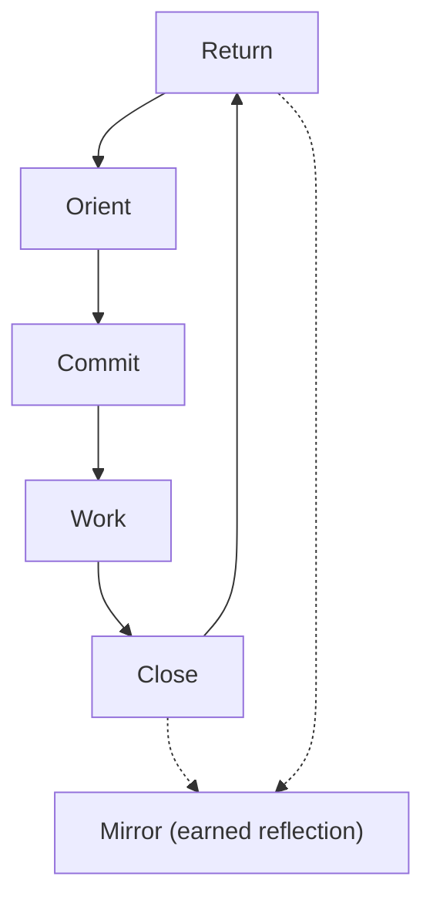

# Experience Spine

The Eli product should be organized around one primary behavioral loop rather than many equal product destinations.

## Primary Loop

The core Eli loop is:

1. **Return** - the student comes back to the product
2. **Orient** - Eli clarifies what matters right now
3. **Commit** - the next step becomes acceptable and bounded
4. **Work** - the product supports actual study without competing with it
5. **Close** - progress is verified in a grounded way
6. **Reflect when earned** - `Mirror` may turn repeated behavior into meaning

## Loop Diagram

## Why This Spine Matters

This loop gives Eli a product center of gravity.

Without it, the product would naturally drift toward:

- dashboard behavior
- feature sprawl
- too many equally weighted destinations
- progress theater instead of grounded support

The loop keeps the product anchored in the student's real task: returning to study and moving through a meaningful unit of effort.

## Mirror's Position

`Mirror` is not a permanent destination and not a default operating mode.

It is a reflective layer that may appear near return or closure when Eli has enough evidence to say something meaningful without overreaching.

That means:

- `Mirror` should not interrupt the loop constantly
- `Mirror` should not become a dashboard of insights
- `Mirror` should not be used just because reflection sounds brand-rich

If reflection is not earned, the loop should remain guidance-oriented.

## Design Consequence

Every major product decision should support one of these loop stages.

If a feature does not help return, orientation, commitment, work, closure, or earned reflection, it should be treated with suspicion.
