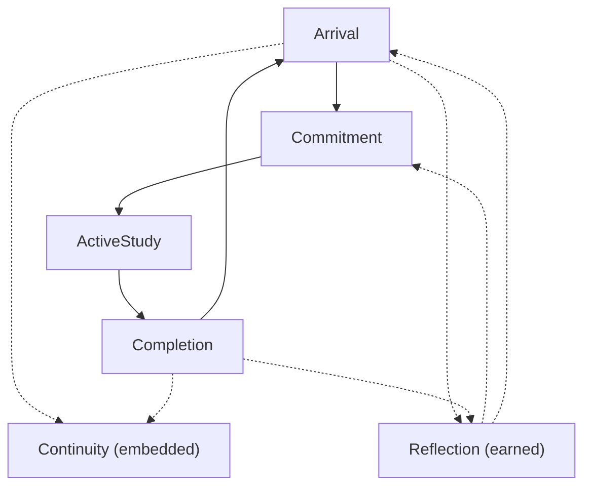

# Surface Architecture

The Eli product should be built around a small set of canonical surfaces.

These surfaces are not final screen designs. They are the recurring product moments that the experience architecture depends on.

## Surface Set

### 1. Arrival Surface

This is the re-entry surface.

Its job is to:

- welcome the student back without performance pressure
- restore orientation quickly
- make the next step visible
- help the student re-orient quickly

Architectural properties:

- **Role in architecture:** Primary surface
- **State sensitivity:** Highly sensitive, especially to `Gentle` and `Focus`
- **Phase sensitivity:** Strong. Early phases should stay generic and non-presumptuous
- **Mirror allowance:** Allowed only when reflection has been earned and remains light
- **Must never become:** A dashboard-like review wall or guilt-heavy summary

## 2. Commitment Surface

This is the surface where the student accepts or defines the next unit of effort.

Its job is to:

- narrow ambiguity
- make beginning feel manageable
- bound the task enough to feel real
- avoid overloading the student with setup decisions

The commitment surface is where Eli converts orientation into willingness to act.

Architectural properties:

- **Role in architecture:** Primary surface
- **State sensitivity:** Most influenced by `Gentle` and `Focus`; `Momentum` may make it more decisive
- **Phase sensitivity:** Moderate. Phase should affect confidence of framing, not task inflation
- **Mirror allowance:** Not appropriate as a dominant layer here
- **Must never become:** A setup ritual or choice-heavy planning screen

## 3. Active Study Surface

This is the work surface.

Its job is to:

- protect focus
- support the current study effort
- stay quiet enough that actual study remains the center of gravity
- avoid unnecessary product interruption

This surface should be the least branded-feeling part of the product in a decorative sense, while still remaining unmistakably Eli in tone, spacing, and calmness.

Architectural properties:

- **Role in architecture:** Primary surface
- **State sensitivity:** Most often `Focus` or `Momentum`; `Gentle` should simplify aggressively
- **Phase sensitivity:** Light. Phase may affect small continuity cues, not the fundamental working posture
- **Mirror allowance:** Disallowed during active work
- **Must never become:** A noisy management surface or feature shelf

## 4. Completion Surface

This is the closure surface.

Its job is to:

- verify that progress counted
- make completion feel grounded
- reinforce continuity without turning progress into performance theater
- prepare the student for either rest, continuation, or later return

This is the most appropriate place for calm confirmation signals.

Architectural properties:

- **Role in architecture:** Primary surface
- **State sensitivity:** All states may arrive here, but completion should remain grounded in each
- **Phase sensitivity:** Moderate. Later phases may support stronger continuity or light reflection
- **Mirror allowance:** Allowed when evidence supports reflection
- **Must never become:** Celebration theater, praise inflation, or a performance recap

## 5. Reflection Surface

This is the `Mirror` surface or `Mirror` moment.

Its job is to:

- turn repeated behavior into meaning
- help the student recognize a pattern without overreach
- remain sparse enough to feel credible

This surface should appear only when reflection has been earned.

Architectural properties:

- **Role in architecture:** Secondary surface
- **State sensitivity:** Most credible in `Focus` and `Momentum`; `Gentle` should use it sparingly
- **Phase sensitivity:** High. `Arrival` should remain minimal, `Familiarity` may be more precise
- **Mirror allowance:** This is the `Mirror` surface
- **Must never become:** An always-on insights area or pseudo-therapeutic diagnosis layer

## 6. Continuity Surface

Per the canonical continuity definition in `04-structural-product-model.md`, continuity is a lightweight embedded surface, not a destination. This section defines its architectural properties as a surface.

Its job is to:

- preserve context between sessions
- support easier return
- provide trusted continuity without becoming an analytics layer

It should feel supportive, not managerial.

Architectural properties:

- **Role in architecture:** Secondary embedded surface
- **State sensitivity:** Most useful in `Gentle` and `Focus`, where re-entry support matters most
- **Phase sensitivity:** Moderate-to-high. Later phases may carry more trusted continuity
- **Mirror allowance:** Limited. Reflection may appear nearby, but continuity should not become `Mirror`
- **Must never become:** A self-review destination, analytics page, or progress dashboard

## Object Crosswalk

The product objects are not equally foregrounded on every surface.

| Surface | Primary object in focus |
|---|---|
| Arrival | `Study thread`, with optional `Curriculum context` if it helps orient the student |
| Commitment | Upcoming `Session` inside a chosen `Study thread` |
| Active Study | Current `Session` |
| Completion | Closed `Session` feeding `Study thread` continuity |
| Continuity | `Study thread` persistence across sessions |
| Reflection | Earned meaning around the student's relationship to a `Study thread` |

This crosswalk keeps the product session-led in immediate action, thread-led in continuity, and curriculum-aware only in supportive background ways.

## Surface Transition Model

This document is the canonical owner of surface transition mechanics.

The loop defines the behavioral sequence. The structural model defines how continuity and reflection sit in the product. This document defines how the canonical surfaces hand off, what inserts are allowed, and what kinds of alternate paths are legitimate without turning Eli into a browse-heavy product.

### Transition rules

- Primary surfaces carry the main route. Secondary surfaces may insert around the route, but should not replace it.
- `Continuity` is an embedded support insert, not a destination and not a gate.
- `Reflection` is an earned insert, not a default step in the loop.
- State changes usually tune the current surface in place. They should change density, directness, and visible context before they change route shape.
- Phase changes usually change specificity, continuity depth, and reflection eligibility. They should not radically alter the primary loop.
- If an insert is not credible or not useful, the product should skip it and keep the loop moving.

### Transition matrix

| Current surface | Entry trigger | Default next surface | Alternate next surfaces | Allowed inserts | Blockers / notes |
|---|---|---|---|---|---|
| Arrival | Cold return, normal re-entry, return after completion, return after interruption without active work | Commitment | Remain on Arrival while orienting; leave to a legitimate secondary route and return | Continuity, Reflection | Arrival should resolve into a bounded next step quickly. It must not become a review destination. |
| Commitment | Student accepts or defines the next unit of effort | Active Study | Stay on Commitment to narrow or revise; return to Arrival if the student backs out before work begins | None as a dominant layer | Commitment must stay lighter than the study task itself. |
| Active Study | Commitment accepted or active work resumed | Completion | Remain in Active Study during pause/resume; return to Arrival only when current work is abandoned | None | Reflection is disallowed during active work. Secondary-route exits should preserve resumability where possible. |
| Completion | Current unit of effort is being closed | Arrival | Reflection then Arrival; Continuity then Arrival; continue into a fresh Commitment only if V1 rules allow it | Continuity, Reflection | Completion must resolve closure before the route fully resets. |
| Reflection | Earned near return or close | Underlying primary surface resumes | From return-side Reflection: Commitment. From close-side Reflection: Arrival. | Reflection is itself the insert | If reflection is not credible, skip it entirely. |
| Continuity | Embedded around return or close to carry context forward | Underlying primary surface resumes | None; Continuity should not create a parallel route | Reflection may appear nearby, but not inside continuity itself | Continuity supports re-entry and carryover. It must remain lightweight and non-managerial. |

## Interruption And Re-Entry Rules

- Re-entry with no active work returns to `Arrival`.
- Re-entry with active work returns to `Active Study`.
- Revision before study begins should usually stay inside `Commitment`.
- Interruption during active work should usually resume in place rather than forcing a return to `Arrival`.
- Leaving the main route for setup, preferences, or lightweight history should preserve the current loop point and return the student there when possible.
- `Mirror` may appear near return or close when earned, but should hand back into the primary surface rather than creating a new browsing mode.

## Conversational Eli In The Surface System

If conversational Eli exists, it should relate to the surfaces like a temporary summoned support mode, not a parallel route.

| Surface | Appropriate conversational help | What remains disallowed |
|---|---|---|
| Arrival | re-entry help, thread recall, bounded history questions, next-step clarification | dashboard-like review, broad analytics recaps, manager-style planning |
| Commitment | help narrowing the next session, naming the thread, reducing ambiguity | choice-heavy orchestration, long planning rituals, tutor-like instruction |
| Active Study | minimal help only, if interruption or resume support is truly needed | reflective conversation during work, deep history review, attention-grabbing interaction |
| Completion | help making sense of what just happened, light thread continuity, earned reflection | performance recap, comparative summaries, pressure-heavy interpretation |

The sheet should deepen clarity, continuity, or support, then return the student to the main loop.

## Surface Hierarchy

Not all surfaces are equally central.

### Primary surfaces
- Arrival
- Commitment
- Active Study
- Completion

These are the core of the product loop.

### Secondary surfaces
- Reflection
- Continuity

These exist to deepen meaning and continuity, but they should not compete with the loop itself. In particular, `Continuity` should usually appear as an embedded support surface rather than as a destination.

## Surface Rule

Every surface should have:

- one clear emotional job
- one calm focal point
- one reason to exist in the product

If a surface starts doing too many jobs at once, it will drift toward clutter, pressure, or dashboard behavior.
