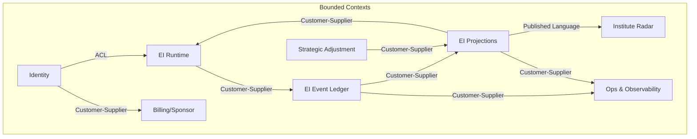

# Context Map

> **How to fill:** Define bounded context boundaries and their relationships. Use relationship types from [DDD-STRATEGIC.md](.agents/skills/clean-ddd-hexagonal/references/DDD-STRATEGIC.md): Customer-Supplier, Conformist, ACL, Partnership, Published Language.
>
> **Rule:** Each bounded context has its own ubiquitous language and model. Same real-world concept may mean different things across contexts.

---

## Bounded contexts

| Context | Responsibility | Subdomain(s) |
|---------|----------------|--------------|
| **Identity** | Auth (Neon), student_id mapping, cohorts, enrollment, roles | Identity, Cohorts, RBAC |
| **EI Event Ledger** | Append-only event store, idempotent writes, query by student | Event Ledger & Behavioral Timeline |
| **EI Projections** | Topic state, aggregates, policy; derived from events | Derived Signals & Student State Projection |
| **EI Runtime** | P1/P2/P3 gates, protocol play selection, Rescue vs Boost | Adaptive Coaching Decisions, Learning Integrity |
| **Strategic Adjustment** | SA dials, next-cycle constraints; feeds EI Runtime policy read | Strategic Adjustment Policy Engine |
| **Institute Radar** | Privacy-safe alerts, evidence summary, cohort-filtered | Institute Radar & Privacy-safe Reporting |
| **Ops & Observability** | Debug timeline, correlation ids, backfill/replay | Ops/Observability/Replay/Backfill |
| **Billing/Sponsor** (future) | Coupons, redemptions, audit trail | Billing/Sponsor/Coupon Enrollment |

---

## Context map diagram (Mermaid)

---

## Relationships

| Upstream | Downstream | Relationship | Notes |
|----------|------------|--------------|-------|
| Identity | EI Runtime | ACL | Translate auth session → student_id; never trust client |
| EI Runtime | EI Event Ledger | Customer-Supplier | Runtime appends events; Ledger owns schema |
| EI Event Ledger | EI Projections | Customer-Supplier | Projections consume events; Ledger is source of truth |
| EI Projections | EI Runtime | Customer-Supplier | Runtime reads aggregates, topic state, policy |
| Strategic Adjustment | EI Projections | Customer-Supplier | SA writes policy; Projections own storage |
| EI Projections | Institute Radar | Published Language | Radar consumes only versioned alert schema; no raw events |
| EI Event Ledger, Projections | Ops & Observability | Customer-Supplier | Debug timeline reads both; admin-only |
