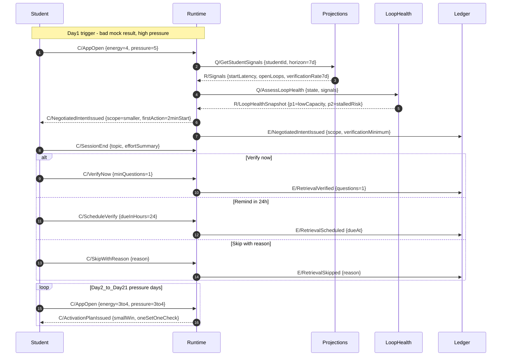
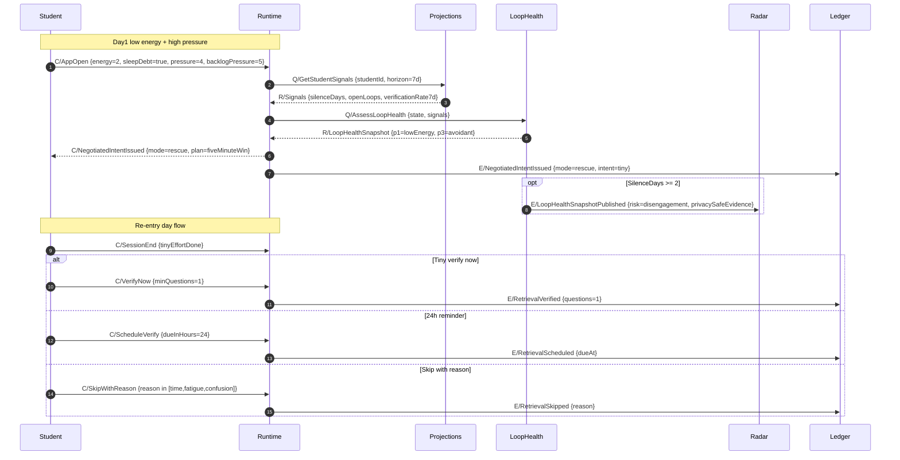
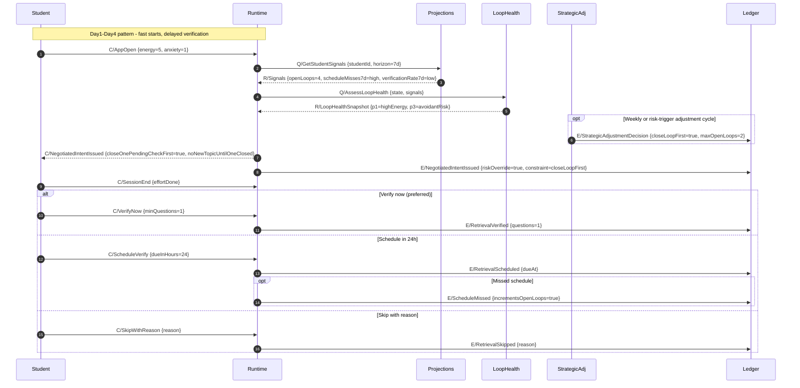

# Domain Message Flows - Storyboards (S2, S5, S7)

This document captures Domain Message Flow Modelling (DMF) for the three detailed storyboard journeys:

- `S2` Revenge planning after a bad mock
- `S5` Burnout runway plus silence
- `S7` High energy with rising pending checks

It follows the DMF guidance in [../domain-modelling-flow.md](../domain-modelling-flow.md) and maps interactions onto bounded contexts from [03-context-map.md](03-context-map.md).

---

## DMF notation and assumptions

- **Diagram type:** Mermaid `sequenceDiagram` (best fit for ordered message exchange).
- **Message kinds:** `C/` command, `Q/` query, `R/` response, `E/` domain event.
- **Payload hints:** each message includes only significant fields (not full schema).
- **Student-facing wording:** "Pending checks" corresponds to open retrieval loops (`openLoops` + schedule misses influence).
- **Scope level:** one canonical interaction loop per storyboard, with `alt/opt/loop` blocks for important branches.

### Participants used

- `Student` - user actor.
- `Runtime` - EI Runtime bounded context (gate orchestration and protocol outputs).
- `Projections` - EI Projections bounded context (aggregates/state/policy reads).
- `LoopHealth` - LoopHealthAssessment bounded context (labels and evidence synthesis).
- `StrategicAdj` - Strategic Adjustment bounded context (policy decisions to Projections).
- `Ledger` - EI Event Ledger bounded context (append-only source of truth).
- `Radar` - Institute Radar bounded context (privacy-safe risk signaling).

---

## S2 DMF - Revenge planning after a bad mock

Scenario intent: pressure is high despite decent energy, so Runtime must negotiate scope and force a tiny start plus tiny proof-of-learning.

---

## S5 DMF - Burnout runway plus silence

Scenario intent: re-entry and dignity preservation are primary. DMF emphasizes low-pressure rescue, silence handling, and minimal compliance asks.

---

## S7 DMF - High energy with rising pending checks

Scenario intent: risk overrides mood. Even with high energy and fast starts, rising open loops and missed schedules force close-loop-first constraints.

---

## Cross-scenario invariants reflected in DMFs

- **Risk over mood:** high energy alone does not permit Boost when adherence risk is high (`openLoops`, `scheduleMisses`, silence).
- **Tiny proof-of-learning:** every `SessionEnd` path preserves integrity through `VerifyNow`, bounded `ScheduleVerify`, or explicit `SkipWithReason`.
- **Ledger is source-of-truth:** protocol outputs and retrieval outcomes are appended as domain events.
- **Interpretation boundary:** `LoopHealth` owns labels and precedence; `Runtime` consumes snapshots for routing.
- **Student trust boundary:** rescue paths reduce friction and preserve dignity, especially in silence/burnout states.
