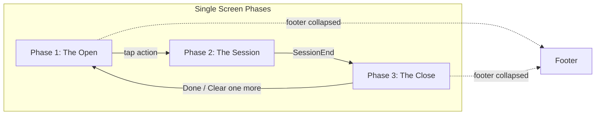

# EI Student App — AI Wireframe Brief

> Pass this file to an AI Wireframe Generator. It distills the student experience architecture into screen specs, layouts, copy, and constraints.

---

## 1. Product Snapshot

- **ELI** — async AI coach for Exams aspirants (16–22 yrs). Calm, evidence-based tone ("elder brother," never task manager).
- **One-screen mobile app.** Three phases on the same route: **Phase 1 (Open)** → **Phase 2 (Session)** → **Phase 3 (Close)**. Phases swap in place; no navigation, no dashboard.
- **State-adaptive UI.** Rescue mode = minimal (1 button). Boost mode = full options. Neutral = standard.
- **Trust-first.** No shame language. No streaks. No surveillance feel. Privacy-safe (institute never sees raw content).

---

## 2. Screens to Wireframe

| Phase         | Variant           | Trigger State                                        | Key Elements                                              |
| ------------- | ----------------- | ---------------------------------------------------- | --------------------------------------------------------- |
| Phase 1       | Silence re-entry  | Burnout student, 3+ days absent                      | 1 button only; minimal copy; warm welcome; no numbers     |
| Phase 1       | High pressure     | Good energy + Panicky pressure (e.g. after bad mock) | 2 buttons; scope-down copy; no questions                  |
| Phase 1       | Deal card         | Ambitious student, 3+ pending checks                 | Pending list (▸ Topic · X days ago) + 2 CTAs              |
| Phase 1       | Boost / clean     | Topper, Sharp energy, 0 pending                      | 2–3 CTAs; challenge prompts                               |
| Phase 1       | Onboarding        | First-ever open                                      | Single CTA; explain 3 moments                             |
| Phase 2       | Active session    | During study                                         | Fixed context bar only                                    |
| Phase 3       | Loop closed       | Verification completed                               | Counter animation (3→2); Seed; 1–2 CTAs                   |
| Phase 3       | Skip acknowledged | Skip (Time / Fatigue / Confusion)                    | Short acknowledgment; single Done                         |
| Phase 3       | Pending = 0       | All checks cleared                                   | Milestone copy; no Clear one more                         |
| Footer        | Collapsed         | Default                                              | One-line summary                                          |
| Footer        | Expanded          | On tap                                               | Sessions, Loops closed, Pending, Rate, Identity statement |
| Identity card | Weekly earned     | Pattern met (e.g. verification rate, re-entry)       | 2-line stats + quoted identity statement + CTA            |

---

## 3. UI Elements Spec

### Scale Chips (AppOpen gate)

- **Energy:** Sharp / Good / Okay / Low / Exhausted (5 options). Prompt: "How's your energy right now?"
- **Pressure (optional):** Calm / Slightly tense / Uneasy / Very stressed / Panicky
- **BacklogPressure (conditional):** On track / Mostly on track / Some pending / Behind / Drowning

Rules: Labels always visible. Max 5 options. Segmented chips, not sliders. No "bad" colors (Exhausted is valid input).

### Pending List

- Format: `▸ [Topic] · [X days ago]`
- Max 5 items. Order: earliest due first.
- Tappable. Hidden in Rescue mode.

### Buttons

- Rescue: 1 button max. Primary CTA only.
- Neutral: 2–3 buttons. Primary most prominent.
- Boost: Up to 3 buttons. Never 4+.

### Footer

- Always collapsed by default. Tap to expand.
- After silence re-entry: show warm label ("Quiet week. That's okay."), not numbers.
- Collapsed format: `This week: X sessions · Y loops closed · [↑/→/↓]`

---

## 4. Copy Library (Exact Strings)

### Phase 1 — Greetings

| Variant                 | Greeting                                                                                                                     |
| ----------------------- | ---------------------------------------------------------------------------------------------------------------------------- |
| Silence re-entry        | "Hey. No speeches." / "Welcome back."                                                                                        |
| Silence re-entry (body) | "One small thing. 5 minutes. That's a win."                                                                                  |
| High pressure           | "Your drive is real. But today's pressure is high."                                                                          |
| High pressure (body)    | "We're not committing to hours. Start with one tiny step."                                                                   |
| Deal card               | "You've been working hard. 3 things you studied are waiting to be tested."                                                   |
| Boost / clean           | "Clean slate. No pending checks." / "Let's raise the bar today."                                                             |
| Pending + standard      | "One pending check first, then anything else."                                                                               |
| Onboarding              | "Welcome. ELI helps you study smarter — not longer. No schedules. No tracking. Just 3 moments: open, study, close the loop." |

### Phase 1 — CTAs

| Variant            | Primary CTA                    | Secondary CTA                              |
| ------------------ | ------------------------------ | ------------------------------------------ |
| Silence re-entry   | "5-minute win"                 | —                                          |
| High pressure      | "Start 2 minutes, then decide" | "Make it smaller"                          |
| Deal card          | "Clear 1 first, then go big"   | "Start something new"                      |
| Boost              | "Hard practice"                | "Advanced problem set" / "Choose your own" |
| Pending + standard | "Clear this check (5 min)"     | "Start new topic"                          |
| Onboarding         | "Pick a topic"                 | —                                          |
| Identity card      | "Let's keep going"             | —                                          |

### Phase 3 — Outcomes

| Outcome             | Copy                                                                                        |
| ------------------- | ------------------------------------------------------------------------------------------- |
| Loop closed         | "Loop closed." / "[Topic] — you proved you remember it."                                    |
| Counter             | "Pending: 3 → 2" (animated)                                                                 |
| Seed (verification) | "[X] checks left this week — you're ahead."                                                 |
| Seed (24h reminder) | "See you tomorrow." / "Tomorrow at this time."                                              |
| Pending = 0         | "All clear. 0 pending checks. Everything you've studied — you've also proved. That's rare." |
| Skip (Time)         | "Noted. Short day."                                                                         |
| Skip (Fatigue)      | "Noted. Rest is part of the plan."                                                          |
| Skip (Confusion)    | "That's okay. Different approach next time."                                                |

### Phase 3 — CTAs

| Outcome             | Buttons                                                                     |
| ------------------- | --------------------------------------------------------------------------- |
| Verification done   | "Done for today" / "Clear one more" (only if energy ≥ Good AND pending ≥ 1) |
| Reminder set / Skip | "Done"                                                                      |

### SessionEnd Prompt

- "Quick check so this session counts."
- Options: `Do 1 question now (2 min)` | `Remind me tomorrow (24h)` | `Skip (Reason)` — reason picker: Time / Fatigue / Confusion

### Identity Statements

- "You're not just studying — you're closing the loop."
- "You came back. That matters."
- "Pressure days don't break you anymore — you still start."
- "You're studying differently now. It shows."
- "Everything you've studied, you've also proved."

### Footer

- Collapsed: `This week: 4 sessions · 2 loops closed · ↑`
- Silence: `Quiet week. That's okay.`
- Expanded identity: statement last, numbers above.

---

## 5. Anti-Patterns (Never Include)

- Separate dashboard page or route
- Charts, graphs, trend lines
- Streak counters (days, flames, badges)
- "You missed X days" / "Welcome back! You missed 3 sessions"
- Gamification: badges, points, XP, leaderboards
- Numbers before identity statement (statement must be last/focal)
- Auto-expanded footer after silence (show warm label, not zeros)
- Persistent stats strip always visible
- Free-text skip reasons (use Time / Fatigue / Confusion only)

---

## 6. Layout Rules

- **Single screen.** One route. Phases swap in place via SDUI payload; no client-side navigation.
- **Mobile-first.** Target 5–20 seconds for gate completion (AppOpen, IntentSet, SessionEnd).
- **Footer** at bottom of Phase 1 and Phase 3. Always visible, always collapsed by default.
- **Phase 2 context bar:** Fixed top. Content: `[Topic] · [TaskType] · [DifficultyTier]`. Non-interactive.

---

## 7. Flow Diagram

---

*Source: docs/student-ux-architecture/ (00-index through 13-implementation-map) and docs/ux-design-brief.md*